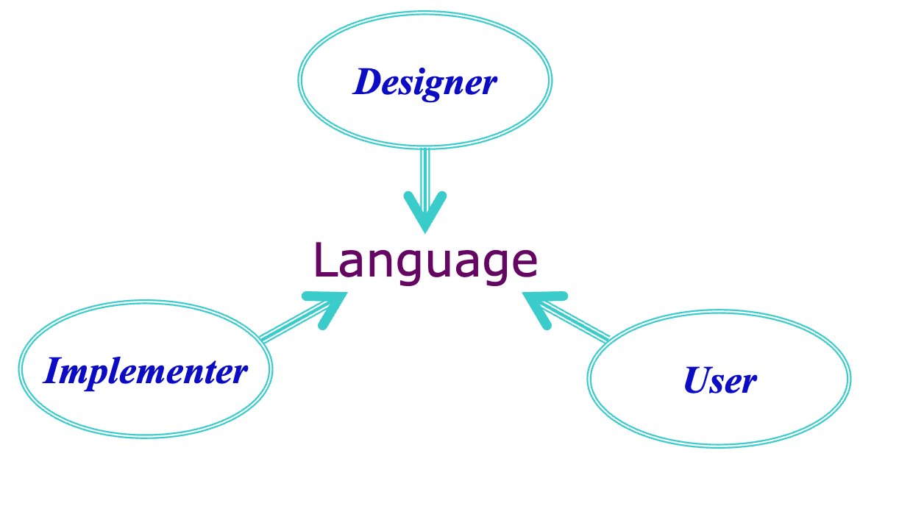
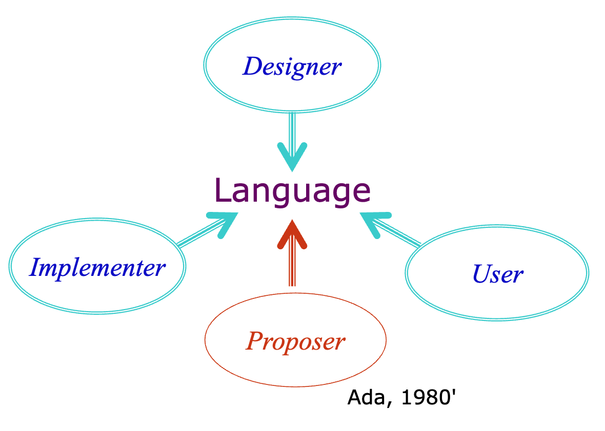
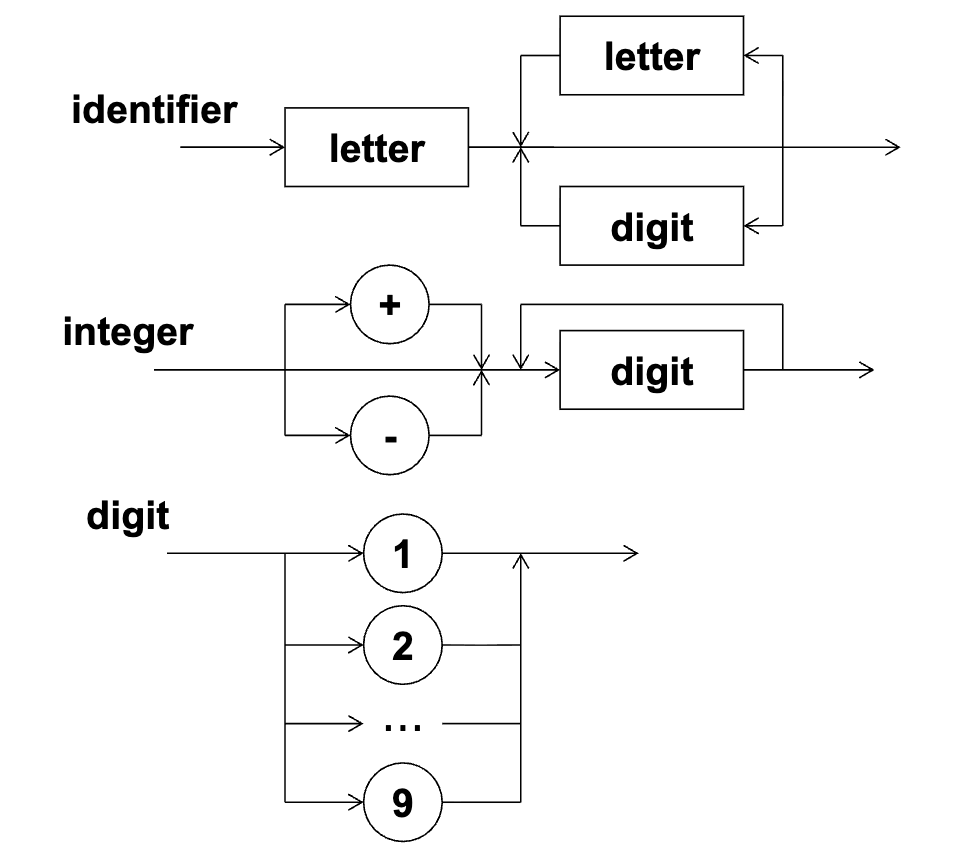
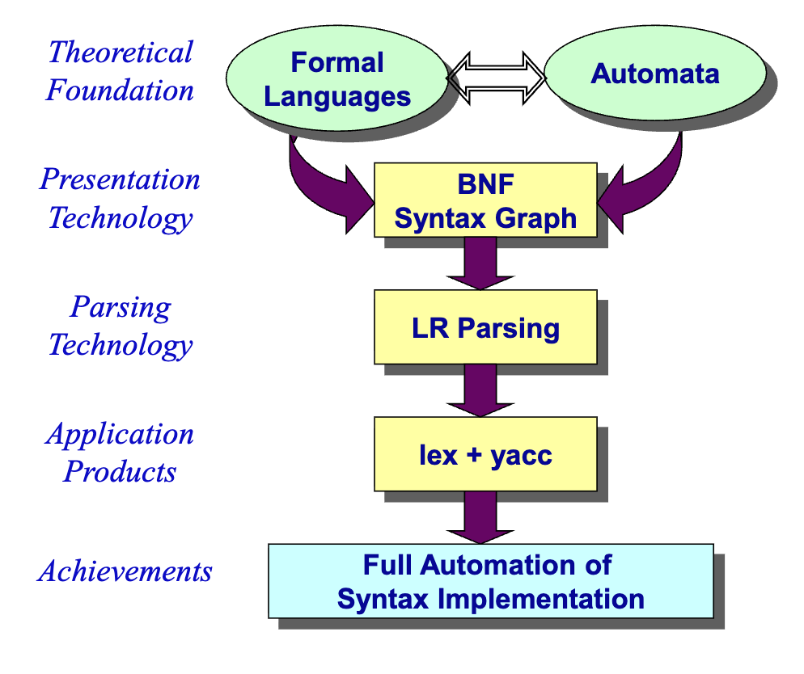
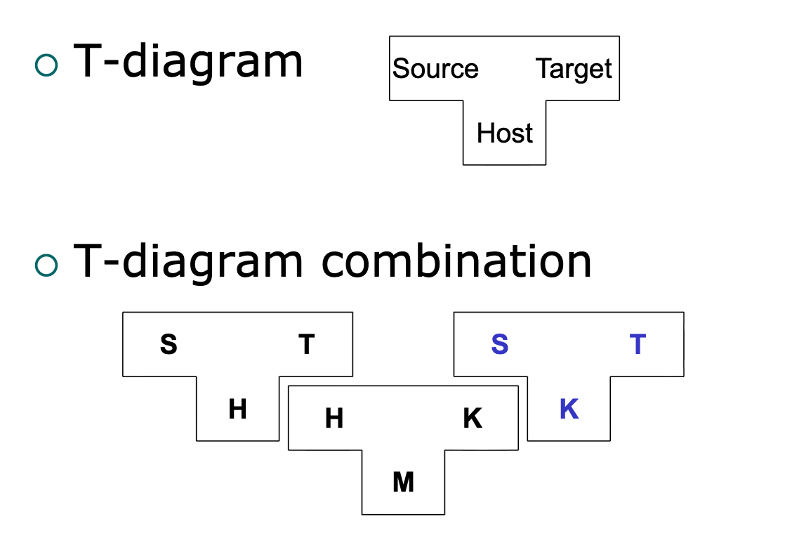
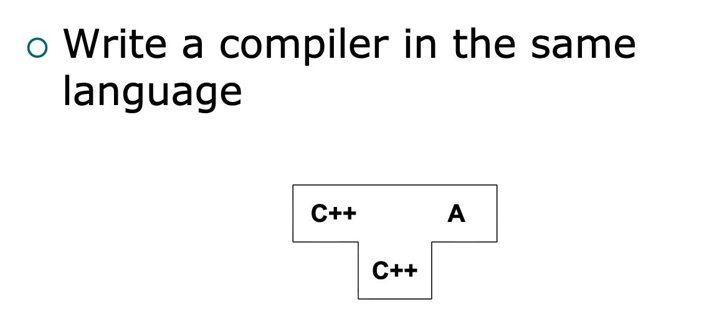
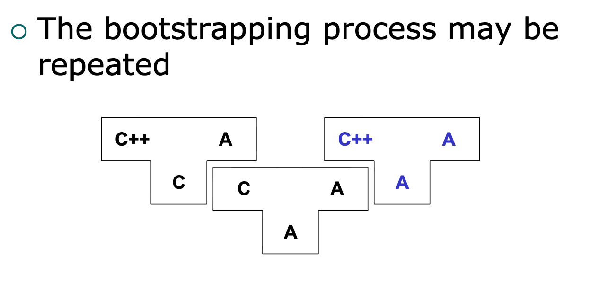
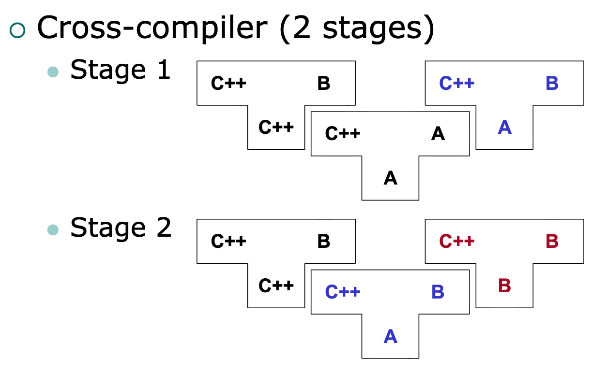
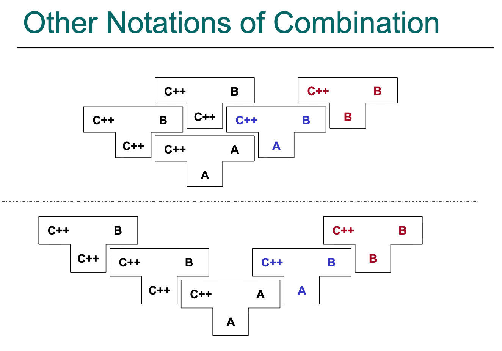
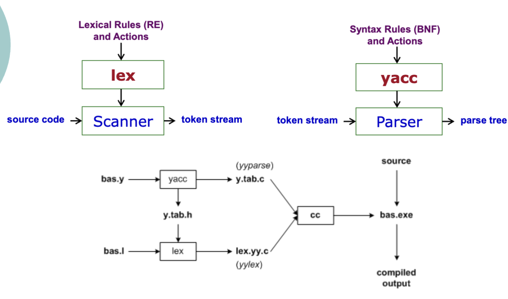

# 讲座1. 引言 (Page 2/61)

1. 计算机语言
2. 语言：定义与处理
3. 编译器的结构
4. 编译器构造
5. 课程描述

---

# 序言 (Page 3/61)

**为什么要学习编译器课程？**
- 理论与实践的完美结合
- 对编程语言有更深入的理解
- 大型编程和软件工程的经典实例

**但对于那些几乎从不开发编译器的学生**
- 我们关注：语言是解决问题的另一种方法。

---

# 让我们玩个游戏 (Page 5/61)

**仅使用Windows GUI计算器（仅鼠标）计算以下内容**
- 5+(8 – 2)
- (286+ 8716)/(1973+ 348)

**启示是什么？**
- 如果用语言来解决这个问题会怎样？

---

# 语言处理 (Page 6/61)

**语言**
- 编程语言
  - 包括脚本
- 领域特定语言（DSL）
  - SQL、HTML、XML、PostScript/PDF/LaTex等
  - 报表、工作流、音乐、朗诵等

**处理**
- 针对特定语言
- 甚至对于编程语言
  - 不仅仅是编译，还有...
  - 美化器、复杂度评估、结构化编辑器、逆向工程等

---

# 1. 计算机语言 (Page 7/61)

- 语言参与者与课程
- 语言定义：如何保持一致性？
- 歧义性
- 语法、语义和语用学

---

# 语言的参与者 (Page 8/61)



---

# 更多参与者 (Page 9/61)



---

# 对应的课程 (Page 10/61)

```
语言编程          用户
编译器构造原理    实现者
编程语言基础      设计者
```

---

# 如何保持一致性 (Page 11/61)

```
语言
├── 设计者
├── 用户
└── 实现者
```

---

# 自然语言与形式语言 (Page 12/61)

**自然语言导致歧义**
- 例如：Java和C++等编程语言中参数求值的顺序。

**自然语言的致命弱点**
- 歧义可以通过更新或修正来消除。
- 但无法支持自动语言处理。
- 形式和非正式类别之间存在巨大差距

---

# 歧义性 (Page 13/61)

**《论语·泰伯篇》**
- 民可使由之不可使知之
- 民可使由之，不可使知之。
- 民可使，由之；不可使，知之。
- 民可使，由之不可，使知之。

---

# 计算机程序中的歧义 (Page 14/61)

**两种典型的歧义**
- 表达式中的优先级和结合性
  - a+ b\* c
- else问题
  - if x> 0 then if y> 0 then x:= 0 else y:= 0
  - if x> 0 then if y> 0 then x:= 0 else y:= 0

**权衡**
- 无歧义性：仅使用无歧义规则
- 简洁性：歧义规则+附加约束

---

# 2. 语言：定义与处理 (Page 15/61)

- 语法、语义和语用学
- BNF和语法图
- 语法的形式化方法
- 形式语义
- 类型系统

---

# 语法、语义和语用学 (Page 16/61)

**语法**
- 符号的短语结构。
- 程序必须是良构的。

**语义**
- 程序的含义，即符号与其所表示含义之间的联系。

**语用学**
- 上下文对含义的贡献方式。
- 如今尚不十分清楚。

---

# 语法 + 语义 + 语用学 = 符号学 (Page 17/61)

---

# 语言的抽象 (Page 18/61)

**抽象思维**
- 抽象出我们考虑的最重要的特征。
- 忽略其他次要细节。
  - 例如：语言的发音

**你相信吗？**
- {a, ab, abb, abbb,...} 是一种语言。
- ∅ 也是一种语言。

---

# 成就与机遇 (Page 19/61)

| 领域 | 时期 | 成就 |
|------|------|------|
| 语法 | 40年代-60年代 | 99% |
| 语义 | 70年代-90年代 | 450% |
| 语用学 | -- | 1% |

---

# 语法定义 (Page 20/61)

1. **字符集**
   - 属性：有限集；有序。
   - 示例：
     - Ada和C++：ASCII
     - APL：EBCDIC
     - Java：？

2. **语法规则**
   - BNF
   - 语法图

---

# BNF：巴科斯-诺尔范式 (Page 21/61)

**约翰·巴科斯（IBM）**

(1924年12月3日-2007年3月17日)
Fortran之父
ACM图灵奖，1977年

"我的大部分工作都源于懒惰。我不喜欢写程序..."
-- IBM Think杂志，1979年

**彼得·诺尔教授**

哥本哈根大学
17页的Algol 60报告
ACM图灵奖，2005年

---

# BNF示例 (Page 22/61)

```
identifier ::= letter{ letter | digit}
letter ::= A | B|...| Z | a | b|...| z
digit ::= 0 | 1|...| 9
```

```
integer ::= [ symbol] unsigned
unsigned ::= digit{ digit}
symbol ::= + | -
digit ::= 0 | 1|...| 9
```

```
for_stmt ::= for loop_var := init direction final do stmt
loop_var ::= int_var
int_var ::= var_id
var_id ::= identifier
init ::= expr
final ::= expr
direction ::= to | downto
```

---

# 更多BNF示例 (Page 23/61)

**规则：**

```
bexpr ::= bexpr or bterm | bterm
bterm ::= bterm and bfactor | bfactor
bfactor ::= not bfactor | ( bexpr) | true | false
```

**实例：**
- true and false or(not true)
- false or true and not false
- true and false and(not false and(true or false))

---

# 语法图 (Page 24/61)

**尼克劳斯·沃思教授**
Pascal之父
ACM图灵奖，1984年




---

# 语法的形式化方法 (Page 25/61)

**理论基础**、**展示技术**、**解析技术**、**应用产品**、**成就**



---

# 成就 (Page 26/61)

1. 定义新语言语法的事实标准。
2. 分析语言的语法属性。
   - 它（或定义的语法）是否歧义？
   - 该文法是LL(k)还是LR(k)？
   - ...
3. 语法处理的自动化。
   - 对于自动化，处理器的输入必须是形式化定义。
     - 词法规则作为lex的输入
     - 语法规则作为yacc的输入

---

# 形式语义的困难 (Page 27/61)

**本质困难**
- 必须基于形式语法。
- 比语法更复杂。
- 需要更多的数学基础。

**人为困难**
- 不同的观点导致不同的方法。
- 符号：缺乏标准化。

---

# 数学困难 (Page 28/61)

**所需的数学基础**
- 离散数学
  - 集合论、数理逻辑、抽象代数、范畴论、类型论等
- 计算模型
  - λ-演算、形式语言和自动机、进程代数、Petri网等
- 专有理论
  - 域理论、幂域理论、霍尔逻辑和其他逻辑等

---

# 形式语义的方法 (Page 29/61)

**不同的观点导致形式语义的各种方法：**
- 操作语义
- 指称语义
- 公理语义
- 代数语义
  - 基于范畴论的ADT语义

---

# 形式语义的期望 (Page 30/61)

- 定义语言形式语义的标准。
- 形式化分析语义属性。
  - 该语言是强类型吗？
  - 该语言支持块结构吗？
  - 该语言是单线程的吗？...
- 语言处理器语义处理的自动化。
  - 形式语义定义作为输入。

---

# 类型系统 (Page 31/61)

- **轻量级的形式语义**
  - 可能是形式语义在实践中最成功的应用。
- **类型安全性**
  - 编译器可以静态发现所有类型相关错误。
    - C++: `float x= 3.14;` (正确)
    - Java: `float x= 3.14;` (错误)
    - Java中的显式类型转换：`float x=(float) 3.14;`

---

# 重要术语 (Page 32/61)

- **静态 vs. 动态**
  - 即编译时 vs. 运行时
- **显式 vs. 隐式**
  - 即手动 vs. 自动
- **逻辑 vs. 物理**
  - 两个抽象层次
- **安全性 vs. 安全**
  - 类型安全性
  - 线程安全性

---

# 3. 编译器的结构 (Page 33/61)

- 翻译的基本概念
- 编译器的阶段
- 编译示例
- 软件架构

---

# 编译器如何工作？ (Page 34/61)

源代码 → 翻译器 → 目标代码

---

# 基本概念 (Page 35/61)

**编程语言**
- 高级
  - 结构化编程、面向对象编程、函数式、逻辑式、并发等
- 低级
  - 汇编、机器码

**讨论**
- 高级和低级编程语言的本质区别是什么？

---

# 基本概念（续） (Page 36/61)

**翻译**
- **讨论**
  - 编译器 vs. （宏）汇编器
  - 编译器 vs. 解释器（优缺点）
  - Java 和 Microsoft.Net 的执行模型是什么？为什么？

---

# 编译器的结构 (Page 37/61)

```
字符流
    ↓
扫描器（Scanner）
    ↓  字符流（Token Stream）
解析器（Parser）
    ↓ -- 解析树（Parse Tree）----
语义分析器（Semantic Analyzer）  ｜
    ↓ -- 解析树（Parse Tree）----
中间代码生成器（Int. Code Generator）
    ↓ -- 中间代码（Intermediate Code）--
优化器（Optimizer）                    ｜
    ↓ -- 中间代码（Intermediate Code）--
代码生成器（Code Generator）
    ↓
目标代码
```

**前端**
- Lexical 语法定义：正则表达式、线性文法、有限自动机
- Syntax 语法定义：BNF
- 语义定义：类型系统、其他规则、非声明式动作

---

# 架构设计 (Page 38/61)

- **分析 vs. 综合**
  - 结构分析
    - 词法分析和语法分析
  - 语义分析
- **前端 vs. 后端**
  - 标准中间表示（IR/IL）支持替换。
    - GCC：GNU编译器集合。
- **错误恢复和符号表管理**

---

# 编译器的亲戚 (Page 39/61)

- **预处理器**
  - C/C++: `#include<...>`
- **汇编器**
- **链接器**
- **加载器**
- **调试器**
- **IDE：集成开发环境**
  - 编辑器+编译器+链接器+调试器+...

---

# 编译示例 (Page 40/61)

**源代码**
- `position= initial+ rate* 60`

**扫描器**
- Token stream: `<id,1><=><id,2><+><id,3><*><60>`

**解析器和语义分析器**

Parse tree:
```
    =
   / \
 id1  +
     / \
   id2  *
       / \
     id3 60
```

---

# 编译示例（续） (Page 41/61)

**中间代码生成器**
- `t1 = int2float(60)`
- `t2 = id3 * t1`
- `t3 = id2 + t2`
- `id1 = t3`

**代码优化器**
- `t1 = id3 * 60.0`
- `id1 = id2 + t1`

**代码生成器**
- `LDF R2, id3`
- `MULF R2, R2,#60.0`
- `LDF R1, id2`
- `ADDF R1, R1, R2`
- `STF id1, R1`

---

# 软件架构 (Page 42/61)

- **什么是软件架构？**
- **典型的SA风格**
  - 分层（3层、n层）
  - 管道和过滤器
  - 事件驱动
  - 客户端-服务器
  - 等
- **SA的好处**
  - 传递
  - 逻辑 vs. 物理

---

# 4. 编译器构造 (Page 43/61)

- 编译器设计的要求
- T-图
- 自举和移植
- 编译器生成器
  - 扫描器生成器
  - 解析器生成器
  - 其他生成器

---

# 编译器设计的要求 (Page 44/61)

- 编译器的效率
  - 时间 vs. 空间
- 目标代码的效率
  - 时间 vs. 空间
- 错误恢复能力
- 高可靠性
- ...

---

# T-图：形式化符号 (Page 45/61)



---

# 自编译 (Page 46/61)

**用同一种语言编写编译器**



---

# 自举 (Page 47/61)

**自举过程可以重复**



---

# 移植 (Page 48/61)

**交叉编译器（2个阶段）**



**其他**



---

# 编译器构造工具 (Page 49/61)

- **形式化定义导致自动化工具**
  - `lex`：扫描器生成器
  - `yacc`：解析器生成器（Yet Another Compiler Compiler）

- **流行工具**
  - C/C++：GNU Flex和GNU Bison
  - Java：JFlex和JavaCUP，ANTLR

---

# lex和yacc (Page 50/61)



---

# 考核方式 (Page 57/61)

**讲座**
- 每周书面作业 × 10：10%
- 测验 × 5：30%
- 期末考试：60%

**实验**
- 实验#1：10%
- 实验#2：15%
- 实验#3：15%
- 实验#4：25%
- 实验#5：35%

---

# 练习1.1 (Page 58/61)

- **想象一种人工计算机语言，可用于解决实际问题，即该语言的应用。**
  - 提示1：语言是解决问题的另一种方法。
  - 提示2：首先找到合适的问题，然后设计语言来解决问题。
- **给出用所提议语言编写的一个完整示例。**
- **讨论如何定义新语言并尝试你的方法。**
- **描述将你的语言思维变为现实的过程，即如何使人工语言可用。**

---

# 练习1.2 (Page 59/61)

- **绘制一个包含两个自举阶段的T-图。**
  - 给定一种新的编程语言L++，我们首先实现L，L++的一个小子集。
  - 然后我们使用L来实现L+，L++的一个子集和L的超集。
  - 最后，使用L+实现L++。

