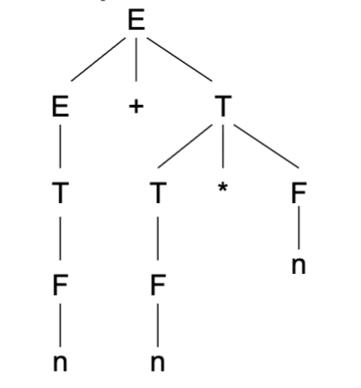
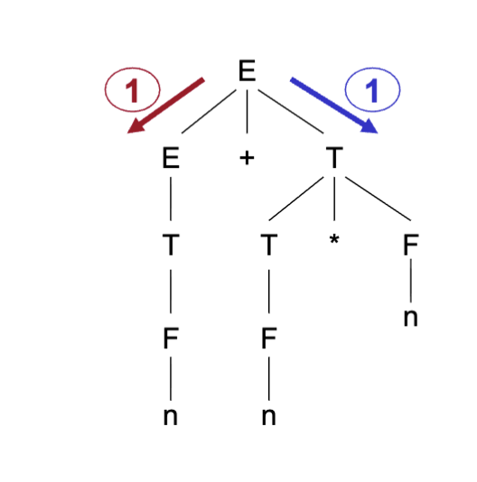
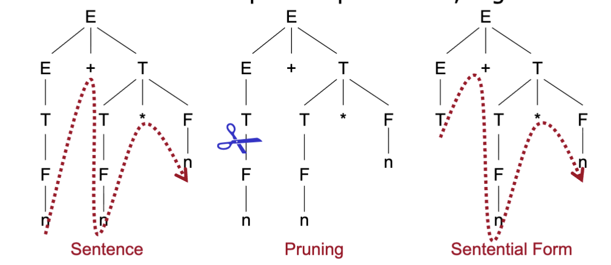
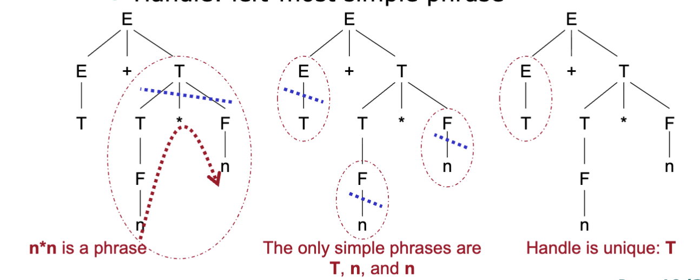
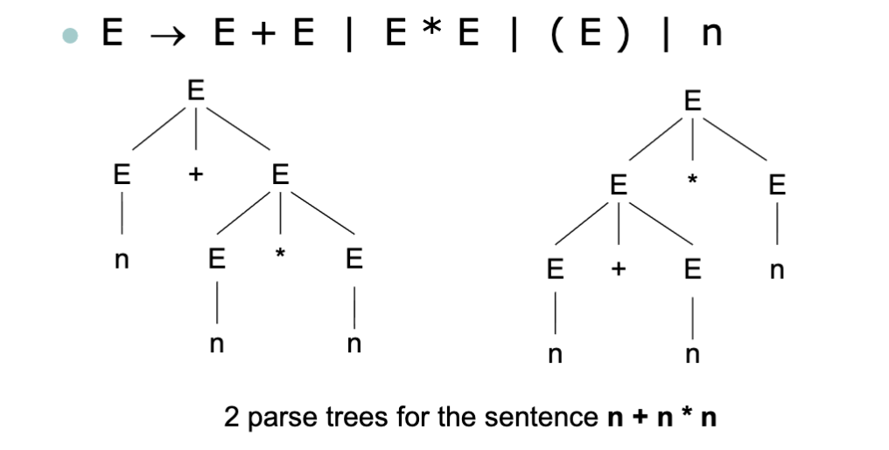

# 讲座2. 形式语言 (Page 3/34)

1. 什么是形式语言？
2. 如何定义特定语言？
3. 上下文无关文法
4. 解析树
5. 二义性
6. 乔姆斯基层次

---

# 形式系统 (Page 4/34)

- **不关心符号的含义。**
  - 符号可以被替换。
- **仅依赖于形式化定义的规则。**
- **程序是形式系统。**

---

# 1. 什么是形式语言？ (Page 5/34)

- **字母表（Alphabet）::= 符号的集合**
  - 非空且有限
  - 符号是元定义
- **字符串（句或词）::= 来自字母表的符号序列**
  - 有限；允许空字符串 ε[epsilon]
  - 操作：空、长度、前缀、后缀、子串、真子串、子序列、连接、克林星号（闭包）
- **Σ\* ::= 字母表Σ上所有可能字符串的集合**
  - 数学上，由 Σ 生成的幺半群（带单位元的半群）。

---

# 语言的形式化定义 (Page 6/34)

- **语言 ::= 字符串的集合**
  - 可能是无限的，或者是空集{}(或∅)
- **语言操作**
  - 并集：L1 ∪ L2
  - 连接：L1 L2
  - 指数：L0={ε}, L1= L, L2= LL,...
  - 克林闭包（星号）：L\*= $$\bigcup_{i=0}^\infty L^i$$
  - 正闭包（加号）：L+= $$\bigcup_{i=1}^\infty L^i$$= L\* L
- **什么是元定义？**

---

# 映射到实践 (Page 7/34)

**绑定**
- 抽象：语言的形式化定义
- 具体：编程语言

**讨论**
- 对于C程序
  - 字母表 Σ →?
  - Σ\* →?
  - 语言 →?
  - 语言中的一个字符串 →?
- 对于Java程序
  - 字母表 Σ →?
  - 语言中的一个字符串 →?

---

# 2. 如何定义特定语言？ (Page 8/34)

- **本质上，如何定义一个集合：**
  - 枚举
    - { aa, ab, ba, bb}
  - 部分枚举
    - { a, ab, abb, abbb,...}
  - 谓词描述
    - { x | P(x) ∧ x ∈ Σ\*}
- 问题：如何定义谓词 P ？
  - 由表达式描述
  - 由文法生成
  - 由自动机识别

---

# 3. \*上下文无关文法（CFG） (Page 9/34)

**CFG是一个4元组（Σ, N, P, S）**
- Σ：字母表，终结符集合
- N ∩ Σ= ∅：非终结符集合
- P：重写规则（产生式）集合
  - 每个产生式形式为 A → α，其中 A ∈ N ∧ α ∈(Σ ∪ N)\*
- S ∈ N：开始（目标）符号

---

# 示例 (Page 10/34)

**一个上下文无关文法**
- G1=({a, b, c},{A, B},{A→aB, A→bB, A→cB, B→a, B→b, B→c}, A)

**简写表示**
```
A → aB | bB | cB
B → a | b | c
```

---

# 推导 (Page 11/34)

**推导（重写）**
- A ⇒ bB ⇒ bc
- 直接推导：bB ⇒ bc
- n步推导：A ⇒² bc
- 0步或更多步推导：A ⇒\* bc
- 1步或更多步推导：A ⇒+ bc
- 左最推导：A ⇒\*lm bc
  - 每一步必须是左最推导
- 右最推导：A ⇒\*rm bc
  - 每一步必须是右最推导
- 规范推导：右最推导

---

# 绑定到实践 (Page 12/34)

**算术表达式**
```
E  → E + T | T
T  → T * F | F
F  → (E) | n
```

**n+n\*n的推导**
- E ⇒ E+T ⇒ E+T\*F ⇒ T+T\*F ⇒ F+T\*F ⇒
  F+F\*F ⇒ F+F\*n ⇒ F+n\*n ⇒ n+n\*n
- 不是规范推导！

**n+n\*n的规范推导**
- E ⇒ E+T ⇒ E+T\*F ⇒ E+T\*n ⇒ E+F\*n ⇒
  E+n\*n ⇒ T+n\*n ⇒ F+n\*n ⇒ n+n\*n

**每个非终结符表示语言的一个子集**

---

# 归约 (Page 13/34)

**归约**
- 以相反顺序推导
- 直接归约
- n步归约
- 左最（规范）归约
- 右最归约

---

# 句子和句柄 (Page 14/34)

**句型**
- 如果 S ⇒\* α，α是G的句型。
- 右（左）句型

**句子**
- 没有非终结符的句型。

**短语**
- 如果 S ⇒\* αAω ∧ A ⇒+ β，β是αβω在A上的短语。

**简单短语**
- 如果 S ⇒\* αAω ∧ A ⇒ β，β是简单短语。

**句柄**
- 如果 S ⇒\*rm αAω ⇒rm αβω，A → β在α之后的位置是αβω的句柄。

---

# 用文法定语言 (Page 15/34)

**由给定CFG G定义的语言**
- L(G)={α | S ⇒\* α ∧ α ∈ Σ\*}
- 即所有句子的集合

**G的所有句型集合是**
- SF(G)={α | S ⇒\* α ∧ α ∈ (Σ ∪ N)\*}

**因此 L(G)= SF(G) ∩ Σ\*。**

---

# BNF（巴科斯-诺尔范式） (Page 16/34)

**等价于CFG**
- 将"→"改为"::="
- 定义计算机语言的事实标准

**EBNF（扩展BNF）**
- ISO/IEC 14977:1996(E)。标准元语言扩展BNF。
- =,"终结符",[可选],{重复}, (分组),(\*注释\*)等。

---

# 4. 解析树 (Page 17/34)

**推导的图形表示**
- 根：开始符号
- 叶子：终结符或ε
- 内部节点：非终结符
- 非终结符的后代：一个产生式

**示例**
```
E ⇒ E+T ⇒ E+T\*F
  ⇒ E+T\*n ⇒ E+F\*n 
  ⇒ E+n\*n ⇒ T+n\*n 
  ⇒ F+n\*n ⇒ n+n\*n
```




---

# 解析树的洞察 (Page 18/34)

**推导的抽象**
- 推导顺序被丢弃。



---

# 解析树中的句子和句型 (Page 19/34)

- **句子**
  - 解析树的边界，例如 n+n\*n
- **修剪**
- **句型**
  - 修剪解析树的边界，例如 T+n\*n



---

# 解析树中的短语和句柄 (Page 20/34)

**对于给定句型，例如 T+n\*n**
- 短语：非终结符子树的边界
- 简单短语：2层子树的边界
- 句柄：最左简单短语



---

# 讨论 (Page 21/34)

**什么是...**
- 句型
- 所有简单短语
- 唯一句柄

---

# 解析 (Page 22/34)

- **解析必须回答2个问题**
  - 源程序是否良构（语法合法）？
    - 即，它是语言的句子吗？
  - 如果是，程序的语法结构是什么？
    - 树是表示部分关系的理想数据结构。
- **2种解析策略**
  - 自顶向下（Top-down）对比自底向上（Bottom-up）

---

# 自顶向下解析 (Page 23/34)

**从开始符号开始**
- 通常以深度优先方式扩展非终结符（预测性质）
- 左最推导
- 解析树的前序遍历

**示例：LL(k)**
- 从左读取，左最推导，有k个向前看符号
- 递归下降（预测）解析

---

# 自底向上解析 (Page 24/34)

**从终结符输入字符串开始**
- 确定用于生成叶子的产生式
- 右最推导的逆序
- 解析树的后序遍历

**示例：LR(k)**
- 从左读取，右最推导，有k个向前看符号
- 解析器生成器 yacc

---

# 5. 歧义性 (Page 25/34)

**对于语言中至少一个句子有多个解析树的文法**
- E  → E+ E | E\* E | ( E) | n
- 句子 n+ n\* n 有2个解析树



---

# 歧义：文法对比语言 (Page 26/34)

**歧义语言（固有的）**
- 不存在定义该语言的无歧义文法。

**歧义文法（后天的）**
- 可以转换为等价的无歧义文法。
- 以下两个文法定义相同的语言

```
E  → E+ E | E\* E | ( E) | n
```

```
E  → E+ T | T
T  → T\* F | F
F  →( E) | n
```

---

# 绑定到实践 (Page 27/34)

**编程语言中的歧义**
- 表达式中的运算符
- 嵌套if语句中的悬空else

**两者都是后天的**
- 可以通过附加消歧规则消除
  - 优先级和结合性
  - 内部"if"匹配
- 解决歧义的两种方法
  - 重写歧义文法
  - 特设解决方案：应用附加规则

---

# 6. 乔姆斯基层次 (Page 28/34)

| 类别 | 文法 | 限制 | 识别器 |
|------|------|------|--------|
| 3 | 正则 | A → aB 或 A → a，其中 A, B ∈ N ∧ a ∈ Σ ∪{ε}。如果A是开始符号且不出现在任何产生式的右侧，则允许 A → ε。 | 有限状态自动机 (FSA) |
| 2 | 上下文无关 | A → α，其中 A ∈ N ∧ α ∈(Σ ∪ N)\*。 | 推下自动机 (PDA) |
| 1 | 上下文相关 | α → β，其中 α, β ∈(Σ ∪ N)\* ∧ α ≠ ε ∧ |α| ≤ |β|。除非α是开始符号且不出现在任何产生式的右侧，否则β不能是ε。 | 线性有界自动机 (LBA) |
| 0 | 无限制 | α → β，其中 α, β ∈(Σ ∪ N)\* ∧ α ≠ ε。 | 图灵机 (TM) |

- 类别越低在理论中有用  
- 类别越高在实践中有用

---

# 正则语言 (Page 29/34)

- **正则语言的能力**
  - 它能定义什么？
    - 标识符
    - 十进制常量
  - 它不能定义什么？
    - 匹配的括号
- 满足词法描述的要求

---

# 上下文无关语言 (Page 30/34)

**上下文无关语言的能力**
- 它能定义什么？
  - 匹配的结构
- 它不能定义什么？
  - 仅使用已声明的变量
  - 匹配的参数传递
- 满足语法描述的要求

---

# 练习2.1 (Page 31/34)

**给定以下文法：**
```
S  →( L) | a
L  → L, S | S
```

**为句子构造解析树**
`(a,((a, a),(a, a)))`

---

# 练习2.2 (Page 32/34)

**给定以下文法：**
```
bexpr  → bexpr or bterm | bterm
bterm  → bterm and bfactor | bfactor
bfactor  → not bfactor | ( bexpr) | true | false
```

**为句子构造解析树**
`not(true or false)`

---

# 练习2.3 (Page 33/34)

**文法：S  → a S b S | b S a S | ε**
**是否歧义？为什么？**

---
