# 讲座3. 词法分析 (Page 3/54)

1. 引言
2. 扫描器构造
3. 词法规范
4. 有限自动机
5. 转换与等价性
6. 正则语言的限制
7. 词法分析实践
 
# 1. 引言 (Page 4/54)

- **软件架构：管道和过滤器**
  - 字符流 → 通过扫描器 → 词法单元流

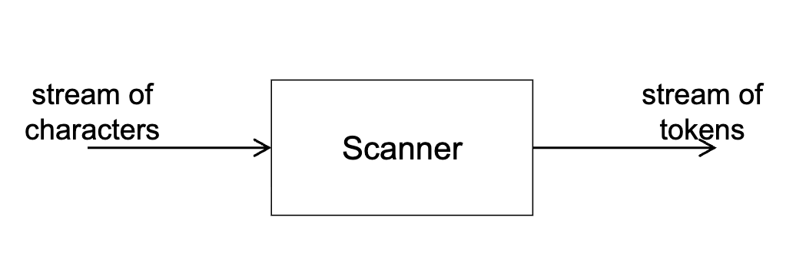

# 扫描器的结构 (Page 5/54)

- **隐式词法规则**
  - 特定扫描器中包含词法规则的代码。

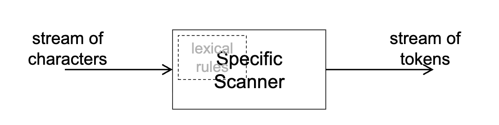

# 扫描器的结构（续） (Page 6/54)

- **显式词法规则（解释模型）**
  - 没有硬编码语言特定的代码，词法规则以数据的形式提供。

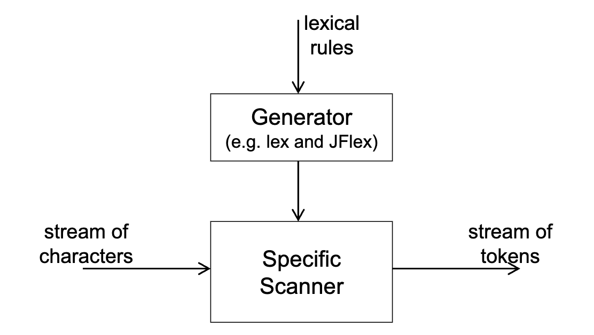

# 扫描器的结构（续） (Page 7/54)

- **显式词法规则（编译模型）**
  - 词法规则以数据的形式提供，但在编译时通过生成器被转换为代码。

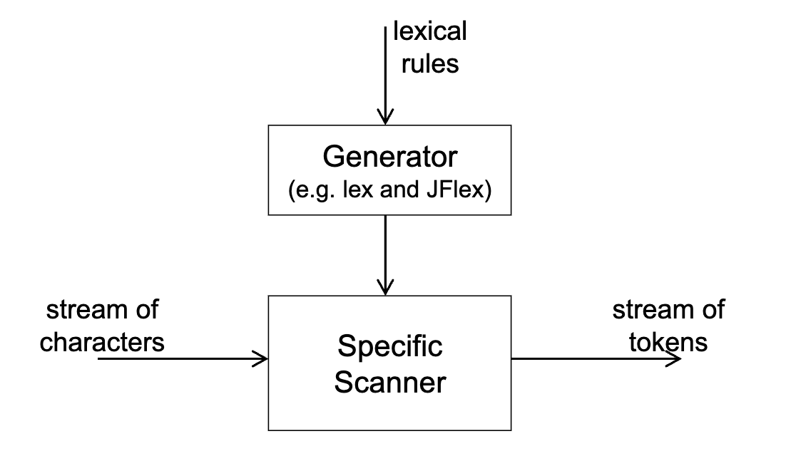

# 输入缓冲 (Page 8/54)

- **编译器前端的大部分运行时间都花在扫描上。**
  - 但最耗时的阶段是优化。
- **缓冲对**
  - 2缓冲方案：每个缓冲区大小为N。
  - 避免覆盖：|词法单元| + |向前看| ≤ N

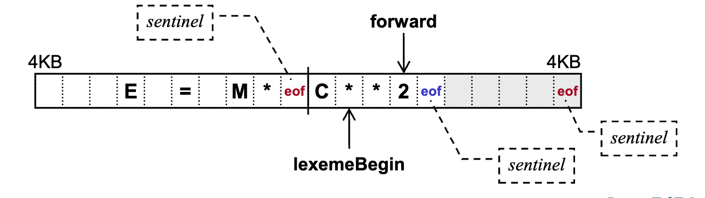

# 输出词法单元 (Page 9/54)

- **现代编程语言的5种词法单元**
  - 标识符：getBalance, weight, ...
  - 保留字：IF, ELSE, WHILE, ...
  - 常量：10, 3.14, -1.26E-5, 'a', "abc", ...
  - 运算符：+, -, *, /, <<, ...
  - 标点符号：(, ), ;, :, ...
- **输出**
  - 一对 <类型, 关联属性值>
    - **某些值是指向符号表的指针。**
  - 符号（字符串）表
    - 数组、链表、哈希集、树集等

# 与解析器的交互 (Page 10/54)

- **目标是减少遍数**
- **2个抽象层次**
  - 逻辑上
    - 通过管道传输词法单元。
  - 物理上
    - 词法单元序列的磁盘文件
    - 并发线程或协程
    - 方法调用

# 2. 扫描器构造 (Page 11/54)

- **词法规则的定义：3种等价的表示法**
  - 表达式
    - 正则表达式
    - 正则定义
  - 文法
    - 正则文法
    - 左/右线性文法
  - 有限自动机
    - 确定性有限自动机（DFA）
    - 非确定性有限自动机（NFA）

# 从形式化规范开始 (Page 12/54)

- **词法单元的规范**
  - 正则定义
    - 层次化和简洁，适合人类阅读。
    - 然后转换为正则表达式。
    - 然后转换为有限自动机。
  - 正则文法
    - 符合语法规则的规范。
    - 然后转换为有限自动机。
- **转换有限自动机**
  - NFA → DFA → 简化DFA
  - 适合在机器上实现。

# 构造步骤 (Page 13/54)

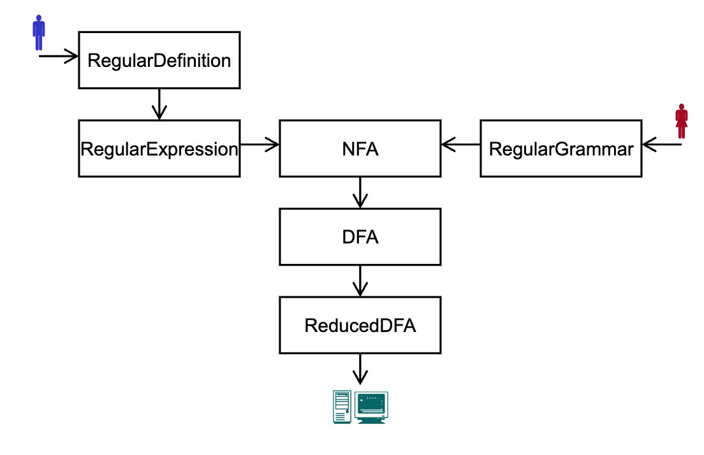

# 编程扫描器 (Page 14/54)

- **隐式转换图**
  - 手动方法
  - 状态转换硬编码在程序中。
- **显式转换图**
  - 基于表的方法
  - 没有硬编码特定词法规则
  - 导致自动扫描器生成。

# 3. 词法规范 (Page 15/54)

- 正则表达式
- 正则定义
- 正则文法
- 转换与等价性

# 正则表达式 (Page 16/54)

- **正则表达式：构造性定义**
  - 基础：
    - ε 是正则表达式；L(ε) = {ε}。
    - a 是正则表达式，如果 a ∈ Σ；L(a) = {a}。
  - 归纳：如果 r 和 s 是正则表达式，
    - r | s 是正则表达式；L(r | s) = L(r) ∪ L(s)。
    - r s 是正则表达式；L(r s) = L(r) L(s)。
    - r* 是正则表达式；L(r*) = (L(r))*。
    - (r) 是正则表达式；L((r)) = L(r)。
  - 扩展：
    - r+ = r, r* = r* r
    - r? = r | ε
    - [ace] = a | c | e, [A–Z] = A | B | ... | Z 

# 正则表达式语言 (Page 17/54)

- **正则表达式：一种语言**
  - 语法
    - a(a | b) b
    - a(a | b)*
  - 语义
    - {aab, abb}
    - {a, aa, ab, aaa, aab, aba, abb, ...}
- **语言是解决问题的替代方法。**

# 讨论 (Page 18/54)

- **运算符的签名**
  - true: → bool
  - +: int × int → int
  - +: real × real → real（重载）
- **前几页中语义函数L的签名是什么？**
  - 语法范畴
  - 语义范畴
  - 映射
 
# 字母表：词法 vs. 语法 (Page 19/54)

- **扫描器和解析器都基于字母表 Σ。**
- **但 Σ 的含义（元素）完全不同。**
  - 扫描器：Σ 中的元素是源程序中的字符。
    - ASCII, EBCDIC, Unicode, ...
  - 解析器：Σ 中的元素是由扫描器生成和传递的词法单元。
 
# 正则表达式的代数定律 (Page 20/54)

- r | s = s | r
- r | (s | t) = (r | s) | t
- r | r = r
- r(st) = (rs)t
- r(s | t) = rs | rt
- (s | t)r = sr | tr
- rε = εr = r
- r\*r\* = r\*
- r\* = ε | r | rr | ...
- (r\*)\* = r\*
- rr\* = r\*r
- (r\* | s\*)\* = (r\*s\*)\*
- (r\*s\*)\* = (r | s)\*
- (rs)\*r = r(sr)\*
- (r | s)\* = (r\*s)\*r\*

**讨论：两个正则表达式等价意味着什么？**
 
# 绑定到实践 (Page 21/54)

- **Pascal中的标识符**
  - (a | b | ... | z | A | B | ... | Z)((a | b | ... | z | A | B | ... | Z) | (0 | 1 | ... | 9))*
- **难以阅读和编写**

# 正则定义 (Page 22/54)

- **形式为**
  - d₁ → r₁
  - d₂ → r₂
  - ...
  - dₙ → rₙ
- **其中 dᵢ ∉ Σ ∧ (dᵢ = dⱼ ⇒ i = j)**
- **且 rᵢ 是 Σ ∪ {d₁, d₂, ..., dᵢ₋₁} 上的正则表达式**
 
# 绑定到实践 (Page 23/54)

- **Pascal中的标识符（扩展）**
  - letter_ → A | B | ... | Z | a | b | ... | z | _
  - digit → 0 | 1 | ... | 9
  - id → letter_(letter_ | digit)*
- **Pascal中的实数**
  - digit → 0 | 1 | ... | 9
  - digits → digit digit*
  - optionalFraction → . digits | ε
  - optionalExponent → (E(+ | - | ε) digits) | ε
  - real → digits optionalFraction optionalExponent
- **正则表达式的层次化表示**
 
# 绑定到实践（续） (Page 24/54)

- **使用扩展运算符编写正则定义**
  - digit → [0–9]
  - digits → digit+
  - real → digits(. digits)?(E[+-]? digits)?

**注意'–'和'-'之间的区别**

# 正则定义与正则表达式之间的转换 (Page 25/54)

- **正则定义 → 正则表达式**
  - 自顶向下，逐步替换
  - 讨论：替换过程是否总是终止？
- **正则表达式 → 正则定义**
  - 简单地添加一个新符号和"→"。
- **等价性**
  - 由它们表示的语言定义
  - 双向
 
# 将正则定义转换为正则文法 (Page 26/54)

- **闭包运算符带来的困难**
  - 转换为左/右递归产生式
- **在正则定义中**
  - id → letter(letter | digit)*
- **引入右部**
  - id → letter rid
  - rid → rid(letter | digit) | ε（在文法中不允许）
  - 即，rid → rid letter | rid digit | ε
  - 或右线性，rid → letter rid | digit rid | ε

# 第3类文法 (Page 27/54)

- **右线性（正则）文法**
  - A → aB 或 A → a，其中 A, B ∈ N ∧ a ∈ Σ U{ε}。
- **左线性文法**
  - A → Ba 或 A → a，其中 A, B ∈ N ∧ a ∈ Σ U{ε}。
- **扩展形式**
  - 右线性（正则）文法
    - A → αB 或 A → α，其中 A, B ∈ N ∧ α ∈ Σ*。
  - 左线性文法
    - A → Bα 或 A → α，其中 A, B ∈ N ∧ α ∈ Σ*。
 
# 4. 有限自动机 (Page 28/54)

- **3种有限自动机**
  - DFA（确定性有限自动机）
  - NFA（非确定性有限自动机）
  - ε-NFA（带空转换的非确定性有限自动机）
- **有限自动机定义的语言**
- **有限自动机的表示**
  - 对人类：转换图
  - 对计算机/机器：转换表
 
# 形式化定义 (Page 29/54)

- **有限自动机是一个5元组：M = (Σ, S, Δ, s₀, F)，其中**
  - Σ 是输入字母表。
  - S ∩ Σ = ∅ 是有限状态集。
  - Δ 是转换函数。
  - s₀ ∈ S 是开始（初始）状态。
  - F ⊆ S 是接受（终止）状态集。
- **DFA、NFA和ε-NFA仅在以下方面不同**
  - 对于DFA，δ: S × Σ → S
  - 对于NFA，δ: S × Σ → 2ˢ
  - 对于ε-NFA，δ: S × (Σ ∪ {ε}) → 2ˢ
 
# 有限自动机定义的语言 (Page 30/54)

- **转换函数的重载**
  - 对于任何 a ∈ Σ, s ∈ S 和 ω ∈ Σ*,
    - δ(s, ε) = s
    - δ(s, ωa) = δ(δ(s, ω), a)
- **给定有限自动机 M，**
  - L(M) = {ω | ω ∈ Σ* ∧ ∃s ∈ F. δ(s₀, ω) = s}
 
# 转换图 (Page 31/54)

- **有限自动机的图形表示**

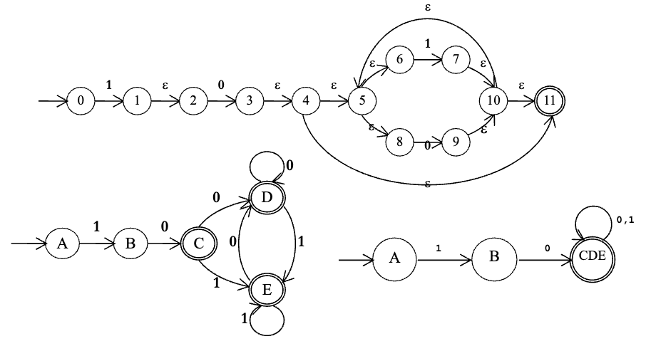
 
# 实践中常用 (Page 32/54)

- **有状态对象的状态转换描述**

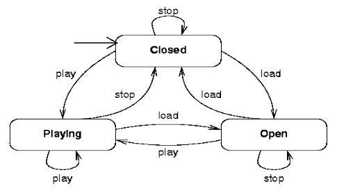

- **UML（统一建模语言）**
  - 面向对象建模和设计的事实标准。
  - 类的状态图。

# 内部表示 (Page 33/54)

- **转换表**
  - 行
    - DFA、NFA和ε-NFA：状态 S
  - 列
    - DFA和NFA：字母表 Σ
    - ε-NFA：Σ ∪ {ε}
  - 单元格
    - DFA：S 的一个元素
    - NFA和ε-NFA：S 的子集
- 这就是为什么NFA和ε-NFA不适合实现。
 
# 5. 转换与等价性 (Page 34/54)

- 正则文法到ε-NFA
- 正则表达式到ε-NFA
- 确定化（ε-NFA）
- 简化（DFA）
 
# 正则文法到ε-NFA (Page 35/54)

- **算法**
  - 添加一个新的终止状态 f
  - 对于任何 a ∈ Σ ∪ {ε} 和 A, B ∈ N,
    - 如果 A → a 其中 a ∈ Σ ∪ {ε}，令 δ(A, a) = f
    - 如果 A → aB，令 δ(A, a) = B
 
# 一个例子 (Page 36/54)

- **给定正则文法**
  - A → 0 | 0B | 1D
  - B → 0D | 1C
  - C → 0 | 0B | 1D
  - D → 0D | 1D
- **我们有一个等价的ε-NFA**

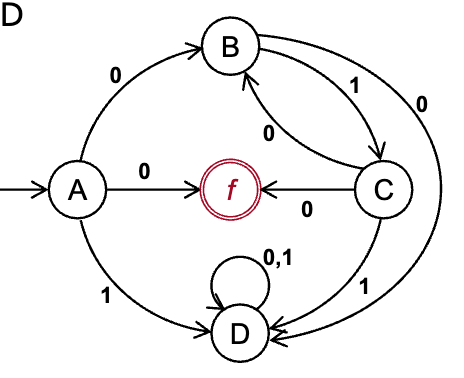
 
# 正则表达式到ε-NFA (Page 37/54)

- **汤普森构造（McNaughton-Yamada-Thompson算法）**
  - 与正则表达式的构造性定义相对应的构造方法
  - 基础：
    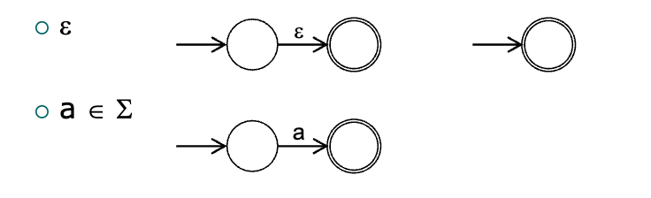

# 归纳 (Page 38/54)

- **r = s | t**
  - 2个新状态
  - 4个新ε转换
  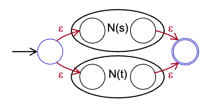

- **r = s t**
  - 没有新状态或转换
  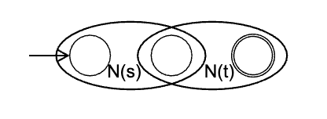

- **r = s\***
  - 2个新状态
  - 4个新ε转换
  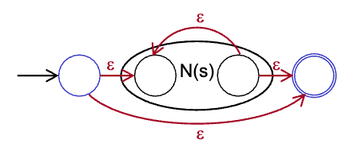
 
# 一个例子 (Page 39/54)

- **给定正则表达式**
  - (a | b)*abb
- **我们有**
  - a | b
  - (a | b)*

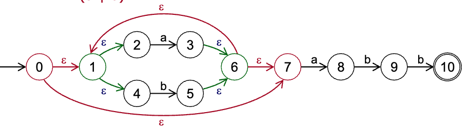
 
# ε-NFA到DFA (Page 40/54)

- **应用了2种方法**
  - 子集构造
  - ε-closure构造
- **子集**
  - 新DFA中的一个状态对应于原始NFA中状态的一个子集。
- **ε-closure**
  - 空转换不消耗任何输入。
 
# 一个例子 (Page 41/54)

- A = {0}, B = {1, 2}, C = {3, 4, 5, 6, 8, 11}
- D = {9, 10, 11, 5, 6, 8}, E = {7, 10, 11, 5, 6, 8}
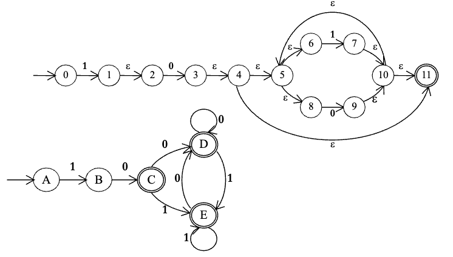
 
# 计算ε闭包 (Page 42/54)

- **令 ε-closure({0}) = {0} = A，然后**
  - δ(A, 1) = ε-closure({1}) = {1, 2} = B
  - δ(B, 0) = ε-closure({3}) = {3, 4, 5, 6, 8, 11} = C
  - δ(C, 0) = ε-closure({9}) = {5, 6, 8, 9, 10, 11} = D
  - δ(C, 1) = ε-closure({7}) = {5, 6, 7, 8, 10, 11} = E
  - δ(D, 0) = ε-closure({9}) = D
  - δ(D, 1) = ε-closure({7}) = E
  - δ(E, 0) = ε-closure({9}) = D
  - δ(E, 1) = ε-closure({7}) = E
 
# DFA的简化 (Page 43/54)

- **找出状态的等价类**
  - 方法1：
    - 使用表格表示等价关系
    - 只需要一个三角形。
  - 方法2：
    - 使用状态集的划分
 
# 一个例子 (Page 44/54)

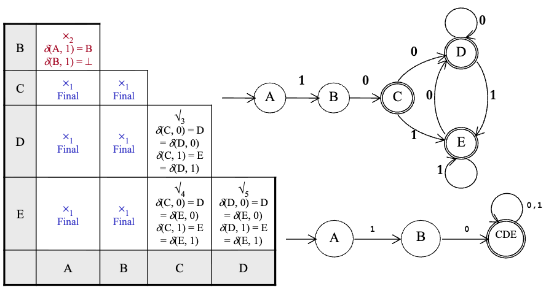

# 更多例子 (Page 45/54)

- {1, 2, 4, 5, 6, 7, 8} {3}（终止和非终止，即从ε）
- {1, 4, 5, 6, 7} {2, 8} {3}（从1到终止和非终止）
- {1, 5, 7} {4, 6} {2, 8} {3}（从0到终止和非终止）
- {1, 5} {7} {4, 6} {2, 8} {3}（从0到状态{2, 8}和{7}）
- {1, 5} {7} {4, 6} {2, 8} {3}（或从1到状态{6}和{5}）
- 未发现差异，终止。

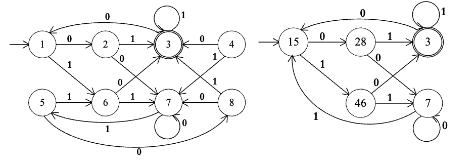

# 6. 正则语言的限制 (Page 46/54)

- **正则语言无法处理无限计数和匹配**
  - 例如 {aⁿ b cⁿ | n ≥ 1} 不是正则集。
- **大多数编程语言中括号的匹配**
  - 不能用正则表达式描述
  - 不能用正则文法生成
  - 不能用有限自动机识别
 
# 7. 词法分析实践 (Page 47/54)

- **实践中的扫描器：在我们的实验课中训练**
  - 手动构造扫描器
    - 定义词法规则
    - 构造有限自动机
    - 基于有限自动机的蓝图编写扫描器
  - 使用扫描器生成器构造扫描器
    - lex, Flex, 和 JFlex
 
# 字符串处理 (Page 48/54)

- **正则表达式是描述字符串中模式的常用方法。**
  - 正则表达式实现中的权衡和后果
    - 使用NFA识别
    - 正则表达式直接到DFA
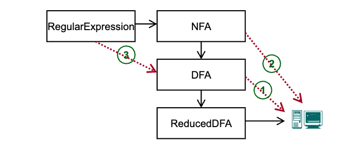

# 练习3.1 (Page 49/54)

- 给出以下Pascal程序中识别的词法单元。
  ```
  function max(i, j: integer): integer;
  {return the maximum of integers i and j}
  begin
    if i > j then max := i else max := j
  end;
  ```
 
# 练习3.2 (Page 50/54)

- (DBv2, Ch.3, pp.125, ex.3.3.2) 描述以下正则表达式表示的语言：
  - a(a | b)* a
  - a* b a* b a* b a*
 
# 练习3.3 (Page 51/54)

- (DBv2, Ch.3, pp.125, ex.3.3.4) 大多数语言是大小写敏感的，因此关键字只能以一种方式编写，描述其词法单元的正则表达式非常简单。
- 然而，有些语言，如Pascal和SQL，是大小写不敏感的。例如，SQL关键字SELECT也可以写成select, Select, 或 sELEcT。
- 展示如何为大小写不敏感语言中的关键字编写正则表达式。
- 通过为SQL中的SELECT编写表达式来说明你的想法。
 
# 练习3.4 (Page 52/54)

- 给定以下正则表达式 1\*(0 | 01)\*  
  (1) 将其转换为等价的有限自动机。  
  (2) 为练习(1)的结果构造等价的DFA。  
  (3) 简化(2)的结果并得到简化DFA。
 
# 练习3.5** (Page 53/54)

- 给定字母表 Σ = {z, o, /}，Σ上程序中的注释以"/o"开始，以"o/"结束。不允许嵌套注释。
  - (1) 绘制一个DFA，它只识别源程序中的所有注释。
  - (2) 编写一个单一的正则表达式，精确描述源程序中的所有注释。
 