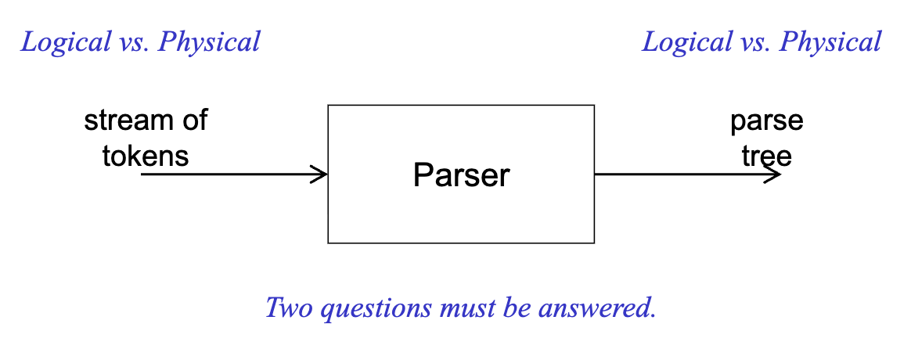
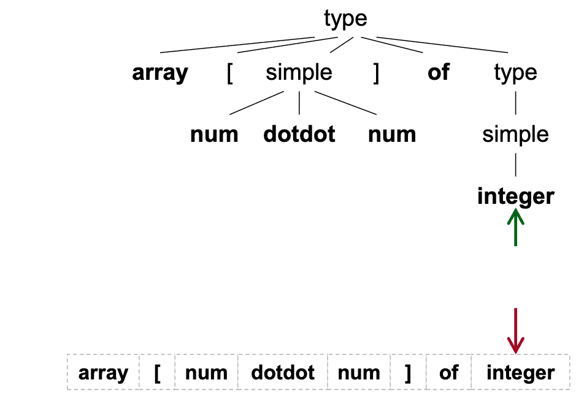
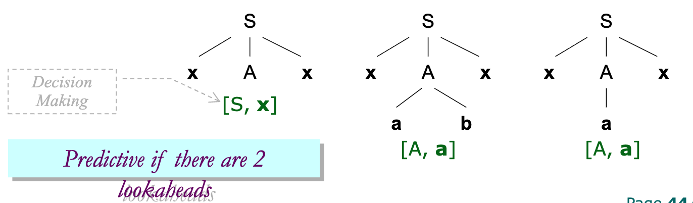
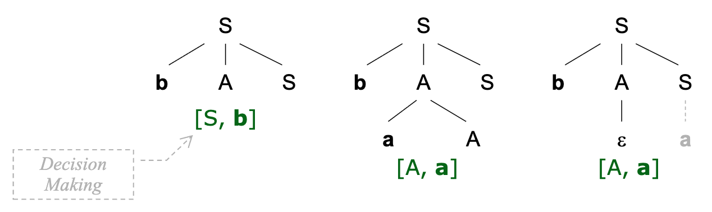
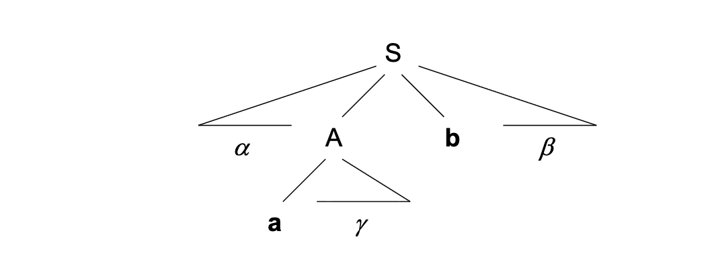
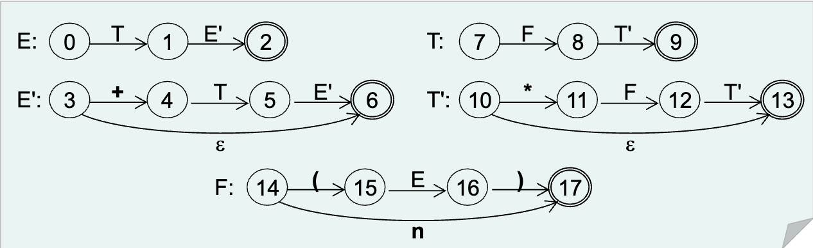
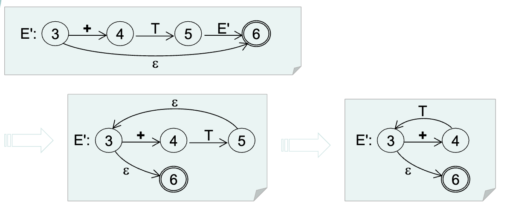
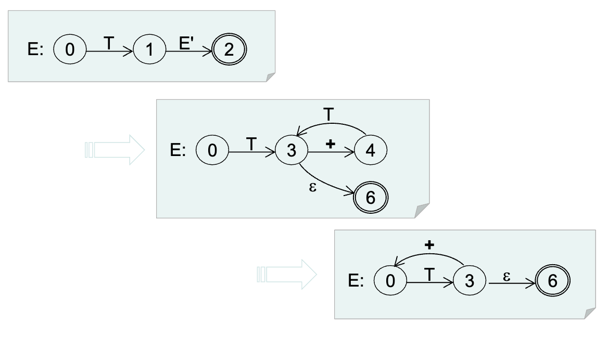
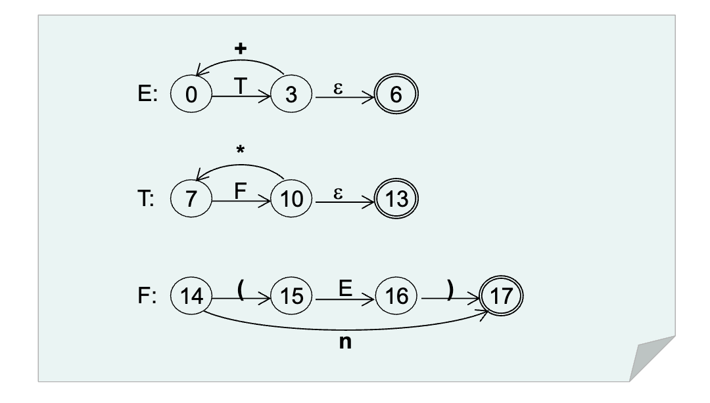
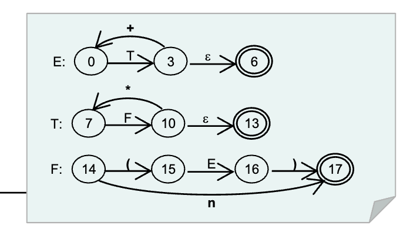

# 讲座4. 自顶向下语法分析 (Page 2/79)

1. 语法分析简介
2. 自顶向下语法分析
3. 重写文法
4. 带回溯的自顶向下语法分析器
5. 如何做到预测性
6. 递归下降预测分析器

# 1. 语法分析简介 (Page 4/79)

- **语法分析器：输入Input、处理Process和输出Output(IPO)**
- 词法单元流 → 语法分析 → 语法分析树



# 复习 (Page 8/79)

- **语法分析器和扫描器之间的管道**
  - 方法调用（过程调用）
  - 逻辑与物理
- **上下文无关文法**
  - 语法分析树、推导和归约
  - 歧义性

# 上下文无关的能力 (Page 9/79)

- **它能生成什么语言？**
  - $L_0=\{a^n b^n | n ≥ 1\}$
- **它不能生成什么语言？**
  - $L_1=\{ω c ω | ω ∈(a | b)^* ∧ a, b, c ∈ Σ\}$
  - $L_2=\{a^n b^m c^n d^m | n ≥ 1 ∧ m ≥ 1\}$
- 实践中某些问题的抽象
  - 如何解决这个问题？

# 2. 自顶向下语法分析 (Page 10/79)

- **语法分析策略**
  - 自顶向下语法分析
    - 如何在多个候选产生式中选择唯一的产生式？
  - 自底向上语法分析
    - 如何在句型中找到句柄？

# 自顶向下语法分析：动机 (Page 11/79)

- **一个激励示例**
```
type   → simple 
       |  ^ id 
       |  array [ simple ] of type
simple → integer 
       |  char 
       |  num dotdot num
```
  - array[1..10] of integer

# 语法分析过程



步骤：

0. 使用 `type → array [ simple ] of type` 推导
1. `array` 匹配
2. `[` 匹配
3. 使用 `simple → num dotdot num` 推导
4. `num` 匹配
5. `dotdot` 匹配
6. `num` 匹配
7. `]` 匹配
8. `of` 匹配
9.  使用 `type → simple` 推导
10. 使用 `simple → integar` 推导
11. `integar` 和 `type` 匹配
12. 接受

# 自顶向下语法分析器：视角 (Page 24/79)

- **视角1：语法分析能力与效率**
  - 带回溯的自顶向下语法分析器
  - 预测分析器
- **视角2：语法分析器实现**
  - 递归下降语法分析器
    - 带回溯的语法分析器
    - 预测分析器
  - 表驱动语法分析器
    - 使用显式栈和语法分析表的非递归程序
    - 一种自动化方法（通常是预测性的）

# 重写文法 (Page 26/79)

> 文法变换

- **解决歧义性**
  - 权衡和后果
- **消除 ε-产生式**
  - 系统性消除左递归
- **消除左递归**
  - 避免自顶向下语法分析中的无限循环
- **左因子分解**
  - 避免自顶向下语法分析中的回溯


# 解决歧义性 (Page 27/79)

- **复习：实践中的歧义性**
  - 表达式
  - 悬挂else
- **解决歧义性**
  - 特设约束
  - 权衡和后果

# 歧义性表达式 (Page 28/79)

- **歧义性文法**
    ```
    expr → expr + expr 
        | expr * expr 
        | ( expr ) | n
    ```

- **无歧义文法**
    ```
    expr → expr + term | term
    term → term * factor | factor
    factor → ( expr ) | n
    ```

# 3. 重写规则 (Page 29/79)

- **特设但启发式的重写规则**
  - 优先级规则
  - 结合性规则

# 悬挂else问题 (Page 30/79)

- **文法**
    ```
    stmt → if expr then stmt 
         | if expr then stmt else stmt 
         | other
    ```

- **示例**
    ```
    if E1 then S1 else if E2 then S2 else S3
    ```
    
- **歧义性**
    ```
    if E1 then if E2 then S1 else S2
    if E1 then if E2 then S1 else S2
    ```

# 无歧义文法 (Page 31/79)

- **额外的消歧规则**
  - 每个else与最近的未匹配的then匹配
- **无歧义文法**
    ```
    stmt            → matched_stmt | open_stmt
    matched_stmt    → if expr then matched_stmt else matched_stmt 
                    | other
    open_stmt       → if expr then stmt 
                    | if expr then matched_stmt else open_stmt
  ```
- **示例**
  ```
  if E1 then { if E2 then S1 else S2 }
  ```

# 消除ε-产生式 (Page 32/79)

- **ε-自由文法**
  - 没有产生式体是 $\varepsilon$（$\varepsilon$-产生式），或者
  - 唯一的 $\varepsilon$-产生式是 $S \to \varepsilon$，且 $S$ 不出现在任何产生式的体中
- **消除算法**
  - 对于每个产生式 $A \to X_1 X_2 \dots X_n$，其中
    $X_i \in \Sigma \cup N,\ 1 \leq i \leq n$
  - 添加新产生式 $A \to a_1 a_2 \dots a_n$，其中
    - $\neg(X_i \Rightarrow^* \varepsilon) \Rightarrow (a_i = X_i)$
    - $(X_i \Rightarrow^* \varepsilon) \Rightarrow (a_i = X_i \lor a_i = \varepsilon)$
    - $\exists\ 1 \leq i \leq n.\ a_i \neq \varepsilon$

# 消除ε-产生式：示例1 (Page 33/79)

- **原始文法**
    ```
    S → A a | b
    A → A c | S d | ε
    ```
- **重写文法**
    ```
    S → A a | a | b
    A → A c | c | S d
    ```

# 消除ε-产生式：示例2 (Page 34/79)

- **原始文法**
    ```
    S → a S b S | b S a S | ε
    ```
- **等价的ε-自由文法**
    ```
    S'  → S | ε
    S   → a S b S | a b S | a S b | a b
        | b S a S | b a S | b S a | b a
    ```

# ε-自由文法定理 (Page 35/79)

- **给定任何上下文无关文法G，存在ε-自由文法G'，使得L(G) – {ε} = L(G')**
  - ε ∉ L(G) ⇒ L(G) = L(G')
  - G 和 G' 之间唯一的区别是产生式

# 消除左递归 (Page 36/79)

从左递归到右递归

- **简单直接左递归**
  ```
  A → A α | β
  ```
  ```
  A  → β A'
  A' → α A' | ε
  ```
- **消除算法**
    ```
    A → Aα1 | Aα2 | ... | Aαm
      | β1 | β2 | ... | βn
    ```
    ```
    A  → β1 A' | β2 A' | ... | βn A'
    A' → α1 A' | α2 A' | ... | αm A' | ε
    ```

# 直接左递归：示例 (Page 37/79)

- **原始文法**
    ```
    E → E + T | T
    T → T * F | F
    F → ( E ) | n
    ```
- **等价的无左递归文法**
    ```
    E  → T E'
    E' → + T E' | ε
    T  → F T'
    T' → * F T' | ε
    F  → ( E ) | n
    ```

# 系统性消除 (Page 38/79)

- **前提条件**
  - 没有循环，例如$A ⇒^+ A$
  - 没有 ε-产生式，例如: A → ε
- **消除算法**
  将非终结符按某种顺序排列为A1, A2,..., An
  ```
  for i = 1 to n do begin
    for j = 1 to i – 1 do begin
      将每个形式为Ai → Ajγ 的产生式替换为产生式
      Ai → δ1γ | δ2γ | ... | δkγ,
      其中Aj → δ1 | δ2 | ... | δk是当前所有的Aj-产生式
    end
    消除Ai-产生式之间的直接左递归
  end
  ```

# 系统性消除：示例1 (Page 39/79)

- **原始文法**
    ```
    S → A a | b
    A → A c | S d | ε
    ```
- **重写文法**
  - 消除ε-产生式：
    ```
    S → A a | a | b
    A → A c | c | S d
    ```
  - 消除左递归，按S, A顺序：
    ```
    S  → A a | a | b
    A  → A c | c | A a d | a d | b d
    A  → c A' | a d A' | b d A'
    A' → c A' | a d A' | ε
    ```

# 系统性消除：示例2 (Page 40/79)

- **原始文法**
    ```
    S → A c | c
    A → B b | b
    B → S a | a
    ```
- **按不同顺序重写(等价)**
  - 按S, A, B顺序：
    ```
    S  → A c | c
    A  → B b | b
    B  → A c a | c a | a
    B  → B b c a | b c a | c a | a
    B  → b c a B' | c a B' | a B'
    B' → b c a B' | ε
    ```
  - 按B, A, S顺序：
    ```
    B  → S a | a
    A  → S a b | a b | b
    S  → S a b c | a b c | b c | c
    S  → a b c S' | b c S' | c S'
    S' → a b c S' | ε
    ```

# 左因子分解 (Page 41/79)

- **简单左因子分解**
    ```
    A  → α β1 | α β2
    A  → α A'
    A' → β1 | β2
    ```
- **左因子分解算法**
    ```
    A  → α β1 | α β2 | ... | α βn | γ
    A  → α A' | γ
    A' → β1 | β2 | ... | βn
    ```

# 左因子分解：示例 (Page 42/79)

- **原始文法**
    ```
    S → if E then S | if E then S else S | other
    E → bool
    ```
- **左因子分解后**
    ```
    S  → if E then S S' | other
    S' → else S | ε
    E  → bool
    ```

# 结论：为什么要重写？ (Page 43/79)

- **对于所有语法分析技术**
  - 解决歧义性：为什么？
- **仅对于自顶向下语法分析**
  - 消除ε-产生式：为什么？
  - 消除左递归：为什么？
  - 左因子分解：为什么？

# 4. 带回溯的自顶向下语法分析器 (Page 44/79)

- **权衡和后果**
  - 优点：能够处理大多数CFG
  - 缺点：复杂，效率低
- **仅用于演示自顶向下语法分析的思想**
  - 为什么左递归会导致无限循环？
  - 非终结符可以推导的第一个符号的含义

# 基于动作做决策 (Page 45/79)

- **给定以下文法**
    ```
    S → x A x
    A → a b | a | b
    ```
- **仅使用一个向前看符号进行语法分析**
  - 句子：xax
  - 如果有2个向前看符号则是预测性的



# 基于动作做决策（续） (Page 46/79)

- **给定以下文法**
    ```
    S → b A S | a
    A → a A | ε
    ```
- **由ε-产生式引起的回溯**
  - 句子：ba



# 自顶向下语法分析中的四个动作 (Page 47/79)

- **通用动作**
  - 接受
  - 错误
- **自顶向下语法分析特有的动作**
  - 匹配
  - 推导

# 5. 如何做到预测性 (Page 48/79)

- **语法分析器如何做到预测性？**
  - 文法的充分必要条件
  - 如何根据向前看符号选择唯一的产生式候选

# FIRST()和FOLLOW() (Page 49/79)

- **这两个函数的目的**
  - a ∈ FIRST(A) 且 b ∈ FOLLOW(A)



# FIRST()函数 (Page 50/79)

- **意图**：在根据向前看符号x选择**A → α | β**之一时，我们必须有**FIRST(α) ∩ FIRST(β) = ∅**
- **语法（签名）**
  - FIRST: (Σ ∪ N)* → $2^{(Σ∪{ε})}$
- **语义**
  - {x | α ⇒* x..., x ∈ Σ} ⊆ FIRST(α)
  - α ⇒* ε ⇒ ε ∈ FIRST(α)
    - **为什么我们在FIRST(α)中允许ε？**

# FIRST()函数（续） (Page 51/79)

- **给定X ∈ Σ ∪ N，我们有FIRST(X)**
  - X ∈ Σ ⇒ FIRST(X) = {X}
  - X ∈ N ∧ X → Y1Y2...Yn ⇒
    - ∃1 ≤ i ≤ n. a ∈ FIRST(Yi) ∧ ∀1 ≤ j ≤ i – 1. ε ∈ FIRST(Yj) ⇒ a ∈ FIRST(X)
    - ∀1 ≤ k ≤ n. ε ∈ FIRST(Yk) ⇒ ε ∈ FIRST(X)
      - 因此我们有X → ε ⇒ ε ∈ FIRST(X)

# FIRST()函数（续） (Page 52/79)

- **给定α = X1X2...Xn ∈ (Σ ∪ N)*，我们有FIRST(α)**
  - FIRST(X1) – {ε} ⊆ FIRST(α)
  - ∀2 ≤ i ≤ n. ∀1 ≤ j ≤ i – 1. ε ∈ FIRST(Xj) ⇒ FIRST(Xi) – {ε} ⊆ FIRST(α)
  - ∀1 ≤ i ≤ n. ε ∈ FIRST(Xi) ⇒ ε ∈ FIRST(α)

> 重载

# FOLLOW()函数 (Page 53/79)

- **意图**：在根据向前看符号x选择A → α | ε之一时，我们必须有FIRST(α) ∩ FOLLOW(A) = ∅
- **语法（签名）**
  - FOLLOW: N → 2Σ ∪ {$}，其中特殊符号$表示输入词法单元流的结束
- **语义**
  - {x | S ⇒* αAxβ ∧ x ∈ Σ} ⊆ FOLLOW(A)
  - S ⇒* αA ⇒ $ ∈ FOLLOW(A)

# FOLLOW()函数（续） (Page 54/79)

- **给定X ∈ N，我们有FOLLOW(X)**
  - X = S ⇒ $ ∈ FOLLOW(X)
  - A → αXβ ⇒ FIRST(β) – {ε} ⊆ FOLLOW(X)
  - (A → αX) ∨ (A → αXβ ∧ ε ∈ FIRST(β)) ⇒ FOLLOW(A) ⊆ FOLLOW(X)

# 示例1 (Page 55/79)

- **给定以下文法**
  ```
  E  → T E'
  E' → + T E' | ε
  T  → F T'
  T' → * F T' | ε
  F  → ( E ) | n
  ```
- **我们有**
  - FIRST(F) = FIRST(T) = FIRST(E) = {(, n}
  - FIRST(T') = {*, ε}
  - FIRST(E') = {+, ε}
  - FOLLOW(E) = FOLLOW(E') = {), $}
  - FOLLOW(T) = FOLLOW(T') = {+, ), $}
  - FOLLOW(F) = {+, *, ), $}

# 示例2 (Page 56/79)

- **给定以下文法**
  ```
  A → B C
  B → A x | x | ε
  C → y C | y
  ```
- **我们有**

| 符号 | FIRST | FOLLOW |
|------|-------|--------|
| A | x y | x $ |
| B | x y ε | y |
| C | y | x $ |

手动计算中的启发式方法：
- 左与右
- 自顶向下与自底向上

# 预测语法分析的条件 (Page 57/79)

- **充分必要条件**
- **CFG G是LL(1)当且仅当对于G的任意两个不同产生式A → α | β，以下条件成立**
  - FIRST(α) ∩ FIRST(β) = ∅
  - ε ∈ FIRST(β) ⇒ FIRST(α) ∩ FOLLOW(A) = ∅

# 讨论 (Page 58/79)

- **LL(1)条件带来了什么好处？**
  - 根据当前非终结符和单个向前看符号在语法分析器中决定推导/错误动作
  - 只会选择0个或1个产生式
- **它们不是预测性的（为什么？）**
  - 歧义性文法
  - 带左递归的文法
  - 带左因子的文法

# 6. 递归下降预测分析器 (Page 59/79)

- **一种适合手动开发自顶向下语法分析器的方法**

# 开发阶段 (Page 60/79)

- **递归下降预测分析器的开发**
  1. 解决文法中的歧义性
  2. 消除文法中的左递归
  3. 对文法进行左因子分解
  4. 从文法构建转换图
  5. 简化转换图（特设且可选）
  6. 使用转换图作为蓝图编写语法分析器

# 转换图 (Page 61/79)

- **可视化预测分析器**
  - 对于每个非终结符A
    - 创建初始状态和最终状态
    - 对于每个A → X1X2...Xn，创建一条从初始状态到最终状态的路径，边标记为X1, X2,..., Xn
      - 如果A → ε，路径标记为ε

# 转换图：示例 (Page 62/79)

- **给定以下文法**
  ```
  E → T E'
  E' → + T E' | ε
  T → F T'
  T' → * F T' | ε
  F → ( E ) | n
  ```
- **转换为转换图**



# 转换图的简化 (Page 63/79)

- **特设规则：迭代替换**







# 讨论 (Page 66/79)

- **转换图：（递归下降预测）语法分析 vs. 扫描**
  - 观点1
  - 观点2

# 编写递归预测分析器 (Page 67/79)

- **使用转换图作为语法分析器的蓝图**
  - 为每个图编写一个递归过程
    - S的图的过程是主入口
  - 设计过程的控制流，模仿图中的路径，考虑向前看符号
    - 如果路径中边的标签是终结符，执行匹配动作
    - 如果标签是非终结符，执行推导动作，即递归调用非终结符的过程

# 编码规则 (Page 68/79)

- **A → a B b**
  ```java
  void A(){
    match(a);
    B();
    match(b);
  }
  ```
  ```java
  void match(Token tok){
    if(lookahead == tok){
      lookahead = scanner.getNextToken();
    } else error();
  }
  ```

# 编码规则（续） (Page 69/79)

- **A → a B b | b A B**
  ```java
  void A(){
    if(lookahead == a){
      match(a); B(); match(b)
    } else if(lookahead == b){
      match(b); A(); B()
    } else error()
  }
  ```

# 编码规则（续） (Page 70/79)

- **A → a B b | b A B | C**
  ```java
  void A(){
    if(lookahead == a){
      match(a); B(); match(b)
    } else if(lookahead == b){
      match(b); A(); B()
    } else; // do nothing
  }
  ```
  ```java
  void A(){
    if(lookahead == a){
      match(a); B(); match(b)
    } else if(lookahead == b){
      match(b); A(); B()
    } else if(lookahead in FIRST(C)){
      // do nothing, more accurate
    } else error();
  }
  ```
# 编码规则（续） (Page 71/79)

- **A → a B b | b A B | ε**
  ```java
  void A(){
    if(lookahead == a){
      match(a); B(); match(b)
    } else if(lookahead == b){
      match(b); A(); B()
    } else; // do nothing
  }
  ```
  ```java
  void A(){
    if(lookahead == a){
      match(a); B(); match(b)
    } else if(lookahead == b){
      match(b); A(); B()
    } else if(lookahead in FOLLOW(A)){
      // 什么都不做，更准确！
    } else error();
  }
  ```

# 示例1 (Page 72/79)

```
type → simple 
     | ^ id 
     | array [ simple ] of type
simple → integer 
       | char 
       | num dotdot num
```


```java
void type() throws SyntacticException{
  if(lookahead.equals(new Token('^'))){
    match(new Token('^'));
    match(new Token(Token.ID));
  } else if(lookahead.equals(new Token(Token.ARRAY))){
    match(new Token(Token.ARRAY));
    match(new Token('['));
    simple();
    match(new Token(']'));
    match(new Token(Token.OF));
    type();
  } else simple();
}
```

使用未简化的转换图作为蓝图时，编码直接且直观。

# 示例1（续） (Page 73/79)

```java
void simple() throws SyntacticException{
  if(lookahead.equals(new Token(Token.INTEGER))){
    match(new Token(Token.INTEGER));
  } else if(lookahead.equals(new Token(Token.CHAR))){
    match(new Token(Token.CHAR));
  } else if(lookahead.equals(new Token(Token.NUM))){
    match(new Token(Token.NUM));
    match(new Token(Token.DOTDOT));
    match(new Token(Token.NUM));
  } else throw new SyntacticException();
}

void match(Token tok) throws SyntacticException{
  if(lookahead.equals(tok))
    lookahead = scanner.getNextToken();
  else throw new SyntacticException();
}
```

# 示例2 (Page 74/79)



```java
void expr() throws SyntacticException{
  term();
  while(lookahead.equals(new Token('+'))){
    match(new Token('+'));
    term();
  }
}

void term() throws SyntacticException{
  factor();
  while(lookahead.equals(new Token('*'))){
    match(new Token('*'));
    factor();
  }
}
```

使用简化的转换图编码时需要一些技巧。

# 示例2（续） (Page 75/79)

```java
void factor() throws SyntacticException{
  if(lookahead.equals(new Token('('))){
    match(new Token('('));
    expr();
    match(new Token(')'));
  } else if(lookahead.equals(new Token(Token.NUM))){
    match(new Token(Token.NUM));
  } else{
    throw new SyntacticException();
  }
}
```

# 练习4.1 (Page 76/79)

- **给定以下文法**
  ```
  S → ( L ) | a
  L → L , S | S
  ```
  - 消除文法中的左递归
  - 为文法绘制转换图
  - 编写递归下降预测分析器
  - 指出输入句子(a,(a, a))的过程调用序列

# 练习4.2 (Page 77/79)

- **考虑上下文无关文法**
  ```
  S → a S b S | b S a S | ε
  ```
  - 你能为该文法构建预测分析器吗？为什么？

# 练习4.3 (Page 78/79)

- **计算以下文法开始符号的FIRST和FOLLOW**
  ```
  S → S S+ | S S* | a
  ```
