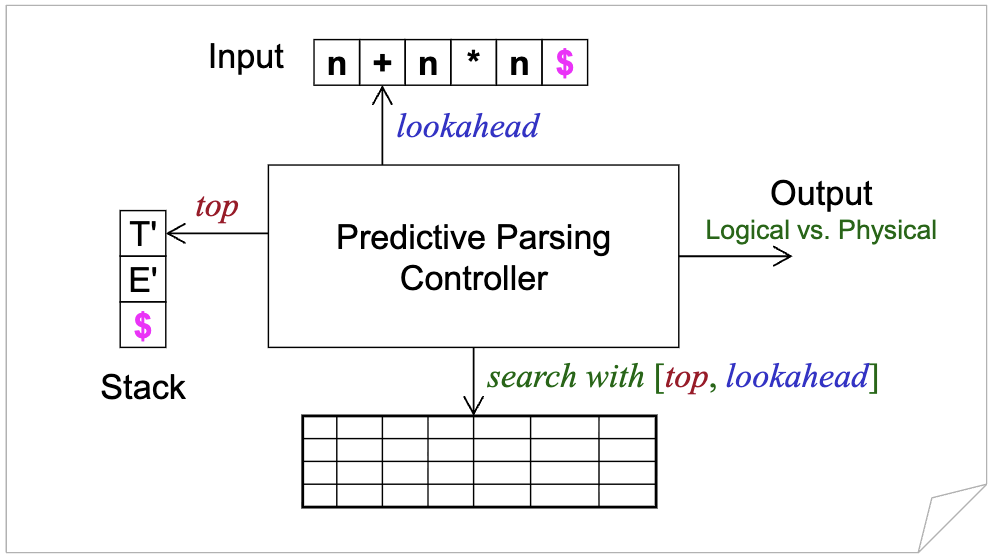

# 讲座5. LL(1)语法分析

# 讲座5. LL(1)语法分析 (Page 3/32)

1. 预测分析表
2. 表驱动语法分析器
3. LL(1)语法分析中的错误恢复

# 1. 预测分析表 (Page 4/32)

- **基于语法分析表决定动作**
  - 前提条件：LL(1)文法
- **自顶向下语法分析器中的四种动作**
  - 推导
  - 匹配
  - 接受
  - 错误

# 复习 (Page 5/32)

- **给定以下文法**
  ```
  E  → T E'
  E' → + T E' | ε
  T  → F T'
  T' → * F T' | ε
  F  → ( E )  | n
  ```
- **我们有**
  - $\text{FIRST}(F) = \text{FIRST}(T) = \text{FIRST}(E) = \{(, n\}$
  - $\text{FIRST}(T') = \{*, \varepsilon\}$
  - $\text{FIRST}(E') = \{+, \varepsilon\}$
  - $\text{FOLLOW}(E) = \text{FOLLOW}(E') = \{), \$\}$
  - $\text{FOLLOW}(T) = \text{FOLLOW}(T') = \{+, ), \$\}$
  - $\text{FOLLOW}(F) = \{+, *, ), \$\}$

# 语法分析表：示例 (Page 6/32)

- **对于上述文法**

| 非终结符 | n | + | * | ( | ) | $ |
|----------|---|---|---|---|---|---|
| E | T E' | | | T E' | | |
| E' | | + T E' | | | ε | ε |
| T | F T' | | | F T' | | |
| T' | | | * F T' | | ε | ε |
| F | n | | | ( E ) | | |

# 语法分析表的构造 (Page 7/32)

- **算法：对于每个产生式 $A \to \alpha$**
  - 对于每个 $a \in \text{FIRST}(\alpha) \cap \Sigma$，将 $A \to \alpha$ 添加到 $M[A, a]$
  - 如果 $\varepsilon \in \text{FIRST}(\alpha)$，对于每个 $b \in \text{FOLLOW}(A)$，将 $A \to \alpha$ 添加到 $M[A, b]$
    - **注意**：$b$ 可能是 $ 符号，表示输入词法单元的结束
- **讨论：语法分析表中的冲突**
  - 单个条目是否可能包含多个产生式？
  - 这意味着什么？

# 语法分析表中的冲突 (Page 8/32)

- **左因子分解后的悬挂else文法**
  ```
  S  → if E then S S' | other
  S' → else S | ε
  E  → expr
  ```

| 非终结符 | if | then | else | other | expr | $ |
|----------|----|------|------|-------|------|---|
| S | if E then S S' | | | other | | |
| S' | | | ε, else S | | | ε |
| E | | | | | expr | |

# 讨论 (Page 9/32)

- **语法分析表中冲突出现的位置**
  - 左递归
    ```
    A → A a | b
    ```
  - 左因子
    ```
    A → a b | a c
    ```
  - 歧义性

# 2. 表驱动语法分析器 (Page 10/32)

- **没有硬编码的特定文法**
  - 语法分析器由语法分析表驱动
    - **控制器足够通用，可以处理所有LL(1)文法**
  - 语法分析表包含文法的所有信息
    - **LL(1)语法分析器的自动生成是从LL(1)文法生成语法分析表**

# 表驱动语法分析器的模型 (Page 11/32)

- **语法分析器的组件**
  - **特定于表驱动预测语法分析器**
    - 语法分析表
    - 控制器
    - （显式）栈
  - **通用组件**
    - 输入：可以抽象为向前看符号
    - 输出：逻辑与物理

# 表驱动语法分析器的模型（续） (Page 12/32)

- **表驱动预测语法分析器**



# 初始和接受配置 (Page 13/32)

- **初始配置**
  - 栈：$ S
  - 向前看：指向第1个输入符号，输入字符串以$结束
- **接受配置**
  - 栈：$
  - 向前看：指向$

# 预测分析控制器 (Page 14/32)

```java
initialize();
while(!stack.top().equals(new Symbol('$'))){
  top = stack.top();
  if(top instanceof Terminal){ // 匹配终结符
    stack.pop();
    match(top);
  } else{ // 推导非终结符
    if(table[top, lookahead] is X → Y1Y2...Yk){
      output(X → Y1Y2...Yk);
      stack.pop();
      stack.push(Yk, Yk-1, ..., Y1); // Y1在顶部
    } else error(); // 语法分析表中的空条目
  }
}
if(lookahead.equals(new Symbol('$'))) accept();
else error();
```

# LL(1)语法分析：示例 (Page 15/32)

- **给定以下CFG**
  ```
  S → a B a
  B → b B | ε
  ```

| 非终结符 | a | b | $ |
|----------|---|---|---|
| S | a B a | | |
| B | ε | b B | |

# 语法分析过程 (Page 16/32)

| 步骤 | 栈 | 输入 | 参考 | 动作 | 输出 |
|------|----|------|------|------|------|
| 0 | $ S | a b b a $ | [S, a] = a B a | 推导 | S → a B a |
| 1 | $ a B a | a b b a $ | | 匹配 | |
| 2 | $ a B | b b a $ | [B, b] = b B | 推导 | B → b B |
| 3 | $ a B b | b b a $ | | 匹配 | |
| 4 | $ a B | b a $ | [B, b] = b B | 推导 | B → b B |
| 5 | $ a B b | b a $ | | 匹配 | |
| 6 | $ a B | a $ | [B, a] = ε | 推导 | B → ε |
| 7 | $ a | a $ | | 匹配 | |
| 8 | $ | $ | | 接受 | |

| 非终结符 | a | b | $ |
|----------|---|---|---|
| S | a B a | | |
| B | ε | b B | |

# LL(1)语法分析：更多示例 (Page 17/32)

- **给定输入字符串：n + n * n**

| 非终结符 | n | + | * | ( | ) | $ |
|----------|---|---|---|---|---|---|
| E | T E' | | | T E' | | |
| E' | | + T E' | | | ε | ε |
| T | F T' | | | F T' | | |
| T' | | ε | * F T' | | ε | ε |
| F | n | | | ( E ) | | |

# 语法分析过程 (Page 18/32)

| 步骤 | 栈 | 输入 | 参考 | 动作 | 输出 |
|------|----|------|------|------|------|
| 0 | $ E | n + n * n $ | [E, n] = T E' | 推导 | E → T E' |
| 1 | $ E' T | n + n * n $ | [T, n] = F T' | 推导 | T → F T' |
| 2 | $ E' T' F | n + n * n $ | [F, n] = n | 推导 | F → n |
| 3 | $ E' T' n | n + n * n $ | | 匹配 | |
| 4 | $ E' T' | + n * n $ | [T', +] = ε | 推导 | T' → ε |
| 5 | $ E' | + n * n $ | [E', +] = + T E' | 推导 | E' → + T E' |
| 6 | $ E' T + | + n * n $ | | 匹配 | |
| 7 | $ E' T | n * n $ | [T, n] = F T' | 推导 | T → F T' |
| 8 | $ E' T' F | n * n $ | [F, n] = n | 推导 | F → n |

| 非终结符 | n | + | * | ( | ) | $ |
|----------|---|---|---|---|---|---|
| E | T E' | | | T E' | | |
| E' | | + T E' | | | ε | ε |
| T | F T' | | | F T' | | |
| T' | | ε | * F T' | | ε | ε |
| F | n | | | ( E ) | | |

# 语法分析过程（续） (Page 19/32)

| 步骤 | 栈 | 输入 | 参考 | 动作 | 输出 |
|------|----|------|------|------|------|
| 9 | $ E' T' n | n * n $ | | 匹配 | |
| 10 | $ E' T' | * n $ | [T', *] = * F T' | 推导 | T' → * F T' |
| 11 | $ E' T' F * | * n $ | | 匹配 | |
| 12 | $ E' T' F | n $ | [F, n] = n | 推导 | F → n |
| 13 | $ E' T' n | n $ | | 匹配 | |
| 14 | $ E' T' | $ | [T', $] = ε | 推导 | T' → ε |
| 15 | $ E' | $ | [E', $] = ε | 推导 | E' → ε |
| 16 | $ | $ | | 接受 | |

| 非终结符 | n | + | * | ( | ) | $ |
|----------|---|---|---|---|---|---|
| E | T E' | | | T E' | | |
| E' | | + T E' | | | ε | ε |
| T | F T' | | | F T' | | |
| T' | | ε | * F T' | | ε | ε |
| F | n | | | ( E ) | | |

# 错误报告：缺少操作数 (Page 20/32)

| 步骤 | 栈 | 输入 | 参考 | 动作 | 输出 |
|------|----|------|------|------|------|
| 0 | $ E | n + * n $ | [E, n] = T E' | 推导 | E → T E' |
| 1 | $ E' T | n + * n $ | [T, n] = F T' | 推导 | T → F T' |
| 2 | $ E' T' F | n + * n $ | [F, n] = n | 推导 | F → n |
| 3 | $ E' T' n | n + * n $ | | 匹配 | |
| 4 | $ E' T' | + * n $ | [T', +] = ε | 推导 | T' → ε |
| 5 | $ E' | + * n $ | [E', +] = + T E' | 推导 | E' → + T E' |
| 6 | $ E' T + | + * n $ | | 匹配 | |
| 7 | $ E' T | * n $ | [T, *] = 空 | 错误 | 缺少操作数 |

# 错误报告：缺少运算符 (Page 21/32)

| 步骤 | 栈 | 输入 | 参考 | 动作 | 输出 |
|------|----|------|------|------|------|
| 0 | $ E | n n * n $ | [E, n] = T E' | 推导 | E → T E' |
| 1 | $ E' T | n n * n $ | [T, n] = F T' | 推导 | T → F T' |
| 2 | $ E' T' F | n n * n $ | [F, n] = n | 推导 | F → n |
| 3 | $ E' T' n | n n * n $ | | 匹配 | |
| 4 | $ E' T' | n * n $ | [T', n] = 空 | 错误 | 缺少运算符 |

# 错误报告：缺少右括号 (Page 22/32)

| 步骤 | 栈 | 输入 | 参考 | 动作 | 输出 |
|------|----|------|------|------|------|
| 0 | $ E | n + n ( $ | [E, n] = T E' | 推导 | E → T E' |
| 1 | $ E' T | n + n ( $ | [T, n] = F T' | 推导 | T → F T' |
| 2 | $ E' T' F | n + n ( $ | [F, n] = n | 推导 | F → n |
| 3 | $ E' T' n | n + n ( $ | | 匹配 | |
| 4 | $ E' T' | + n ( $ | [T', +] = ε | 推导 | T' → ε |
| 5 | $ E' | + n ( $ | [E', +] = + T E' | 推导 | E' → + T E' |
| 6 | $ E' T + | + n ( $ | | 匹配 | |
| 7 | $ E' T | n ( $ | [T, n] = F T' | 推导 | T → F T' |
| 8 | $ E' T' F | n ( $ | [F, n] = n | 推导 | F → n |
| 9 | $ E' T' n | n ( $ | | 匹配 | |
| 10 | $ E' T' | ( $ | [T', (] = 空 | 错误 | 缺少运算符 |

# 错误报告：缺少左括号 (Page 23/32)

| 步骤 | 栈 | 输入 | 参考 | 动作 | 输出 |
|------|----|------|------|------|------|
| 0 | $ E | n + n ) $ | [E, n] = T E' | 推导 | E → T E' |
| 1 | $ E' T | n + n ) $ | [T, n] = F T' | 推导 | T → F T' |
| 2 | $ E' T' F | n + n ) $ | [F, n] = n | 推导 | F → n |
| 3 | $ E' T' n | n + n ) $ | | 匹配 | |
| 4 | $ E' T' | + n ) $ | [T', +] = ε | 推导 | T' → ε |
| 5 | $ E' | + n ) $ | [E', +] = + T E' | 推导 | E' → + T E' |
| 6 | $ E' T + | + n ) $ | | 匹配 | |
| 7 | $ E' T | n ) $ | [T, n] = F T' | 推导 | T → F T' |
| 8 | $ E' T' F | n ) $ | [F, n] = n | 推导 | F → n |
| 9 | $ E' T' n | n ) $ | | 匹配 | |
| 10 | $ E' T' | ) $ | [T', *] = * F T' | 推导 | T' → * F T' |
| 11 | $ E' T' | ) $ | [T', )] = ε | 推导 | T' → ε |
| 12 | $ E' | ) $ | [E', )] = ε | 推导 | E' → ε |
| 13 | $ | ) $ | | 错误 | |

# 3. LL(1)语法分析中的错误恢复 (Page 24/32)

- **语法分析器在错误情况下应该做什么？**
  - 给出错误信息
    - 尽可能有意义
  - 从错误情况中恢复
    - 能够继续使用剩余输入进行语法分析

# LL(1)语法分析中的错误 (Page 25/32)

- **三种类型的错误**
  - **终结符不匹配**
    - 栈顶是终结符，但与向前看符号不匹配
  - **[栈顶, 向前看] = 空**
    - 没有产生式候选
  - **栈为空但输入未结束**
    - 栈为空，但输入字符串未结束

# 带同步的语法分析表 (Page 26/32)

| 非终结符 | n | + | * | ( | ) | $ |
|----------|---|---|---|---|---|---|
| E | T E' | | | T E' | synch | synch |
| E' | | + T E' | | | ε | ε |
| T | F T' | synch | | F T' | synch | synch |
| T' | | ε | * F T' | | ε | ε |
| F | n | synch | synch | ( E ) | synch | synch |

$\text{FOLLOW}(E) = \text{FOLLOW}(E') = \{), \$\}$  
$\text{FOLLOW}(T) = \text{FOLLOW}(T') = \{+, ), \$\}$  
$\text{FOLLOW}(F) = \{+, *, ), \$\}$  

弹出栈顶（较少）  
跳过向前看（较多）

# 带错误恢复的语法分析 (Page 27/32)

- **错误恢复策略**
  - 如果 [栈顶, 向前看] = 空，则
    - 跳过向前看，即前移输入并保持栈不变
  - 如果 [栈顶, 向前看] = synch，则
    - 跳过栈顶，即弹出栈并保持输入不变
  - 如果 栈顶 ≠ 向前看，则
    - 跳过栈顶，即弹出栈并保持输入不变

# 带错误恢复的语法分析过程 (Page 28/32)

| 步骤 | 栈 | 输入 | 参考 | 动作 | 输出 |
|------|----|------|------|------|------|
| 0 | $ E | * n * + n $ | [E, *] = 空 | 跳过输入 | 错误 |
| 1 | $ E | n * + n $ | [E, n] = T E' | 推导 | E → T E' |
| 2 | $ E' T | n * + n $ | [T, n] = F T' | 推导 | T → F T' |
| 3 | $ E' T' F | n * + n $ | [F, n] = n | 推导 | F → n |
| 4 | $ E' T' n | n * + n $ | | 匹配 | |
| 5 | $ E' T' | * + n $ | [T', *] = * F T' | 推导 | T' → * F T' |
| 6 | $ E' T' F * | * + n $ | | 匹配 | |
| 7 | $ E' T' F | + n $ | [F, +] = synch | 跳过栈顶 | 错误 |
| 8 | $ E' T' | + n $ | [T', +] = ε | 推导 | T' → ε |
| 9 | $ E' | + n $ | [E', +] = + T E' | 推导 | E' → + T E' |
| 10 | $ E' T + | + n $ | | 匹配 | |
| 11 | $ E' T | n $ | [T, n] = F T' | 推导 | T → F T' |
| 12 | $ E' T' F | n $ | [F, n] = n | 推导 | F → n |
| 13 | $ E' T' n | n $ | | 匹配 | |
| 14 | $ E' T' | $ | [T', $] = ε | 推导 | T' → ε |
| 15 | $ E' | $ | [E', $] = ε | 推导 | E' → ε |
| 16 | $ | $ | | 接受 | |

# 错误恢复技术 (Page 29/32)

- **恐慌模式错误恢复**
  - 跳过输入直到找到同步符号
- **短语级错误恢复**
  - 为每个空条目分配特定的错误例程
- **错误产生式**
  - 适用于常见错误但不是所有错误
- **全局修正**
  - 全局分析输入以找到错误
  - 昂贵且不实用

# 练习5.1 (Page 30/32)

- **给定以下文法**
  ```
  S → ( L ) | a
  L → L , S | S
  ```
  - 为文法构造LL(1)语法分析表
    - 注意：必须先消除左递归
  - 按照之前幻灯片的风格，绘制句子 (a, (a, a)) 的详细语法分析过程

# 练习5.2** (Page 31/32)

- **考虑以下文法**
  ```
  A → B | B C
  B → a B | ε
  C → a b
  ```
  - 对文法进行左因子分解
  - 左因子分解后，该文法是LL(1)文法吗？或者是LL(k)文法？为什么？
    - 注意：可以尝试输入字符串 ab

# 进一步阅读 (Page 32/32)

- **龙书，第2版(DBv2)**
  - **全面阅读：**
    - 第4.4.3–4.4.4节：LL(1)语法分析
    - 第4.1.4和4.4.5节：LL(1)语法分析中的错误恢复
  - **跳过阅读：**
    - 第4.2.7节：CFG与正则表达式的区别

享受这门课程！