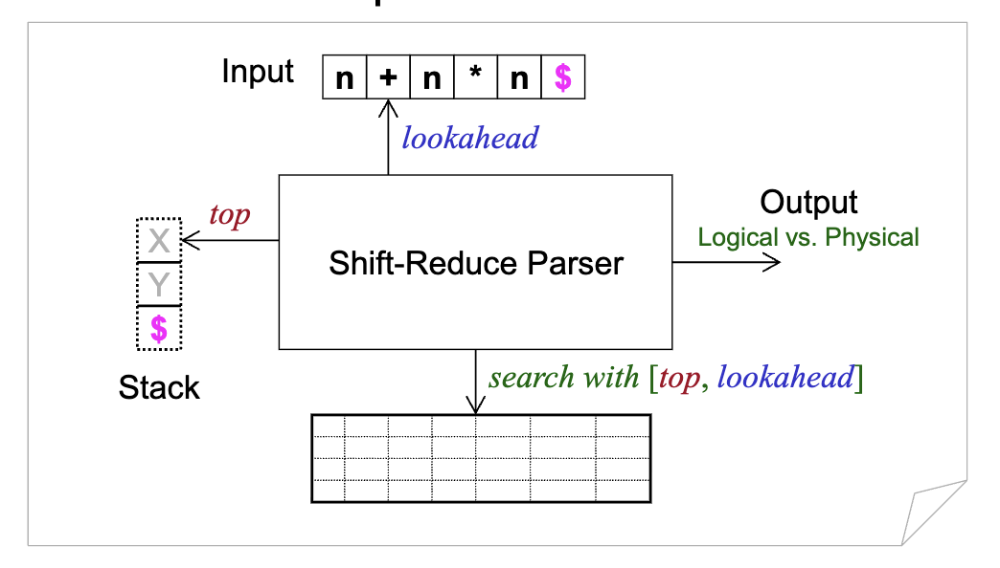
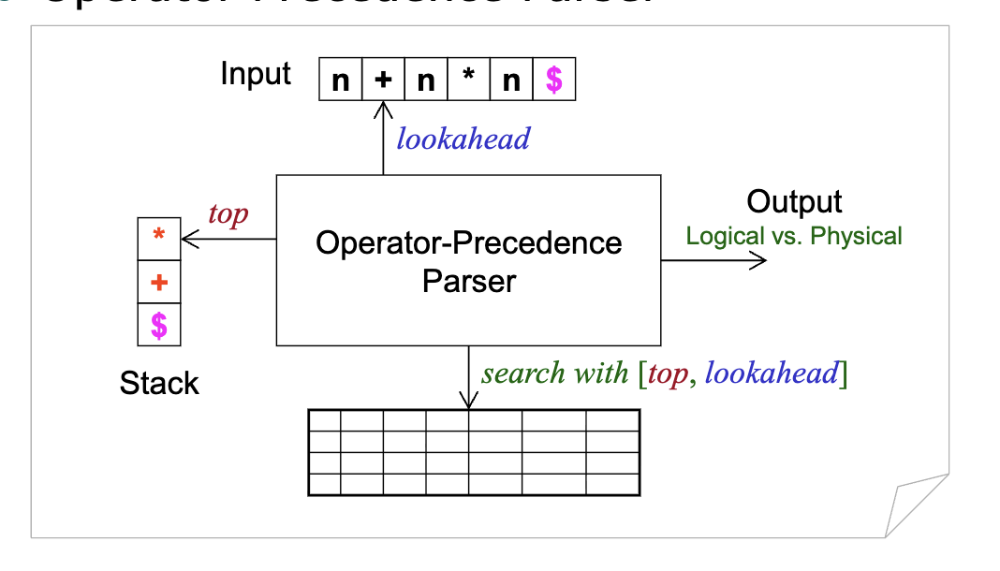

# 讲座6. 算符优先分析(OPP)

1. **自底向上分析**
2. **移进-归约分析的抽象模型**
3. **算符优先分析器**
4. **我们丢弃了什么？**
5. **OPP是否消失了？**

---

# 1. 自底向上分析 (Page 3/44)

- **一个启发性例子**
  - 从叶子节点开始，向上构建语法树，直到根节点。
  - 对于文法：
    - $E \to E + T \mid T$
    - $T \to T * F \mid F$
    - $F \to (E) \mid n$

---

# n * n (Page 4/44)

- **从叶子节点开始：** $n * n$

```

    n * n
```

---

# F (Page 5/44)

```
    F
    |
    n * n
```

- **第一个n是句柄，归约后**
  - 我们得到最右句型：$F * n$

---

# T (Page 6/44)

```
    T
    |
    F
    |
    n * n
```

- **F是句柄，我们得到：** $T * n$

---

# T F (Page 7/44)

```
    T   F
    |   |
    F   |
    |   |
    n * n
```

- **在$T * n$中n是句柄，我们得到：** $T * F$

---

# T (Page 8/44)

```
      T
     /|\
    T | F
    | | |
    F | |
    | | |
    n * n
```

- **$T * F$是句柄**

---

# E (Page 9/44)

```
      E
      |
      T
     /|\
    T | F
    | | |
    F | |
    | | |
    n * n
```

- **T是句柄**

---

# 另一个例子 (Page 10/44)

- **对于文法：**
  - $S \to a B c D e$
  - $B \to B b \mid b$
  - $D \to d$

---

# S (Page 11/44)

```
        S
      //|\\
    / / | \ \
   a B  c  D e
    / \    |
   B   b   d
  -+-
   b 
```

- **归约 = 句柄（b）修剪**
  - 最右句型：$a b b c d e$

---

# S (Page 12/44)

```
        S
      //|\\
    / / | \ \
   a B  c  D e
   -/-\-   |
   B   b   d
```

- **Bb是句柄**
  - 最右句型：$a B b c d e$

---

# S (Page 13/44)

```
        S
      //|\\
    / / | \ \
   a B  c  D e
          -+-
           d
```

- **d是句柄**
  - 最右句型：$a B c d e$

---

# S (Page 14/44)

```
        S
      //|\\
   -/-/-|-\-\-
   a B  c  D e
```

- **aBcDe是句柄**
  - 最右句型：$a B c D e$

---

# S (Page 15/44)

```
    S
```

- **成功归约到根节点**
  - 最右句型：$S$

---

# 复习 (Page 16/44)

- **句型中的可归约串**
  - 最右句型的句柄
    - **如果** $S \Rightarrow^*_{rm} \alpha A \omega \Rightarrow_{rm} \alpha \beta \omega$**，则**
    - 产生式 $A \to \beta$ 在 $\alpha$ 之后的位置是 $\alpha \beta \omega$ 的句柄。
  - **性质**
    - 句柄右侧的子串（即上述定义中的 $\omega$）必须只包含终结符。
      - **注意这是最右（rm）推导。**

---

# 复习（续） (Page 17/44)

- **语法树中的句柄**
  - 最左的两层子树。
  - 不实用，仅有助于理解概念。
- **自底向上分析的关键问题**
  - 如何在句型中找到可归约串？
    - **LR分析：** 句柄（最左简单短语）
    - **OPP：** 最左素短语

---

# 2. 移进-归约分析的抽象模型 (Page 18/44)

- **与LL(1)分析对称**
  - 表驱动方法
    - 基于表格的分析决策
    - **LL(1)分析表** 与
      - 算符优先关系表
      - **LR(0)/SLR(1)/LALR(1)/LR(1)分析表**
  - 显式栈
    - 自顶向下分析：$[\$S, \omega\$] \Rightarrow [\$, \$]$
    - **自底向上分析：** $[\$, \omega\$] \Rightarrow [\$S, \$]$
  - 动作
    - 自顶向下分析：匹配-推导
    - **自底向上分析：** 移进-归约

---

# 抽象模型 (Page 19/44)

- **移进-归约分析器**



---

# 启发性例子 (Page 20/44)

- **给定之前的文法**
  - $S \to a B c D e$
  - $B \to B b \mid b$
  - $D \to d$
- **对于之前的句子**
  - $a b b c d e$

---

# 启发性例子（续） (Page 21/44)

| 步骤 | 栈 | 输入 | 动作 | 输出 |
|---|---|---|---|---|
| 1 | $\$$ | $a b b c d e\$$ | 移进 | |
| 2 | $\$ a$ | $b b c d e\$$ | 移进 | |
| 3 | $\$ a b$ | $b c d e\$$ | 归约 | $B \to b$ |
| 4 | $\$ a B$ | $b c d e\$$ | 移进 | |
| 5 | $\$ a B b$ | $c d e\$$ | 归约 | $B \to B b$ |
| 6 | $\$ a B$ | $c d e\$$ | 移进 | |
| 7 | $\$ a B c$ | $d e\$$ | 移进 | |
| 8 | $\$ a B c d$ | $e\$$ | 归约 | $D \to d$ |
| 9 | $\$ a B c D$ | $e\$$ | 移进 | |
| 10 | $\$ a B c D e$ | $\$$ | 归约 | $S \to a B c D e$ |
| 11 | $\$ S$ | $\$$ | 接受 | |

---

# 更多启发性例子 (Page 22/44)

- **给定表达式的二义性文法**
  - $E \to E + E \mid E * E \mid (E) \mid n$
- **对于以下句子**
  - $n + n * n$

---

# 更多启发性例子（续） (Page 23/44)

| 步骤 | 栈 | 输入 | 动作 | 输出 |
|---|---|---|---|---|
| 1 | $\$$ | $n + n * n\$$ | 移进 | |
| 2 | $\$ n$ | $+ n * n\$$ | 归约 | $E \to n$ |
| 3 | $\$ E$ | $+ n * n\$$ | 移进 | |
| 4 | $\$ E +$ | $n * n\$$ | 移进 | |
| 5 | $\$ E + n$ | $* n\$$ | 归约 | $E \to n$ |
| 6 | $\$ E + E$ | $* n\$$ | 移进 | |
| 7 | $\$ E + E *$ | $n\$$ | 移进 | |
| 8 | $\$ E + E * n$ | $\$$ | 归约 | $E \to n$ |
| 9 | $\$ E + E * E$ | $\$$ | 归约 | $E \to E * E$ |
| 10 | $\$ E + E$ | $\$$ | 归约 | $E \to E + E$ |
| 11 | $\$ E$ | $\$$ | 接受 | |

---

# 模型中的抽象是什么？ (Page 24/44)

- **分析表的形式是什么？**
  - 算符优先关系表
  - **LR分析表**
- **栈的内容是什么？**
  - 算符
  - **分析状态**
- **如何确定栈顶的可归约子串？**
  - 最左素短语
  - **句柄**

---

# 具体实现 (Page 25/44)

- **移进-归约分析的抽象模型的具体实现**

```
         ┌─────────────────────┐
         │   移进-归约分析器     │
         └─────────────────────┘
                   │
        ┌──────────┴──────────┐
        │                     │
   ┌────▼────┐           ┌────▼────┐
   │ OPP分析器│           │ LR分析器 │
   └─────────┘           └─────────┘
                              │
           ┌──────────────────┼───────────────┐
           │           │           │          │
      ┌────▼────┐ ┌────▼────┐ ┌────▼────┐ ┌───▼─────┐
      │ LR(0)   │ │ SLR(1)  │ │ LALR(1) │ │  LR(1)  │
      │ 分析器   │ │ 分析器   │ │ 分析器   │ │  分析器  │ 
      └─────────┘ └─────────┘ └─────────┘ └─────────┘     
```

---

# 3. 算符优先分析器 (Page 26/44)

- **具体实现**
  - **分析表**
    - 算符优先关系
  - **显式栈**
    - 算符
  - **可归约子串**
    - 最左素短语

---

# OPP分析器的具体模型 (Page 27/44)

- **算符优先分析器**



---

# 算符文法 (Page 28/44)

- **一类小但重要的文法**
  - 没有 $\varepsilon$-产生式。
  - 没有产生式的两个相邻非终结符。
- **例如**
  - **不是算符文法**
    - $E \to E A E \mid (E) \mid -E \mid id$
    - $A \to + \mid - \mid * \mid / \mid \wedge$
  - **算符文法**
    - $E \to E + E \mid E - E \mid E * E \mid E / E \mid E \wedge E \mid (E) \mid -E \mid id$

---

# 算符优先 (Page 29/44)

- **三种优先关系**
  - $a \lessdot b$
  - $a \doteq b$
  - $a \gtrdot b$
- **二元关系的性质**
  - 非自反
  - 非对称
  - 非传递
  - 偏序关系

---

# 算符优先关系表 (Page 30/44)

| | id | + | * | $ |
|---|---|---|---|---|
| id | | $\gtrdot$ | $\gtrdot$ | $\gtrdot$ |
| + | $\lessdot$ | $\gtrdot$ | $\lessdot$ | $\gtrdot$ |
| * | $\lessdot$ | $\gtrdot$ | $\gtrdot$ | $\gtrdot$ |
| $ | $\lessdot$ | $\lessdot$ | $\lessdot$ | |

---

# 分析算法 (Page 31/44)

```c
initialize();
for(;;){
    if(top == $ && lookahead == $)
        accept();
    topOp = stack.topMostTerminal();
    if(topOp \lessdot lookahead || topOp \doteq lookahead){ // 移进
        stack.push(lookahead);
        lookahead = scanner.getNextToken();
    }
    else if(topOp \gtrdot lookahead){ // 归约
        do{
            topOp = stack.pop();
        } while(stack.topMostTerminal() \gtrdot || \doteq topOp);
    }
    else
        error();
}
```

---

# 句子分析 (Page 32/44)

| 步骤 | 栈 | 输入 | 参考 | 动作 | 输出 |
|---|---|---|---|---|---|
| 1 | $\$$ | $n + n * n\$$ | $\$ \lessdot n$ | 移进 | |
| 2 | $\$ n$ | $+ n * n\$$ | $n \gtrdot +$ | 归约 | $E \to n$ |
| 3 | $\$ E$ | $+ n * n\$$ | $\$ \lessdot +$ | 移进 | |
| 4 | $\$ E +$ | $n * n\$$ | $+ \lessdot n$ | 移进 | |
| 5 | $\$ E + n$ | $* n\$$ | $n \gtrdot *$ | 归约 | $E \to n$ |
| 6 | $\$ E + E$ | $* n\$$ | $+ \lessdot *$ | 移进 | |
| 7 | $\$ E + E *$ | $n\$$ | $* \lessdot n$ | 移进 | |
| 8 | $\$ E + E * n$ | $\$$ | $n \gtrdot \$$ | 归约 | $E \to n$ |
| 9 | $\$ E + E * E$ | $\$$ | $* \gtrdot \$$ | 归约 | $E \to E * E$ |
| 10 | $\$ E + E$ | $\$$ | $+ \gtrdot \$$ | 归约 | $E \to E + E$ |
| 11 | $\$ E$ | $\$$ | | 接受 | |

---

# 更实用的OPP表 (Page 33/44)

| | + | - | * | / | ^ | id | ( | ) | $ |
|---|---|---|---|---|---|---|---|---|---|
| + | $\gtrdot$ | $\gtrdot$ | $\lessdot$ | $\lessdot$ | $\lessdot$ | $\lessdot$ | $\lessdot$ | $\gtrdot$ | $\gtrdot$ |
| - | $\gtrdot$ | $\gtrdot$ | $\lessdot$ | $\lessdot$ | $\lessdot$ | $\lessdot$ | $\lessdot$ | $\gtrdot$ | $\gtrdot$ |
| * | $\gtrdot$ | $\gtrdot$ | $\gtrdot$ | $\gtrdot$ | $\lessdot$ | $\lessdot$ | $\lessdot$ | $\gtrdot$ | $\gtrdot$ |
| / | $\gtrdot$ | $\gtrdot$ | $\gtrdot$ | $\gtrdot$ | $\lessdot$ | $\lessdot$ | $\lessdot$ | $\gtrdot$ | $\gtrdot$ |
| ^ | $\gtrdot$ | $\gtrdot$ | $\gtrdot$ | $\gtrdot$ | $\lessdot$ | $\lessdot$ | $\lessdot$ | $\gtrdot$ | $\gtrdot$ |
| id | $\gtrdot$ | $\gtrdot$ | $\gtrdot$ | $\gtrdot$ | $\gtrdot$ | | | $\gtrdot$ | $\gtrdot$ |
| ( | $\lessdot$ | $\lessdot$ | $\lessdot$ | $\lessdot$ | $\lessdot$ | $\lessdot$ | $\lessdot$ | $\doteq$ | |
| ) | $\gtrdot$ | $\gtrdot$ | $\gtrdot$ | $\gtrdot$ | $\gtrdot$ | | | $\gtrdot$ | $\gtrdot$ |
| $ | $\lessdot$ | $\lessdot$ | $\lessdot$ | $\lessdot$ | $\lessdot$ | $\lessdot$ | $\lessdot$ | | |

---

# OPP表的另一种形式 (Page 34/44)

| | + | - | * | / | ^ | id | ( | ) | $ |
|---|---|---|---|---|---|---|---|---|---|
| + | 归约 | 归约 | 移进 | 移进 | 移进 | 移进 | 移进 | 归约 | 归约 |
| - | 归约 | 归约 | 移进 | 移进 | 移进 | 移进 | 移进 | 归约 | 归约 |
| * | 归约 | 归约 | 归约 | 归约 | 移进 | 移进 | 移进 | 归约 | 归约 |
| / | 归约 | 归约 | 归约 | 归约 | 移进 | 移进 | 移进 | 归约 | 归约 |
| ^ | 归约 | 归约 | 归约 | 归约 | 移进 | 移进 | 移进 | 归约 | 归约 |
| id | 归约 | 归约 | 归约 | 归约 | 归约 | | | 归约 | 归约 |
| ( | 移进 | 移进 | 移进 | 移进 | 移进 | 移进 | 移进 | 移进 | |
| ) | 归约 | 归约 | 归约 | 归约 | 归约 | | | 归约 | 归约 |
| $ | 移进 | 移进 | 移进 | 移进 | 移进 | 移进 | 移进 | | |

---

# OPP中的错误恢复 (Page 35/44)

| | + | - | * | / | ^ | id | ( | ) | $ |
|---|---|---|---|---|---|---|---|---|---|
| + | 归约 | 归约 | 移进 | 移进 | 移进 | 移进 | 移进 | 归约 | 归约 |
| - | 归约 | 归约 | 移进 | 移进 | 移进 | 移进 | 移进 | 归约 | 归约 |
| * | 归约 | 归约 | 归约 | 归约 | 移进 | 移进 | 移进 | 归约 | 归约 |
| / | 归约 | 归约 | 归约 | 归约 | 移进 | 移进 | 移进 | 归约 | 归约 |
| ^ | 归约 | 归约 | 归约 | 归约 | 移进 | 移进 | 移进 | 归约 | 归约 |
| id | 归约 | 归约 | 归约 | 归约 | 归约 | 错误1 | 错误1 | 归约 | 归约 |
| ( | 移进 | 移进 | 移进 | 移进 | 移进 | 移进 | 移进 | 移进 | 错误2 |
| ) | 归约 | 归约 | 归约 | 归约 | 归约 | 错误1 | 错误1 | 归约 | 归约 |
| $ | 移进 | 移进 | 移进 | 移进 | 移进 | 移进 | 移进 | 错误3 | 接受 |

**短语级恢复**

---

# 处理重载算符 (Page 36/44)

- **重载一元和二元算符**
  - $id - id * id$
  - $id * - id$
- **通过扫描器区分或解析重载**
  - 记住之前处理的词法单元。

---

# 4. 我们丢弃了什么？ (Page 37/44)

- **自动表格构造**
  - 从表达式的无二义性文法构造算符优先关系表。
  - **权衡：成本与成本**
    - 编写无二义性文法
    - 构造优先关系表

---

# 节省表格空间 (Page 38/44)

| | + | - | * | / | ^ | id | ( | ) | $ |
|---|---|---|---|---|---|---|---|---|---|
| f | 2 | 2 | 4 | 4 | 4 | 6 | 0 | 6 | 0 |
| g | 1 | 1 | 3 | 3 | 5 | 5 | 5 | 0 | 0 |

- **优先函数**
  - 将 $n \times n$ 矩阵打包成 $2 \times n$ 矩阵。
  - 节省一些空间来存储分析表。
  - **但有些东西丢失了。**
    - 每对算符必须有关系。

---

# 5. OPP是否消失了？ (Page 39/44)

- **OPP已从许多现代编译器教科书中消失，例如**
  - **DBv2**（而DBv1关注OPP）
  - **Tiger书**
  - **编译器设计的艺术**
  - **等等。**

---

# 忽略OPP的原因 (Page 40/44)

- **一些原因是：**
  - OPP只处理非常简单的语言。
  - OPP在发现字符串不在语言中时效果不佳。
  - 算符优先级已被纳入LR分析器，因此为具有多个优先级的表达式编写LR分析器并不难。
  - 空间问题已不像过去那样严重。
  - OPP通常在入门数据结构课程中教授。

---

# 但OPP仍然有效 (Page 41/44)

- **即使在商业应用中，特别是OPP和递归分析的结合**
  - **一些Sun javac编译器**
    - 递归分析器粗略地分析表达式。
    - OPP正确分析二元算符。
  - **一些开源Verilog模拟器**
    - OPP将Verilog表达式作为手写递归下降分析器的独立部分进行分析。
    - Verilog表达式复杂，语言不规则且非上下文无关。
  - **早期Symantec的THINK C编译器**
  - **贝尔实验室的原始C编译器**（据报道）

---

# 练习6.1 (Page 42/44)

- **考虑文法**
  - $S \to (L) \mid a$
  - $L \to L, S \mid S$
- **我们有该文法的以下算符优先关系。**
  - **按照之前幻灯片的风格，展示句子$(a, (a, a))$的详细分析过程。**

| | a | ( | ) | , | $ |
|---|---|---|---|---|---|
| a | | | $\gtrdot$ | $\gtrdot$ | $\gtrdot$ |
| ( | $\lessdot$ | $\lessdot$ | $\doteq$ | $\lessdot$ | |
| ) | | | $\gtrdot$ | $\gtrdot$ | $\gtrdot$ |
| , | $\lessdot$ | $\lessdot$ | $\gtrdot$ | $\gtrdot$ | |
| $ | $\lessdot$ | $\lessdot$ | | | |

---
