# 讲座7. LR解析

# 讲座7. LR解析 (Page 2/91)

1. LR解析简介
2. LR解析的动机
3. 简单LR解析
   - LR(0)和SLR(1)
4. 更强大的LR解析
   - LR(1)和LALR(1)
5. LR解析中的歧义性
6. LR解析中的错误恢复

# 1. LR解析简介 (Page 3/91)

- **优点**
  - 识别几乎所有实用的CFG(比LL解析更强大)
  - 高效率
  - 尽快检测错误
- **缺点**
  - 解析表规模较大
  - 手动构建解析表困难

# 2. LR解析的动机 (Page 4/91)

- **关键：移进-归约决策制定**
  - 维护状态以跟踪我们在解析过程中的位置
- **状态由项目表示**
  - $A \to XYZ$ 产生四个项目(LR(0)项目)
    - $A \to \bullet XYZ$
    - $A \to X \bullet YZ$
    - $A \to XY \bullet Z$
    - $A \to XYZ \bullet$
  - $A \to \varepsilon$ 只产生一个项目：$A \to \bullet$

# 项目 (Page 5/91)

- **项目的不同形式**
  - $A \to X \bullet aZ$ 
    - "移进"项目 
    - 表示移进符号a
  - $A \to X \bullet BZ$ 
    - "待归约"项目 
    - 表示期望从剩余输入字符串中归约B
  - $A \to XYZ \bullet$ 
    - "归约"项目 
    - 表示句柄已出现在栈顶
  - $S \to XYZ \bullet$ 
    - "接受"项目(归约项目的特殊形式) 
    - 表示接受输入的状态

# 增广文法 (Page 6/91)

- **增广文法的原理和目的**
  - 添加新的开始符号$S'$
    - $S' \to S$
    - $S \to ...$
  - 增广文法的意图
    - 开始符号永远不会出现在任何产生式的体中
    - 那么接受状态(项目)是唯一的：$S' \to S \bullet$

# 动机示例 (Page 7/91)

- **考虑以下文法**
  $$
  \begin{align*}
  S' &\to S \\
  S &\to aA \mid bB \\
  A &\to cA \mid d \\
  B &\to cB \mid d
  \end{align*}
  $$

# 初始状态

$$
I_0: S' \to \bullet S
$$

**等价闭包** 

$$
I_0: S' \to \bullet S \\
S \to \bullet aA \\
S \to \bullet bB
$$
- **内核项目**
- **非内核项目或闭包项目**

# 状态转移 (Page 11/91)

$$
I_0: S' \to \bullet S \\
S \to \bullet aA \\
S \to \bullet bB \\
\xrightarrow{S}\\
I_1: S' \to S \bullet
$$
- 如果剩余字符串可以归约为S(期望!)

# 移进操作 (Page 12/91)

$$
I_0: S' \to \bullet S \\
S \to \bullet aA \\
S \to \bullet bB \\
\xrightarrow{a}\\
I_2: S \to a \bullet A
$$
- 如果剩余字符串的第一个符号是a(移进!)

**等价闭包计算**

$$
I_0: S' \to \bullet S \\
S \to \bullet aA \\
S \to \bullet bB \\
\xrightarrow{a} \\
I_2: S \to a \bullet A \\
A \to \bullet cA \\
A \to \bullet d
$$
- 状态$I_2$中的等价闭包

# 另一个移进 (Page 14/91)

$$
I_0: S' \to \bullet S \\
S \to \bullet aA \\
S \to \bullet bB \\
\xrightarrow{b} \\
I_3: S \to b \bullet B \\
B \to \bullet cB \\
B \to \bullet d
$$
- 如果剩余字符串的第一个符号是b(移进!)

# 完整的DFA (Page 17/91)

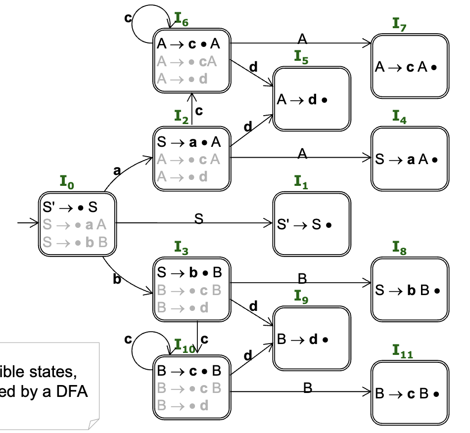

# 使用DFA工作 (Page 18/91)

- **考虑以下句子：** $acd$
- **我们有最右推导：**
  $$
  S' \Rightarrow S \Rightarrow aA \Rightarrow acA \Rightarrow accA \Rightarrow accd
  $$

# 初始状态 (Page 20/91)

```
输入字符串: | a c c d
(初始化)
```

# 移进操作1 (Page 21/91)

```
输入字符串: a | c c d
(移进)
```

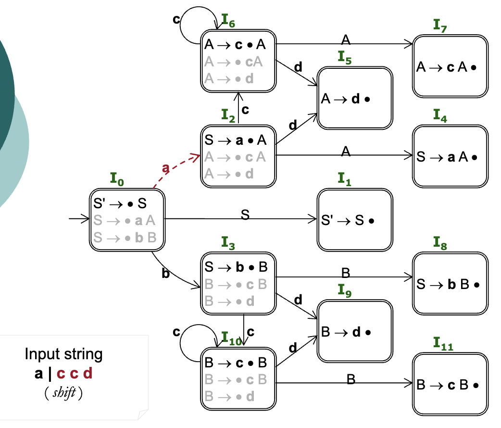

# 移进操作2 (Page 22/91)

```
输入字符串: a c | c d
(移进)
```

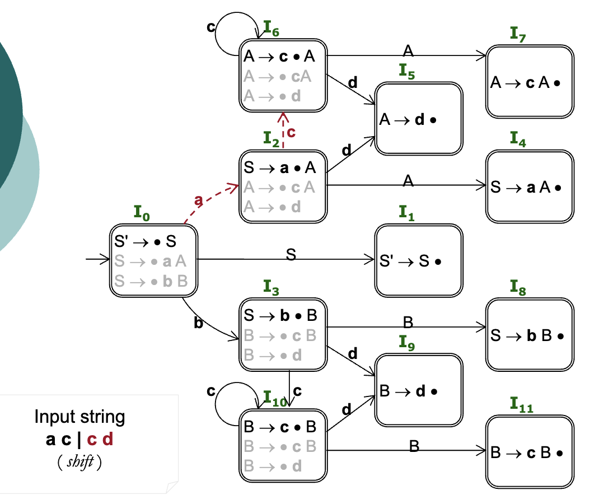

# 移进操作3 (Page 23/91)

```
输入字符串: a c c | d
(移进)
```

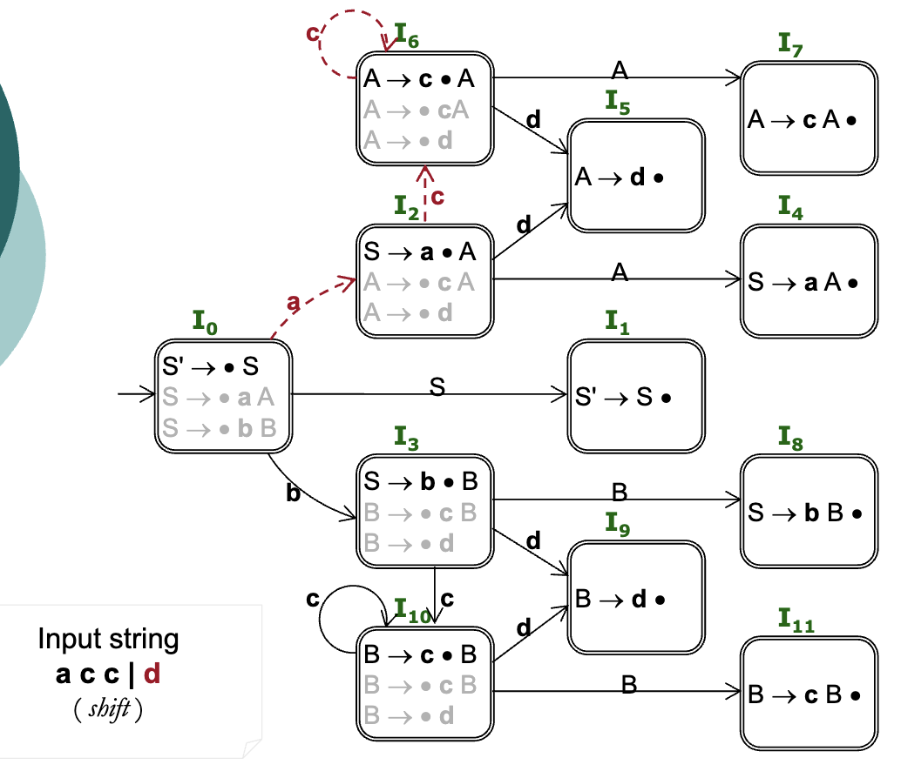

# 移进操作4 (Page 24/91)

```
输入字符串: a c c d |
(移进)
```

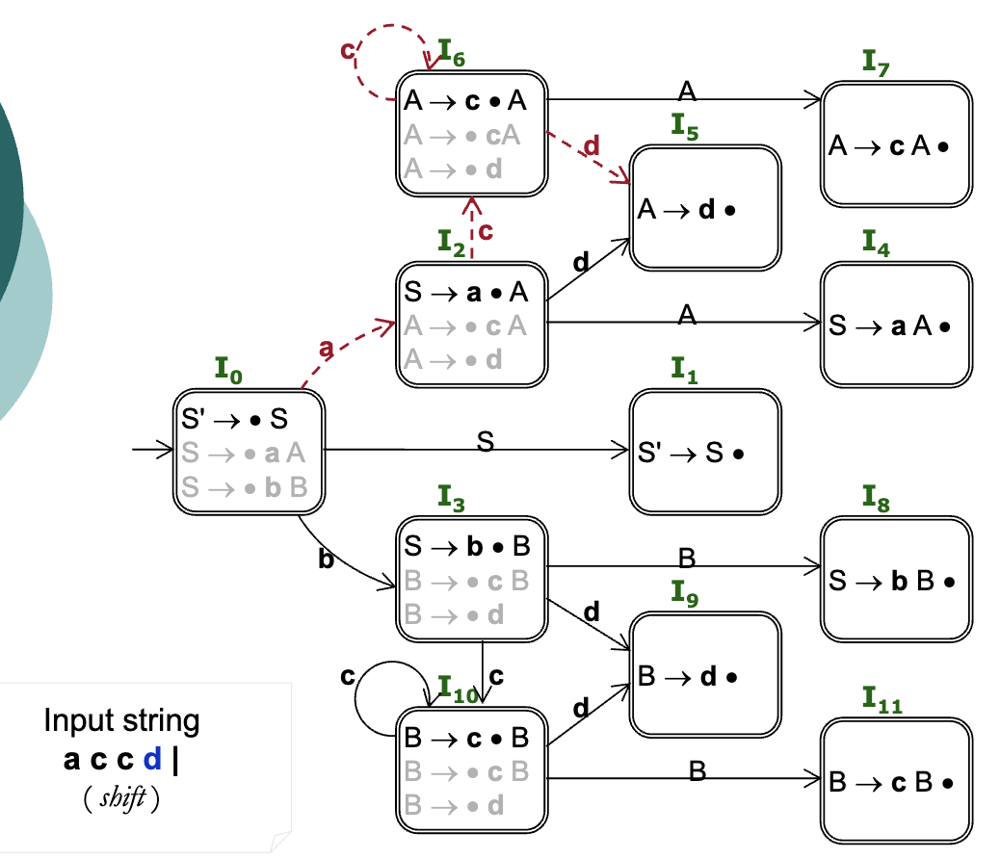

# 归约操作1 (Page 25/91)

```
输入字符串: a c c A |
(使用 A → d 归约)
```

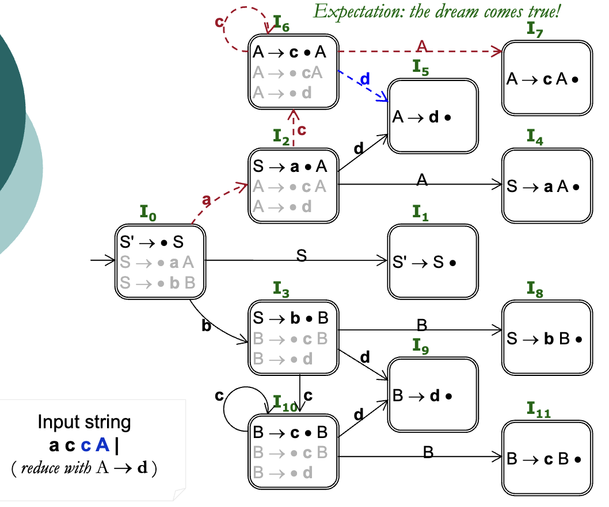

# 归约操作2 (Page 26/91)

```
输入字符串: a c A |
(使用 A → cA 归约)
```

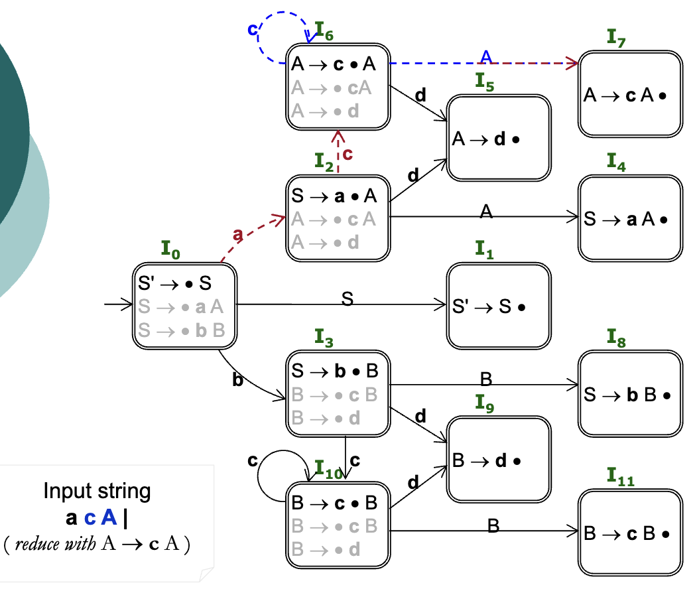

# 归约操作3 (Page 27/91)

```
输入字符串: a A |
(使用 A → cA 归约)
```

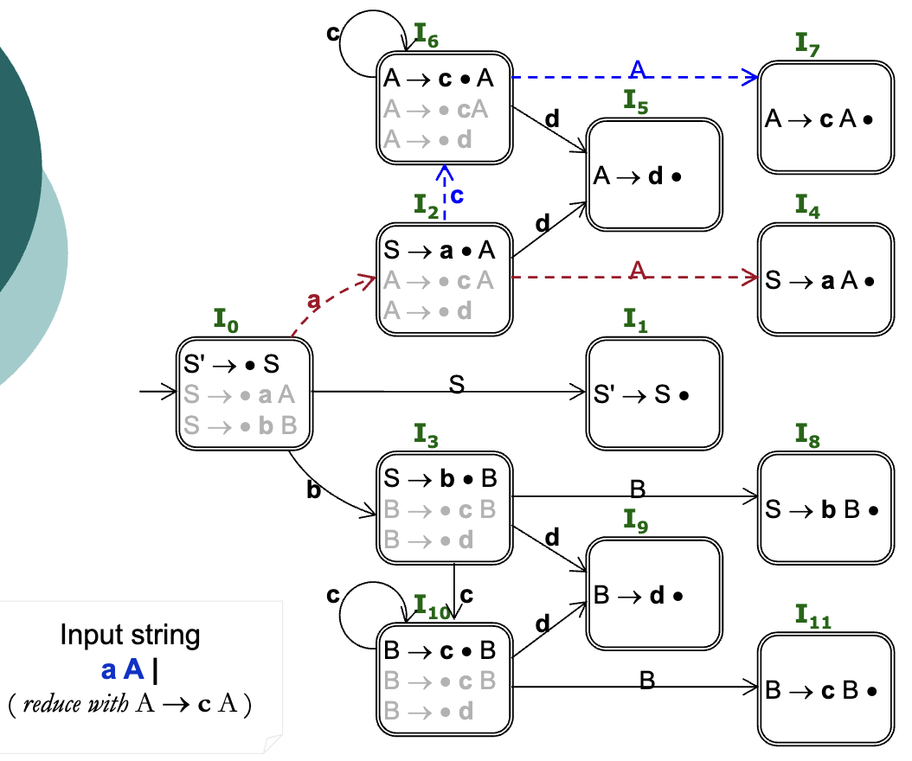

# 归约操作4 (Page 28/91)

```
输入字符串: S |
(使用 S → aA 归约并接受)
```

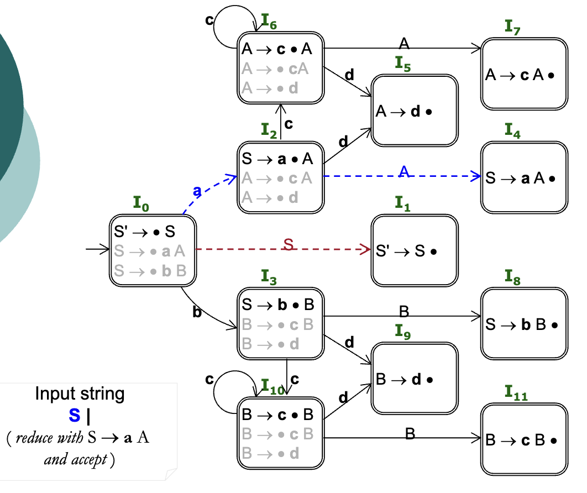

# 解析决策表 (Page 29/91)

| 步骤 | 符号 | 状态 | 输入 | 参考 | 动作 | 输出 |
|------|------|------|------|------|------|------|
| 1 | $ | 0 | accd$ | S → • aA | 移进 | |
| 2 | $ a | 0 2 | ccd$ | A → • cA | 移进 | |
| 3 | $ ac | 0 2 6 | cd$ | A → • cA | 移进 | |
| 4 | $ acc | 0 2 6 6 | d$ | A → • d | 移进 | |
| 5 | $ accd | 0 2 6 6 5 | $ | A → d • | 归约 | A → d |
| 6 | $ accA | 0 2 6 6 7 | $ | A → cA • | 归约 | A → cA |
| 7 | $ acA | 0 2 6 7 | $ | A → cA • | 归约 | A → cA |
| 8 | $ aA | 0 2 4 | $ | S → aA • | 归约 | S → aA |
| 9 | $ S | 0 1 | $ | S' → S • | 接受 | |

# 回顾 (Page 30/91)

**移进-归约解析的抽象模型实现**

- **移进-归约解析器**
  - **算符优先解析器**
  - **LR解析器**
    - **LR(0)解析器**
    - **SLR(1)解析器**
    - **LALR(1)解析器**
    - **LR(1)解析器**

# LR解析器 (Page 31/91)

- **具体实现**
  - **解析表**
    - ACTION
    - GOTO
  - **显式栈**
    - 状态
    - 文法符号(可选)
  - **可归约子串**
    - 句柄

# LR解析器的具体模型 (Page 32/91)

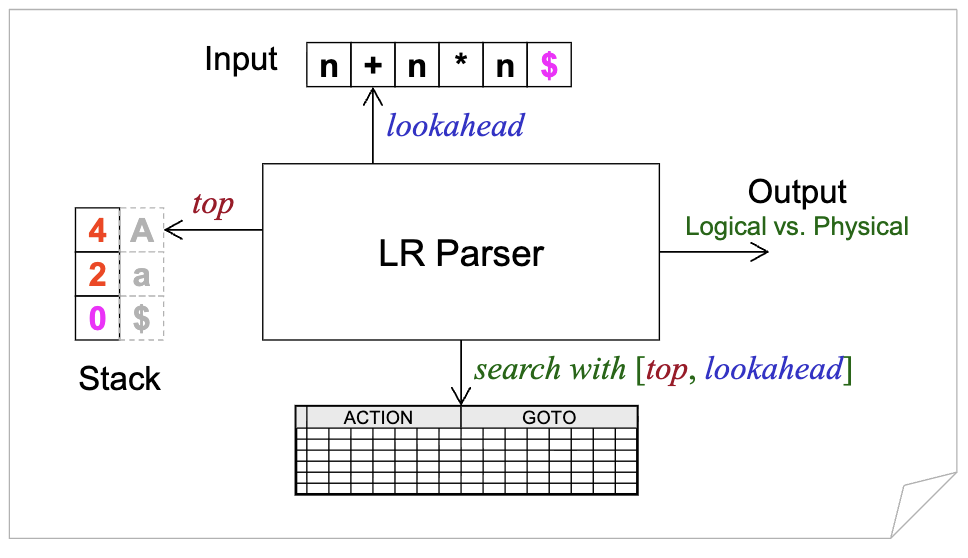

# DFA识别的语言 (Page 33/91)

- **文法的可行前缀**
  - 可以出现在栈上的所有文法符号串
  - 可行前缀是右句型的前缀，该前缀不超过该句型最右句柄的右端
    - 学习如何建立公式！

# 可行前缀的性质 (Page 34/91)

- **可行前缀必须是右句型的前缀**
  - $S \Rightarrow^*_{rm} \alpha\omega$，其中$\alpha$是栈的内容，$\omega$不包含非终结符
- **并非所有右句型的前缀都是可行前缀**
  - $E \Rightarrow^*_{rm} F \ast n \Rightarrow_{rm} (E) \ast n$
  - 其中$(,(E,(E)$是可行前缀
  - 但$(E)\ast$不是，因为解析器一旦句柄出现就会执行归约

# 有效项目的定义 (Page 35/91)

- **有效项目的定义**
  - 项目$A \to \beta_1 \bullet \beta_2$对可行前缀$\alpha\beta_1$有效，如果存在推导
    $$
    S' \Rightarrow^*_{rm} \alpha A \omega \Rightarrow_{rm} \alpha \beta_1 \beta_2 \omega
    $$
    其中$\omega$只包含终结符
  - **有效项目提供的提示**
    - 如果$\beta_2 \
eq \varepsilon$，解析器应该执行shift()，因为句柄尚未出现在解析栈顶
    - 如果$\beta_2 = \varepsilon$，解析器应该执行reduce()

# 关于有效项目的定理1 (Page 36/91)

- **closure()的基础，用于构造DFA的状态**
  - 如果$A \to \beta_1 \bullet B \beta_2$对$\alpha\beta_1$是有效项目，且$B \to \gamma$是产生式
  - 那么$B \to \bullet \gamma$对$\alpha\beta_1$也是有效项目
  - **[证明]**
    - $S' \Rightarrow^*_{rm} \alpha A \omega \Rightarrow_{rm} \alpha \beta_1 B \beta_2 \omega$ (定义)
    - $\Rightarrow^*_{rm} \alpha \beta_1 B \delta \omega$ (假设$\beta_2 \omega \Rightarrow^*_{rm} \delta \omega$)
    - $\Rightarrow_{rm} \alpha \beta_1 \gamma \delta \omega$ (我们有$B \to \gamma$)
    - $B \to \bullet \gamma$对$\alpha\beta_1$是有效项目 (定义)

# 关于有效项目的定理2 (Page 37/91)

- **goto()的基础，用于构造DFA的转移**
  - 如果$A \to \beta_1 \bullet X \beta_2$对$\alpha\beta_1$是有效项目
  - 那么$A \to \beta_1 X \bullet \beta_2$对$\alpha\beta_1X$是有效项目
  - **[证明]**
    - $S' \Rightarrow^*_{rm} \alpha A \omega \Rightarrow_{rm} \alpha \beta_1 X \beta_2 \omega$ (定义)
    - $A \to \beta_1 X \bullet \beta_2$对$\alpha\beta_1X$有效 (定义)

# 3. 简单LR解析 (Page 38/91)

- **解析表构造步骤**
  - 增广文法
    - 确保唯一的接受状态
  - 绘制识别文法所有可行前缀的DFA
  - 计算所有非终结符符号的FIRST()和FOLLOW()集合
    - 或在填充表格时按需计算
  - 填充LR解析表(ACTION和GOTO)
    - 使用超前查看来决定归约

# 增广文法 (Page 39/91)

- **给定前面示例的增广和编号文法：**
  $$
  \begin{align*}
  (0) &\quad S' \to S \\
  (1) &\quad S \to aA \\
  (2) &\quad S \to bB \\
  (3) &\quad A \to cA \\
  (4) &\quad A \to d \\
  (5) &\quad B \to cB \\
  (6) &\quad B \to d
  \end{align*}
  $$

# FIRST()和FOLLOW()集合 (Page 40/91)

- **我们有**
  - FIRST(S) = {a, b}
  - FIRST(A) = {c, d}
  - FIRST(B) = {c, d}
  - FOLLOW(S) = {$}
  - FOLLOW(A) = {$}
  - FOLLOW(B) = {$}

# 识别所有可行前缀的DFA (Page 41/91)

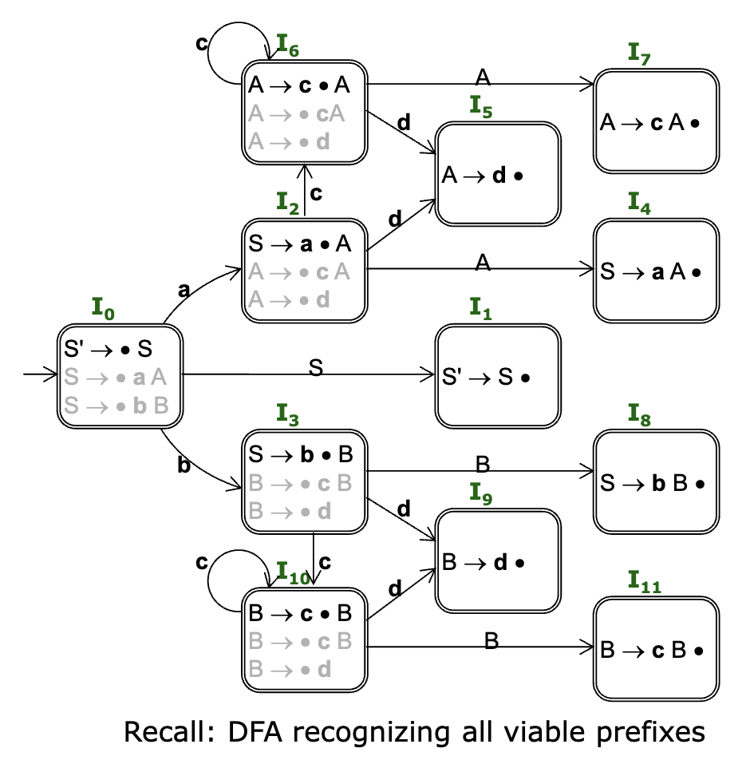

# LR(0)解析表 (Page 42/91)

| 状态 | ACTION | ACTION | ACTION | ACTION | ACTION | GOTO | GOTO | GOTO |
|------|--------|--------|--------|--------|--------|------|------|------|
| 状态 | a | b | c | d | $ | S | A | B |
| 0 | s2 | s3 | | | | 1 | | |
| 1 | | | | | acc | | | |
| 2 | | | s6 | s5 | | | 4 | |
| 3 | | | s10 | s9 | | | | 8 |
| 4 | r1 | r1 | r1 | r1 | r1 | | | |
| 5 | r4 | r4 | r4 | r4 | r4 | | | |
| 6 | | | s6 | s5 | | | 7 | |
| 7 | r3 | r3 | r3 | r3 | r3 | | | |
| 8 | r2 | r2 | r2 | r2 | r2 | | | |
| 9 | r6 | r6 | r6 | r6 | r6 | | | |
| 10 | | | s10 | s9 | | | | 11 |
| 11 | r5 | r5 | r5 | r5 | r5 | | | |

LR(0)使用0个超前查看来决定归约

# 基于解析表的决策 (Page 45/91)

| 步骤 | 符号 | 状态 | 输入 | 参考 | 动作 | 输出 |
|------|------|------|------|------|------|------|
| 1 | $ | 0 | accd$ | a[0,a]=s2 | 移进 | |
| 2 | $ a | 0 2 | ccd$ | a[2,c]=s6 | 移进 | |
| 3 | $ ac | 0 2 6 | cd$ | a[6,c]=s6 | 移进 | |
| 4 | $ acc | 0 2 6 6 | d$ | a[6,d]=s5 | 移进 | |
| 5 | $ accd | 0 2 6 6 5 | $ | a[5,$]=r4 g[6,A]=7 | 归约 | A → d |
| 6 | $ accA | 0 2 6 6 7 | $ | a[7,$]=r3 g[6,A]=7 | 归约 | A → cA |
| 7 | $ acA | 0 2 6 7 | $ | a[7,$]=r3 g[2,A]=4 | 归约 | A → cA |
| 8 | $ aA | 0 2 4 | $ | a[4,$]=r1 g[0,S]=1 | 归约 | S → aA |
| 9 | $ S | 0 1 | $ | a[1,$]=acc | 接受 | |

# 简单LR(SLR)解析表 (Page 46/91)

| 状态 | ACTION | ACTION | ACTION | ACTION | ACTION | GOTO | GOTO | GOTO |
|------|--------|--------|--------|--------|--------|------|------|------|
| 状态 | a | b | c | d | $ | S | A | B |
| 0 | s2 | s3 | | | | 1 | | |
| 1 | | | | | acc | | | |
| 2 | | | s6 | s5 | | | 4 | |
| 3 | | | s10 | s9 | | | | 8 |
| 4 | | | | | r1 | | | |
| 5 | | | | | r4 | | | |
| 6 | | | s6 | s5 | | | 7 | |
| 7 | | | | | r3 | | | |
| 8 | | | | | r2 | | | |
| 9 | | | | | r6 | | | |
| 10 | | | s10 | s9 | | | | 11 |
| 11 | | | | | r5 | | | |

SLR(1)简单使用1个超前查看来决定归约(超前查看必须在被归约符号的FOLLOW集合中)

# LR(0)和SLR(1)的区别 (Page 47/91)

**使用LR(0)解析表解析**
| 步骤 | 符号 | 状态 | 输入 | 参考 | 动作 | 输出 |
|------|------|------|------|------|------|------|
| 1 | $ | 0 | add$ | a[0,a]=s2 | 移进 | |
| 2 | $ a | 0 2 | dd$ | a[2,d]=s5 | 移进 | |
| 3 | $ ad | 0 2 5 | d$ | a[5,d]=r4, g[2,A]=4 | 归约 | A → d |
| 4 | $ aA | 0 2 4 | d$ | a[4,d]=r1, g[0,S]=1 | 归约 | S → aA |
| 5 | $ S | 0 1 | d$ | a[1,d]=空 | 错误 | |

**使用SLR(1)解析表解析**
| 步骤 | 符号 | 状态 | 输入 | 参考 | 动作 | 输出 |
|------|------|------|------|------|------|------|
| 1 | $ | 0 | add$ | a[0,a]=s2 | 移进 | |
| 2 | $ a | 0 2 | dd$ | a[2,d]=s5 | 移进 | |
| 3 | $ ad | 0 2 5 | d$ | a[5,d]=空 | 错误 | |

# 更复杂的示例 (Page 48/91)

- **考虑表达式的无歧义文法**
  $$
  \begin{align*}
  E &\to E + T \mid T \\
  T &\to T \ast F \mid F \\
  F &\to (E) \mid id
  \end{align*}
  $$
- **增广文法(编号)**
  $$
  \begin{align*}
  (0) &\quad E' \to E \\
  (1) &\quad E \to E + T \\
  (2) &\quad E \to T \\
  (3) &\quad T \to T \ast F \\
  (4) &\quad T \to F \\
  (5) &\quad F \to (E) \\
  (6) &\quad F \to id
  \end{align*}
  $$

# 识别所有可行前缀的DFA (Page 49/91)

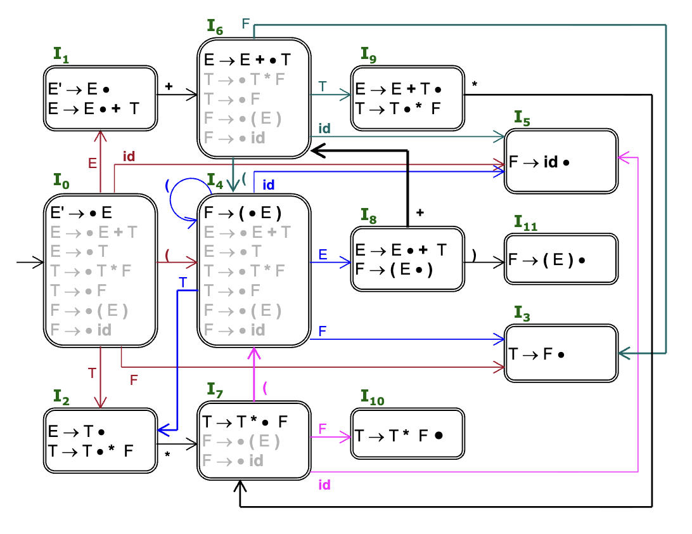

# FIRST()和FOLLOW()集合 (Page 50/91)

- **从前几讲很容易计算以下集合：**
  - FIRST(E) = {(, id}
  - FIRST(T) = {(, id}
  - FIRST(F) = {(, id}
  - FOLLOW(E) = {+, ), $}
  - FOLLOW(T) = {+, *, ), $}
  - FOLLOW(F) = {+, *, ), $}

# SLR(1)解析表 (Page 51/91)

| 状态 | ACTION | ACTION | ACTION | ACTION | ACTION | ACTION | GOTO | GOTO | GOTO |
|------|--------|--------|--------|--------|--------|--------|------|------|------|
| 状态 | id | + | * | ( | ) | $ | E | T | F |
| 0 | s5 | | | s4 | | | 1 | 2 | 3 |
| 1 | | s6 | | | | acc | | | |
| 2 | | r2 | s7 | | r2 | r2 | | | |
| 3 | | r4 | r4 | | r4 | r4 | | | |
| 4 | s5 | | | s4 | | | 8 | 2 | 3 |
| 5 | | r6 | r6 | | r6 | r6 | | | |
| 6 | s5 | | | s4 | | | | 9 | 3 |
| 7 | s5 | | | s4 | | | | | 10 |
| 8 | | s6 | | | s11 | | | | |
| 9 | | r1 | s7 | | r1 | r1 | | | |
| 10 | | r3 | r3 | | r3 | r3 | | | |
| 11 | | r5 | r5 | | r5 | r5 | | | |

# 这不是LR(0)文法！ (Page 52/91)

| 状态 | ACTION | ACTION | ACTION | ACTION | ACTION | ACTION | GOTO | GOTO | GOTO |
|------|--------|--------|--------|--------|--------|--------|------|------|------|
| 状态 | id | + | * | ( | ) | $ | E | T | F |
| 0 | s5 | | | s4 | | | 1 | 2 | 3 |
| 1 | | s6 | | | | acc | | | |
| 2 | r2 | r2 | s7/r2 | r2 | r2 | r2 | | | |
| 3 | r4 | r4 | r4 | r4 | r4 | r4 | | | |
| 4 | s5 | | | s4 | | | 8 | 2 | 3 |
| 5 | r6 | r6 | r6 | r6 | r6 | r6 | | | |
| 6 | s5 | | | s4 | | | | 9 | 3 |
| 7 | s5 | | | s4 | | | | | 10 |
| 8 | | s6 | | | s11 | | | | |
| 9 | r1 | r1 | s7/r1 | r1 | r1 | r1 | | | |
| 10 | r3 | r3 | r3 | r3 | r3 | r3 | | | |
| 11 | r5 | r5 | r5 | r5 | r5 | r5 | | | |

# 4. 更强大的LR解析 (Page 53/91)

1. 不是SLR(1)的文法
2. LR(1)解析表
3. LALR(1)解析表
4. LALR(1)解析中的冲突

# 无歧义但不是SLR(1)的文法 (Page 54/91)

- **考虑无歧义但不是SLR(1)的文法：**
  $$
  \begin{align*}
  S &\to L = R \mid R \\
  L &\to \ast R \mid id \\
  R &\to L
  \end{align*}
  $$

# 项目中的冲突 (Page 55/91)

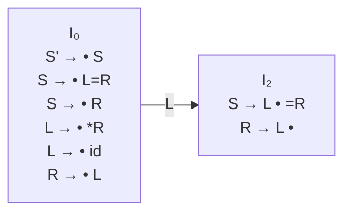

在输入符号'='上存在移进/归约冲突，因为'=' ∈ FOLLOW(R)

# LR(1)解析的动机 (Page 56/91)

- **如何利用超前查看？**
  - **LR(0)**：不使用超前查看
    - 所有列都填充相同的归约
  - **SLR(1)**：简单利用超前查看
    - 只填充FOLLOW集合中的列
    - 比LR(0)更准确，因此冲突更少
  - **更强大的LR解析 – LR(1)**
    - 只填充可以跟随可行前缀的列(符号)
    - 比SLR(1)更准确
  - **权衡 – LALR(1)**
    - 比LR(1)更高效但能力较弱
    - 比SLR(1)更强大

# 有效LR(1)项目的定义 (Page 57/91)

- **有效项目的定义**
  - 项目$[A \to \beta_1 \bullet \beta_2, a]$对可行前缀$\alpha\beta_1$有效，如果存在推导
    $$
    S' \Rightarrow^*_{rm} \alpha A \omega \Rightarrow_{rm} \alpha \beta_1 \beta_2 \omega
    $$
    其中$\omega$以$a$开头，或$\omega = \varepsilon \land a = \$$

# 关于有效LR(1)项目的定理1 (Page 58/91)

- **closure()的基础，用于构造DFA的状态**
  - 如果$[A \to \beta_1 \bullet B \beta_2, a]$对$\alpha\beta_1$是有效项目，且$B \to \gamma$是产生式
  - 那么$[B \to \bullet \gamma, b]$对$\alpha\beta_1$也是有效项目，其中$b \in FIRST(\beta_2a)$
  - **[证明]**
    - $S' \Rightarrow^*_{rm} \alpha A a \omega \Rightarrow_{rm} \alpha \beta_1 B \beta_2 a \omega$ (定义)
    - $\Rightarrow^*_{rm} \alpha \beta_1 B b \delta$ (假设$\beta_2 a \omega \Rightarrow^*_{rm} b \delta$)
    - $\Rightarrow_{rm} \alpha \beta_1 \gamma b \delta$ (我们有$B \to \gamma$)
    - $[B \to \bullet \gamma, b]$对$\alpha\beta_1$有效 (定义)

# 关于有效LR(1)项目的定理2 (Page 59/91)

- **goto()的基础，用于构造DFA的转移**
  - 如果$[A \to \beta_1 \bullet X \beta_2, a]$对$\alpha\beta_1$是有效项目
  - 那么$[A \to \beta_1 X \bullet \beta_2, a]$对$\alpha\beta_1X$是有效项目
  - **[证明]**
    - $S' \Rightarrow^*_{rm} \alpha A a \omega \Rightarrow_{rm} \alpha \beta_1 X \beta_2 a \omega$ (定义)
    - $[A \to \beta_1 X \bullet \beta_2, a]$对$\alpha\beta_1X$有效 (定义)

# 示例 (Page 60/91)

- **考虑以下文法**
  $$
  \begin{align*}
  (0) &\quad S' \to S \\
  (1) &\quad S \to CC \\
  (2) &\quad C \to cC \\
  (3) &\quad C \to d
  \end{align*}
  $$

# FIRST()和FOLLOW()集合 (Page 61/91)

- **很容易计算以下集合：**
  - FIRST(S) = FIRST(C) = {c, d}
  - FOLLOW(S) = {$}
  - FOLLOW(C) = {c, d, $}

# 识别所有可行前缀的DFA (Page 62/91)

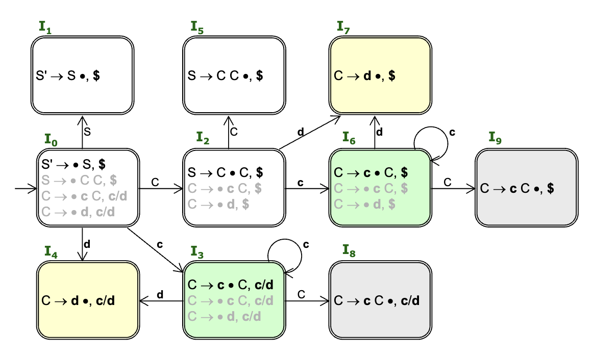

# LR(1)解析表 (Page 63/91)

| 状态 | ACTION | ACTION | ACTION | GOTO | GOTO |
|------|--------|--------|--------|------|------|
| 状态 | c | d | $ | S | C |
| 0 | s3 | s4 | | 1 | 2 |
| 1 | | | acc | | |
| 2 | s6 | s7 | | | 5 |
| 3 | s3 | s4 | | | 8 |
| 4 | r3 | r3 | | | |
| 5 | | | r1 | | |
| 6 | s6 | s7 | | | 9 |
| 7 | | | r3 | | |
| 8 | r2 | r2 | | | |
| 9 | | | r2 | | |

# LALR(1)解析表 (Page 64/91)

- **实践中使用的向前查看LR解析**
  - **状态数量，如C或Pascal**
    - LR(0) = SLR(1)：几百个
    - LR(1)：几千个(10倍)
  - **LALR(1)的策略：合并具有相同核心的状态**
    - 例如：I3和I6，I4和I7，I8和I9
    - 同一项目的超前查看被合并
    - GOTO()仅依赖于核心

# LALR(1) vs. LR(1) (Page 65/91)

- **合并永远不会产生新的移进-归约冲突**
  - 假设在合并状态中
    - $[A \to \alpha \bullet, a]$调用归约
    - $[B \to \beta \bullet a \gamma, b]$调用移进
  - 由于原始状态具有相同的核心，必须有一些状态具有
    - $[A \to \alpha \bullet, a]$调用归约
    - $[B \to \beta \bullet a \gamma, c]$调用移进(对于某些c)
  - 那么原始状态已经存在冲突

# LALR(1) vs. LR(1)(续) (Page 66/91)

- **但合并会产生新的归约-归约冲突**
  - **例如**
    $$
    \begin{align*}
    S' &\to S \\
    S &\to aAd \mid bBd \mid aBe \mid bAe \\
    A &\to c \\
    B &\to c
    \end{align*}
    $$
  - $\{[A \to c \bullet, d], [B \to c \bullet, e]\}$对可行前缀ac有效
  - $\{[A \to c \bullet, e], [B \to c \bullet, d]\}$对可行前缀bc有效
  - 但合并有冲突：$\{[A \to c \bullet, d/e], [B \to c \bullet, d/e]\}$

# LALR(1)中的新冲突示例 (Page 67/91)

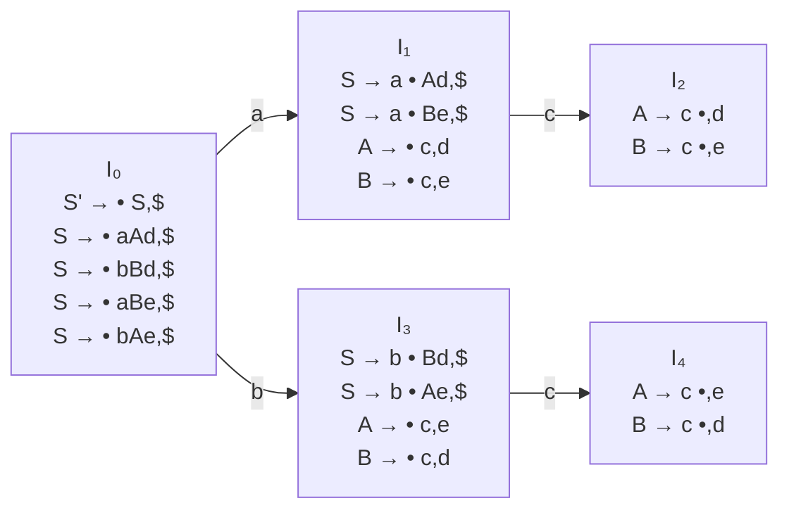

# 构造LALR(1)解析表的更高效算法 (Page 68/91)

- **请随意忽略它**
- **但你为什么要忽略它？**

# 5. LR解析中的歧义性 (Page 69/91)

- **LR解析中歧义性的权衡和后果**
  - **在文法级别解决歧义性**
    - 优点和缺点？
  - **在解析表级别解决歧义性**
    - 优点和缺点？
  - **在源代码级别解决歧义性**
    - 优点和缺点？

# 歧义表达式文法 (Page 70/91)

- **给定歧义文法**
  $$
  \begin{align*}
  (0) &\quad E' \to E \\
  (1) &\quad E \to E + E \\
  (2) &\quad E \to E \ast E \\
  (3) &\quad E \to (E) \\
  (4) &\quad E \to id
  \end{align*}
  $$

# 识别所有可行前缀的DFA (Page 71/91)

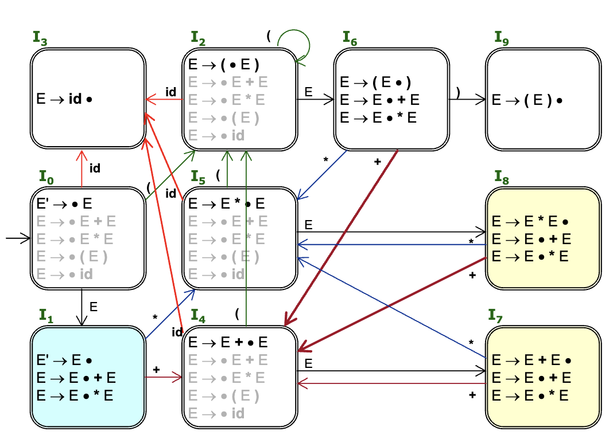

移进-规约冲突

# SLR(1)解析表 (Page 72/91)

| 状态 | ACTION | ACTION | ACTION | ACTION | ACTION | ACTION | GOTO |
|------|--------|--------|--------|--------|--------|--------|------|
| 状态 | id | + | * | ( | ) | $ | E |
| 0 | s3 | | | s2 | | | 1 |
| 1 | | s4 | s5 | | | acc | |
| 2 | s3 | | | s2 | | | 6 |
| 3 | | r4 | r4 | | r4 | r4 | |
| 4 | s3 | | | s2 | | | 7 |
| 5 | s3 | | | s2 | | | 8 |
| 6 | | s4 | s5 | | s9 | | |
| 7 | | r1/s4 | r1/s5 | | r1 | r1 | |
| 8 | | r2/s4 | r2/s5 | | r2 | r2 | |
| 9 | | r3 | r3 | | r3 | r3 | |

在解析表级别解决歧义性

# 悬挂else文法 (Page 73/91)

- **给定歧义文法**
  $$
  \begin{align*}
  (0) &\quad S' \to S \\
  (1) &\quad S \to iSeS \\
  (2) &\quad S \to iS \\
  (3) &\quad S \to a
  \end{align*}
  $$

# 识别所有可行前缀的DFA (Page 74/91)

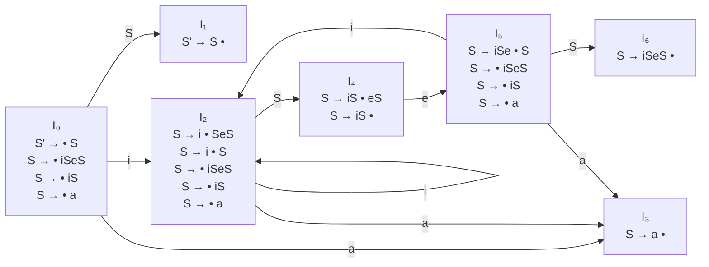

- **移进-归约冲突**

# SLR(1)解析表 (Page 75/91)

| 状态 | ACTION | ACTION | ACTION | ACTION | GOTO |
|------|--------|--------|--------|--------|------|
| 状态 | i | e | a | $ | S |
| 0 | s2 | | s3 | | 1 |
| 1 | | | | acc | |
| 2 | s2 | | s3 | | 4 |
| 3 | | r3 | | r3 | |
| 4 | | r2/s5 | | r2 | |
| 5 | s2 | | s3 | | 6 |
| 6 | | r1 | | r1 | |

在解析表级别解决歧义性

# 解析句子 (Page 76/91)

| 步骤 | 符号 | 状态 | 输入 | 参考 | 动作 | 输出 |
|------|------|------|------|------|------|------|
| 1 | $ | 0 | iiae a$ | a[0,i]=s2 | 移进 | |
| 2 | $ i | 0 2 | iae a$ | a[2,i]=s2 | 移进 | |
| 3 | $ ii | 0 2 2 | ae a$ | a[2,a]=s3 | 移进 | |
| 4 | $ iia | 0 2 2 3 | e a$ | a[3,e]=r3 g[2,S]=4 | 归约 | S → a |
| 5 | $ iiS | 0 2 2 4 | e a$ | **a[4,e]=s5** | 移进 | |
| 6 | $ iiSe | 0 2 2 4 5 | a$ | a[5,a]=s3 | 移进 | |
| 7 | $ iiSea | 0 2 2 4 5 3 | $ | a[3,$]=r3 g[5,S]=6 | 归约 | S → a |
| 8 | $ iiSeS | 0 2 2 4 5 6 | $ | a[6,$]=r1 g[2,S]=4 | 归约 | S → iSeS |
| 9 | $ iS | 0 2 4 | $ | a[4,$]=r2 g[0,S]=1 | 归约 | S → iS |
| 10 | $ S | 0 1 | $ | a[1,$]=acc | 接受 | |

# 6. LR解析中的错误恢复 (Page 77/91)

- **对于输入句子中的错误**
  - 所有LR解析器都会发现所有错误
    - 如果我们能够构建无冲突的解析表
  - 报告错误前进行更多归约
    - LR(0) ≥ SLR(1) ≥ LALR(1) ≥ LR(1)
    - 但它们都不会将错误的输入符号移进栈

# 错误恢复技术回顾 (Page 78/91)

- **恐慌模式错误恢复**
  - 跳过输入直到找到同步标记
- **短语级错误恢复**
  - 为每个空条目分配特定的错误例程
- **错误产生式**
  - 适合常见错误但不适合所有错误
- **全局修正**
  - 全局分析输入以查找错误
  - 昂贵且不实用

# 恐慌模式错误恢复 (Page 79/91)

- **弹出直到找到状态s，该状态对特定非终结符A有GOTO()**
  - 通常A表示主要构造，如stmt、expr或block
  - 它表示构造A有错误
- **压入GOTO(s, A)**
- **丢弃0个或多个超前查看，直到找到可以跟随A的符号**
- 从DFA的角度看更容易理解

# 短语级错误恢复 (Page 80/91)

- **检查每个空条目，并为其分配指向特定错误处理例程的指针**
- **特定于应用：取决于语言的使用**

# 之前的DFA识别所有可行前缀 (Page 81/91)

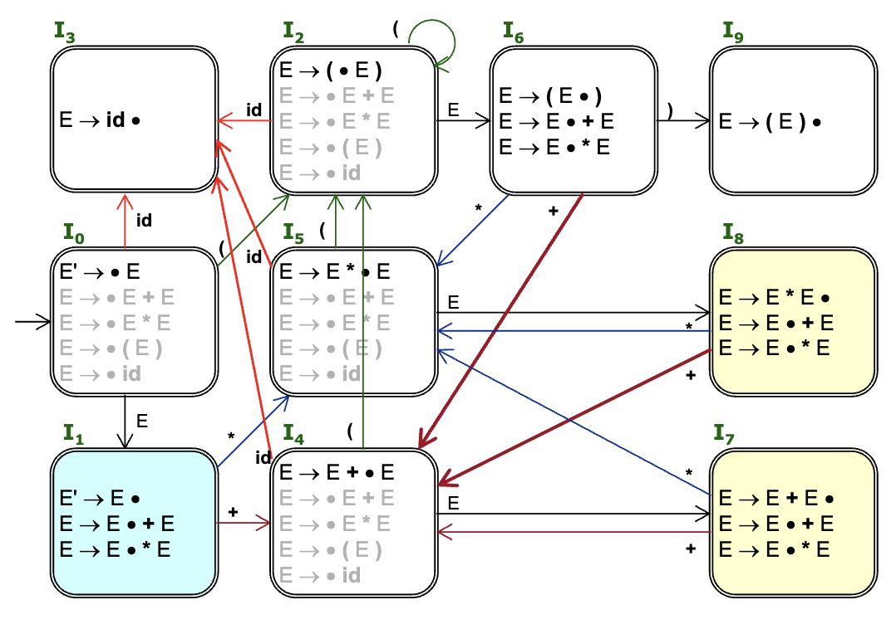

# 之前的解析表 (Page 82/91)

| 状态 | ACTION | ACTION | ACTION | ACTION | ACTION | ACTION | GOTO |
|------|--------|--------|--------|--------|--------|--------|------|
| 状态 | id | + | * | ( | ) | $ | E |
| 0 | s3 | e1 | e1 | s2 | e2 | e1 | 1 |
| 1 | e3 | s4 | s5 | e3 | e2 | acc | |
| 2 | s3 | e1 | e1 | s2 | e2 | e1 | 6 |
| 3 | r4 | r4 | r4 | r4 | r4 | r4 | |
| 4 | s3 | e1 | e1 | s2 | e2 | e1 | 7 |
| 5 | s3 | e1 | e1 | s2 | e2 | e1 | 8 |
| 6 | e3 | s4 | s5 | e3 | s9 | e4 | |
| 7 | r1 | r1 | s5 | r1 | r1 | r1 | |
| 8 | r2 | r2 | r2 | r2 | r2 | r2 | |
| 9 | r3 | r3 | r3 | r3 | r3 | r3 | |

推迟错误检测直到进行一次或多次归约

# 错误处理例程 (Page 83/91)

- **e1**：期望操作数('id'或'(')
  - 压入状态3；// 添加符号'id'
- **e2**：不平衡的右括号
  - 丢弃一个超前查看；// 移除')'
- **e3**：期望运算符
  - 压入状态4；// 添加符号'+'
- **e4**：期望右括号
  - 压入状态9；// 添加符号')'

# 解析错误输入 (Page 84/91)

| 步骤 | 符号 | 状态 | 输入 | 参考 | 动作 | 输出 |
|------|------|------|------|------|------|------|
| 1 | $ | 0 | id+)$ | a[0,id]=s3 | 移进 | |
| 2 | $ id | 0 3 | +)$ | a[3,+]=r4 g[0,E]=1 | 归约 | E → id |
| 3 | $ E | 0 1 | +)$ | a[1,+]=s4 | 移进 | |
| 4 | $ E+ | 0 1 4 | )$ | a[4,)]=e2 | 丢弃 | 不平衡的')' |
| 5 | $ E+ | 0 1 4 | $ | a[4,$]=e1 | 压入3 | 期望操作数 |
| 6 | $ E+id | 0 1 4 3 | $ | a[3,$]=r4 g[4,E]=7 | 归约 | E → id |
| 7 | $ E+E | 0 1 4 7 | $ | a[7,$]=r1 g[0,E]=1 | 归约 | E → E+E |
| 8 | $ E | 0 1 | $ | a[1,$]=acc | 结束 | |

# 结论：上下文无关文法分类 (Page 85/91)

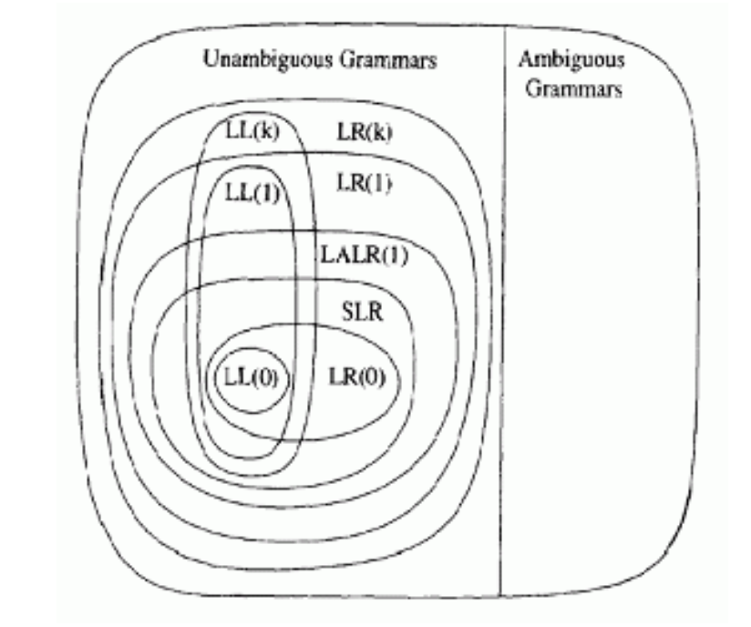

# 练习7.1 (Page 86/91)

- **考虑文法**
  $$
  \begin{align*}
  S &\to (SR \mid a \\
  R &\to ,SR \mid )
  \end{align*}
  $$
  - 尝试为该文法构造SLR(1)解析表，并查看解析表中是否存在冲突

# 练习7.2 (Page 87/91)

- **考虑文法**
  $$
  \begin{align*}
  S &\to Sab \mid aR \\
  R &\to S \mid a
  \end{align*}
  $$
  - 该文法是SLR(1)文法吗？为什么？

# 练习7.3 (Page 88/91)

- **考虑文法**
  $$
  \begin{align*}
  S &\to A \\
  A &\to BA \mid \varepsilon \\
  B &\to aB \mid b
  \end{align*}
  $$
  - 证明该文法是LR(1)文法
  - 为该文法构造LR(1)解析表
  - 按照本讲义的风格，展示句子abab的详细解析过程

# 练习7.4* (Page 89/91)

- **(DBv2, pp.278, ex.4.7.4) 证明文法**
  $$
  \begin{align*}
  S &\to Aa \mid bAc \mid dc \mid bda \\
  A &\to d
  \end{align*}
  $$
  - 是LALR(1)但不是SLR(1)

