# 讲座8. 语法导向翻译 (Page 2/63)

1. 引言
2. 语法导向定义：示例
3. 求值顺序和依赖图
4. S-属性定义
5. L-属性定义和翻译方案
6. 预测解析中的L-属性定义
7. LR解析中的L-属性定义

---

# 1. 引言 (Page 3/63)

- **什么是语法导向翻译？**
  - 例如：指称语义
- **每个组件都有其指称。**
- **复合组件的指称仅依赖于其子组件的指称。**
- **为什么是语法导向的？**

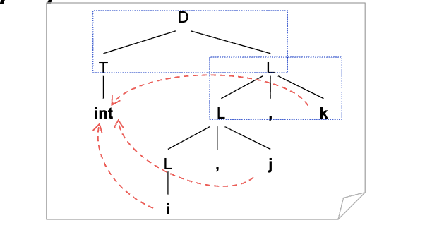

---

# 语法导向翻译的应用 (Page 4/63)

- **涵盖两个编译阶段**
  - 语义分析
  - 中间代码生成
- **我们的学习步骤**
  1. 语法导向翻译的一般概念和框架
  2. 将这些概念和框架应用于语义分析和中间代码生成

---

# 基本思想 (Page 5/63)

- **将语法符号与属性关联**
  - 基于特定应用。
  - 要操作的数据。
- **将产生式与语义规则关联**
  - 也称为语义动作。
  - 操作属性的操作。

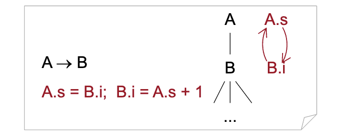

---

# 更多见解：虚拟机 (Page 6/63)

- **语法导向翻译可以解释为虚拟机**
  - 做什么：语义动作。
  - 怎么做：求值顺序，即执行动作的顺序。


---

# 挑战 (Page 7/63)

- **语义动作执行顺序决策的效率**
  - 最好的方式是在解析时执行语义动作。
  - 即动作的求值顺序与解析输出的顺序相同。
  - 权衡：能力与效率

---

# 概念 (Page 8/63)

- **语法导向定义**
  - 翻译方案
- **带注释的解析树**
  - 带动作的带注释解析树
- **综合属性**
- **继承属性**

---

# 语法导向定义 (Page 9/63)

| 序号 | 产生式 | 语义规则 |
|------|--------|----------|
| 1 | L → E n | L.val= E.val print(L.val) 副作用 |
| 2 | E → E₁+ T | E.val= E₁.val+ T.val |
| 3 | E → T | E.val= T.val |
| 4 | T₁ → T₂* F 不同下标风格 | T₁.val= T₂.val* F.val |
| 5 | T → F | T.val= F.val |
| 6 | F →( E) | F.val= E.val |
| 7 | F → digit | F.val= digit.lexval |


---

# 带注释的解析树 (Page 10/63)

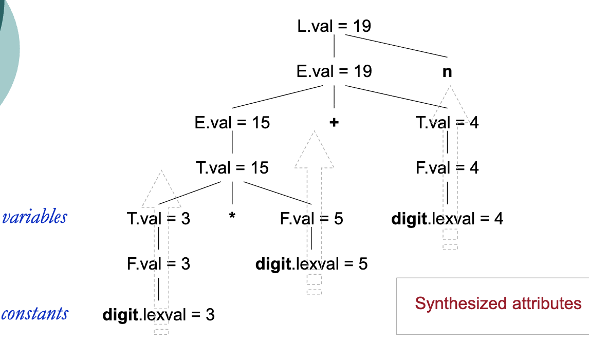

---

# 继承属性 (Page 11/63)

| 序号 | 产生式 | 语义规则 |
|------|--------|----------|
| 1 | D → T L | L.inh= T.type |
| 2 | T → int | T.type= INTEGER |
| 3 | T → real | T.type= REAL |
| 4 | L → L₁, id | L₁.inh= L.inh addType(id.entry, L.inh) |
| 5 | L → id | addType(id.entry, L.inh) |

---

# 带注释的解析树 (Page 12/63)

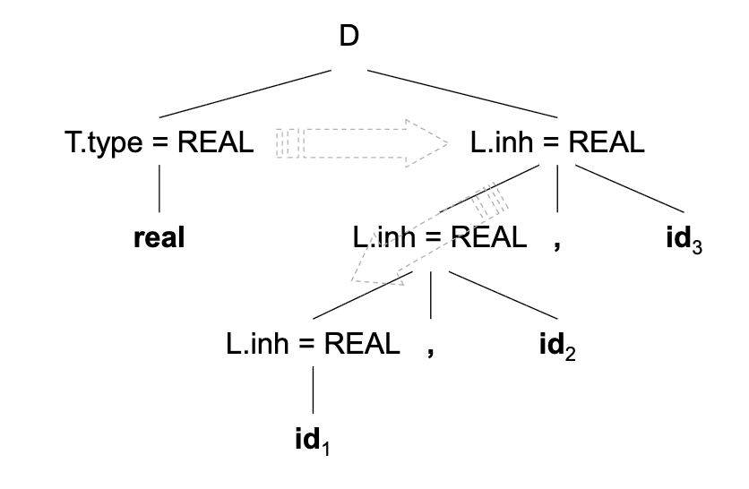

---

# 2. 语法导向定义：示例 (Page 13/63)

- **语法树的构造**
- **DAG的构造**
- **数组的类型结构**

---

# 语法树 (Page 14/63)

| 序号 | 产生式 | 语义规则 |
|------|--------|----------|
| 1 | E → E₁+ T | E.node= new Node('+', E₁.node, T.node) |
| 2 | E → E₁ – T | E.node= new Node('–', E₁.node, T.node) |
| 3 | E → T | E.node= T.node |
| 4 | T →( E) | T.node= E.node |
| 5 | T → id | T.node= new Leaf(id, id.entry) |
| 6 | T → num | T.node= new Leaf(num, num.val) |

---

# 语法树（续） (Page 15/63)

- **a – 4+ c的语法树**

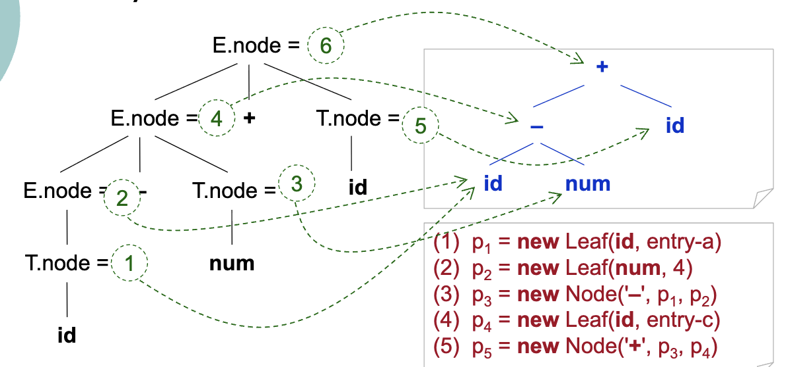

(1) p1= new Leaf(id, entry-a)  
(2) p2= new Leaf(num, 4)  
(3) p3= new Node('–', p1, p2)  
(4) p4= new Leaf(id, entry-c)  
(5) p5= new Node('+', p3, p4)

---

# DAG (Page 16/63)

- **DAG：有向无环图**
  - a+ a*(b – c)+(b – c)* d

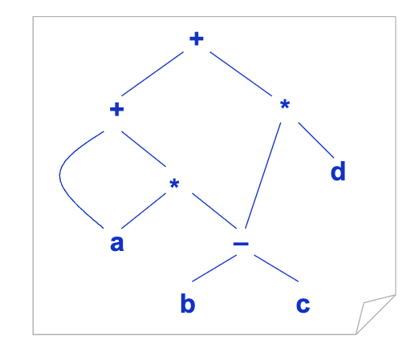

```
(1) p1= new Leaf(id, entry-a)  
(2) p2= new Leaf(id, entry-a)  
(3) p3= new Leaf(id, entry-b)  
(4) p4= new Leaf(id, entry-c)  
(5) p5= new Node('–', p3, p4)  
(6) p6= new Node('*', p2, p5)  
(7) p7= new Node('+', p1, p6)  
(8) p8= new Leaf(id, entry-b)  
(9) p9= new Leaf(id, entry-c)  
(10) p10= new Node('–', p8, p9)  
(11) p11= new Leaf(id, entry-d)  
(12) p12= new Node('*', p10, p11)  
(13) p13= new Node('+', p7, p12)
```

---

# 类型结构 (Page 17/63)

| 序号 | 产生式 | 语义规则 |
|------|--------|----------|
| 1 | T → B C | T.type= C.type C.base= B.type |
| 2 | B → int | B.type= int |
| 3 | B → float | B.type= float |
| 4 | C →[ num] C₁ | C.type= array(num.val, C₁.type) C₁.base= C.base |
| 5 | C → ε | C.type= C.base |

---

# 类型结构（续） (Page 18/63)

- **int[2][3]的类型结构**

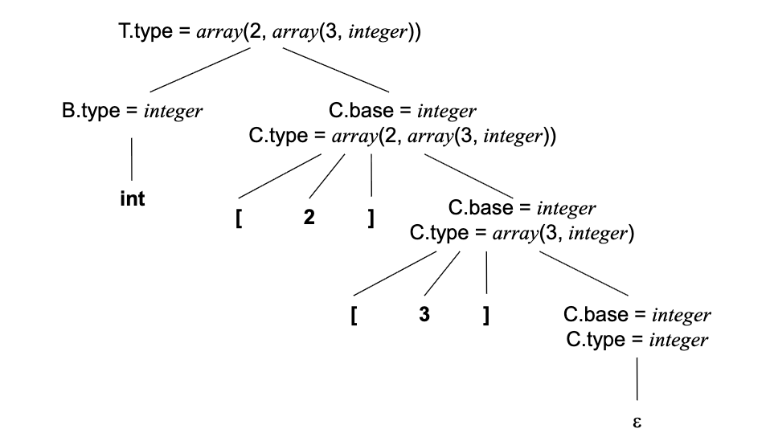

---

# 3. 求值顺序和依赖图 (Page 19/63)

- **工作步骤的一般框架：**
  - 为语法符号引入属性。
  - 为每个产生式定义语义规则。
  - 基于解析树绘制依赖图。
  - 通过依赖图的拓扑排序确定求值顺序。
  - 根据求值顺序执行语义规则。

> 使用显式解析树

---

# 优缺点 (Page 20/63)

- **优点**
  - 通用且强大的方法。
  - 可用于演示语法导向定义求值顺序的原理。
- **缺点**
  - 显式解析树。
  - 效率低且不实用。

---

# 之前的语法导向定义 (Page 21/63)

| 序号 | 产生式 | 语义规则 |
|------|--------|----------|
| 1 | D → T L | L.inh= T.type |
| 2 | T → int | T.type= INTEGER |
| 3 | T → real | T.type= REAL |
| 4 | L → L₁, id | L₁.inh= L.inh addType(id.entry, L.inh) |
| 5 | L → id | addType(id.entry, L.inh) |

---

# 依赖图：示例 (Page 22/63)

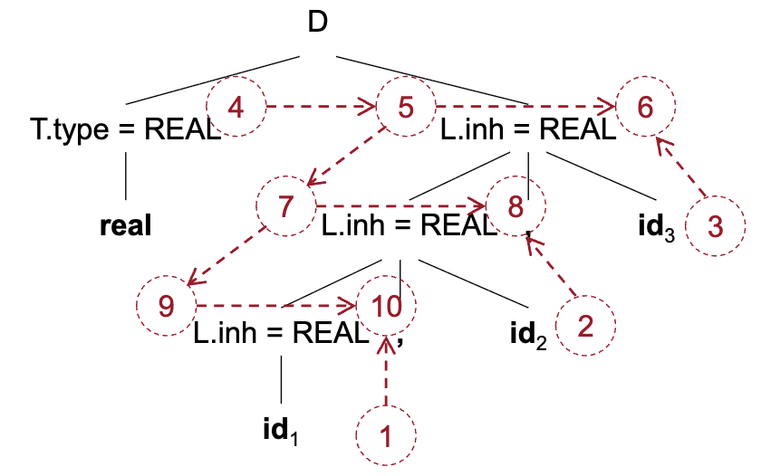

- 6, 8, 10 是虚拟属性  
- addType(id.entry, L.inh)

---

# 求值顺序 (Page 23/63)

- **拓扑排序**
  - 规范：依赖图
  - 实现：求值顺序
- **将规范映射到实现**
  - 1:1 -- 图中无任何环
  - 1:n -- 图中无任何环
  - 1:0 -- 图中有环

---

# 隐式解析树 (Page 24/63)

- **S-属性定义**
  - 每个属性都是综合的。
  - 保证与LR解析输出顺序相同的求值顺序。
- **L-属性定义**
  - 每个属性都是综合的，或仅从父节点或左兄弟继承（不从右兄弟继承）。
  - 保证与递归下降预测解析顺序相同的求值顺序。

---

# 4. S-属性定义 (Page 25/63)

- **仅包含综合属性的语法导向定义**
- **S-属性定义的求值顺序**
  - 向上，且仅向上
  - 与LR解析顺序相同！

---

# 规范与实现 (Page 26/63)

- **在LR解析时求值S-属性定义**

```
S-属性定义(规范)
⬆
在LR解析时求值(实现)
```

---

# 之前的计算器示例 (Page 27/63)

| 序号 | 产生式 | 语义规则 |
|------|--------|----------|
| 1 | L → E n | L.val= E.val print(L.val) |
| 2 | E → E₁+ T | E.val= E₁.val+ T.val |
| 3 | E → T | E.val= T.val |
| 4 | T₁ → T₂* F | T₁.val= T₂.val* F.val |
| 5 | T → F | T.val= F.val |
| 6 | F →( E) | F.val= E.val |
| 7 | F → digit | F.val= digit.lexval |

将语法符号的属性与解析栈中的位置关联。

---

# 在LR解析中的实现 (Page 28/63)

| 序号 | 产生式 | 代码 | 说明 |
|------|--------|------|------|
| 1 | L → E n | stack[ntop].val= stack[top – 1].val; print(stack[ntop].val); | |
| 2 | E → E₁+ T | stack[ntop].val= stack[top – 2].val+ stack[top].val; | stack[top – 1].val='+' |
| 3 | E → T | | |
| 4 | T₁ → T₂* F | stack[ntop].val= stack[top – 2].val* stack[top].val; | stack[top – 1].val='*' |
| 5 | T → F | | |
| 6 | F →( E) | stack[ntop].val= stack[top – 1].val; | stack[top].val=')' stack[top – 2].val='(' |
| 7 | F → digit | | |

设置一个与解析（状态）栈高度相同的属性栈：  
ntop= top – | 右侧 | + 1

**在LR解析时求值**

| 步骤 | 状态（示例） | 属性 | 输入 | 代码 | 输出 |
|------|-------------|------|------|------|------|
| 1 | $ | $ | 3* 5+ 4 n$ | | |
| 2 | $ 3 | $ 3 | * 5+ 4 n$ | -- | F → digit |
| 3 | $ F | $ 3 | * 5+ 4 n$ | -- | T → F |
| 4 | $ T | $ 3 | * 5+ 4 n$ | | |
| 5 | $ T* | $ 3* | 5+ 4 n$ | | |
| 6 | $ T* 5 | $ 3* 5 | + 4 n$ | -- | F → digit |
| 7 | $ T* F | $ 3* 5 | + 4 n$ | 3* 5 | T → T* F |
| 8 | $ T | $ 15 | + 4 n$ | -- | E → T |
| 9 | $ E | $ 15 | + 4 n$ | | |
| 10 | $ E+ | $ 15+ | 4 n$ | | |
| 11 | $ E+ 4 | $ 15+ 4 | n$ | -- | F → digit |
| 12 | $ E+ F | $ 15+ 4 | n$ | -- | T → F |
| 13 | $ E+ T | $ 15+ 4 | n$ | 15+ 4 | E → E+ T |
| 14 | $ E | $ 19 | n$ | | |
| 15 | $ E n | $ 19 n | $ | print(19) | L → E n |
| 16 | $ L | $ 19 | $ | accept | |

---

# 5. L-属性定义和翻译方案 (Page 30/63)

- **如果每个继承属性仅依赖于其左兄弟的属性或其父节点的继承属性，则语法导向定义是L-属性的。**
  - 支持综合属性。
  - 不能依赖于其父节点的任何综合属性！（为什么？）

---

# 深度优先求值顺序 (Page 31/63)

- **L-属性定义的求值顺序**
  - 与解析树的深度优先访问顺序相同。
  - 也与自顶向下解析顺序相同。

```c
void dfvisit(n: Node){
    for(each child m of n, from left to right){
        evaluate inherited attributes of m;
        dfvisit(m)
    }
    evaluate synthesized attributes of n
}
```

---

# 翻译方案 (Page 32/63)

- **翻译方案与L-属性定义**
  - 翻译方案中的显式求值顺序。
  - 以从左到右深度优先的顺序执行语义动作。

```
L-属性定义(规范)
⬆
翻译方案(实现)
```

---

# 翻译方案：示例1 (Page 33/63)

- **L-属性定义的后缀翻译方案：**

```
L → E n     { print(E.val);}
E → E₁+ T   { E.val= E₁.val+ T.val;}
E → T       { E.val= T.val;}
T → T₁* F   { T.val= T₁.val* F.val;}
T → F       { T.val= F.val;}
F →( E)     { F.val= E.val;}
F → digit   { F.val= digit.lexval;}
```

---

# 翻译方案：示例2 (Page 34/63)

- **用于LR解析的翻译方案：**

```
L → E n   { print(stack[top – 1].val); top= top – 1;}
E → E₁+ T { stack[top – 2].val= stack[top – 2].val+ stack[top].val; top= top – 2;}
E → T
T → T₁* F { stack[top – 2].val= stack[top – 2].val* stack[top].val; top= top – 2;}
T → F
F →( E)   { stack[top – 2].val= stack[top – 1].val; top= top – 2;}
F → digit
```

---

# 翻译方案：示例3 (Page 35/63)

- **从中缀表达式到后缀表达式转换的翻译方案：**
  - 产生式内的动作。

```
E → T R
R → addop T { print(addop.lexeme);}
    R₁
R → ε
T → num     { print(num.val);}
```

---

# 翻译方案：示例3（续） (Page 36/63)

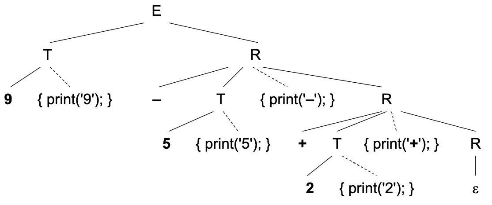

带动作的解析树

---

# 翻译方案：示例4 (Page 37/63)

- **前缀表达式的问题翻译方案：**
  - 在自顶向下和自底向上解析中都有问题。

```
L → E n
E →         { print('+');} 
    E₁+ T
E → T
T →         { print('*');} 
    T₁* F
T → F
F → ( E)
F → digit   { print(digit.lexval);}
```

---

# 翻译方案：示例4（续） (Page 38/63)

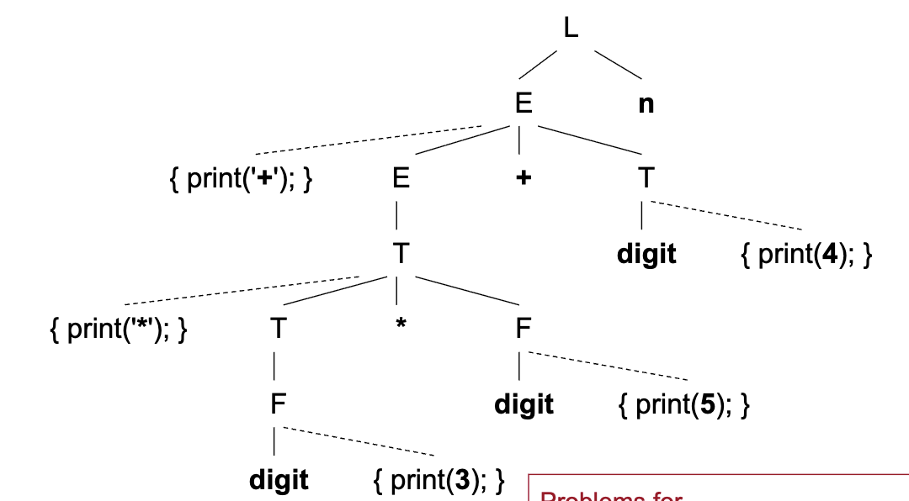

自顶向下解析的问题：左递归  
自底向上解析的问题：嵌入动作

---

# 从L-属性定义到翻译方案 (Page 39/63)

- **三个转换规则**
  1. A的继承属性必须在A之前计算。
  2. 动作不能引用该动作右侧符号的综合属性。
  3. 综合属性必须在其引用的所有属性计算完成后计算。

不满足要求：  
```
S → A₁ A₂ { A₁.in= 1; A₂.in= 2;}  
A → a     { print(A.in);}
```
---

# 排版框：EQN和TEX (Page 40/63)

| 序号 | 产生式 | 语义动作 |
|------|--------|----------|
| 1 | S → B | B.ps= 10 |
| 2 | B → B₁ B₂ | B₁.ps= B.ps B₂.ps= B.ps B.ht= max(B₁.ht, B₂.ht) B.dp= max(B₁.dp, B₂.dp) |
| 3 | B → B₁ sub B₂ 高优先级，右结合性 | B₁.ps= B.ps B₂.ps= B.ps × 70% B.ht= max(B₁.ht, B₂.ht – B.ps × 25%) B.dp= max(B₁.dp, B₂.dp+ B.ps × 25%) |
| 4 | B →( B₁) | B₁.ps= B.ps B.ht= B₁.ht B.dp= B₁.dp |
| 5 | B → text | B.ht= getHight(B.ps, text.lexval) B.dp= getDepth(B.ps, text.lexval) |
- ps= 点大小
- ht= 高度 
- dp= 深度

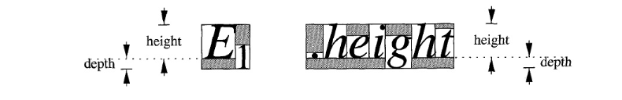

---

# 从L-属性定义到翻译方案 (Page 41/63)

```
S →         { B.ps= 10;}  
    B
B →         { B₁.ps= B.ps;}
    B₁      { B₂.ps= B.ps;}
    B₂      { B.ht= max(B₁.ht, B₂.ht); 
              B.dp= max(B₁.dp, B₂.dp);}
B →         { B₁.ps= B.ps;}
    B₁ sub  { B₂.ps= B.ps × 70%;}
    B₂      { B.ht= max(B₁.ht, B₂.ht – B.ps × 25%); 
              B.dp= max(B₁.dp, B₂.dp+ B.ps × 25%);}
B → (       { B₁.ps= B.ps;}
    B₁)     { B.ht= B₁.ht; B.dp= B₁.dp;}
B → text    { B.ht= getHight(B.ps, text.lexval); 
              B.dp= getDepth(B.ps, text.lexval);}
```

---

# 6. 预测解析中的L-属性定义 (Page 42/63)

- **开发步骤**
  - 为语法规则编写可能的LL(1)文法(可能有左递归)。
  - 通过附加语义规则定义L-属性定义。
  - 将L-属性定义转换为翻译方案。
  - 消除翻译方案中的左递归。
  - 编写递归下降预测解析器（翻译器）。

---

# 消除左递归：简单示例 (Page 43/63)

- **激励示例：简单情况**
  - 技巧：如果动作不计算任何属性，则将动作视为终结符。

```
E → E₁+ T{ print('+');}
E → T
```

转换为：

```
E → T R
R → + T{ print('+');} R
R → ε
```

---

# 消除左递归：更多示例 (Page 44/63)

- **更复杂的情况**

```
E → E₁+ T   { E.val= E₁.val+ T.val;}
E → E₁ – T  { E.val= E₁.val – T.val;}
E → T       { E.val= T.val;}
T → ( E)    { T.val= E.val;}
T → num     { T.val= num.val;}
```

转换为：

```
E → T     { R.i= T.val;} 
    R     { E.val= R.s;}
R → + T   { R₁.i= R.i+ T.val;} 
    R₁    { R.s= R₁.s;}
R → – T   { R₁.i= R.i – T.val;} 
    R₁    { R.s= R₁.s;}
R → ε     { R.s= R.i;}
T → ( E)  { T.val= E.val;}
T → num   { T.val= num.val;}
```

---

# 消除左递归：更多示例（续） (Page 45/63)

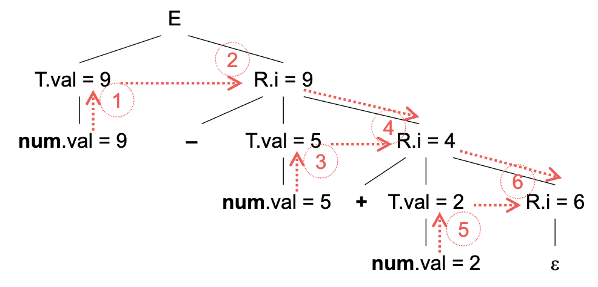

输入表达式 9 – 5+ 2 的求值顺序

---

# 消除左递归 (Page 46/63)

- **一般规则**
  - 仅适用于S-属性定义（后缀翻译方案）。

---

# 消除左递归（续） (Page 47/63)

```
A → A₁Y  { A.a= g(A₁.a, Y.y);}
A → X     { A.a= f(X.x);}
```

转换为：
```
A → X   { R.i= f(X.x);} R{ A.a= R.s;}
R → Y   { R₁.i= g(R.i, Y.y);} R₁{ R.s= R₁.s;}
R → ε   { R.s= R.i;}
```

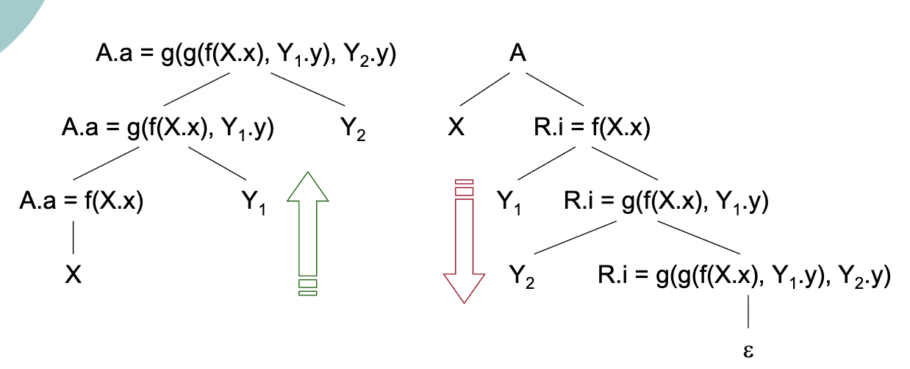

---

# 编写预测解析器 (Page 48/63)

- **回顾：编写递归下降预测解析器（仅用于解析）**
  - 每个语法符号对应一个（递归）子程序。
  - 起始符号对应主入口子程序。
  - 在每个子程序中，根据前瞻符号进行分支操作。

---

# 编写预测解析器：示例 (Page 49/63)

- **仅用于解析**

```
R → addop T { R₁.i= mknode(addop.lexeme, R.i, T.nptr);}
    R₁      { R.s= R₁.s;}
R → ε       { R.s= R.i;}
```

```java
void R(){
    if(lookahead== addop){
        match(addop);
        T();
        R()
    } else{
        // 什么都不做
    }
}
```

---

# 编写预测翻译器 (Page 50/63)

- **编写带语义动作的翻译器**
  - 每个继承属性对应一个形式参数。
  - 所有综合属性对应返回值
    - **多个综合属性可以合并到单个记录中。**
  - 每个子节点的属性对应一个局部变量。
  - 处理产生式的右侧
    - 终结符：match()
    - 非终结符：过程调用
    - 动作：直接执行（复制）

---

# 从解析器到翻译器 (Page 51/63)

```
R → addop T   { R₁.i= mknode(addop.lexeme, R.i, T.nptr);}
    R₁        { R.s= R₁.s;}
R → ε         { R.s= R.i;}
```
```java
SyntaxTreeNode R(SyntaxTreeNode i){
    SyntaxTreeNode s; // 综合属性
    SyntaxTreeNode t_nptr, r1_i, r1_s; // 用于子节点
    char addopLexeme; // 临时变量
    if(lookahead== addop){
        addopLexeme= lookahead.lexval;
        match(addop);
        t_nptr= T();
        r1_i= mknode(addopLexeme, i, t_nptr);
        r1_s= R(r1_i);
        s= r1_s;
    } else{
        s= i;
    }
    return s;
}
```

---

# 7. LR解析中的L-属性定义 (Page 52/63)

- **S-属性定义很容易通过LR解析求值。**
  - 参见本幻灯片第4节。
- **在LR解析中求值L-属性定义的挑战是什么？**
  - 并非所有动作都在产生式体的最右侧（后缀翻译方案）。
  - 继承属性未存储在解析栈中。

---

# 利用技巧 (Page 53/63)

- **使用标记将所有嵌入动作移动到产生式体的最右侧。**
- **在解析栈中追踪继承属性。**
  - 最简单的情况：定位通过复制规则计算的继承属性。
  - 引入标记以帮助在栈中定位继承属性。
  - 还使用新标记来定位不是通过复制规则计算的继承属性。

---

# 将嵌入动作移动到最右侧 (Page 54/63)

- **标记是充当占位符的ε-产生式。**

原始：
```
E →  T R
R →  + T { print('+');} R 
  |  – T{ print('–');} R 
  |  ε
T →  num{ print(num.val);}
```

转换后：
```
E → T R
R → + T M R 
  | – T N R 
  | ε
T → num   { print(num.val);}
M → ε     { print('+');}
N → ε     { print('–');}
```

---

# 追踪复制的继承属性 (Page 55/63)

- **继承属性的计算是嵌入动作的最大来源。**

```
D → T       { L.inh= T.type;} 
    L
T → int     { T.type= INTEGER;}
T → real    { T.type= REAL;}
L →         { L₁.inh= L.inh;}
    L₁, id  { addType(id.entry, L.inh);}
L → id      { addType(id.entry, L.inh);}
```

---

# 追踪重写的继承属性（续） (Page 56/63)

```
D → T       { L.inh= T.type;} 
    L
T → int     { T.type= INTEGER;}
T → real    { T.type= REAL;}
L →         { L₁.inh= L.inh;}
    L₁, id  { addType(id.entry, L.inh);}
L → id      { addType(id.entry, L.inh);}
```

| 产生式 | 代码 |
|--------|------|
| D → T L | |
| T → int | stack[ntop].val= INTEGER; |
| T → real | stack[ntop].val= REAL; |
| L → L₁, id | addType(stack[top].val, stack[top – 3].val); |
| L → id | addType(stack[top].val, stack[top – 1].val); |

---

# 预测继承属性的位置 (Page 57/63)

- **引入新标记**

原始：
```
S → a A   { C.i= A.s;} 
    C
S → b A B { C.i= A.s;} 
    C
C → c     { C.s= g(C.i);}
```
转换后：
```
S → a A     { C.i= A.s;} 
    C
S → b A B   { M.i= A.s;} 
    M       { C.i= M.s;} 
    C
C → c       { C.s= g(C.i);}
M → ε       { M.s= M.i;}
```

---

# 存储计算的继承属性 (Page 58/63)

- **也使用新标记**

原始：
```
S → a A   { C.i= f(A.s);} 
    C
C → c     { C.s= g(C.i);}
```

转换后：
```
S → a A { M.i= A.s;} 
    M   { C.i= M.s;} 
    C
C → c   { C.s= g(C.i);}
M → ε   { M.s= f(M.i);}
```

---

# 实际示例 (Page 59/63)

| 产生式 | 语义动作 |
|--------|----------|
| S → K B | B.ps= K.s 任何时候当B被规约时B.ps立即在下方 |
| K → ε | K.s= 10  |
| B → B₁ L B₂ | B₁.ps= B.ps L.i= B.ps B₂.ps= L.s B.ht= max(B₁.ht, B₂.ht) B.dp= max(B₁.dp, B₂.dp) |
| L → ε | L.s= L.i |
| B → B₁ sub M B₂ | B₁.ps= B.ps M.i= B.ps B₂.ps= M.s B.ht= max(B₁.ht, B₂.ht – B.ps × 25%) B.dp= max(B₁.dp, B₂.dp+ B.ps × 25%) |
| M → ε | M.s= M.i × 70% |
| B →( N B₁) | B₁.ps= B.ps N.i= B.ps B.ht= B₁.ht B.dp= B₁.dp |
| N → ε | N.s= N.i |
| B → text | B.ht= getHight(B.ps, text.lexval) B.dp= getDepth(B.ps, text.lexval) |

---

# 实际示例（续） (Page 60/63)

| 产生式 | 代码 |
|--------|------|
| S → K B | |
| K → ε | stack[ntop].ps= 10; ps被视为综合属性 |
| B → B₁ L B₂ | stack[ntop].ht= max(stack[top – 2].ht, stack[top].ht); stack[ntop].dp= max(stack[top – 2].dp, stack[top].dp); |
| L → ε | stack[ntop].ps= stack[top – 1].ps; |
| B → B₁ sub M B₂ | stack[ntop].ht= max(stack[top – 3].ht, stack[top].ht – stack[top – 4].ps × 25%); stack[ntop].dp= max(stack[top – 3].dp, stack[top].dp+ stack[top – 4].ps × 25%); |
| M → ε | stack[ntop].ps= stack[top – 2].ps × 70% |
| B →( N B₁) | stack[ntop].ht= stack[top – 1].ht stack[ntop].dp= stack[top – 1].dp |
| N → ε | stack[ntop].ps= stack[top – 1].ps; |
| B → text | stack[ntop].ht= getHight(stack[top – 1].ps, stack[top].lexval); stack[ntop].dp= getDepth(stack[top – 1].ps, stack[top].lexval); 移除所有继承属性的计算 |

---

# 练习8.1 (Page 61/63)

- **给定EQN语言的翻译方案（见本讲座第40页），计算输入：text sub text sub text的高度和深度。**
  - 假设对于每个text，
  - getHeight(ps, text.lexval)= 8* ps
  - getDepth(ps, text.lexval)= 0
