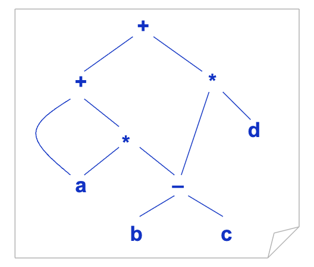
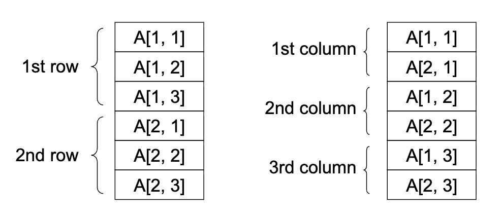
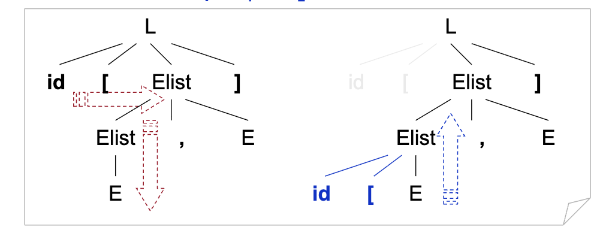
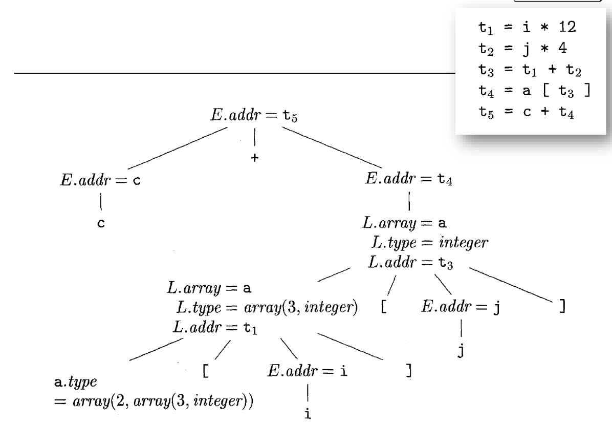
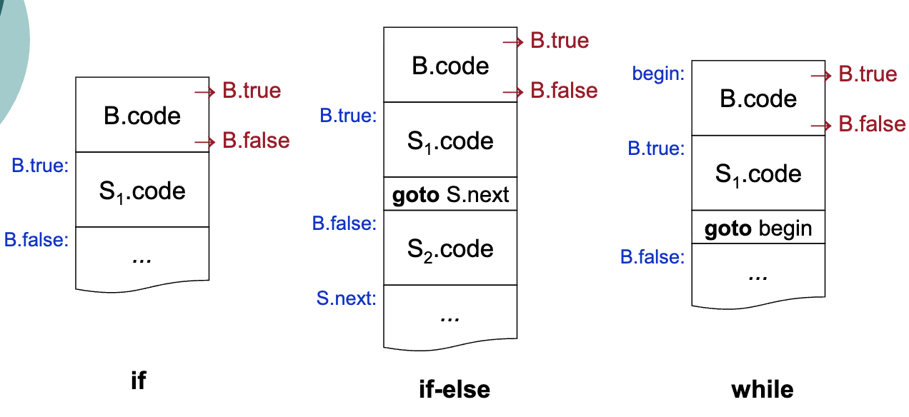

# 讲座9. 语义分析和中间代码生成

1. 引言
2. 类型和声明
3. 赋值和表达式
4. 类型检查
5. 布尔表达式
6. 回填和控制流语句

# 1. 引言 (Page 3/53)

**回顾**
- 前端与后端
  - m × n：m个前端和n个后端
- **前端和后端之间的接口**
  - 中间表示（IR）
  - 为什么需要IR？可扩展性和优化
- **语义（静态）分析**
  - 最常见的分析
    - 类型检查
  - 其他静态检查
    - 不可达代码
    - 未初始化变量的使用
    - 等等

# 静态检查 (Page 4/53)

- **语义分析还关注源代码的良构性**
  - 由于上下文无关文法的表达能力
  - 例如：
    - 实际参数的数量匹配
      - 上下文敏感要求无法使用上下文无关文法指定
    - break语句必须在循环或switch中
      - 需要复杂且不自然的上下文无关文法

# 中间表示 (Page 5/53)

- **高级中间表示**
  - AST和DAG
  - 适用于静态类型检查等任务
- **低级中间表示**
  - 三地址代码：x = y op z
  - 适用于机器相关任务，如寄存器分配和指令选择
- **IR选择/设计是应用特定的**
  - C语言常用（AT&T Bell Lab Advanced C++）

# 三地址代码 (Page 6/53)

- **编译器生成的临时变量**
  - x + y * z
  - t1 = y * z
  - t2 = x + t1
- **示例**
  - t1 = b - c
  - t2 = a * t1
  - t3 = a + t2
  - t4 = t1 * d
  - t5 = t3 + t4



# 地址 (Page 7/53)

- **三地址代码中的地址**
  - 名称（源代码中的变量）
    - 可能实现为指向符号表中条目的指针或引用
  - 常量
    - 必须考虑类型转换
  - 编译器生成的临时变量
    - 对优化有用
    - 寄存器分配

# 指令 (Page 8/53)

- **常见的三地址指令**
```java
x = y op z  // 算术和逻辑运算
x = op y    // 取反和转换
x = y       // 复制
```
```java
goto L            // 无条件跳转
if x goto L       // 条件跳转
ifFalse x goto L  // 条件跳转
if x op y goto L  // 关系运算
```
```java
param x1      // 参数传递
param x2
...
param xn
call p, n     // 过程调用
y = call p, n // 函数调用
return y      // 返回值
```
# 指令（续） (Page 9/53)

- **常见的三地址指令**

```java
x = y[i] // 索引复制，i是偏移量
x[i] = y
```

```java
x = &y  // 地址和指针赋值
x = *y
*x = y
```
# 三地址代码：示例 (Page 10/53)

- **源代码**
  ```java
  do i = i + 1; 
  while(a[i] < v);
  ```
- **翻译为三地址代码（符号标签）**
  ```java
  L:  t1 = i + 1
      i = t1
      t2 = i * 8
      t3 = a[t2]
      if t3 < v goto L
  ```
- **另一种翻译形式（位置编号）**
  ```java
  100: t1 = i + 1
  101: i = t1
  102: t2 = i * 8
  103: t3 = a[t2]
  104: if t3 < v goto 100
  ```
# 三地址代码的实现 (Page 11/53)

- 空间消耗
- 优化的灵活性

- **四元式（quads）**
  - 优点和缺点？
- **三元式**
  - 优点和缺点？
- **间接三元式**
  - 优点和缺点？

# 四元式 (Page 12/53)

- **源代码**
  - a = b * -c + b * -c
- **三地址代码**
  - t1 = minus c
  - t2 = b * t1
  - t3 = minus c
  - t4 = b * t3
  - t5 = t2 + t4
  - a = t5
- **四元式**

| |op|arg1|arg2|result|
| ---|---|---|---|---|
| 0|minus|c||t1|
| 1|*|b|t1|t2|
| 2|minus|c||t3|
| 3|*|b|t3|t4|
| 4|+|t2|t4|t5|
| 5|=|t5||a|
| ...|...||||

# 2) 三元式 (Page 13/53)

| |op|arg1|arg2|
| ---|---|---|---|
| 0|minus|c||
| 1|*|b|(0)|
| 2|minus|c||
| 3|*|b|(2)|
| 4|+|(1)|(3)|
| 5|=|a|(4)|
| ...|...|||

# 3) 间接三元式 (Page 14/53)

| 35|(0)|
| ---|---|
| 36|(1)|
| 37|(2)|
| 38|(3)|
| 39|(4)|
| 40|(5)|
| ...|...|

在Java中，指令对象数组

# 2. 类型和声明 (Page 15/53)

- **声明**
  - 字面量：隐式
  - 变量：显式
  - 其他名称：显式
- **强类型语言中的类型检查**
  - 类型兼容性
  - 类型推断
  - 隐式类型转换
  - 解析重载运算符

# 简化文法 (Page 16/53)

- **一次只声明一个名称**
  - D → T id; D | ε
  - T → B C | record{ D}
  - B → int | double
  - C → [ num] C | ε

# 类型声明的翻译 (Page 17/53)

- **计算类型和宽度**
```
T → B         {t = B.type; w = B.width} 
    C         {T.type = C.type; T.width = C.width}
B → int       { B.type = INTEGER; B.width = 4}
B → double    { B.type = DOUBLE; B.width = 8}
C → [ num] C1 {C.type = array(num.value, C1.type); // 类型表达式
               C.width = num.value × C1.width}
C → ε         { C.type = t; C.width = w}
```

- 试试看：int[2][3]
  - T.type和T.width是什么？

# 类型声明的翻译（续） (Page 18/53)

- **计算相对地址**
```
P →       {offset = 0} // top表示当前符号表
    D
D → T id; {top.put(id.lexeme,T.type, offset); 
           offset += T.width} // 嵌入动作可以通过标记器移除
    D1
D → ε
```

# 另一个示例 (Page 19/53)

- **输入类型和宽度**
```
P →                   {offset = 0} 
    D
D → D; D
D → id: T             {table.enter(id.name, T.type, offset); 
                       offset += T.width}
T → integer           {T.type = INTEGER; T.width = 4}
T → real              {T.type = REAL; T.width = 8}
T → array[num] of T1  {T.type = array(num.value, T1.type); 
                       T.width = num.value × T1.width}
T → ^ T1              {T.type = pointer(T1.type); 
                       T.width = 4}
```

- 试试看：k: array[5] of ^real
  - 有什么副作用？

# 作用域的翻译 (Page 20/53)

- **嵌套过程中的声明**
```
P →           { tableStack.push(new Table(null)); 
                offsetStack.push(0)} 
    D         { addWidth(tableStack.top(), 
                offsetStack.top()); 
                tableStack.pop(); 
                offsetStack.pop()}
D → D; D
D → proc id;  { tableStack.push(new Table(tableStack.top())); 
                offsetStack.push(0)} 
    D1; S     { addWidth(tableStack.top(), offsetStack.top()); 
                t = tableStack.top(); tableStack.pop(); 
                offsetStack.pop(); 
                tableStack.top().enter(id.name, t)}
D → id: T     { tableStack.top().enter(id.name, T.type, offsetStack.top());
                offsetStack.top() += T.width}
```

# 作用域的翻译（续） (Page 21/53)

- **记录中的字段名**

```
T → record  {tableStack.push(new Table(null)); 
             offsetStack.push(0)} 
    D end   {T.type = record(tableStack.top()); 
             T.width = offsetStack.top(); 
             tableStack.pop(); 
             offsetStack.pop()}
```

# 3. 赋值和表达式 (Page 22/53)

- **中间代码生成**
  - 代码连接
    - gen(...)
    - ||
    - 无副作用
  - 增量生成
    - DBv1: emit(...)
    - DBv2: 重载 gen(...)
    - 有副作用

# 表达式的翻译 (Page 23/53)

- **代码连接（语法导向定义）**

|  |产生式|语义规则|
|--|---|---|
| 1|S → id = E;|S.code = E.code \|\| gen(top.get(id.lexeme) '=' E.addr)|
| 2|E → E1 + E2|E.addr = new Temp(); E.code = E1.code \|\| E2.code \|\| gen(E.addr '=' E1.addr '+' E2.addr)|
| 3|E → - E1|E.addr = new Temp(); E.code = E1.code\|\|gen(E.addr '=' 'minus' E1.addr)|
| 4|E → ( E1)|E.addr = E1.addr; E.code = E1.code|
| 5|E → id|E.addr = top.get(id.lexeme); E.code = ""|

# 表达式的翻译（续） (Page 24/53)

- **增量翻译（翻译方案）**
```
S → id = E;   { gen(top.get(id.lexeme) '=' E.addr)}
E → E1 + E2   { E.addr = new Temp(); 
                gen(E.addr '=' E1.addr '+' E2.addr)}
E → - E1      { E.addr = new Temp(); 
                gen(E.addr '=' 'minus' E1.addr)}
E → (E1)      { E.addr = E1.addr}
E → id        { E.addr = top.get(id.lexeme)}
```
# 另一个示例 (Page 25/53)

- **声明的变量**
```
S → id := E;    { p = symbolTable.lookup(id.name); 
                  if(p == null) throw new SomeException(); 
                  emit(p '=' E.place)}
E → E1 + E2     { E.place = new Temp(); 
                  emit(E.place '=' E1.place '+' E2.place)}
E → - E1        { E.place = new Temp(); 
                  emit(E.place '=' 'minus' E1.place)}
E → ( E1)       { E.place = E1.place}
E → id          { p = symbolTable.lookup(id.name); 
                  if(p == null) throw new SomeException(); 
                  E.place = p}
```

# 数组元素的寻址 (Page 26/53)

- **二维数组布局**
  - 行优先 vs. 列优先



# 数组元素的寻址 (Page 27/53)

- **数组元素的相对地址**
  - A[i]
    - base + (i - low) × w
    - i × w + (base - low × w) // 用于优化的常量
  - A[i1, i2]
    - base + ((i1 - low1) × n2 + i2 - low2) × w
    - ((i1 × n2) + i2) × w + (base - (low1 × n2 + low2) × w)
  - A[i1, i2, ..., ik]
    - (((...(i1 × n2 + i2) × n3 + i3)...) × nk + ik) × w + base - (((...(low1 × n2 + low2) × n3 + low3)...) × nk + lowk) × w

# 寻址技巧 (Page 28/53)

- **对于每个新维度的增量，递归计算寻址**
  - 例如从k到k+1
    - 对于变量部分V：V × nk+1 + ik+1
    - 对于常量部分C：C × nk+1 + lowk+1

# 数组引用的文法 (Page 29/53)

- **Pascal中的数组引用：a[2, 3]**
  - L → id[ Elist] | id
  - Elist → Elist, E | E
- **文法转换（为什么？）**
  - L → Elist] | id
  - Elist → Elist, E | id[ E



# 翻译方案 (Page 30/53)

- **Pascal中数组元素的寻址**
```
(1) S → L := E    { if(L.offset == null) emit(L.place '=' E.place) 
                    else emit(L.place '[' L.offset ']' '=' E.place)}
(2) E → E1 + E2   { E.place = new Temp(); 
                    emit(E.place '=' E1.place '+' E2.place)}
(3) E → ( E1)     { E.place = E1.place}
(4) E → L         { if(L.offset == null) E.place = L.place 
                    else{ 
                      E.place = new Temp(); 
                      emit(E.place '=' L.place '[' L.offset ']')
                    }}
(5) L → Elist]    { L.place = new Temp(); 
                    emit(L.place '=' constant(Elist.array)); 
                    L.offset = new Temp(); 
                    emit(L.offset '=' Elist.place '*' width(Elist.array))} 
                    // L.place = base - C * w, L.offset = V * w
(6) L → id        { L.place = id.place; 
                    L.offset = null} // L是简单id（如果L.offset为null）或数组引用
(7) Elist → Elist1, E   { t = new Temp(); 
                          m = Elist1.ndim + 1; 
                          emit(t '=' Elist1.place '*' limit(Elist1.array, m)); 
                          emit(t '+=' E.place); 
                          Elist.array = Elist1.array; 
                          Elist.place = t; 
                          Elist.ndim = m}
(8) Elist → id[ E       { Elist.array = id.place; // = base
                          Elist.place = E.place;  // = V
                          Elist.ndim = 1}         // = dimensions
```

# 另一个翻译方案 (Page 32/53)

- **C/C++中的数组引用：a[2][3]**
  - 对于所有n，lown = 0
  - 寻址公式
    - A[i]
      - base + i × w
    - A[i1][i2]
      - base + i1 × w1 + i2 × w2
      - w1是行的宽度
      - w2是行中元素的宽度
    - A[i1][i2]...[ik]
      - base + i1 × w1 + i2 × w2 + ... + ik × wk

> Java不使用行优先存储数组

# 另一个翻译方案（续） (Page 33/53)

- **翻译方案**

```
S → id = E;   { gen(top.get(id.lexeme) '=' E.addr)}
S → L = E;    { gen(L.array.base '[' L.addr ']' '=' E.addr)}
E → E1 + E2   { E.addr = new Temp(); 
                gen(E.addr '=' E1.addr '+' E2.addr)}
E → id        { E.addr = top.get(id.lexeme)}
E → L         { E.addr = new Temp(); 
                gen(E.addr '=' L.array.base '[' L.addr ']')}
L → id[ E]    { L.array = top.get(id.lexeme); 
                L.type = L.array.type.element; 
                L.addr = new Temp(); 
                gen(L.addr '=' E.addr '*' L.type.width)}
L → L1[ E]    { L.array = L1.array; 
                L.type = L1.type.element; 
                t = new Temp(); 
                L.addr = new Temp();
                gen(t '=' E.addr '*' L.type.width); 
                gen(L.addr '=' L1.addr '+' t)}
              // L仅用于数组引用
                  E.addr = E.place
                  L.array.base = L.place
                  L.addr = L.offset
```



# 4. 类型检查 (Page 35/53)

- **强类型 vs. 弱类型**
  - 强度是相对的
- **类型定义**
  - 原始类型：常量枚举
  - 复合类型：类型表达式
  - 函数类型：签名
    - **如果f的类型是s → t且x的类型是s，那么表达式f(x)的类型是t**

# 翻译方案：示例 (Page 36/53)

- **类型检查、推断和隐式转换**
```
E → E1 * E2 { E.place := new Temp(); 
              if(E1.type == TK_INT && E2.type == TK_INT){
                emit(E.place '=' E1.place '*int' E2.place); 
                E.type = TK_INT; } 
              elsif(E1.type == TK_REAL && E2.type == TK_REAL){
                emit(E.place '=' E1.place '*real' E2.place); 
                E.type = TK_REAL; } 
              elsif(E1.type == TK_INT && E2.type == TK_REAL){ 
                t := new Temp(); 
                emit(t '=' 'int2real' E1.place);
                emit(E.place '=' t '*real' E2.place); 
                E.type = TK_REAL;}
              elsif(...){ ... }
            }
```

# 5. 布尔表达式 (Page 37/53)

- **布尔表达式用于**
  - 控制流
  - 计算逻辑值

# 计算逻辑值 (Page 38/53)

- **a < b 等价于 if(a < b) then 1 else 0**

```
E → E1 or E2      { E.place = new Temp(); 
                    emit(E.place '=' E1.place 'or' E2.place)}
E → E1 and E2     { E.place = new Temp(); 
                    emit(E.place '=' E1.place 'and' E2.place)}
E → not E1        { E.place = new Temp(); 
                    emit(E.place '=' 'not' E1.place)}
E → ( E1)         { E.place = E1.place}
E → id1 relop id2 { E.place = new Temp(); 
                    emit('if' id1.place relop.op id2.place 'goto' currentStmt+3); 
                    emit(E.place '=' '0'); 
                    emit('goto' currentStmt+2); 
                    emit(E.place '=' '1')}
E → true          { E.place = new Temp(); 
                    emit(E.place '=' '1')}
E → false         { E.place = new Temp(); 
                    emit(E.place '=' '0')}
```
# 计算逻辑值：示例 (Page 39/53)

- **源代码**
  - a < b or c < d and e < f
- **中间代码**
  - 100: if a < b goto 103
  - 101: t1 = 0
  - 102: goto 104
  - 103: t1 = 1
  - 104：if c < d goto 107
  - 105: t2 = 0
  - 106: goto 108
  - 107: t2 = 1
  - 108: if e < f goto 111
  - 109: t3 = 0
  - 110: goto 112
  - 111: t3 = 1
  - 112: t4 = t2 and t3
  - 113: t5 = t1 or t4
  - 114: ...

# 短路求值 (Page 40/53)

- **控制流语句**
  - S → if ( B ) S1
  - S → if ( B ) S1 else S2
  - S → while ( B ) S1
- **&&和||的短路求值**
  - 为了更高的求值效率
  - 还有...

# 生成代码说明 (Page 41/53)



# 语法导向定义：控制流语句 (Page 42/53)

| 产生式|语义规则|
| ---|---|
| P → S|S.next = new Label(); P.code = S.code \|\| label(S.next) // S.next从哪里来？|
| S → assign|S.code = assign.code|
| S → S1 S2|S1.next = new Label(); S2.next = S.next; S.code = S1.code \|\| label(S1.next) \|\| S2.code|
| S → if( B) S1|B.true = new Label(); B.false = S1.next = S.next; S.code = B.code \|\| label(B.true) \|\| S1.code|
| S → if( B) S1 else S2|B.true = new Label(); B.false = new Label(); S1.next = S2.next = S.next; S.code = B.code \|\| label(B.true) \|\| S1.code \|\| gen('goto' S.next) \|\| label(B.false) \|\| S2.code|
| S → while( B) S1|begin = new Label(); B.true = new Label(); B.false = S.next; S1.next = begin; S.code = label(begin) \|\| B.code \|\| label(B.true) \|\| S1.code \|\| gen('goto' begin) // 避免冗余的goto|

# 语法导向定义：布尔表达式 (Page 43/53)

| 产生式|语义规则|
| ---|---|
| B → B1 \|\| B2|B1.true = B.true; B1.false = new Label(); B2.true = B.true; B2.false = B.false; B.code = B1.code \|\| label(B1.false) \|\| B2.code // 短路求值|
| B → B1 && B2|B1.true = new Label(); B1.false = B.false; B2.true = B.true; B2.false = B.false; B.code = B1.code \|\| label(B1.true) \|\| B2.code|
| B → ! B1|B1.true = B.false; B1.false = B.true; B.code = B1.code|
| B → E1 relop E2|B.code = E1.code \|\| E2.code \|\| gen('if' E1.addr relop.op E2.addr 'goto' B.true) \|\| gen('goto' B.false)|
| B → true|B.code = gen('goto' B.true)|
| B → false|B.code = gen('goto' B.false)|

# 语法导向翻译：示例 (Page 44/53)

- **源代码**
  - if(x < 100 || x > 200 && x != y) x = 0
- **中间代码**
```
    if x < 100 goto L2
    goto L3
L3: if x > 200 goto L4
    goto L1
L4: if x != y goto L2
    goto L1
L2: x = 0
L1: ...
```
# 6. 回填和控制流语句 (Page 45/53)

- **在控制流语句的SDD中**
  - S.next从哪里来？
  - 只有在生成所有中间代码后，才能计算S.next
- **在布尔表达式的SDD中**
  - B.true和B.false从哪里来？
  - 必须由布尔表达式的上下文提供
  - 上下文依赖于S.next的结果

# 设计动机和解决方案 (Page 46/53)

- **动机**
  - 一遍代码生成
- **解决方案**
  - 使用回填
- 这是处理必须在最后计算的初始值的通用方法

# 布尔表达式的回填 (Page 47/53)

- **翻译方案**
```
B → B1 || M B2    { backpatch(B1.falseList, M.instruction); 
                    B.trueList = merge(B1.trueList, B2.trueList); 
                    B.falseList = B2.falseList;}
B → B1 && M B2    { backpatch(B1.trueList, M.instruction); 
                    B.trueList = B2.trueList; 
                    B.falseList = merge(B1.falseList, B2.falseList);}
B → ! B1          { B.trueList = B1.falseList; 
                    B.falseList = B1.trueList;}
B → ( B1)         { B.trueList = B1.trueList; 
                    B.falseList = B1.falseList;}
B → E1 relop E2   { B.trueList = new List(nextInstruction); 
                    B.falseList = new List(nextInstruction+1); 
                    emit('if' E1.addr relop.op E2.addr 'goto__'); 
                    emit('goto__');}
B → true          { B.trueList = new List(nextInstruction); 
                    emit('goto__');}
B → false         { B.falseList = new List(nextInstruction); 
                    emit('goto__');}
M → ε             { M.instruction = nextInstruction;}
```
# 控制流语句的回填 (Page 48/53)

- **翻译方案**
```
S → if( B) M S1 { backpatch(B.trueList, M.instruction); S.nextList = merge(B.falseList, S1.nextList);}
S → if( B) M1 S1 N else M2 S2 
          { backpatch(B.trueList, M1.instruction);
            backpatch(B.falseList, M2.instruction); 
            S.nextList = merge(S1.nextList, N.nextList, S2.nextList);}
S → while M1( B) M2 S1 
          { backpatch(B.trueList, M2.instruction); 
            backpatch(S1.nextList, M1.instruction); 
            S.nextList = B.falseList; 
            emit('goto' M1.instruction);}
S → { L}        { S.nextList = L.nextList;}
S → A;          { S.nextList = new List(); // 赋值或原子}
M → ε           { M.instruction = nextInstruction;}
N → ε           { N.nextList = new List(nextInstruction); 
                  emit('goto__');}
L → L1 M S      { backpatch(L1.nextList, M.instruction); 
                  L.nextList = S.nextList;}
L → S           { L.nextList = S.nextList;}
```
# 练习9.1 (Page 49/53)

- **设A被声明为a[2..4] x[1..5]整数数组，每个整数占4字节**
  - 输入令牌字符串x := A[3, 2]的翻译结果是什么？
  - 提示：使用Pascal的翻译方案

# 练习9.2 (Page 50/53)

- **设a被声明为5×6整数数组，每个整数占4字节**
  - 输入令牌字符串i = a[3][2]的翻译结果是什么？
  - 提示：使用C/C++的翻译方案

# 练习9.3 (Page 51/53)

- **输入令牌字符串x < 100 || x > 200 && x != y的翻译结果是什么？**
  - 提示：使用带回填的布尔表达式翻译方案
  - 假设生成代码的起始位置是100
