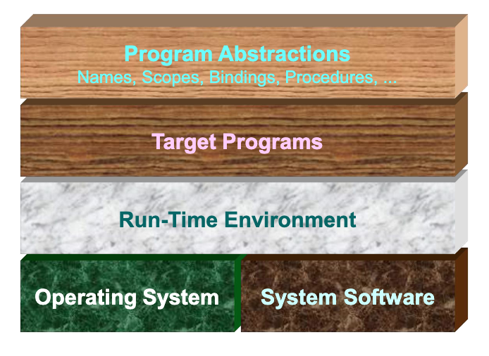
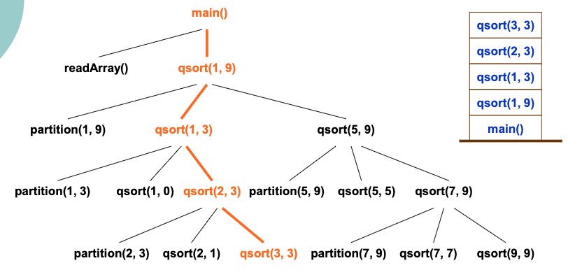
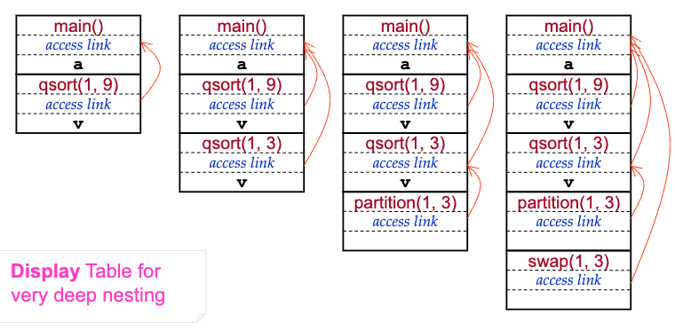
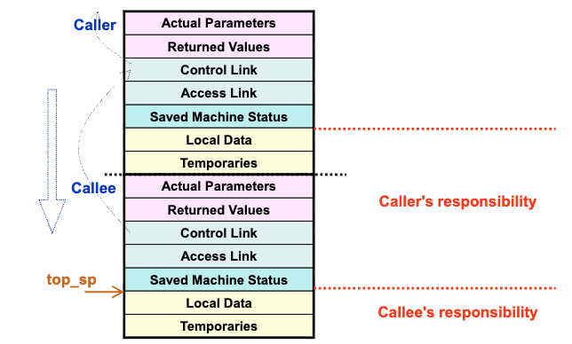
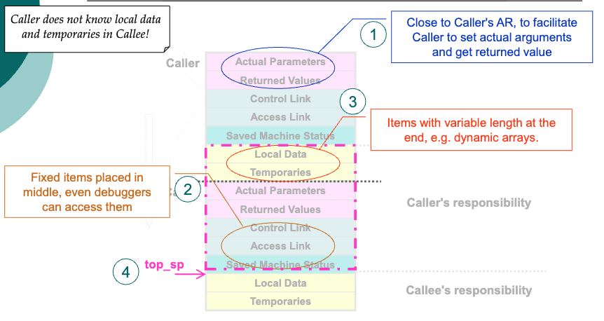
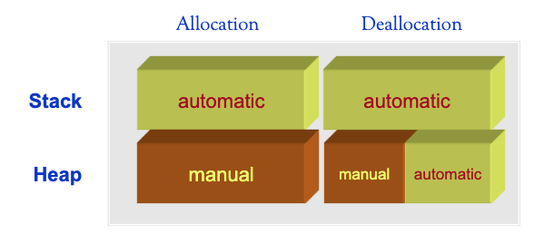
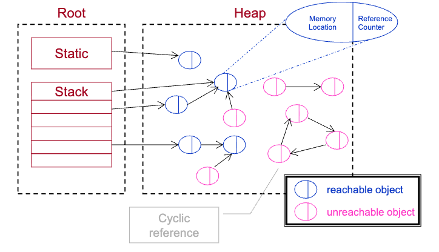
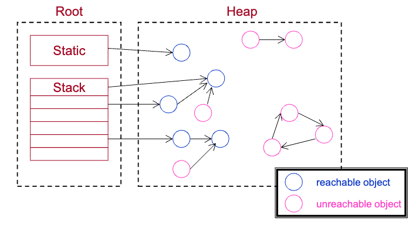
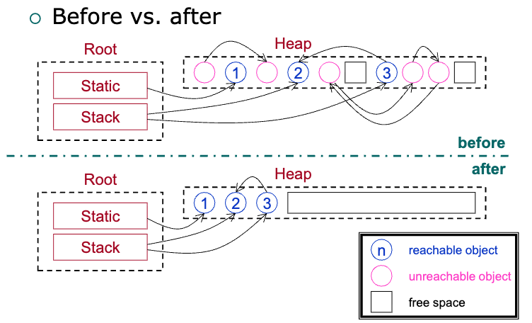
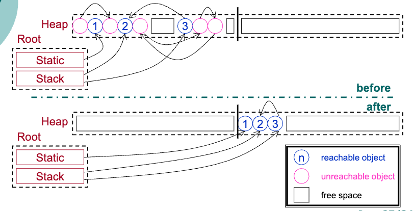

# 讲座10. 运行时环境 (Page 2/34)

1. 存储管理
2. 栈和活动记录
3. 进程内通信
4. 堆管理
5. 垃圾回收

# 1. 存储管理 (Page 3/34)

子程序抽象需要运行时栈的支持



# 典型存储布局和分配 (Page 4/34)

- **存储区域划分**
```
低地址
  代码区      
  静态区  // 全局和静态变量     
  堆     // new/delete, malloc/free  
  空闲内存    
  栈     // 活动记录
高地址     
```

# 2. 栈和活动记录 (Page 5/34)

- **支持子程序抽象**
  - 也称为控制栈
- **通用设计规则**
  - 按需激活

```java
program sort(input, output);
var
    a: array[0..10] of integer;  // 定义待排序的整数数组（下标 0~10）
    x: integer;                  // 全局变量，用于交换操作时暂存数据

procedure readarray;
var
    i: integer;
begin
    // （此处省略输入逻辑，如循环读取数组元素）
end { readarray };

procedure exchange(i, j: integer);
begin
    x := a[i];   // 暂存 a[i] 的值到 x
    a[i] := a[j];// 将 a[j] 赋值给 a[i]
    a[j] := x;   // 将暂存的 x 赋值给 a[j]，完成两个元素的交换
end { exchange };

procedure quicksort(m, n: integer);
var
    k, v: integer;

function partition(y, z: integer): integer;
var
    i, j: integer;
begin
    // （分区逻辑：围绕基准值调整数组，使左小右大）
    // ...a... （操作数组 a 的代码）
    // ...v... （处理基准值 v 的逻辑）
    exchange(i, j);  // 调用交换过程，调整元素位置
    // ... （返回分区点等后续逻辑）
end { partition };

begin
    // （快速排序主逻辑：递归调用 partition 和自身）
end { quicksort };

begin
    // （程序主流程：如调用 readarray、quicksort 等）
end { sort }.
```
# 活动树 (Page 7/34)

- **活动树和运行时栈**



# 活动记录（或帧） (Page 8/34)

- **活动记录的典型组织**
  - 实际参数：被调用者设置，寄存器优先
  - 返回值：调用者设置，寄存器优先
  - 控制链：指向调用者的AR的指针
  - 访问链：指向外层AR的指针
  - 保存的机器状态：返回地址和寄存器
  - 局部数据：用户定义
  - 临时变量：编译器生成

# 访问链 (Page 9/34)

- **快速排序示例中的访问链**
  - 对于非常深的嵌套，使用显示表（Display Table）



# 3. 进程内通信 (Page 10/34)

- **过程调用的实现**
  - **调用序列**
    - 分配活动记录
    - 将信息填入字段
    - ...
  - **返回序列**
    - 恢复机器状态
    - 继续调用者的执行
    - ...
- 进程内通信 vs. 进程间通信（IPC）

# 调用者 vs. 被调用者 (Page 11/34)

- **过程调用的实现**




# 活动记录设计 (Page 12/34)

- **设计原则**
  - 调用者不知道被调用者的局部数据和临时变量！
  - 1.靠近调用者的AR，便于调用者设置实际参数和获取返回值
  - 2.固定项放在中间，调试器也可以访问
  - 3.可变长度项放在末尾，例如动态数组



# 调用序列 (Page 13/34)

- **典型的调用序列**
  1. 调用者计算实际参数
  2. 调用者将返回地址和旧的top_sp存储到被调用者的活动记录中
  3. 调用者将活动记录压入栈（增加top_sp）
  4. 被调用者保存寄存器值和其他状态信息
  5. 被调用者初始化局部数据并开始执行

# 返回序列 (Page 14/34)

- **典型的返回序列**
  1. 被调用者设置返回值
  2. 被调用者弹出活动记录（减少top_sp）
  3. 被调用者恢复寄存器
  4. 被调用者跳转到状态字段中的返回地址
  5. 调用者获取返回值（即使top_sp已减少）

# 4. 堆管理 (Page 15/34)

- **堆管理的关键问题是碎片化**
  - 同时考虑时间效率和空间效率
  - 如何最小化碎片化？

# 多线程 (Page 16/34)

- **多线程程序共享一个公共堆**
  - 当然，每个程序必须有自己的控制栈
- **不同线程中过程之间的通信比IPC更容易**
  - 共享堆可用于通信

# 5. 垃圾回收 (Page 17/34)

- **自动内存管理？**



# 术语 (Page 18/34)

- **垃圾**
  - 无法被引用的对象
- **内存泄漏**
  - 可能是最麻烦的bug
  - Java有内存泄漏吗？
- **性能分析器（Rational Purify）**
  - JVMPI：JVM性能分析器接口，自JDK 1.2（Java 2）起
  - JVM TI：JVM工具接口，自JDK 5.0起
- **垃圾回收**
  - 优点和缺点？
  - 语言中的高级抽象
- **收集器 vs. 修改器**
  - Java方法：访问器 vs. 修改器
  - 对JVMGCI的期望

# 性能指标 (Page 19/34)

- **总体执行时间**
- **空间使用**
  - 避免碎片化
- **暂停时间**
  - 对实时应用至关重要
- **程序局部性**
  - 程序大部分时间执行相对较小的代码片段，只访问少量数据（90%的时间在10%的代码上）
  - 局部性有助于利用内存层次结构（寄存器、缓存、内存、磁盘等）
  - 垃圾回收可以改善时间和空间局部性

# 垃圾回收算法 (Page 20/34)

- **引用计数（立即）**
- **基于追踪的算法（周期性）**
  - 基本标记-清除
  - Baker的标记-清除
  - 基本标记-压缩
  - Cheney的复制收集器
- **短暂停算法**
  - 增量垃圾回收
  - 增量可达性分析
  - 部分收集
  - 分代垃圾回收

# 引用计数 (Page 21/34)

- **counter++ vs. counter--**



# 引用计数（续） (Page 22/34)

- **优点**
  - 简单
  - 增量收集
  - 立即收集
- **缺点**
  - 无法收集不可达的循环数据结构
  - 额外操作导致昂贵的开销
    - 取决于计算，而不仅仅是对象数量

# 标记-清除 (Page 23/34)

- **2个步骤：追踪（标记），然后清除**



# 标记-清除（续） (Page 24/34)

- **优点**
  - 如果垃圾很少，效率很高
  - 能够收集循环引用
- **缺点**
  - 垃圾量大时效率低
    - H. Baker（1992）的改进
    - 保持所有分配对象的列表
  - 修改器（程序）的暂停使其难以应用于实时应用
  - 导致堆中的碎片化

# 标记-压缩 (Page 25/34)

- **前后对比**



# 标记-压缩（续） (Page 26/34)

- **3个步骤**
  1. 标记阶段：类似于标记-清除
  2. 为每个可达对象从堆的低端计算新地址
  3. 将对象复制到新位置并更新根区域和对象中的所有引用
- **优缺点**
  - 优点：改善空间使用和程序局部性，避免碎片化
  - 缺点：第3步（压缩中的复制）很昂贵
    - 更新引用简单快速

# 复制收集器 (Page 27/34)

- **前后对比**



# 复制收集器（续） (Page 28/34)

- **堆被划分为2个半空间**
  - 可达对象一旦被发现就立即移动
  - 不触及任何不可达对象
- **优点**
  - 更高效和流行
- **缺点**
  - 只能利用一半的堆内存

# 成本比较 (Page 29/34)

- **标记-清除**
  - 堆中块的数量
- **Baker的改进**
  - 到达对象的数量
- **标记-压缩**
  - 堆中块的数量
  - 到达对象的总大小
- **复制收集器**
  - 到达对象的总大小

# 分代垃圾回收 (Page 30/34)

- **动机**
  - 处理短命和长命对象的差异
- **方法**
  - 对象根据某些标准被划分为多个代
    - 通常与对象的年龄相关
  - 可以在不同的时间间隔使用不同的技术进行垃圾回收，基于代

# JVM中的实现 (Page 31/34)

- **使用两代（年轻代和老年代）方法**
- **年轻代：复制收集器**
  - 新创建的对象往往很快死亡
- **老年代：标记-压缩**
  - 为性能提供良好的技术混合

# 练习10.1 (Page 32/34)

- **上网搜索并写一篇短文，比较Java平台和Microsoft .Net平台上的垃圾回收**
