# 讲座11. 代码生成 (Page 2/52)

1. 引言
2. 目标机器的抽象
3. 过程的实现
4. 基本块的优化
5. 简单的代码生成器
6. 窥孔优化

# 1. 引言 (Page 3/52)

- **代码生成器关注的重点**
  - 指令选择
    - 选择合适的目标机器指令来实现中间代码语句。
  - 寄存器分配和分配
    - 充分利用寄存器，这是最快的计算单元。
  - 指令排序
    - 决定指令执行的顺序。
    - 也称为指令调度。

# 指令选择 (Page 4/52)

- **生成代码的速度和大小成本都需要考虑**
  - 权衡和后果。
- **示例1：a = a + 1**
  - LD R0, a 
  - ADD R0, R0,#1 
  - ST a, R0
  - INC a
- **示例2：将寄存器R0设置为0**
  - LD R0,#0
  - XOR R0, R0

# 寄存器分配和分配 (Page 5/52)

- **包括两个子问题**
  - 寄存器分配 allocation
    - 选择在程序的每个点驻留在寄存器中的变量集合。
  - 寄存器作业 assignment
    - 选择变量将驻留的具体寄存器。
- 代码生成中的一个难题

# 指令调度 (Page 6/52)

- **对现代流水线处理器很重要**
  - RISC：精简指令集计算机
    - RISC vs. CISC
  - 数据冒险（流水线中的停顿）：在寄存器中数据可用之前尝试使用它。
    - 写入寄存器的值在其后续周期中不可用。
    - 后续周期应该被不依赖该值的指令利用
      - 否则它们将被浪费。
    - 优化：将没有依赖关系的指令聚类在一起，同时保持原始语义。

# 指令调度（续） (Page 7/52)

- **示例：(a + b) + c 在SGI的MIPS 2000上**
  ```
  LD R1, a 
  LD R2, b
  NOP
  ADDi R1, R1, R2 
  LD R2, c
  NOP
  ADDi R1, R1, R2
  ```

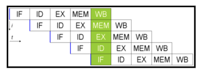

- **最优生成代码**
  ```
  LD R1, a 
  LD R2, b 
  LD R3, c 
  ADDi R1, R1, R2 
  NOP 
  ADDi R1, R1, R3
  ```

# 2. 目标机器的抽象 (Page 8/52)

- 指令集
- 寻址模式
- 程序和指令成本

# 指令集 (Page 9/52)

- **支持以下指令**
  - LD dst, addr // 加载
  - ST x, Ri // 存储
  - OP dst, src1, src2 // ADD, SUB,...
  - OP dst, src1 // 一元操作
  - BR L // 跳转
  - Bcond r, L // 条件跳转

# 寻址模式 (Page 10/52)

- **指令中的寻址**
  - #C // 立即常数，成本= 1
  - x // 绝对寻址，成本= 1
  - *x // 间接内存，成本= 1
  - R // 直接寄存器，成本= 0
  - *R // 间接寄存器，成本= 0
  - a(Ri) // 直接索引，成本= 1
    - a是变量或常数
    - LD R1, a(R2)
      - R1 = contents(a + contents(R2))
    - LD R1, 100(R2)
      - R1 = contents(100 + contents(R2))
  - *a(Ri) // 间接索引，成本= 1
    - LD R1, *100(R2)
      - R1 = contents(contents(100 + contents(R2)))

# 程序和指令成本 (Page 11/52)

- **指令成本**
  - = 1 + operand_addr_cost
- **程序成本**
  - = 指令成本总和
- **示例**
  - LD R0, R1 // 成本= 1
  - LD R0, x // 成本= 2
  - LD R1, *100(R2) // 成本= 2

# 3. 过程的实现 (Page 12/52)

- 静态分配
- 栈分配

# 静态分配 (Page 13/52)

- **调用callee的实现**
  - ...
  - ST callee.staticArea,#here+ 20 // 返回地址
  - BR callee.codeArea // 跳转到被调用者
  - ...
- **返回的实现**
  - ...
  - BR *callee.staticArea // 返回到调用者

> 假设返回地址保存在活动记录的开头。并且 20 = 5 words * 4 bytes/word

# 示例：三地址代码 (Page 14/52)

```
// c的代码
action1
call p
action2
halt
```

```
// p的代码
action3
return
```

# 示例：实现 (Page 15/52)

```
// c的代码
100 action1
120 ST 364,#140 // 返回地址
132 BR 200      // 调用p
140 action2
160 HALT        // 返回到操作系统
    ...
// p的代码
200 action3
220 BR*364      // 返回到其调用者
    ...
// c的活动记录
300             // 返回地址到调用者
304             // c的局部数据
    ...
// p的活动记录
364 140         // 返回地址到调用者
368             // p的局部数据
```

# 栈分配 (Page 16/52)

- **初始化的实现**
  ```
  LD SP,#stackStart // 初始化栈
  ...               // main()的代码
  HALT              // 终止
  ```
- **调用callee的实现**
  ```
  ADD SP, SP,#caller.recordSize // 压入AR
  ST *SP,#here+ 16              // 返回地址, SP: DBv2必须假设寻址0(SP)没有额外成本
  BR callee.codeArea            // 跳转到被调用者
  SUB SP, SP,#caller.recordSize // 弹出AR
  ```

- **返回的实现**
  ```
  BR *0(SP) // 返回到调用者
  ```

# 示例：三地址代码 (Page 17/52)

```
// m的代码
action1
call q
action2
halt

// p的代码
action3
return

// q的代码
action4
call p
action5
call q
action6
call q
return
```

# 示例：实现 (Page 18/52)

```
100 LD SP,#600
108 action1
128 ADD SP, SP,#msize
136 ST *SP,#152
144 BR 300
152 SUB SP, SP,#msize
160 action2
180 HALT
... // code for p
200 action3
220 BR *0(SP)
... // code for q
300 action4
320 ADD SP, SP,#qsize
328 ST *SP,#344
336 BR 200
344 SUB SP, SP,#qsize
352 action5
372 ADD SP, SP,#qsize
380 ST *SP,#396
388 BR 300
396 SUB SP, SP,#qsize
404 action6
424 ADD SP, SP,#qsize
432 ST *SP,#448
440 BR 300
448 SUB SP, SP,#qsize
456 BR*0(SP)
... 
600
```

# 4. 基本块的优化 (Page 19/52)

- **方法**
  - 基本块 → 有向无环图 → 基本块
  - 超级编译器中的Petri网

# 基本块 (Page 20/52)

- **单一入口和单一出口**
- **示例**
  ```
  (1) i = 1
  (2) j = 1
  (3) t1 = 10 * i
  (4) t2 = t1 + j
  (5) t3 = 8 * t2
  (6) t4 = t3 – 88
  (7) a[t4] = 0.0
  (8) j = j + 1
  (9) if j <= 10 goto 3
  (10) i = i + 1
  (11) if i <= 10 goto 2
  (12) i = 1
  (13) t5 = i – 1
  (14) t6 = 88 * t5
  (15) a[t6] = 1.0
  (16) i = i + 1
  (17) if i <= 10 goto 13
  ```

# 流图 (Page 21/52)

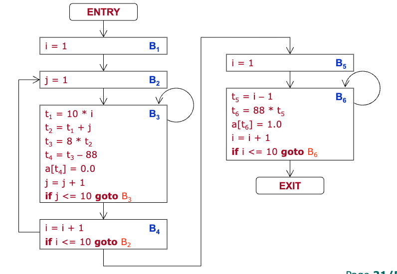

# 流图的构建 (Page 22/52)

- **将三地址指令划分为基本块**
  - 领导者：基本块中的第一条指令。
  - 查找所有领导者的算法
    1. 第一条三地址指令
    2. 条件或无条件跳转的目标
    3. 紧跟在条件或无条件跳转之后的指令

# 活跃性和下次使用信息 (Page 23/52)

- **在基本块中计算活跃性和下次使用信息：向后扫描**
  - 初始化：对于每个变量v，
    - v.nextUse = none; v.liveness = v是临时变量？false: true; 
    - // 保守的 实践中的全局数据流分析
  - 对于每个i: x = y + z
    - 将x、y和z的信息附加到指令i；
    - x.liveness = false; x.nextUse = none;
    - y.liveness = z.liveness = true; y.nextUse = z.nextUse = i;

# 示例 (Page 24/52)

- **信息存储在符号表中每个变量的入口处**

原来
```
(1) t = a – b
(2) u = a – c
(3) v = t + u
(4) d = v + u
```

后来
```
(1) t(3),T = a(2),T – b –,T
(2) u(3),T = a –,T – c –,T
(3) v(4),T = t –,F + u(4),T
(4) d –,T = v –,F + u –,F
```

| 变量 | Next-Use | Next-Use | Next-Use | Next-Use | Next-Use | Liveness | Liveness | Liveness | Liveness | Liveness |
|------|----------|----------|----------|----------|----------|----------|----------|----------|----------|----------|
| 变量 | Init | (4) | (3) | (2) | (1) | Init | (4) | (3) | (2) | (1) |
| a | − | | | (2) | (1) | T | | | T | T |
| b | − | | | | (1) | T | | | | T |
| c | − | | | (2) | | T | | | T | |
| d | − | − | | | | T | F | | | |
| t | − | | (3) | | − | F | | T | | F |
| u | − | (4) | (3) | − | | F | T | T | F | |
| v | − | (4) | − | | | F | T | F | | |

# 基于DAG的优化 (Page 25/52)

- **执行几种代码改进转换**
  - 消除局部公共子表达式
  - 消除死代码
  - 重新排序独立语句
  - 应用代数定律

# 局部公共子表达式 (Page 26/52)

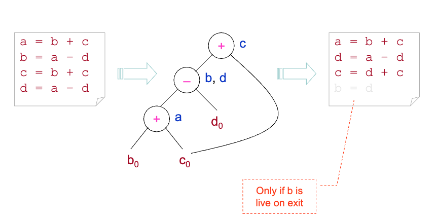

> 仅当b在退出时是活跃的

# 死代码 (Page 27/52)

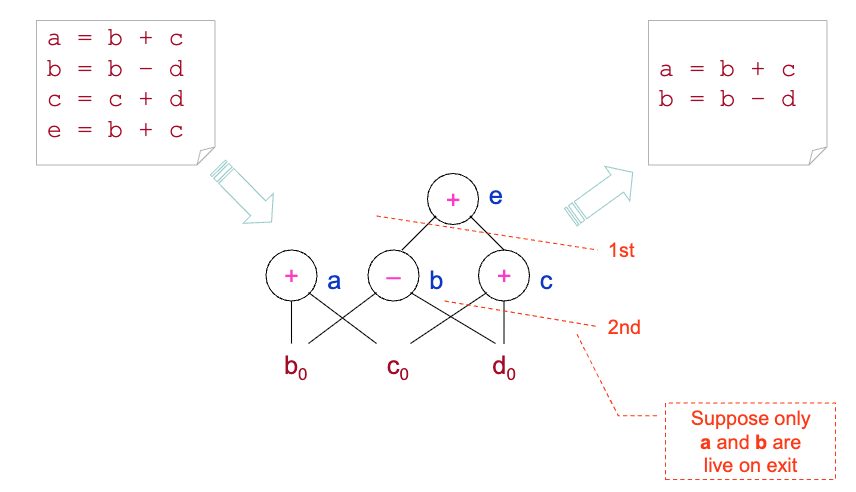

假设只有a和b在退出时是活跃的


# 代数恒等式 (Page 28/52)

- **算术恒等式**
  - x + 0 = 0 + x = x
  - x * 1 = 1 * x = x
  - x – 0 = x
  - x / 1 = x
  - ...
- **局部强度降低**
  - 2 * x ⇒ x + x
  - x / 2 ⇒ x * 0.5
  - ...
- **常量折叠**
  - 2 * 3.14 ⇒ 6.28
  - ...

# 数组引用 (Page 29/52)

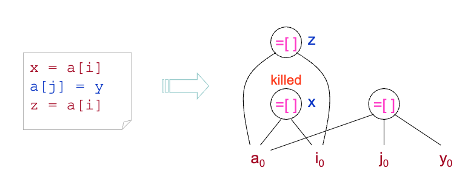

# 示例：从BB构建DAG(1) (Page 30/52)

```
t1 = 4 * i
t2 = a[t1]
t3 = 4 * i
t4 = b[t3]
t5 = t2 * t4
t6 = t5 + prod
prod = t6
t7 = i + 1
i = t7
if i <= 20 goto(1)
```
```
  (*) t1
  / \
 4  i0
```

# 示例：从BB构建DAG(2) (Page 31/52)

```
t1 = 4 * i
t2 = a[t1]
t3 = 4 * i
t4 = b[t3]
t5 = t2 * t4
t6 = t5 + prod
prod = t6
t7 = i + 1
i = t7
if i <= 20 goto(1)
```

```
     (=[]) t2
     / \
    /   \
  a0    (*) t1
        / \
      4  i0
```

# 示例：从BB构建DAG(3)-(10) (Page 32-39/52)

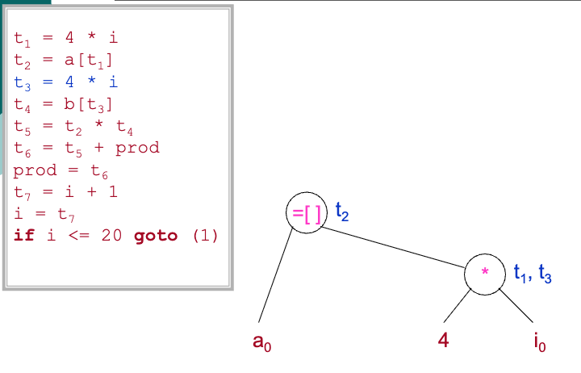

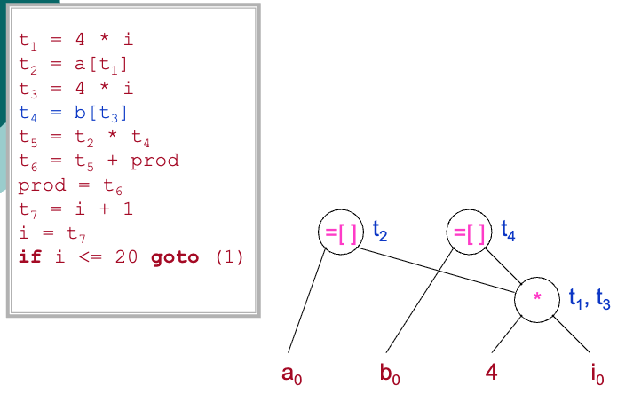

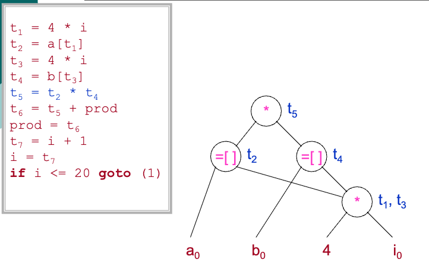

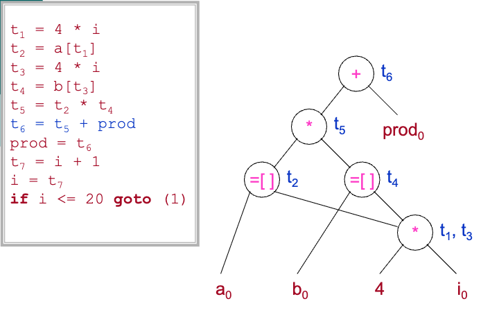

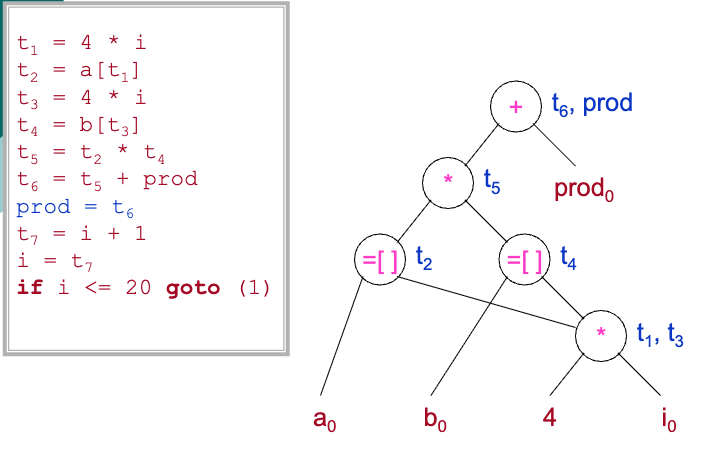

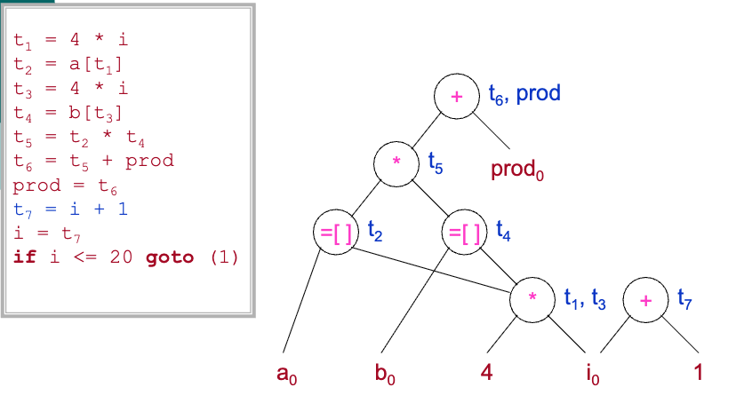

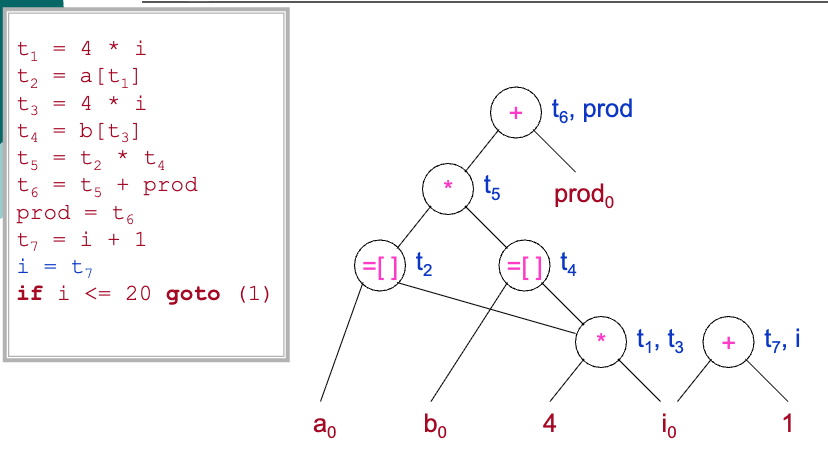

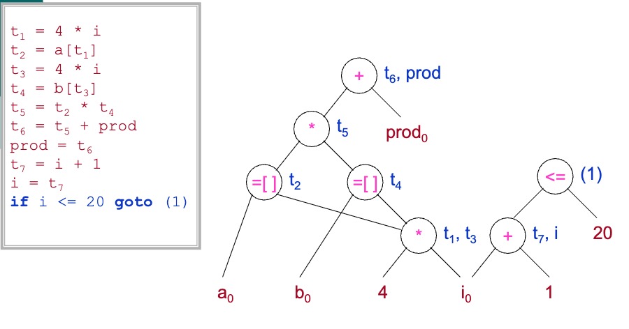

# 5. 简单的代码生成器 (Page 40/52)

- **"简单"意味着什么？**
  - 为单个基本块生成代码。
- **动机**
  - 充分利用寄存器以获得最佳优势。

| 存储访问 | 周期 | 能力 |
|--------|--------|----------|
| 寄存器 | 1 | 256-8000 字节 |
| 缓存 | 3 | 256 KB- 1 MB |
| 主内存 | 20-100 | 32 MB- 1 GB |
| 磁盘 | 0.5-5 百万 | 10 GB- 1 TB |

- 程序员
  - 主内存
  - 磁盘
- 编译器
  - 寄存器
  - 缓存
- 操作系统和硬件
  - 缓存
  - 主内存

# 寄存器和地址描述符 (Page 41/52)

- **寄存器描述符**
  - RegDesc: 寄存器 → 2^变量
- **地址描述符**
  - AddrDesc: 变量 → 2^位置
  - 位置 = 寄存器 ∪并 内存

# 代码生成算法 (Page 42/52)

- **基于函数getReg(x = y op z)**
  - 为三地址指令x = y op z中的变量选择寄存器。
    - 也就是说，分别为x、y和z选择Rx、Ry和Rz。
  - 基于寄存器描述符和地址描述符做出决策。

# 代码生成算法（续） (Page 43/52)

- **x = y + z的机器指令**
  - 调用getReg(x = y + z)为x、y和z选择寄存器Rx、Ry和Rz。
  - 如果y ∉ regDesc(Ry)，获取一些y' ∈ addrDesc(y)并发出指令：LD Ry, y'。
  - 如果z ∉ regDesc(Rz)，获取一些z' ∈ addrDesc(z)并发出指令：LD Rz, z'。
  - 发出指令：ADD Rx, Ry, Rz。
  - 调整寄存器和地址描述符。

# 代码生成算法（续） (Page 44/52)

- **x = y的机器指令**
  - 调用getReg(x = y)选择寄存器Rx和Ry。
    - getReg()总是为x和y选择相同的寄存器。
  - 如果y ∉ regDesc(Ry)，获取一些y' ∈ addrDesc(y)并发出指令：LD Ry, y'。
  - 调整寄存器描述符：regDesc(Ry) ∪ = {x}

# getReg(...)的设计 (Page 45/52)

- **输入：x = y + z**
- **输出：Rx、Ry和Rz**
- **算法（以Ry为例）**
  - 如果y在某些寄存器中，从中选择Ry。
  - 否则如果有空寄存器，选择一个作为Ry。
  - 否则 {让R是一个候选，R持有v，对每个v检查：
    - 如果addrDesc(v)有其他位置，R是OK的。
    - 否则如果v == x且x != z，R是OK的。
    - 否则如果v稍后不使用，R是OK的。
    - 否则溢出，即发出ST v, R。
  - 选择溢出最少的R }。

# 6. 窥孔优化 (Page 46/52)

- **一种简单但有效的局部代码改进技术**
  - 检查目标指令的滑动窗口（窥孔）。
  - 用更短或更快的序列替换窥孔内的指令序列。

# 消除冗余的加载和存储 (Page 47/52)

- **示例**
  ```
  LD R0, a 
  ST a, R0 
  // 消除
  ```

# 消除不可达代码 (Page 48/52)

- **示例**
```
    if debug == 1 goto L1 
    goto L2 
L1: print debugging information 
L2:
    if debug != 1 goto L2 
    print debugging information 
L2:
```
# 流控制优化 (Page 49/52)

- **示例**
  - 回想流控制语句的翻译方案！
```
    goto L1
    ...
L1: goto L2
    goto L2
    ...
L1: goto L2
```
```
    if a < b goto L1
    ...
L1: goto L2
    if a < b goto L2
    ...
L1: goto L2
```

# 代数简化和强度降低 (Page 50/52)

- **示例**
  - x = x + 0 // 消除
  - x = x * 1 // 消除
  - y = x * 2, y = x << 1
  - y = x * 4, y = x << 2
