# 讲座12. 代码优化

1. 引言
2. 局部优化
3. 控制流分析和循环优化
4. 数据流分析和全局优化

---

# 1. 引言 (Page 3/63)

- **术语**
  - 代码优化 与 代码改进
- **前提条件**
  - 语义保持的转换
- **权衡和后果**
  - 时间效率 与 空间效率
  - 编译器效率 与 目标代码效率

---

# 优化级别 (Page 4/63)

- **三个优化级别**
  - 源代码
    - 手动优化，但最有效
  - 中间代码
    - 通用且自动
    - 即使你编写了良好的源代码也是必要的
  - 目标代码
    - 机器相关（例如寄存器和流水线）

---

# 优化范围 (Page 5/63)

- **四个优化范围**
  - 窥孔优化
    - 基于滑动窗口，最小的范围
  - 局部优化
    - 在基本块内
  - 循环优化
    - 在循环内
  - 全局优化
    - 最大的范围
    - 过程内优化 与 过程间优化

---

# 一个示例 (Page 6/63)

```c
sum = 0;
for(int i = 1; i <= 20; i++)
    sum += A[i] * B[i];
```

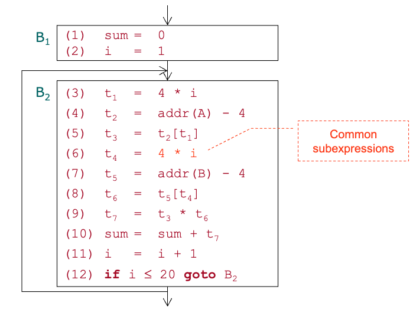

- 公共子表达式 t4 = 4 * i

---

# 一个示例：消除公共子表达式 (Page 7/63)

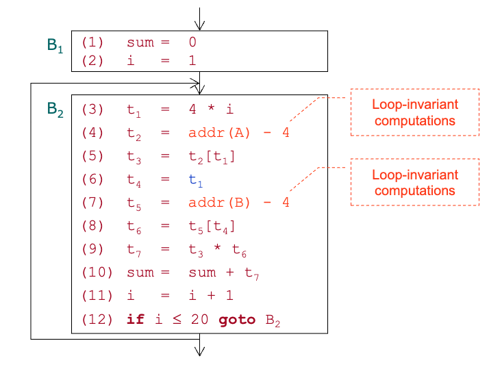

- **循环不变计算**
  - t2 = addr(A) - 4
  - t5 = addr(B) - 4

---

# 一个示例：循环优化中的代码移动 (Page 8/63)

```
B1  (1) sum = 0
    (2) i = 1
    (4) t2 = addr(A) - 4
    (7) t5 = addr(B) - 4
```
```
B2  (3) t1 = 4 * i // 归纳变量：t1 和 i 保持同步
    (5) t3 = t2[t1]
    (6) t4 = t1
    (8) t6 = t5[t4]
    (9) t7 = t3 * t6
    (10) sum = sum + t7
    (11) i = i + 1
    (12) if i ≤ 20 goto B2
```

---

# 一个示例：归纳变量和强度降低 (Page 9/63)

```
B1  (1) sum = 0
    (2) i = 1
    (4) t2 = addr(A) - 4
    (7) t5 = addr(B) - 4
    (3) t1 = 4 * i
```
```
B2  (5) t3 = t2[t1]
    (6) t4 = t1
    (8) t6 = t5[t4]
    (9) t7 = t3 * t6
    (10) sum = sum + t7
    (11) i = i + 1
    (3') t1 = t1 + 4
    (12) if i ≤ 20 goto B2 // 循环条件可以改变
```
---

# 一个示例：循环条件转换 (Page 10/63)

```
B1  (1) sum = 0
    (2) i = 1
    (4) t2 = addr(A) - 4
    (7) t5 = addr(B) - 4
    (3) t1 = 4 * i // i = 1
```
```
B2  (5) t3 = t2[t1]
    (6) t4 = t1
    (8) t6 = t5[t4] // t4 = t1
    (9) t7 = t3 * t6
    (10) sum = sum + t7
    (11) i = i + 1 // 如果 i 在出口处不活跃，可以被移除
    (3') t1 = t1 + 4
    (12) if t1 ≤ 80 goto B2
```

---

# 一个示例：常量和复制传播 (Page 11/63)

```
B1  (1) sum = 0
    (2) i = 1  // 假设 i 在出口处不活跃
    (4) t2 = addr(A) - 4
    (7) t5 = addr(B) - 4
    (3) t1 = 4
```
```
B2  (5) t3 = t2[t1]
    (6) t4 = t1  // 假设 t4 在出口处不活跃
    (8) t6 = t5[t1]
    (9) t7 = t3 * t6
    (10) sum = sum + t7
    (11) i = i + 1  // 假设 i 在出口处不活跃
    (3') t1 = t1 + 4
    (12) if t1 ≤ 80 goto B2
```

---

# 一个示例：消除冗余操作 (Page 12/63)
```
B1  (1) sum = 0
    (4) t2 = addr(A) - 4
    (7) t5 = addr(B) - 4
    (3) t1 = 4 
```
```
B2  (5) t3 = t2[t1]
    (8) t6 = t5[t1]
    (9) t7 = t3 * t6
    (10) sum = sum + t7
    (3') t1 = t1 + 4
    (12) if t1 ≤ 80 goto B2
```

---

# 2. 局部优化 (Page 13/63)

- **转换**
  - 公共子表达式
  - 常量和复制传播
  - 消除冗余操作
- 基本块 -> DAG -> 基本块

---

# 另一个示例(1) (Page 14/63)

```
(1) t0 = 3.14
(2) t1 = 2 * t0
(3) t2 = R + r
(4) A = t1 * t2
(5) B = A
(6) t3 = 2 * t0
(7) t4 = R + r
(8) t5 = t3 * t4
(9) t6 = R - r
(10) B = t5 * t6
```

```
 ()t0
3.14
```

---

# 另一个示例(2) (Page 15/63)

```
(1) t0 = 3.14
(2) t1 = 2 * t0
(3) t2 = R + r
(4) A = t1 * t2
(5) B = A
(6) t3 = 2 * t0
(7) t4 = R + r
(8) t5 = t3 * t4
(9) t6 = R - r
(10) B = t5 * t6
```

```
     ()t1
    6.28

 ()t0  ()
3.14    2 
```

---

# 另一个示例(3) (Page 16/63)

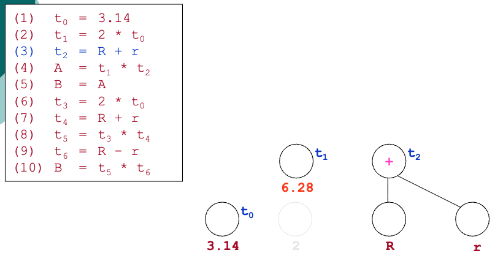

---

# 另一个示例(4) (Page 17/63)

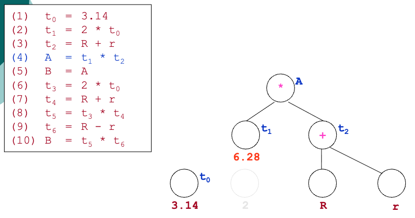

---

# 另一个示例(5) (Page 18/63)

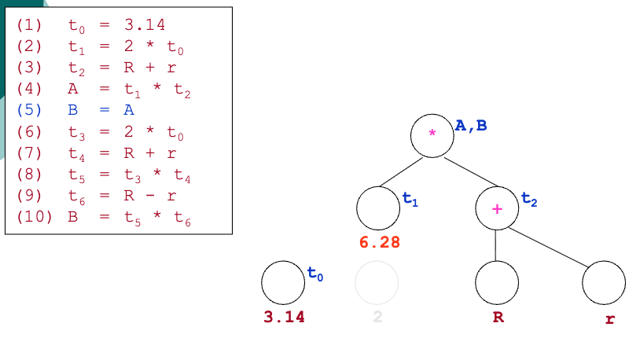

---

# 另一个示例(6) (Page 19/63)

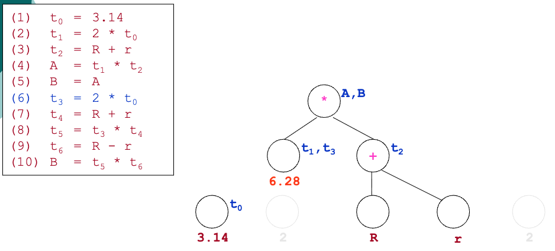

---

# 另一个示例(7) (Page 20/63)

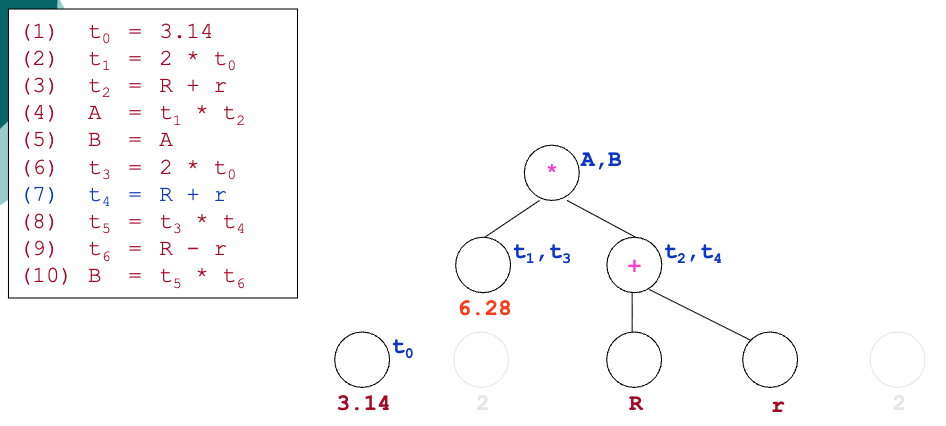

---

# 另一个示例(8) (Page 21/63)

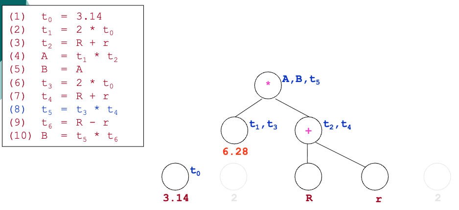

---

# 另一个示例(9) (Page 22/63)

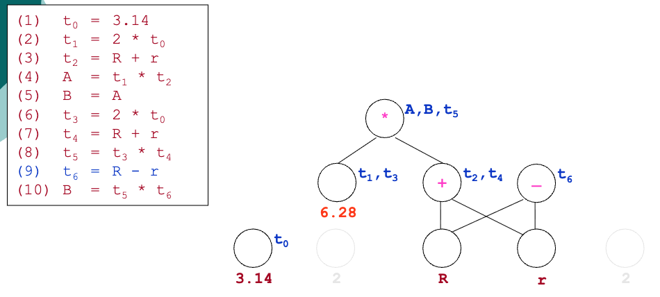

---

# 另一个示例(10) (Page 23/63)

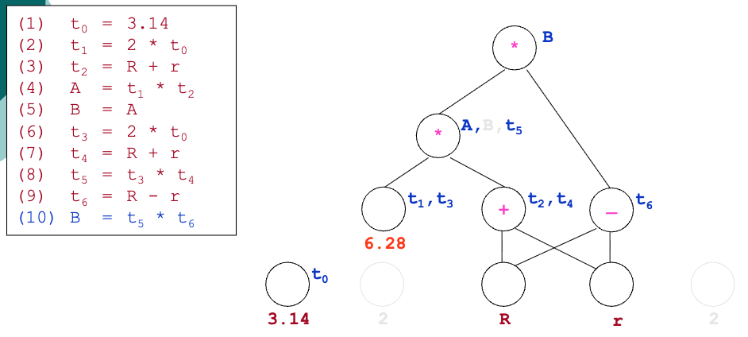

---

# 另一个示例(结束) (Page 24/63)

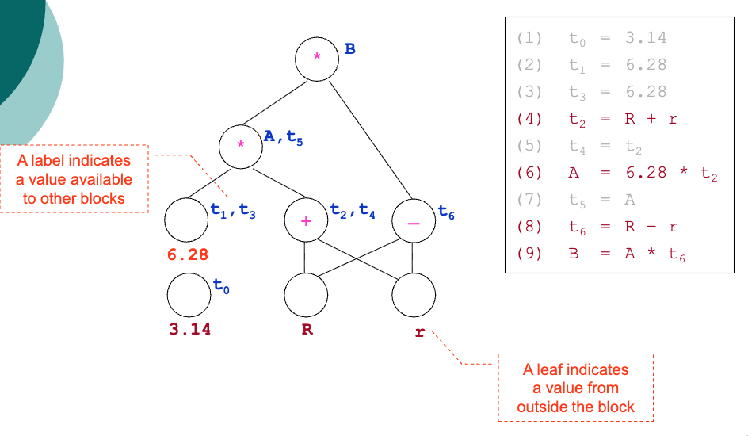

- **叶子节点表示来自块外部的值**
- **标签表示对其他块可用的值**

---

# 3. 控制流分析和循环优化 (Page 25/63)

- **三个重要子问题**
  - 如何基于流图定义循环？
  - 如何在流图中找到循环？
  - 如何优化循环？

---

# 基于流图定义循环 (Page 26/63)

- **循环是有唯一入口（头）的强连通子图**
  - **属性：**
    - 强连通
    - 唯一入口（代码移动的目的地）
    - 循环可以表示为节点序列

---

# 一个示例 (Page 27/63)

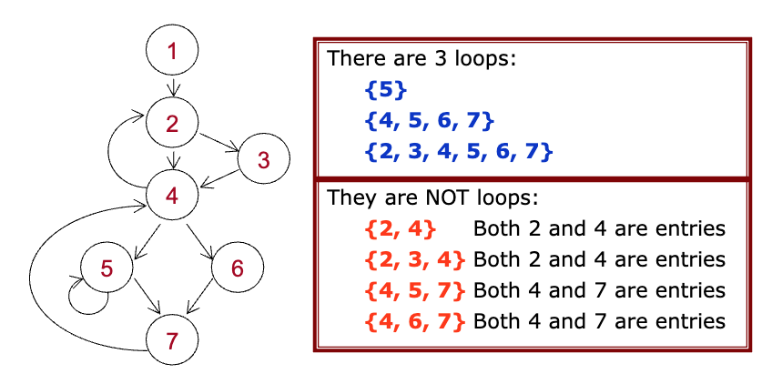

**有3个循环：**
- {5}
- {4, 5, 6, 7}
- {2, 3, 4, 5, 6, 7}

**它们不是循环：**
- {2, 4} 2和4都是入口
- {2, 3, 4} 2和4都是入口
- {4, 5, 7} 4和7都是入口
- {4, 6, 7} 4和7都是入口

---

# 支配者 (Page 28/63)

- **符号**
  - m DOM n 表示 m 是 n 的支配者
  - D(n) 是 n 的所有支配者的集合
    - **D(n) = {m | m DOM n}**
- **属性**
  - 入口是循环中所有节点的支配者
  - 二元关系 DOM 是偏序关系
    - 自反性、传递性和反对称性

---

# 计算 D(n) 的算法 (Page 29/63)

- **输入：流图 G = (N, E, n₀)**
  - N = 节点集合；E = 边集合；n₀ = 入口
- **算法**
  ```
  1. D(n₀) = {n₀};
  2. foreach(n ∈ N - {n₀}) D(n) = N;
  3. changed = true;
  4. while(changed){
  5.   changed = false;
  6.   foreach(n ∈ N - {n₀}){
  7.     newd = {n} ∪ (∩p∈PRE(n) D(p));
  8.     if(D(n) ≠ newd){
  9.       D(n) = newd; changed = true;
  10.    }
  11.  }
  12.}
  ```
  **PRE = 前驱节点**

---

# 上一个示例 (Page 30/63)

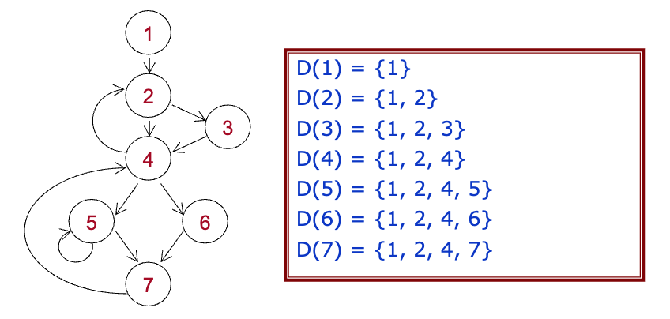

- D(1) = {1}
- D(2) = {1, 2}
- D(3) = {1, 2, 3}
- D(4) = {1, 2, 4}
- D(5) = {1, 2, 4, 5}
- D(6) = {1, 2, 4, 6}
- D(7) = {1, 2, 4, 7}

---

# 回边和自然循环 (Page 31/63)

- **回边**
  - a → b 是回边如果 a → b ∈ E ∧ b DOM a
- **自然循环**
  - 由回边 a → b 定义的自然循环 = {b} ∪ {不经过 b 就能到达 a 的节点}

---

# 上一个示例 (Page 32/63)

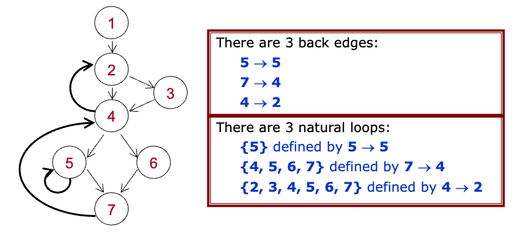

**有3条回边：**
- 5 → 5
- 7 → 4
- 4 → 2

**有3个自然循环：**
- {5} 由 5 → 5 定义
- {4, 5, 6, 7} 由 7 → 4 定义
- {2, 3, 4, 5, 6, 7} 由 4 → 2 定义

---

# 通过回边查找循环 (Page 33/63)

- **输入：回边 n → d**
- **算法：**
  ```
  1. void insert(Node m){
  2.   if(m ∉ loop){// d 不会被压入
  3.     loop = loop ∪ {m};
  4.     stack.push(m)
  5.   }
  6. }
  7. void main(){
  8.   Stack stack = new Stack();
  9.   loop = {d};// PRE(d) 不会被添加
  10.  insert(n);
  11.  while(stack.notEmpty()){
  12.    m = stack.pop();
  13.    foreach(p ∈ PRE(m)) insert(p)
  14.  }
  15.}
  ```

---

# 示例#1 (Page 34/63)

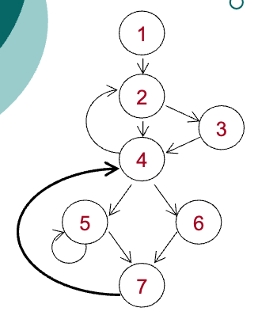

- **给定回边 7 → 4**
  1. 初始化：loop = {4, 7}, stack = [7]
  2. 弹出 7；插入 5 和 6；loop = {4, 7, 5, 6}, stack = [5, 6]
  3. 弹出 6；插入 4（已在 loop 中）；loop 不变，stack = [5]
  4. 弹出 5；插入 4 和 5（都在 loop 中）；loop 不变，stack = []
  5. 结果：loop = {4, 7, 5, 6}


---

# 示例#2 (Page 35/63)

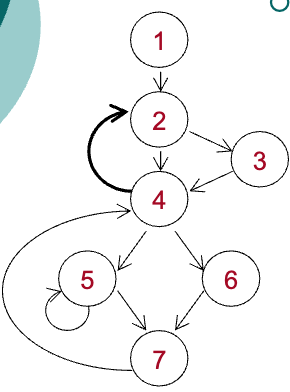

- **给定回边 4 → 2**
  1. 初始化：loop = {2, 4}, stack = [4]
  2. 弹出 4；插入 2, 3 和 7（2 已在 loop 中）；loop = {2, 4, 3, 7}, stack = [3, 7]
  3. 弹出 7；插入 5 和 6；loop = {2, 4, 3, 7, 5, 6}, stack = [3, 5, 6]
  4. 弹出 6；插入 4（已在 loop 中）；loop 不变，stack = [3, 5]
  5. 弹出 5；插入 4 和 5（都在 loop 中）；loop 不变，stack = [3]
  6. 弹出 3；插入 2（已在 loop 中）；loop 不变，stack = []
  7. 结果：loop = {2, 4, 3, 7, 5, 6}


---

# 自然循环的属性 (Page 36/63)

- **自然循环不能覆盖常识中的所有循环**
  - 例如：在以下流图中没有回边，但它在常识中确实有一个循环：{2, 3}
  - 只有在可约流图中，回边才能找到所有循环
- **可约流图**
  - 移除所有回边后，子图是无环的
  - 在可约流图中，循环的唯一入口是头节点
  - 从结构化程序生成的流图通常是可约的

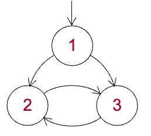

---

# 循环优化：代码移动 (Page 37/63)

- **代码移动的目标**
  - 循环头节点的前驱节点之后
- **什么代码可以移动？**
  对于指令 x = y op z，
  1. 它是循环不变操作
     - y 和 z 的所有可能定义都在循环外部，包括常量，或者（递归地）
     - 由循环不变值定义
  2. 循环中没有其他语句定义 x
  3. 循环中对 x 的所有使用都由它定义

---

# 循环优化：降低强度和消除归纳变量 (Page 38/63)

- **基本归纳变量**
  - i = i ± C
    - 循环中对 i 的唯一赋值
    - C 是循环不变的
- **归纳变量族**
  - j = C₁ * i ± C₂
    - C₁ 和 C₂ 都是循环不变的
- **动机**
  - 用族中的某个 j 替换 i
    - 可以移除 j 的乘法
    - 然后可以消除 i
  - 对索引变量特别有效

---

# 一个示例：归纳变量族 (Page 39/63)

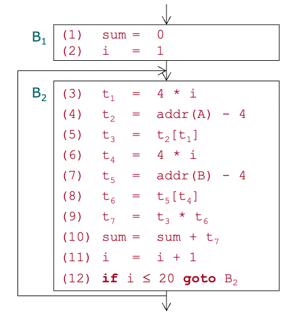

- **只有一个循环：{B2}**
- **基本归纳变量：i**
- **归纳变量族：**
  - t1 = (i, 4, 0) = 4 * i + 0
  - t4 = (i, 4, 0) = 4 * i + 0

---

# 一个示例：强度降低(1) (Page 40/63)

```
B1  (1) sum = 0
    (2) i = 1
    (2a) t1' = 4 * i
    (2b) t4' = 4 * i
```
```
B2  (3) t1 = 4 * i
    (4) t2 = addr(A) - 4
    (5) t3 = t2[t1]
    (6) t4 = 4 * i
    (7) t5 = addr
    (B) - 4(8) t6 = t5[t4]
    (9) t7 = t3 * t6
    (10) sum = sum + t7
    (11) i = i + 1
    (12) if i ≤ 20 goto B2
```

- **为族中的每个归纳变量创建新变量 j'（例如 t1' 和 t4'）**
- **在预头节点末尾初始化新变量：**
  - j' = C₁ * i
  - j' = j' + C₂ // 仅当 C₂ ≠ 0

---

# 一个示例：强度降低(2) (Page 41/63)

```
B1  (1) sum = 0
    (2) i = 1
    (2a) t1' = 4 * i
    (2b) t4' = 4 * i
```
```
B2  (3) t1 = t1'
    (4) t2 = addr(A) - 4
    (5) t3 = t2[t1]
    (6) t4 = t4'
    (7) t5 = addr(B) - 4
    (8) t6 = t5[t4]
    (9) t7 = t3 * t6
    (10) sum = sum + t7
    (11) i = i + 1
    (12) if i ≤ 20 goto B2
```

- **改变每个归纳变量的定义（例如 t1 和 t4）：**
  - j = j'

---

# 一个示例：强度降低(3) (Page 42/63)

```
B1  (1) sum = 0
    (2) i = 1
    (2a) t1' = 4 * i
    (2b) t4' = 4 * i
```
```
B2  (3) t1 = t1'
    (4) t2 = addr(A) - 4
    (5) t3 = t2[t1]
    (6) t4 = t4'
    (7) t5 = addr(B) - 4
    (8) t6 = t5[t4]
    (9) t7 = t3 * t6
    (10) sum = sum + t7
    (11) i = i + 1
    (11a) t1' = t1' + 4
    (11b) t4' = t4' + 4
    (12) if i ≤ 20 goto B2
```

**在基本归纳变量的唯一定义之后添加线性赋值（i = i ± C）：**
  - t = C₁ * C
  - j' = j' ± t

**如果 C == ±1，只需要添加一条语句：**
  - j' = j' ± C₁

---

# 一个示例：消除死归纳变量 (Page 43/63)

```
B1  (1) sum = 0
    (2) i = 1
    (2a) t1' = 4 * i
    (2b) t4' = 4 * i
```
```
B2  (3) t1 = t1'
    (4) t2 = addr(A) - 4
    (5) t3 = t2[t1]
    (6) t4 = t4'
    (7) t5 = addr(B) - 4
    (8) t6 = t5[t4]
    (9) t7 = t3 * t6
    (10) sum = sum + t7
    (11) i = i + 1
    (11a) t1' = t1' + 4
    (11b) t4' = t4' + 4
    (12) if i ≤ 20 goto B2
```

**如果归纳变量 j 在出口处不活跃，将 j 的使用改为 j'（例如将 t1 和 t4 的引用改为 t1' 和 t4'），然后移除 j 的定义（例如 t1 和 t4）**

---

# 一个示例：改变循环条件 (Page 44/63)

```
B1  (1) sum = 0
    (2) i = 1
    (2a) t1' = 4 * i
    (2b) t4' = 4 * i
```
```
B2  (3) t1 = t1'
    (4) t2 = addr(A) - 4
    (5) t3 = t2[t1]
    (6) t4 = t4'
    (7) t5 = addr(B) - 4
    (8) t6 = t5[t4]
    (9) t7 = t3 * t6
    (10) sum = sum + t7
    (11) i = i + 1
    (11a) t1' = t1' + 4
    (11b) t4' = t4' + 4
    (12) if i ≤ 20 goto B2
```

**从族中选择一个新的归纳变量（例如 t1'），然后改变循环条件**

---

# 一个示例：移除基本归纳变量 (Page 45/63)

```
B1  (1) sum = 0
    (2) i = 1
    (2a) t1' = 4 * i
    (2b) t4' = 4 * i 
```
```
B2  (3) t1 = t1'
    (4) t2 = addr(A) - 4
    (5) t3 = t2[t1]
    (6) t4 = t4'
    (7) t5 = addr(B) - 4
    (8) t6 = t5[t4]
    (9) t7 = t3 * t6
    (10) sum = sum + t7
    (11) i = i + 1
    (11a) t1' = t1' + 4
    (11b) t4' = t4' + 4
    (12) if i ≤ 20 goto B2
```

**如果基本归纳变量 i 在出口处不活跃，可以移除 i 的定义**

---

# 一个示例：循环优化后 (Page 46/63)

```
B1  (1) sum = 0
    (2) i = 1
    (2a) t1' = 4 * i
    (2b) t4' = 4 * i
```
```
B2  (4) t2 = addr(A) - 4
    (5) t3 = t2[t1']
    (7) t5 = addr(B) - 4
    (8) t6 = t5[t4']
    (9) t7 = t3 * t6
    (10) sum = sum + t7
    (11a) t1' = t1' + 4
    (11b) t4' = t4' + 4
    (12a) R = 4 * 20
    (12b) if t1' ≤ R goto B2
```

**优化后的代码便于进一步的局部优化**

---

# 4. 数据流分析和全局优化 (Page 47/63)

- **收集关于数据流的信息**
  - 变量如何被赋值（定义）？
  - 变量如何被引用（使用）？
- **控制流 与 数据流**
  - 控制流分析：基本块被视为黑盒
  - 数据流分析：基本块被视为白盒

---

# 全局信息在哪里需要？ (Page 48/63)

- **局部优化**
  - 如果变量从未被使用，对变量的赋值可以被移除
- **循环优化：代码移动**
  - 根据变量的定义确定循环不变操作
  - 代码移动要求操作是循环中的唯一定义
  - 代码移动还要求定义的变量在循环出口处不活跃
- **循环优化：归纳变量消除**
  - 如果归纳变量在循环外部未被使用，可以被移除
- **代码生成**
  - 关于出口处活跃性的信息有助于寄存器利用

---

# 需要什么全局信息？ (Page 49/63)

- **定义**
  - 语句中 R 值的所有赋值（源）
- **使用**
  - 语句中 L 值的所有可能使用
- **活跃性**
  - 在语句之后，变量是否会作为 R 值被引用？

---

# 基本概念 (Page 50/63)

- **流图中的点（语句之间）**
  - 两个相邻语句之间
  - 第一个语句之前和最后一个语句之后
- **变量 x 的定义（语句）**
  - 可能给 x 赋值的语句
  - L 值
- **变量 x 的使用（语句）**
  - 将 x 作为操作数引用的语句
  - R 值

---

# 基本概念（续） (Page 51/63)

- **定义 d 到达点 p**
  - 存在从 d 之后的点到 p 的路径，使得 d 在路径上不被"杀死"
  - 当我们在 p 之后立即使用 x 时，x 的值可能由 d 确定

---

# Ud-链 与 Du-链 (Page 52/63)

- **Ud-链：变量 x 在使用语句 s 中的使用-定义链**
  - 可以到达 s 的 x 的定义集合
  - 用于查找循环不变量
  - 也用于全局常量折叠
- **Du-链：变量 x 在定义语句 s 中的定义-使用链**
  - 可以从 s 到达的 x 的使用集合
  - 用于循环优化中消除归纳变量
  - 也用于查找归纳变量族

---

# 到达定义分析 (Page 53/63)

- **前向数据流方程**
  ```
  out[B] = (in[B] - kill[B]) ∪ gen[B]
  in[B] = ∪p∈PRE(B) out[p]
  ```

- in[B]：B 入口之前的 ud-链
- out[B]：B 出口之后的 ud-链
- gen[B]：B 中可以到达 B 出口的所有定义
- kill[B]：被 B 杀死的 B 外部的所有定义

---

# Ud-链的构造 (Page 54/63)

- **输入：gen[] 和 kill[]；输出：in[] 和 out[]**
- **算法**
  ```
  for(int i = 1; i <= n; i++){ // 初始化
    in[Bi] = ∅;
    out[Bi] = gen[Bi];
  }
  changed = true;
  while(changed){ // 迭代
    changed = false;
    for(i = 1; i <= n; i++){
      newIn = ∪p∈PRE[Bi] out[p];
      if(newIn ≠ in[Bi]){
        changed = true;
        in[Bi] = newIn;
        out[Bi] = (in[Bi] - kill[Bi]) ∪ gen[Bi];
      }
    }
  }
  ```

---

# 一个示例：(1) gen[] 和 kill[] 已知 (Page 55/63)

- **仅考虑变量 i 和 j**

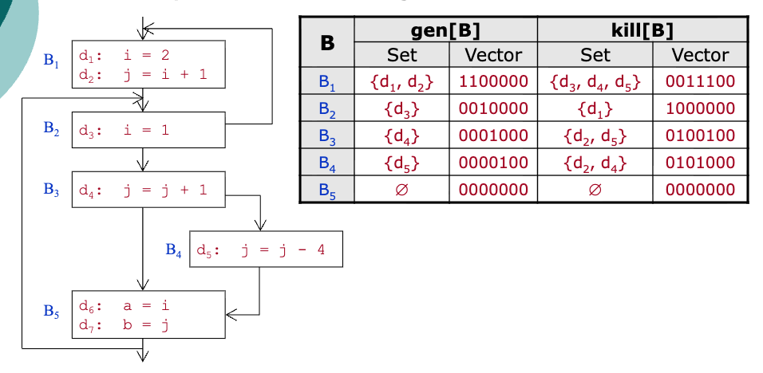

| B | gen[B] | gen[B] | kill[B] | kill[B] |
|---|---|---|---|---|
| B | 集合 | 向量 | 集合 | 向量 |
| B1 | {d1, d2} | 1100000 | {d3, d4, d5} | 0011100 |
| B2 | {d3} | 0010000 | {d1} | 1000000 |
| B3 | {d4} | 0001000 | {d2, d5} | 0100100 |
| B4 | {d5} | 0000100 | {d2, d4} | 0101000 |
| B5 | ∅ | 0000000 | ∅ | 0000000 |

---

# 一个示例：(2) in[] 和 out[] 的迭代 (Page 56/63)

- **深度优先访问：B1, B2, B3, B4 和 B5**

| B | Init | Init | 1st | 1st | 2nd | 2nd | 3rd | 3rd | 4th | 4th |
|---|---|---|---|---|---|---|---|---|---|---|
| B | in[B] | out[B] | in[B] | out[B] | in[B] | out[B] | in[B] | out[B] | in[B] | out[B] |
| B1 | 0000000 | 1100000 | 0010000 | 1100000 | 0110000 | 1100000 | 0111100 | 1100000 | 0111100 | 1100000 |
| B2 | 0000000 | 0010000 | 1100000 | 0110000 | 1111100 | 0111100 | 1111100 | 0111100 | 1111100 | 0111100 |
| B3 | 0000000 | 0001000 | 0110000 | 0011000 | 0111100 | 0011000 | 0111100 | 0011000 | 0111100 | 0011000 |
| B4 | 0000000 | 0000100 | 0011000 | 0010100 | 0011000 | 0010100 | 0011000 | 0010100 | 0011000 | 0010100 |
| B5 | 0000000 | 0000000 | 0011100 | 0011100 | 0011100 | 0011100 | 0011100 | 0011100 | 0011100 | 0011100 |

---

# 一个示例：(3) Ud-链的构造 (Page 57/63)

- **用 in[B] 计算 ud-链**
  - 如果 s.x 在 B 中有定义在 s 之前，s.x 的 ud-链是单元素（最接近 s 的定义）
  - 否则，s.x 的 ud-链是 in[B] 中 x 的所有定义
- **结果 ud-链**
  - 变量 i 在定义 d2：{d1}
  - 变量 j 在定义 d4：{d2, d4, d5} // d3 是 i 的定义，不是 j
  - 变量 j 在定义 d5：{d4}
  - 变量 i 在定义 d6：{d3} // d4 和 d5 是 j 的定义，不是 i
  - 变量 j 在定义 d7：{d4, d5}

---

# 基于 Ud-链的全局常量传播和折叠 (Page 58/63)

```
changed = true;
while(changed){
  changed = false;
  foreach(语句[S: x = ...]){
    foreach(操作数 S.y){ // 常量传播
      if(S.y.ud-链只有一个 i 且 i 是[y = CONST]){
        用 CONST 替换所有 S.y;
        changed = true;
      }
    }
    if(S 有操作符且每个操作数都是 CONST){// 折叠
      let C = 常量操作的结果;
      用[x = C]替换 S;
      changed = true;
    }
  }
}
```

---

# 更多数据流方程：可用表达式 (Page 59/63)

- **前向数据流方程**
  ```
  out[B] = (in[B] - E_kill[B]) ∪ E_gen[B]
  in[B] = if(B == ENTRY, ∅, ∩p∈PRE(B) out[p])
  ```
- **in[B]：B 之前的可用表达式**
- **out[B]：B 之后的可用表达式**
- **E_gen[B]：B 生成的表达式**
- **E_kill[B]：B 杀死的表达式**
- **动机**
  - 在 s 处可用的表达式 E = X op Y 是从入口点到 s 的 E 的最后一次求值，且在 E 的定义之后没有对 X 和 Y 的重新定义
  - 用途：全局公共表达式消除

---

# 更多数据流方程：活跃性分析 (Page 60/63)

- **后向数据流方程**
  ```
  in[B] = (out[B] - def[B]) ∪ use[B]
  out[B] = ∪s∈SUCC(B) in[s]
  ```
- **in[B]：B 之前的活跃变量**
- **out[B]：B 之后的活跃变量**
- **use[B]：B 生成的活跃变量**
- **def[B]：B 杀死的活跃变量**

**SUCC = 后继节点**

---

# 练习 12.1 (Page 61/63)

- **给定以下流图：**
  - 计算所有节点的支配者
  - 找出流图中的所有回边
  - 找出每条回边定义的所有自然循环

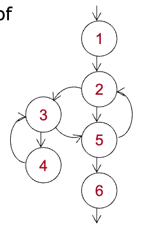
