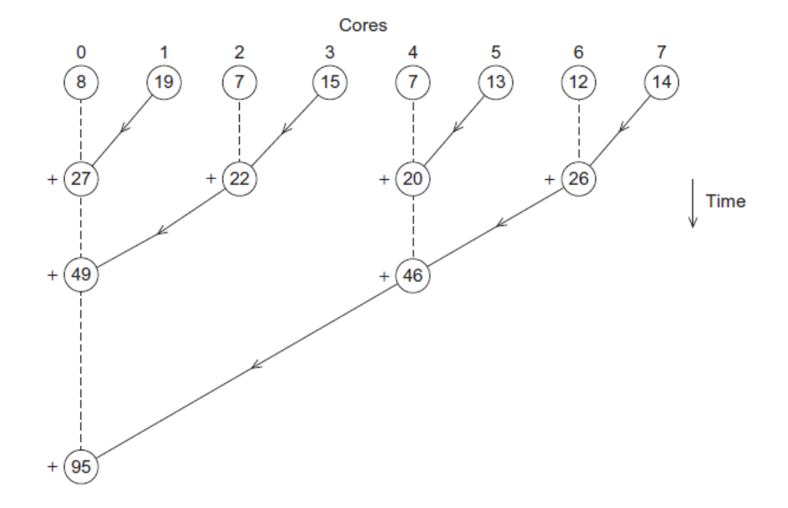
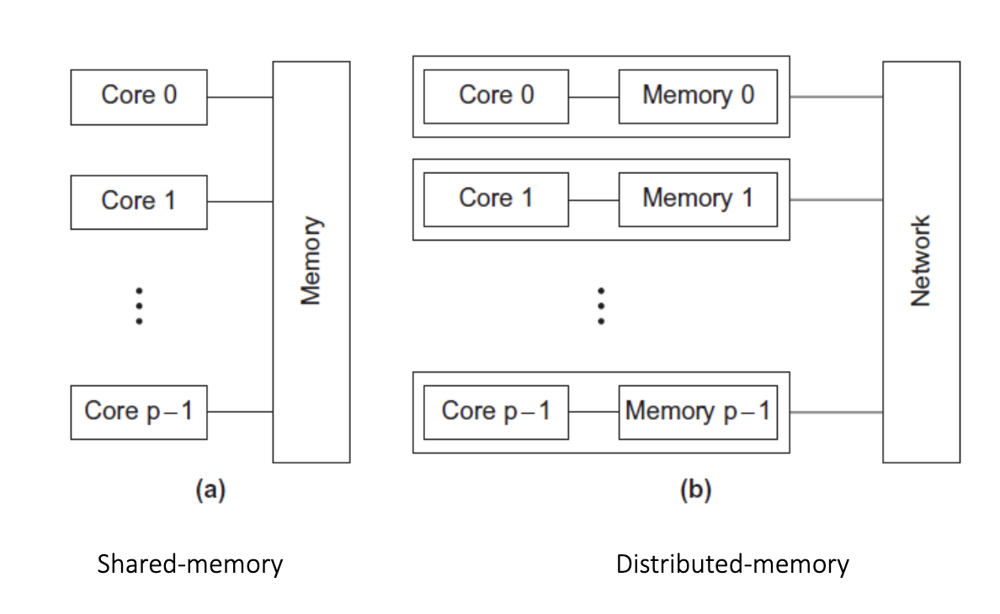
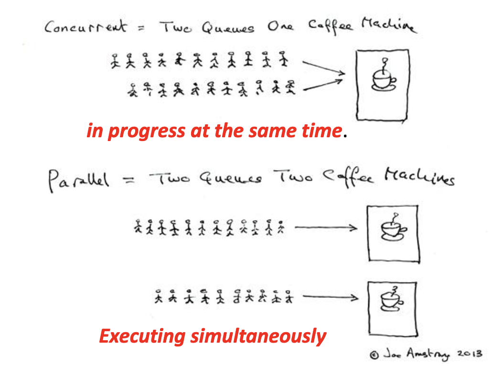
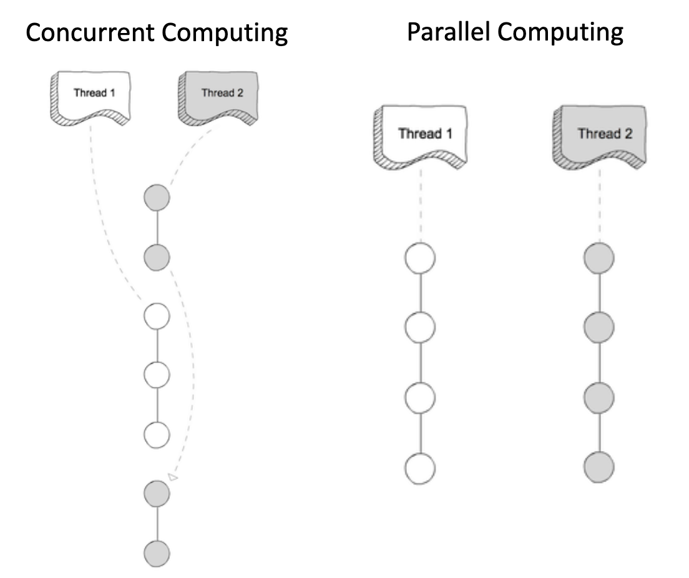

# 并行程序设计

> 参照 谢莉·唐 2020/8/17~2020/9/3

## 第一讲

### 为什么我们需要不断提高的性能

- 计算能力在不断提高，但我们的计算问题和需求也在增加。
- 由于过去的进步，我们从未想过的问题已经得到解决，比如解码人类基因组。
- 更复杂的问题仍在等待解决。

### 为什么我们构建并行系统

- 到目前为止，性能提升主要归因于晶体管密度的增加。
- 但存在固有的问题

### 功耗密度墙

- 英特尔最新的微处理器运行速度比前代更慢，温度更高。
- 英特尔公开承认其微处理器系列遇到了"热墙"。

解决方案
- 从单核系统转向多核处理器。
- 中央处理器（CPU）

### 为什么我们需要编写并行程序
- 运行串行程序的多个实例通常用处不大。
- 想象一下运行你最喜欢的多个游戏实例。
- 你真正想要的是让它运行得更快，让你的程序运行得更快

### 如何编写并行程序

最好的并行解决方案是退一步，设计一个全新的算法。

示例如下
#### 串行
```cpp
sum = 0;
for (i = 0; i < n; it+) {
  x = Compute_next_value (- . .);
  sum †= x;
}
```
### 并行
```cpp
my_sum = 0;
my_first_i = …
my_last_」=・・・；
for (my_i = my_first_i; my_i < my_last_i; my_it+) {
  my_x = Compute_next_value （・・・）；
  my_sum t= my_x;
}
```
- 我们有p个核心，p远小于n。

- 每个核心执行大约n/p个值的部分和

每个核心使用它自己的私有变量
并独立于其他核心执行这段代码块

在每个核心完成代码执行后，私有变量my_sum包含其调用Compute_next_value计算的值的总和。

- 例如，8个核心，n = 24，那么调用Compute_next_value返回：
1,4,3, 9,2,8, 5,1,1, 5,2,7, 2,5,0, 4,1,8, 6,5,1, 2,3,9

一旦所有核心完成计算它们的私有my_sum，它们通过将结果发送到指定的"主"核心来形成全局和，主核心添加最终结果。

全局和
8 + 19 + 7 + 15 + 7 + 13 + 12 + 14 = 95

#### 更好的并行算法
- 不要让主核心执行所有的加法操作
- 核心0添加来自核心2的结果。核心4添加来自核心6的结果，等等。



### 我们如何编写并行程序
- 任务并行
  - 将解决问题的各种任务分配给各个核心。
- 数据并行
  - 将解决问题使用的数据分配给各个核心。
  - 每个核心对其部分数据执行类似的操作

### 协调
- 通信 – 一个或多个核心将其当前部分和发送给另一个核心。
- 负载均衡 – 在各个核心之间均匀分配工作，以避免某个核心负载过重。
- 同步 – 因为每个核心以自己的速度工作，确保核心不会远远领先于其他核心。

### 我们将要做什么
- 编写显式并行的程序
- 使用C语言的三种不同扩展
  - 消息传递接口（MPI）
  - Posix线程（Pthreads）
  - OpenMP

### 并行系统类型
- 共享内存
  - 核心可以共享访问计算机的内存。
  - 通过让核心检查和更新共享内存位置来协调核心。
- 分布式内存
  - 每个核心都有自己的私有内存。
  - 核心必须通过网络显式发送消息进行通信。



### 术语
- 并发计算 – 一个程序在任何时刻都可以有多个任务**在进行中**。
> 同一时间段内，系统能处理多个任务，但任务不一定同时执行; 快速切换上下文，使多个任务看似同时进行
- 并行计算 – 一个程序中多个任务**紧密协作**解决问题
> 同一时刻，多个任务在不同的处理器或处理核心上同时执行，强调真正意义上的同时计算
- 分布式计算 – 一个程序可能需要
> 分配到不同的计算节点（可以是不同的计算机、服务器等）上进行处理
**与其他程序协作**解决问题。

### Concurrent 并发 vs. Parallel 并行

#### 什么是

- 如果一个系统可以同时支持两个或更多动作在进行中，则称该系统为并发的。
- 如果一个系统可以同时支持两个或更多动作同时执行，则称该系统为并行的。



#### 计算差异

- 在并行计算中，执行**发生在同一物理时刻**
  - 在（单核）单处理器上不可能实现并行计算
- 并发计算由进程生命周期重叠组成，但执行**不需要发生在同一时刻**
  - 并发进程可以通过时间片轮转的方式在一个核心上通过交错每个进程的执行步骤来执行
