# ch02.1 并行硬件和并行软件

## 硬件

### 主存储器

-  一组位置的集合，每个位置都能够存储指令和数据
- 每个位置由一个地址组成，用于访问

### 中央处理器（CPU）

#### 控制单元

负责决定程序中应该执行哪条指令。（老板）

#### 算术逻辑单元（ALU）

负责执行实际的指令。（工人）

#### 寄存器

非常快速的存储器，是CPU的一部分

### 程序计数器

存储下一条要执行的指令的地址

### 总线

连接CPU和内存的导线和硬件。

### 连接

- 读：内存 -> CPU
- 写：CPU -> 内存

## 软件

### 进程
> 进程

正在执行的计算机程序的一个实例

进程的组成部分：
- 可执行的机器语言程序。
- 一块内存。
- 操作系统分配给进程的资源描述符。
- 安全信息。
- 关于进程状态的信息。

### 多任务处理

- 给人一种单处理器系统同时运行多个程序的错觉。
- 每个进程轮流运行。（时间片）
- 时间用完后，它等待直到再次轮到它。

### 线程
> 线程

- 线程包含在进程中。
- 它们允许程序员将程序划分为（或多或少）独立的任务。
- 希望是当一个线程因为等待资源而阻塞时，另一个线程有工作可做并可以运行。

### 进程中的线程

一个进程可以拥有多个线程，但一个线程只能属于一个进程。

- "主"线程
- 启动线程称为派生（forking）
- 终止线程称为合并（joining）

### 缓存

#### 局部性原理

- 空间局部性 - 访问附近的位置。
- 时间局部性 - 在不久的将来访问。

#### 缓存级别

- L1缓存：最小且最快，位于CPU芯片本身上。
- L2
- L3

#### 缓存问题

当CPU将数据写入缓存时，缓存中的值可能与主内存中的值不一致。
- 写通缓存：通过在数据写入缓存时更新主内存中的数据来处理这个问题。
- 写回缓存：将缓存中的数据标记为脏。当缓存行被来自内存的新缓存行替换时，脏行被写入内存。

#### 缓存映射

- 全关联 - 新行可以放置在缓存中的任何位置。
- 直接关联 - 每个缓存行在缓存中都有一个唯一的分配位置。
- n路组相联 - 每个缓存行可以放置在缓存中的n个不同位置之一。
  - 当内存中的多个行可以映射到缓存中的几个不同位置时
  - 我们还需要能够决定应该替换或驱逐哪一行

### Virtual memory 虚拟存储器

所有的指令和数据可能无法装入
主存储器，虚拟内存作为缓存用于次要存储
- 利用了空间和时间局部性的原理
- 只保留正在运行的程序的活动部分在主存储
器中
- 交换空间- 那些闲置的部分被保存在一块辅助
存储器中
-  页面——数据和指令的块。
  - 通常这些是相对较大的。
  - 大多数系统都有一个固定的页面大小，目前范围从4到16千字节。

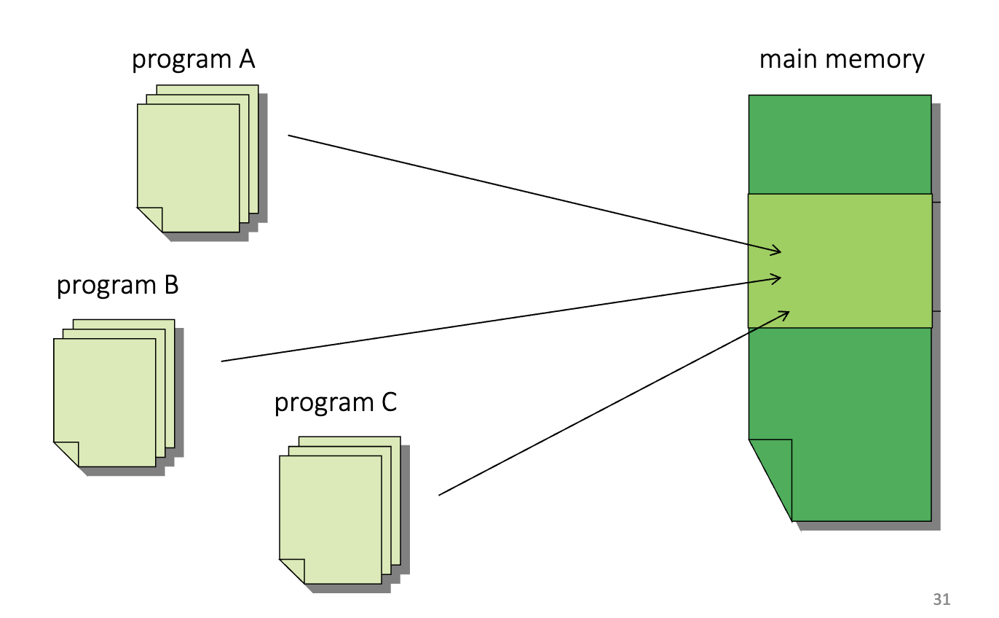

#### Virtual page numbers 虚拟页码

- 当程序被编译时，它的页面被分配了虚拟页号 。
- 当程序运行时，会创建一个表，该表映射虚
拟页号到物理地址。
- 页表用于将虚拟地址转换为物理地址

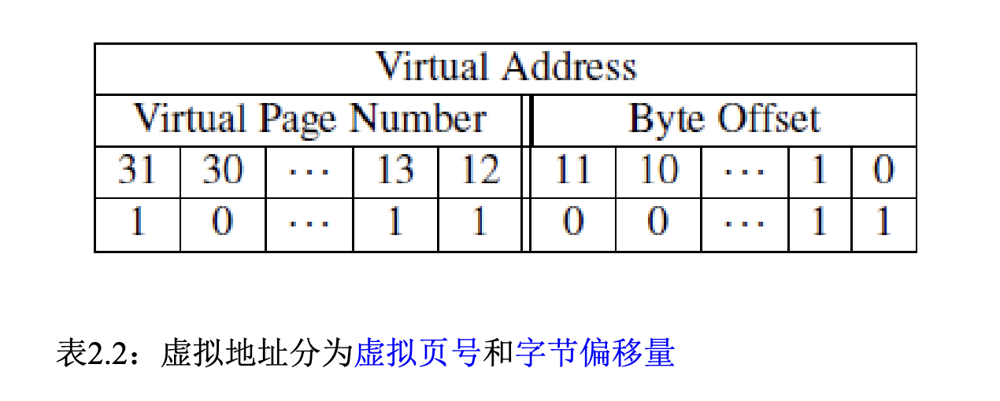

#### Translation-lookaside buffer (TLB)

- 使用页表有可能显著增加每个程序的总运行时间。
- 处理器中的特殊地址转换缓存
- 它 将 页 表 中 的 少 数 条 目 （ 通 常 为 16-512 条
目）缓存在非常快的内存中。
- 页错误-尝试访问页表中一个有效物理地址的
页，但该页仅存储在磁盘上

#### Instruction Level Parallelism (ILP) 指令级并行性

- 多个处理器组件或功能单元同时执行指令
来提高处理器性能的尝试
- 流水线(Pipeline)-功能单元按阶段排列。
- 多问题- 多条指令可以同时启动

#### Multiple Issue 多问题

多问题处理器复制功能单元并尝试同时执行程序中的不同指令
- Static Multiple Issue 静态多问题- 功能单元在编译时调度
- Dynamic Multiple Issue 动态多问题——功能单元是安排在运行时

#### Speculation 推测

- 为了利用多重问题，系统必须找到可以同时执
行的指令
- 在推测中，编译程序或处理器对
一条指令进行猜测，然后根据猜
测执行该指令
- 如果系统估计错误，它必须回去
重新计算

#### Hardware multithreading 硬件多线程

不同线程的同步执行并非总能产生良好效果。硬件多线程提供了一种方法，使系统能够在
当前执行的任务停滞时继续执行有用的工作。例如，当前任务必须等待数据从内存中加载。

- 细粒度- 处理器在每条指令后在线程之间切换，跳过停滞的线程
  - 优点：可避免因机器停机而浪费时间。
  - 缺点: 一个线程已经准备好执行一长串指令，但可能需要等待才能执行每一条指令
- 粗粒度-仅切换那些等待耗时操作完成而停滞的线程
  - 优点：切换线程不需要是近乎瞬时的。
  - Cons:处理器可以在较短的停顿上被和线程切换也会导致延迟
- 同时多线程（SMT）-一种细粒度多线程的变体。
  -  允许多个线程利用多个功能单元
  
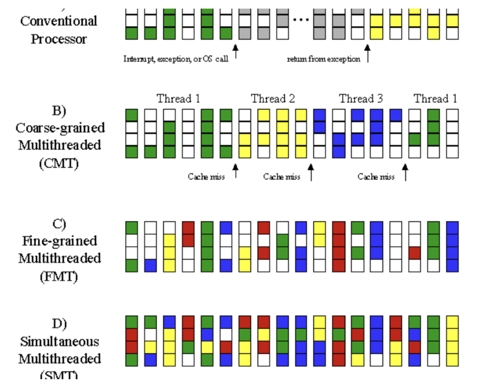

## Program 程序, Process 进程, Thread 线程

- Program 程序
  - 是存储在计算机上的代码，用于完成特定任务
  - 可以存在单个程序的多个实例，且该运行程序的每个实例都是一个进程 
- Process 进程
  - 每个进程都有一个独立的内存地址空间，这意味着进程独立运行，与其他进程隔离
  - 它无法直接访问其他进程中的共享数据
  - 切换从一个进程到另一个进程需要一些时间（相对）用于保存和加载寄存器、内存映射和其他资源。
- Thread 线程
  - 线程 是进程内的执行单位
  - 一个进程可以包含多个线程，这些线程共享进程的内存地址空间和资源
  - 每个线程将拥有自己的栈，但进程中的所有线程将共享堆
  - 进程中的某个线程出现问题，必然会影响其他线程及整个进程的正常运行

### 总结

1. 程序开始时是一个编程代码的文本文件，
2. 程序被编译或解释成二进制形式，
3. 程序被加载到内存中，
4. 程序变为一个或多个运行进程。
5. 进程通常独立，
6. 线程作为进程的子集而存在。
7. 线程之间可以更方便地通信，而进程之间则不能
8. 但是线程更容易受到同一进程内其他线程引起的问题的影响

### 进程与线程优缺点

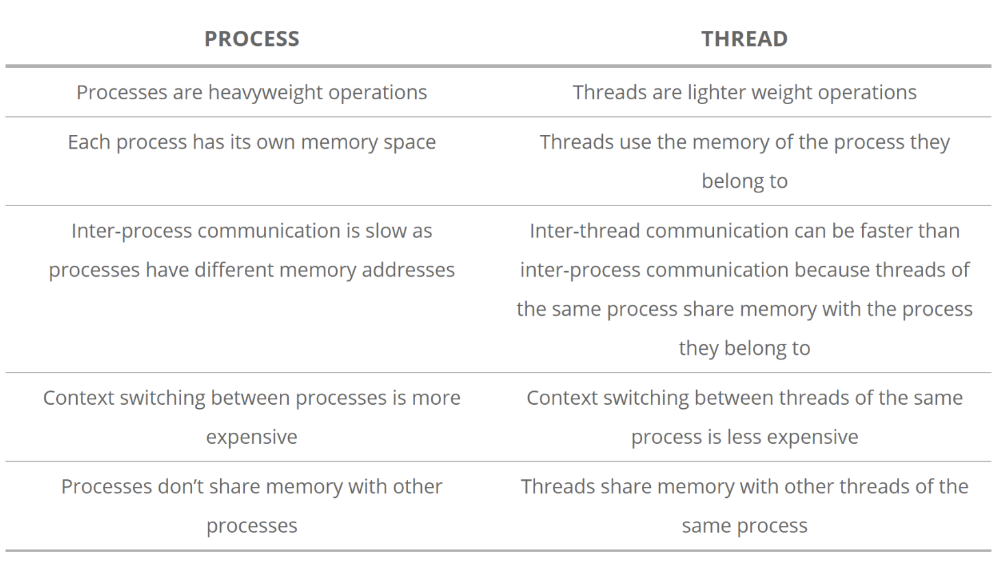

### CPU 中央处理器

- Core 核心通常是指CPU的基本计算单元
  - 它可以运行一个程序上下文或者多个程序上下文，如果它支持硬件线程，比如Intel CPU上的超线程
  - 一个进程可以在多个核心上运行，单个进程可在不同核心上运行多个线程
  - 一个线程可以在多个核心上运行(虽然基本不存在这种情况)，指令流水线和乱序执行的机制可以实现这一点
- CPU 可能拥有一个或多个核心，用于同时执行任务
  - 多核CPU是指一个CPU上具有多个核心
  - 这些任务通常是软件进程和线程，操作系统会调度它们
  - X = 核心数 × 每个核心的硬件线程数
- 处理器是用于描述 任何类型CPU的通用术语，无论其核心数量如何
- 一个多处理器系统包含多个CPU，使其能够并行工作。（这被称为SMP，即对称多处理。）

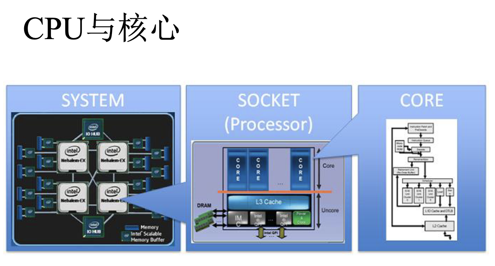


#### Hyperthreading 超线程技术

一个物理微处理器表现得像两个逻辑虚拟核心，共 享 处理器的计算能力，使得一个处 理 器 能 够 同 时 处 理 多 个 任 务 （ 或 线程）。
当超线程启用时，每个CPU核心管理并处理两个执行上下文。

原理
- 逻辑核心：
  - 超线程技术将一个物理核心模拟为两个逻辑核心,操作系统会将其识别为两个独立的处理器.
  - 每个逻辑核心可以同时运行一个线程。
- 资源共享：
  - 两个逻辑核心共享物理核心的执行资源,如算术逻辑单元(ALU)、缓存、总线等.
  - 当一个线程等待数据（如内存访问）时，另一个线程可以继续使用核心的计算资源。
- 指令级并行：
  - 通过并行执行多个线程的指令，减少核心资源的空闲时间 

## GPU 图形处理单元

- 实时图形应用编程接口
  - 使用点、线、三角形来表示物体的表面
  - 使用图形处理流水线将物体表面的内部表示转换为一个像素的数组
  - 该像素数组可以在屏幕上显示
  - 流水线的许多阶段是可编程的, 通过着色函数（shader）来说明
- GPU使用SIMD并行来优化性能
  - 对邻近元素使用相同的着色函数
  - 等同于使用相同的控制流
- GPU严重依赖硬件多线程
  - 避免内存访问的延迟
- GPU不是纯粹的SIMD系统
  - 在一个给定的核上ALU使用了SIMD并行
  - GPU有很多个核，每个核都能独立执行指令流

# ch02.2 并行计算机分类

## 传统计算机分类

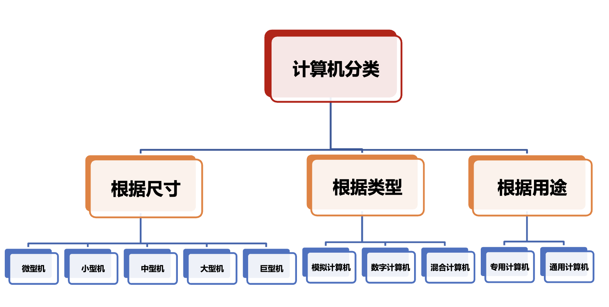

存在的缺陷：
- 由于计算机硬件技术的发展，划分标准需随时间变化
- 这样分类不能反映机器的系统结构特征

## Flynn 分类法

Flynn 弗林分类法的提出：一种基于数据流和指令流的并行性关系的分类方法
- Instruction 指令流: 指机器执行的执行的指令序列，即将一系列数据送入数据处理单元进行修改的命令
- Data 数据流: 指由指令流调用的数据序列，包括输入数据和中间结果，但不包括输出数据
- Multiple 多倍性: 指在系统性能瓶颈部件上处于同一执行阶段的指令或数据的最大可能个数

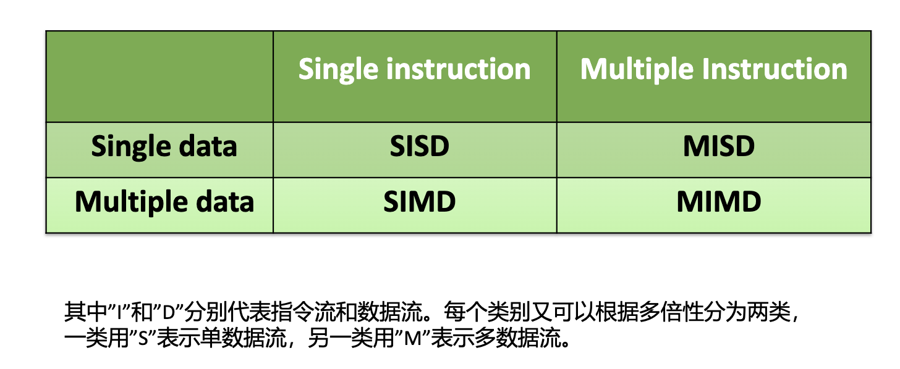

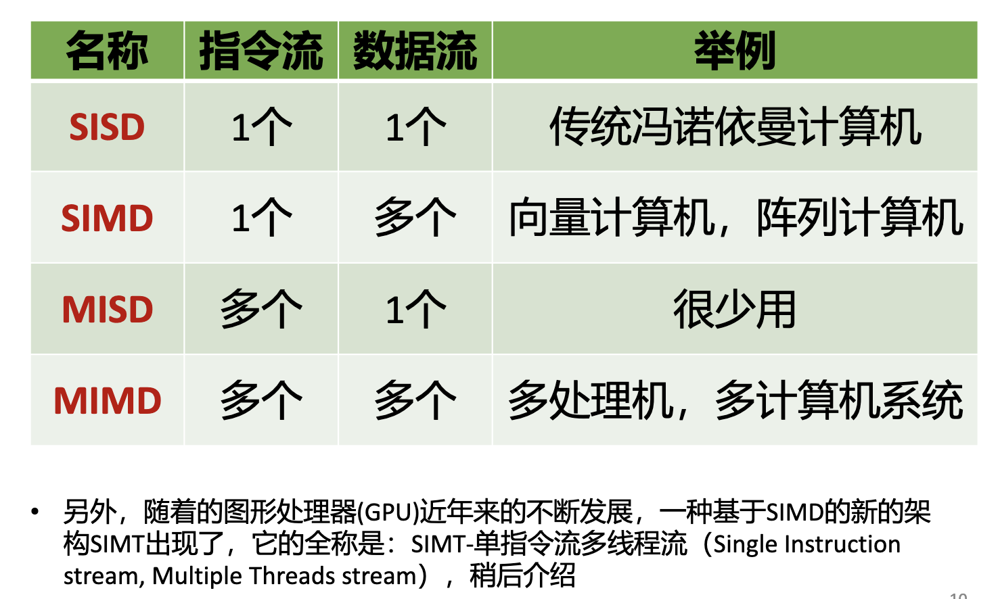

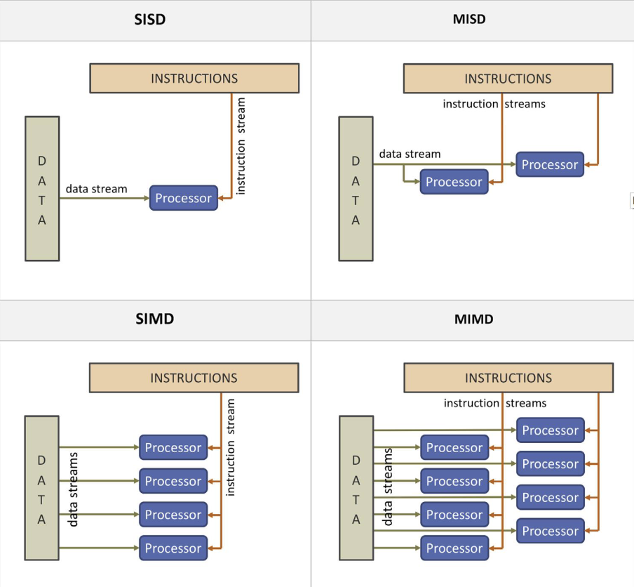

## SISD 体系结构

SISD(Single Instruction Single Data)计算机是一种传统的串行计算机
- 硬件上就不支持任何并行化计算，所有的指令都是串行执行
- CPU在一个时钟周期内只能执行一条数据流
- SIMD计算机可以实现数据级并行，对多个不同的数据流并行执行相同的数据处理操作
  - 把任务切分成多个子任务，每个子任务处理不同的数据流，但执行相同的指令流
  - 主要适用于解决使用向量和矩阵等复杂科学计算和大规模工程计算的问题，如数字信号处理、图像处理

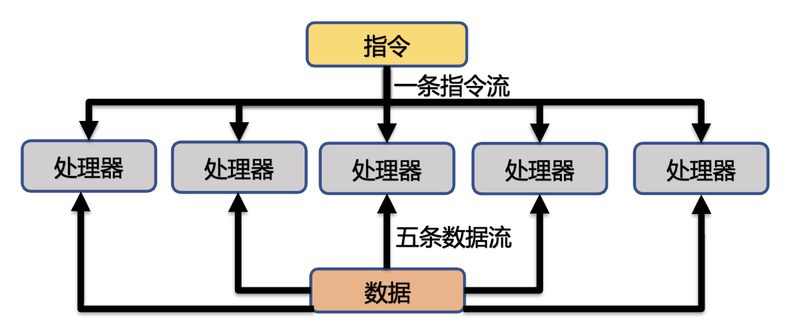

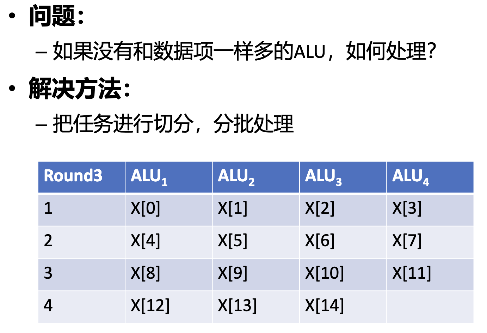

SIMD根据类型又可以分为阵列计算机和向量计算机
### 阵列计算机
- 用一个单一的控制单元提供信号驱动多个处理单元同时运行
- 处理单元之间通过互连网络连接
- 发展前景并不明朗
### 向量计算机

#### 特点

- 专门对向量进行处理的计算机
- 以流水线结构为主，以向量为基本操作单位进行处理
- 能够对数组或者数据向量进行操作（传统CPU只能针对单个元素和标量）

#### 主要部件

- 交叉存储器 （interleaved memory）
  - 内存系统由多个内存体组成
  - 每个内存体能够独立同时访问
- 步长式存储器访问（strided memory access）
  - 能够访问向量中固定间隔（步长）的元素
  - 如：第1,5,9个元素
- 硬件散射/聚集（hardware scatter/gather）
  - 指对无固定间隔的数据进行读（gather）和写（scatter）

#### 优点

- 速度快
- 容易使用
- 向量编译器擅长识别向量化的代码
  - 能识别不能向量化的循环，并提供循环不能向量化的原因
  - 用户能对是否重写代码来支持向量化做出明智决定
- 很高的内存带宽
- 充分利用高速缓存行中的每个元素

#### 缺点

- 不能处理不规则的数据结构和其他并行结构
- 可扩展性受到限制
  - 可扩展性是指能够处理更大问题的能力
  - 新一代系统通过增加向量处理器的数目，而非增加向量长度来进行扩展
- 对长向量的支持需要定制，非常昂贵

## MISD 体系结构

MISD(Multiple Instruction Single Data)中, 每个处理器都按照不同指令流的要求来对同一个数据流以进行不同的处理, 提出存在一定争议
- 有人认为这种类型的计算机至今都未出现
- 有其他人认为有一些类似的例子，例如共享内存的多处理器系统和计算机中的流水线结构

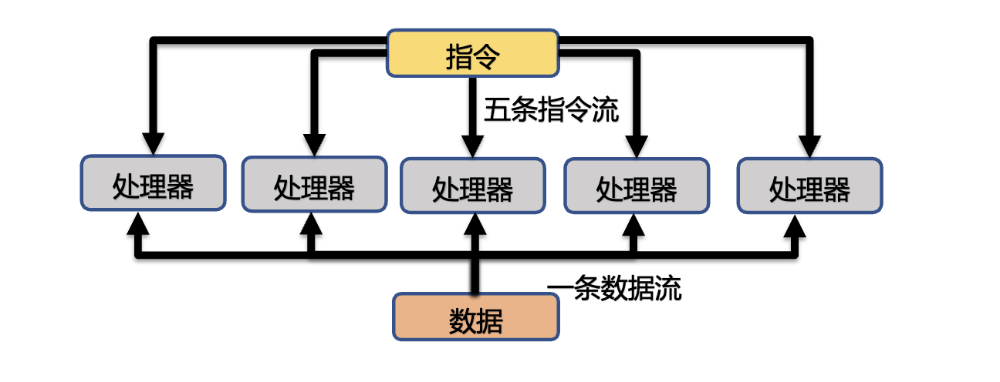

## MIMD 体系结构

MIMD(Multiple Instruction Multiple Data")中，每个处理器都有自己的指令流，也可以和其他处理器共享指令流，对自己的数据进行处理
- 是最广泛应用且现在流行的并行体系结构的形式
- 超算、计算机集群、分布式系统、多处理器计算机和多核计算机都划分为这种类型


## 拓展 SIMT 体系结构

SIMT是一种并行计算中使用的模型，主要是将SIMD与多线程结合在一起，广泛应用于GPU上的计算单元中

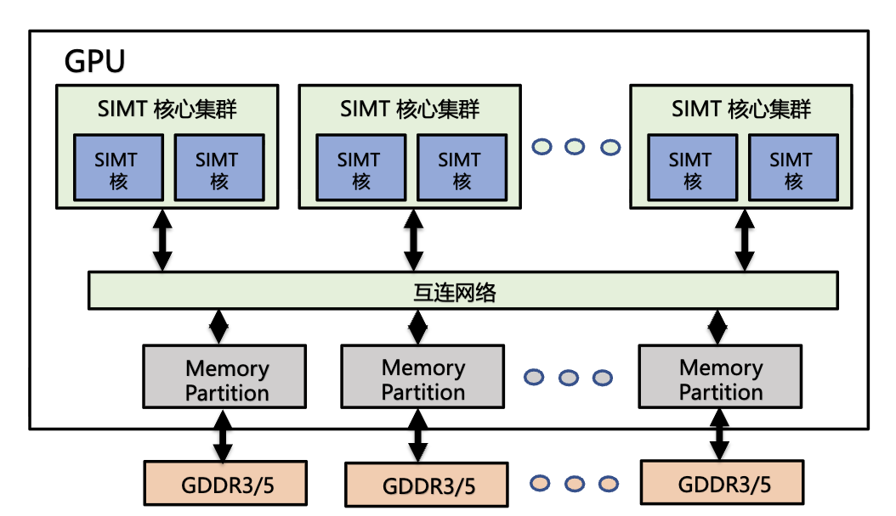

### SIMT vs SIMD

- SIMT比SIMD更灵活
  - SIMT允许一条指令的多数据分开寻址
  - SIMD是必须连续在一起的片段
- SIMD中的向量中元素相互之间可以自由通信
  - SIMD的向量存在于相同的地址空间（例如，都在CPU的同一寄存器中）
- SIMT中的每个线程的寄存器都是私有的
  - SIMT线程之间只能通过共享内存和同步机制进行通信

## Flynn 分类法的局限性

- 分类的对象主要是控制驱动方式下的串行处理和并行处理计算机，对于非控制驱动方式的计算机不适合。
- 把两个不同等级的功能并列对待导致MISD计算机不存在。
- 分类太粗，对流水线处理机的划分不明确，如标量流水线为SISD，向量流水线为SIMD
- 其他分类方法：
  - 冯氏分类法：美籍华人教授冯泽云1972年提出按最大并行度来定量描述各种计算机系统
  - 1978年D.J.Kuck提出按控制流和执行流分类。
  - Wolfagan Handler在1977年提出根据并行度和流水线分类
- flynn分类法的扩展
  - SISD: 单指令单数据流
  - SIMD: 单指令多数据流
  - MISD: 多指令单数据流
  - MIMD: 多指令多数据流
    - 共享式内存(多处理器系统)
      - UMA: 统一内存访问
      - NUMA: 非统一内存访问
        - CC-NUMA: 具有缓存一致性的非统一内存访问
        - NC-NUMA: 非缓存一致性的非统一内存访问
    - 分布式内存(多计算机系统)
      - MPP: 大规模并行处理器
      - COW: 共享内存并行处理器

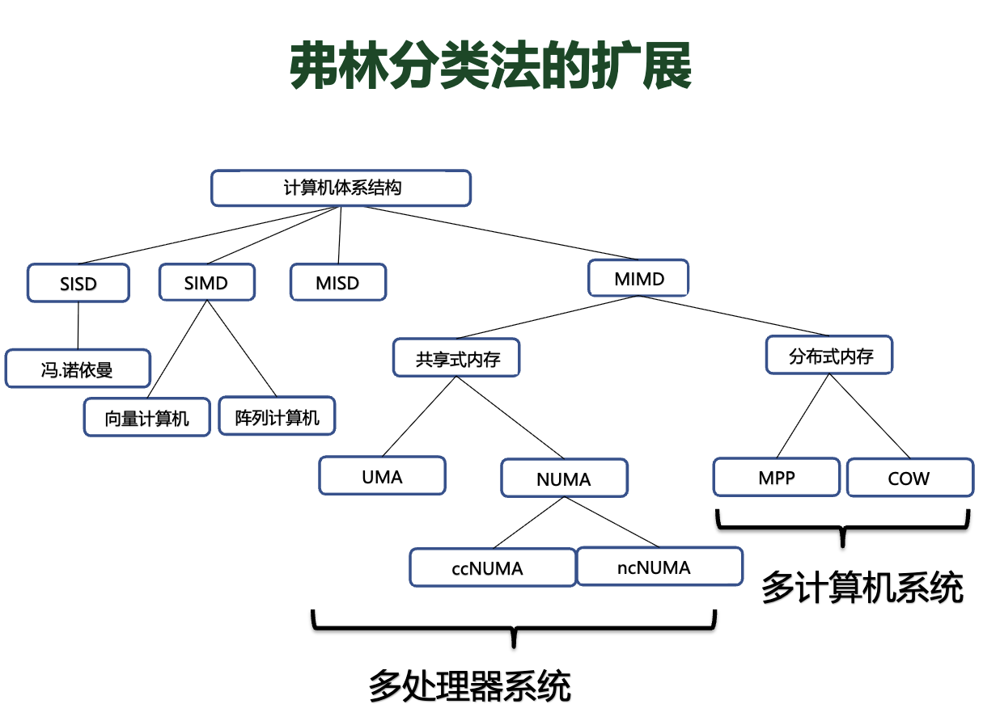

## MIMD 体系结构的分类

根据不同的CPU是如何组织和共享内存的，MIMD机器分为如下的两类：
- 共享式内存（Shared Memory）
- 分布式内存（Distributed Memory）

- 共享式内存系统就是处理器之间共享内存，通过共享内存进行通信
  - 所有的处理器都通过软件或者硬件的方式连接到一个“全局可用”的存储器
- 分布式内存系统（消息驱动）是处理器之间不共享内存，通过消息驱动来通信
  - 对于要共享的数据，它必须作为消息从一个处理器传递到另一个处理器
  - 如果两个处理器之间没有运行软件协议加以辅助，那么一个处理器就无法访问另一个存储器的数据

### 共享式内存系统

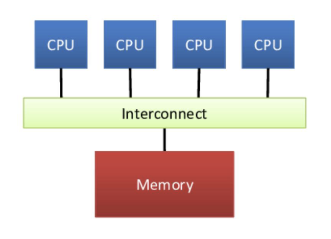

共享式内存系统可以分为如下两类：
- 集中共享内存系统(CSM)
- 分布式共享内存系统(DSM)

线程之间的通信都是通过共享内存地址来完成的，所谓“共享内存”指的就是将所有的存储器抽象成一个整体存储地址。

#### 集中共享式内存

集中共享式内存(Centralized Shared Memory)，又叫对称多处理器(Symmetric Multiprocessors)，一致存储访问系统(Uniform Memory Access)

- 此类多处理器中处理器数目较少，所以处理器之间能够共享一个集中式的存储器
- 所有的存储器能够平等的访问它，这就是 对称 一词的由来。
- 又因为每个处理器都能平等地访问存储器，所以它们访问存储器的延迟都是相同的，因此又被叫做一致存储访问系统

特点
- 有一个存储器被所有处理器均匀共享。
- 所有处理器访问共享的存储器的延迟相同。
- 每个处理器可以拥有私有内存或高速缓存

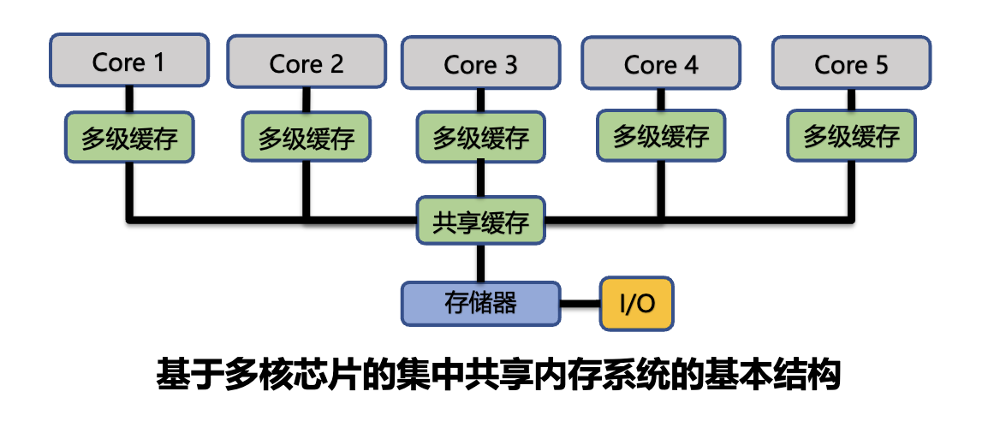

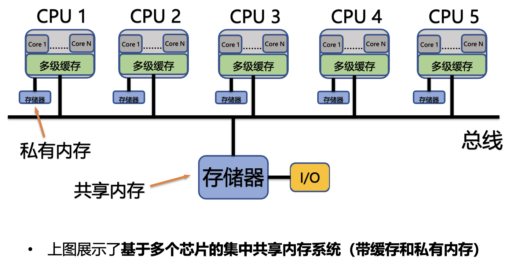

多个芯片与多核芯片不同，这里每个芯片可以认为是一个处理器，将所有的处理器通过总线或者互连网络连接到同一个存储器，而不是在一个芯片的内部，并且每个处理器都有自己的私有内存和共享内存

#### 分布式共享式内存

分布式共享内存系统 (Distributed Shared Memory)，又叫非一致存储访问系统(Non-Uniform Memory Access)

- 每个处理器都拥有自己的存储器，也可以访问其他节点的存储器
- 这类系统之所以叫做非一致存储访问系统，是因为每个结点访问本地内存和访问其它结点的远程内存的延迟是不同的。

特点
- 所有的处理器都能访问一个单一的地址空间。
- 使用LOAD和STORE指令访问远程内存。
- 访问远程内存比访问本地内存延迟要高。
- 每个处理器可以使用高速缓存
- 目前几乎所有的多核心多处理器系统都使用了分布式存储

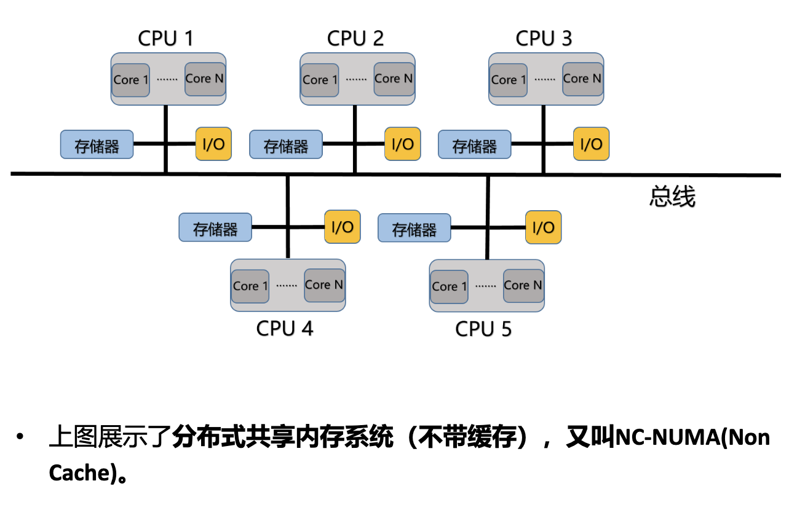

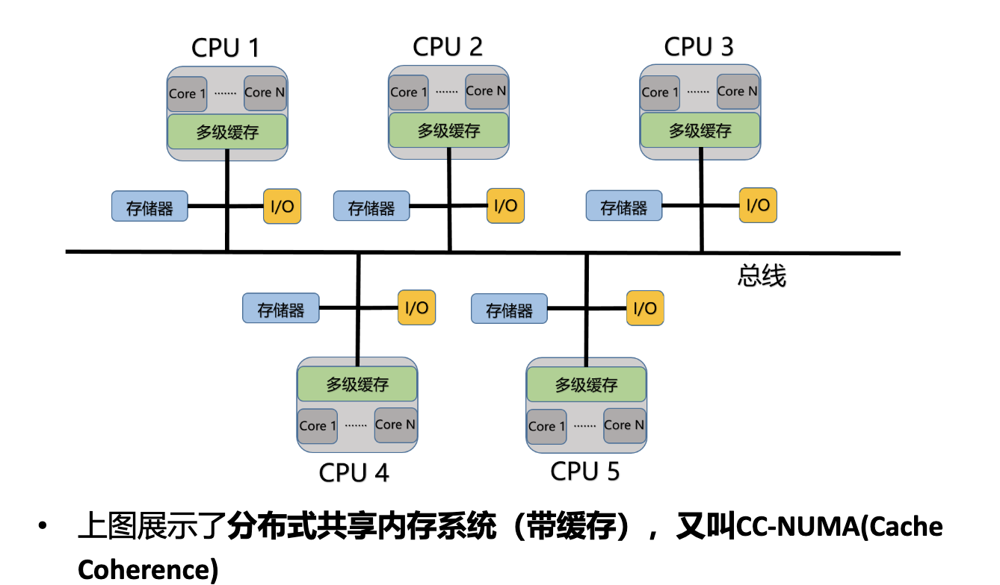

NC-NUMA与CC-NUMA:
- 这两种类型的共享存储器在物理上是分布在不同的处理器的本地存储器之上
- 但是他们都通过总线或者互连网络相连接，可以把所有这些本地存储抽象成一个全局的存储器，并能够被任何处理器访问。

### 分布式内存系统

- 在这种计算机体系结构中，每台计算机使用消息机制（如以太网）连接起来
- 每台计算机都有自己的处理器，每个处理器都有自己的私有内存，私有内存只提供自己的处理器进行访问
- 其他的计算机不能直接访问，每个计算机都有自己独立的物理地址空间
- 分布式内存系统可以分为如下两类：
  - 大规模并行处理器系统(MPP)
  - 工作站机群系统(COW)

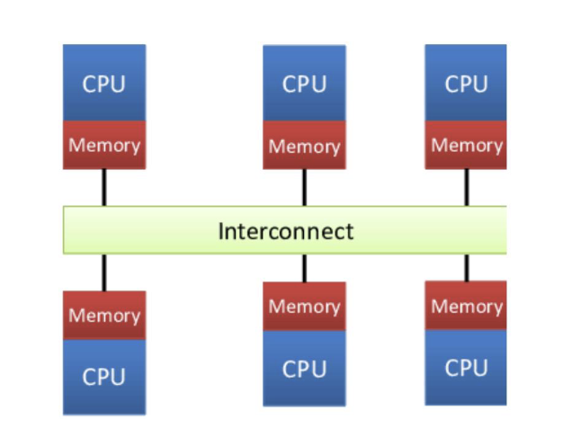


#### 大规模并行处理系统

MPP（Massively Parallel Processors）大规模并行处理器系统

- MPP系统是由成百上千台计算机组成的大规模并行计算机系统
- 主要应用于科学技术、工程模拟等以计算为主的科研工作中。
- 该系统一般开发困难，价格高，市场有限，是国家和公司综合实力的象征

基本架构
- MPP中一般每个节点可以认为是一个没有硬盘的计算机
- MPP节点一般只驻留操作系统内核，由一条I/O总线连接到同一个硬盘上面。
- MPP使用的网络一般情况不是我们使用的高速以太网，它一般使用制造商专有的定制高速通信网络

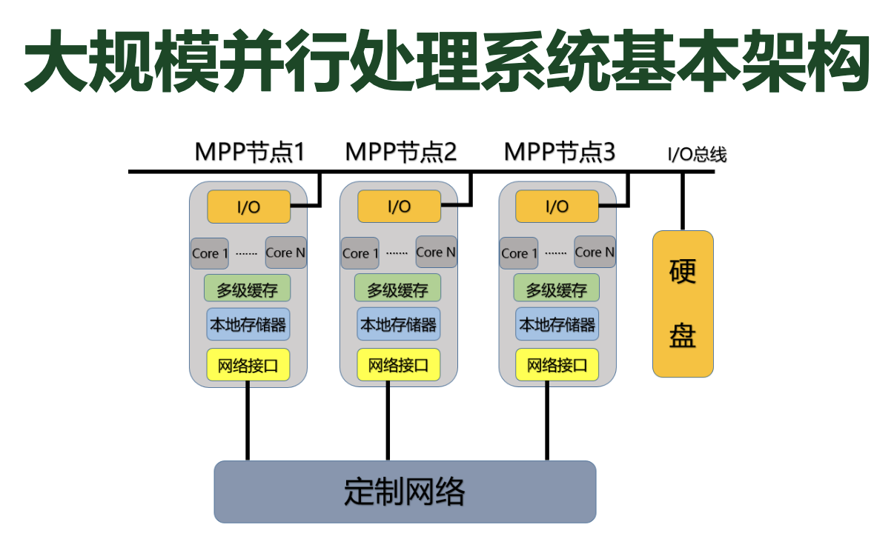

#### 工作站机群系统

COW(Cluster Of Workstations)工作站机群系统 

- 又叫仓库级计算机(Workstations Cluster)
- COW系统是由大量的家用计算机或者工作站通过商用网络连接在一起而构成的多计算机系统。
  - 很多大公司的数据中心就是一个典型的例子。
- 随着云计算的蓬勃发展，COW正在变得越来越重要
  - 相比过去为科学家和工程师们提供高性能计算的角色，现在的COW已经成为为全世界提供信息技术的基础

基本架构

- COW中每个节点都可以认为是一台独立的计算机，它们有自己的硬盘、CPU、存储器等，在商用网络的协作下组成一个工作站机群系统。
- COW通常由多个服务器阵列排列而成。
  - 其中机架是容纳服务器、交换机的外壳框架，一个机架上往往有多个服务器，服务器之间通过机架交换机进行通信。
- 服务器阵列是由多个机架排列而成，阵列内部机架间通过阵列交换机通信

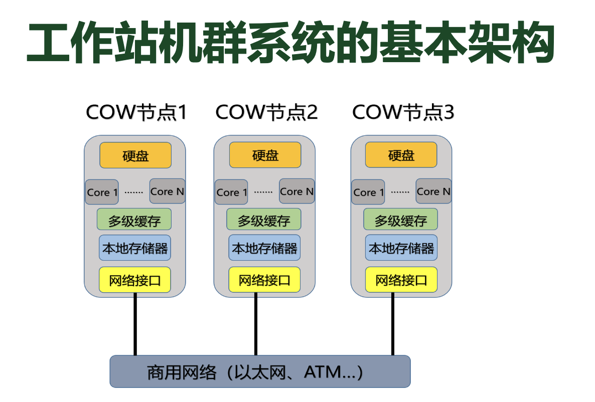

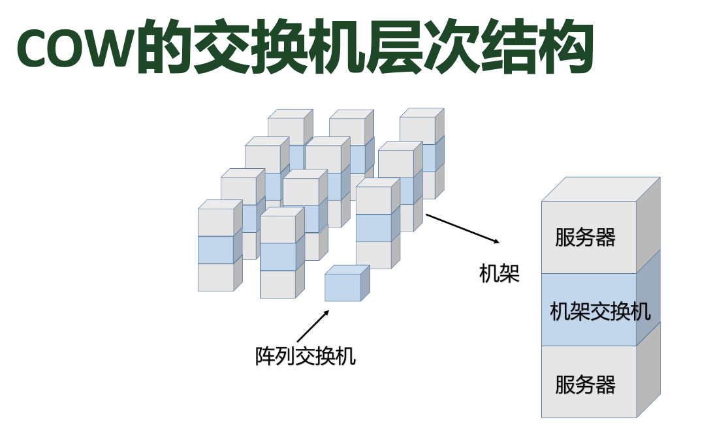

##### COW vs. HPC

- 部分HPC采用的是COW的架构，但是一般不采用商业互联网和商业芯片，HPC一般使用定制的芯片和通信网络。
- HPC强调线程级并行或数据级并行，而COW则强调请求级并行，即可能有多个网络请求同时访问一台机器。
- HPC常常满负载持续数周完成大规模运行作业，而COW是面向并发请求的，通常不会满负载

## 非冯诺依曼体系结构系统

冯诺依曼体系结构的特点:
- 单处理机结构，机器以运算器为中心
- 采用程序存储思想
- 指令和数据无差别的存储在存储器内
- 数据以二进制形式表示
- 软件和硬件完全分离
- 指令由操作码和操作数组成
- 指令都是顺序执行的

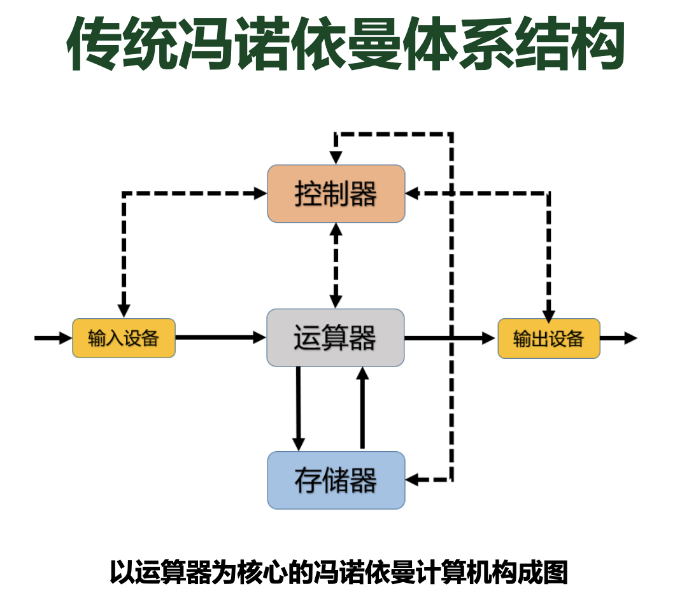

传统的冯·诺依曼型计算机的缺点：
- 从本质上讲是采取串行顺序处理的工作机制
  - 即使有关数据已经准备好，也必须逐条执行指令序列
- 指令与数据在同一存储器
  - 在高速运行时，不能达到同时取指令和取操作数，从而形成了传输过程的瓶颈

非诺依曼化的探讨：
- 对传统冯·诺依曼机进行改造，如采用多个处理部件形成流水处理
- 用多个冯·诺依曼机组成多机系统，支持并行算法结构
- 从根本上改变冯·诺依曼机的控制流驱动方式，如采用数据流

### 哈佛体系结构

哈佛结构(Harvard architecture)是一种典型的非冯诺依曼结构

- 哈佛结构是一种将程序指令存储和数据存储分开的存储器结构，
  - 它的主要特点是将程序和数据存储在不同的存储空间中，即程序存储器和数据存储器是两个独立的存储器，每个存储器独立编址、独立访问
- 目的是为了减轻程序运行时的访存瓶颈，极大的方便了并行处理。

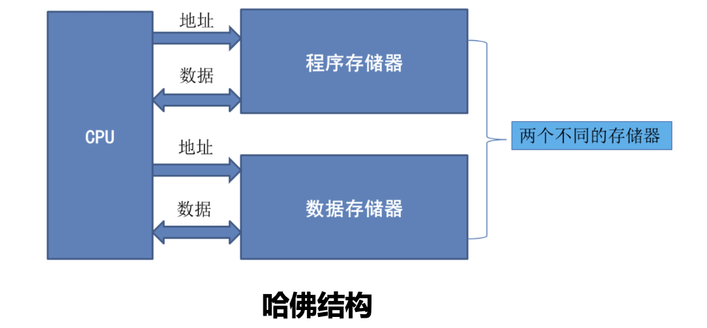

#### 改进型哈佛结构

虽然也使用两个不同的存储器，但它把两个存储器的地址总线合并了，数据总线也进行了合并。原来的哈佛结构需要４条不同的总线，改进后需要两条总线

哈佛结构下，一个地址对应两个位置，一个是对应程序指令，一个对应数据，具体取决于走哪个总线，来确定访问的空间

- 利用公用地址总线访问两个存储模块
- 公用数据总线则被用来完成程序存储模块或数据存储模块与CPU之间的数据传输
- 两条总线由程序存储器和数据存储器分时共用

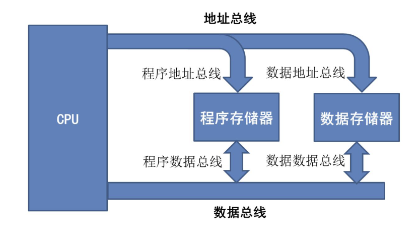

#### ARM架构就是目前一种常见的基于哈佛结构的架构

- 它广泛的应用于嵌入式设备和移动设备中
  - ARM7使用冯诺依曼架构，ARM9、ARM10、ARM11使用哈佛架构
- 现代通用处理器基本都是采用内部类哈佛结构，外部冯诺依曼结构
  - 内部缓存分成数据和指令，外部内存空间不区分指令和地址

### 其他非冯架构的计算机

- 数据流计算机
- 归约机
- 量子计算机
- 光子计算机

#### 数据流计算机

数据流计算思想回答了 “一个运算操作能够被执行的充分条件是什么”这个科学问题

- 即数据就绪开始计算, 同时提出了用数据流图描述计算任务的具体方法.
- 创新之处就在于打破了传统串行执行指令的思维禁锢
- 数据流计算机是探索利用数据流计算思想提升计算机系统性能的实践者和先驱者
- 数据流计算思想给云计算与大数据分析系统领域的编程模型带来了重大变化


# ch02.3 Interconnection Networks 互连网络

互连网络（ICN）是一种可编程系统，用于在终端节点之间传输数据
- 为了维持并行机的稳定运行，处在并行计算机体系结构的核心
- 与局域网/广域网是同一类网络概念
- 但由于非常不同的时间尺度/要求，权衡也非常不同
- 可分为四个领域取决于待处理设备的数量及其邻近性
  - Wide-Area Networks 广域网
  - Local-Area Networks 局域网
  - System-Area Networks 系统区域网络
  - On-Chip Networks 片上网络

四个领域的区别：
- 广域网
  - 互连系统分布于全球
    - 网络互联支持是必需的
    - 数百万台设备相互连接
  - 最大互连距离
    - 数千公里
- 局域网
  - 互连自主计算机系统
    - 机房或整个建筑或校园
    - 数百个设备相互连接
  - 最大互连距离
    - 几米至数十公里
    - 示例（最常用）：
      - 以太网，10Gbps，40Km
- 系统区域网络
  - 互连于一台“机器”内
    - 多处理器系统中的互连
    - 超级计算机中的互连
    - 数百至数千台设备相互连接
  - 最大互连距离
    - 十分之一米（典型）
    - 几百米（一些）
- On-Chip Networks 片上网络
  - 单片互连
    - 设备是微架构元素，缓存、目录、处理器核心
    - 目前，数十种设备的设计很常见
  - 临近度：毫米

> 我们的研究重点在于片上网络与系统区域网络

## 为何研究相互关联

- 提供从系统到外部世界的外部连接
  - 此外，单个计算机系统内部在多个层面的连通性
- 互联网络应该良好地设计
  - 传递最大量的信息
  - 在最短的时间内（和成本、功率限制）
- 应用：
  - 有效管理沟通对提升绩效至关重要
- 趋势：对通信带宽的高需求
  - 增加的计算能力和存储容量
  - 交换网络正在取代总线
- 计算机体系结构/工程师必须理解互连问题和解决方案
  - 为有效设计和评估系统

## 互连网络

- 通信特点
  - 延迟必须低
  - 带宽必须高
  - 消息特征
    - 许多小消息，有几种固定大小
    - 最大消息长度为一个缓存块大小（64或128字节）
- 影响
  - 只有两个层次就足够了：链路层和节点层
  - 通信协议必须简单
    - 无丢包，无复杂流量控制

### 结点与链路

节点封装：
- 一个或多个处理器
- 通信控制器/辅助装置
- 刳刨者
- 路由器通过链路相互连接
- 链接可以是单向或双向

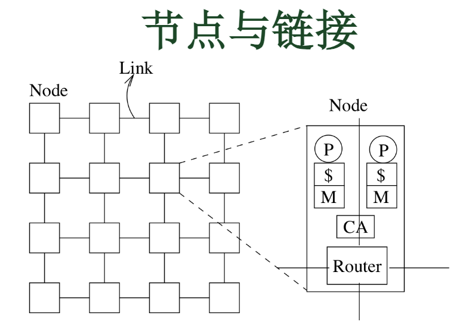

### 链路与信道

- Link =一组连接一对节点的导线
  - 链接可以是单向或双向
  - 由流量控制协议（flit）确定的传输单位
  - Flit的大小由链路延迟和可用缓冲区量决定
- 信道= 链路 + 发送方 + 接收方
- 通过信道传输的消息被分割成数据包
  - 数据包包含头部、尾部和有效载荷

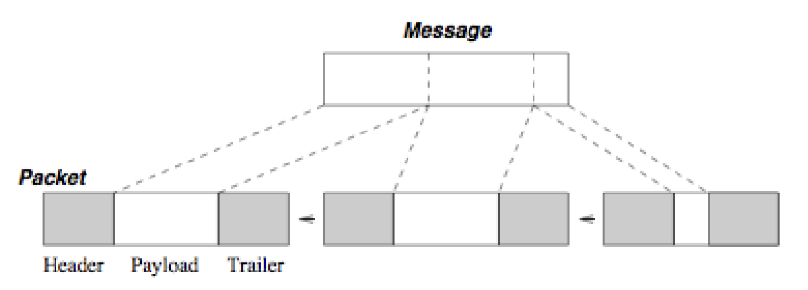


### 设计注意事项

- 应用要求
  - 支持的终端或端口数量
  - 各终端的峰值带宽
  - 各终端平均带宽
  - 延迟要求
  - 邮件大小分布
  - 预期交通模式
  - 要求服务质量
  - 所需可靠性和可用性
- 互连网络的工作
  - 将信息从源节点传输到目标节点
  - 支持实现应用的网络事务
- 延迟尽可能小
  - 尽可能多的同步传输
- 成本尽可能低

### 技术制约

- 信号速率
- 芯片引脚计数（若采用片外网络）
- 区域约束（通常用于片上网络）
- 芯片成本
- 电路板成本（如需背板）
- 每块电路板上的信号
- 每根电缆的信号
- 电缆成本
- 电缆长度
- 信道和交换机功率限制

### Off-chip 片外ICN vs. On-chip 片内ICN

- 芯片外：I/O瓶颈
  - 插针限制带宽
  - 片外I/O传输的固有开销
- 片上
  - 布线限制
    - 水平和垂直布局
    - 短的固定长度
  - 权力
    - 消耗模具功率预算的10%-15%或更高
  - 潜伏期
    - 数量级不同


### ICN 的主要概念

- 拓扑学- 网络中通道和节点的静态配置
- 路由- 确定数据包可遵循的路径集合
- 流量控制[流控] - 为数据包分配网络资源（通道、缓冲区等）并管理竞争
- 交换机微结构- 网络交换机的内部结构
- 网络接口- 如何将终端与交换机连接
- 链路体系结构- 信道上的信号技术与数据表示


## 网络拓扑

- 网络拓扑= 网络的形状
  - 确定消息从一个节点到另一个节点需要经过的跳数（以#跳数为单位）
- 重要特征
  - 直径：最大距离
  - 平均距离
  - 度：指与一个交换机相连的链路数

例题：

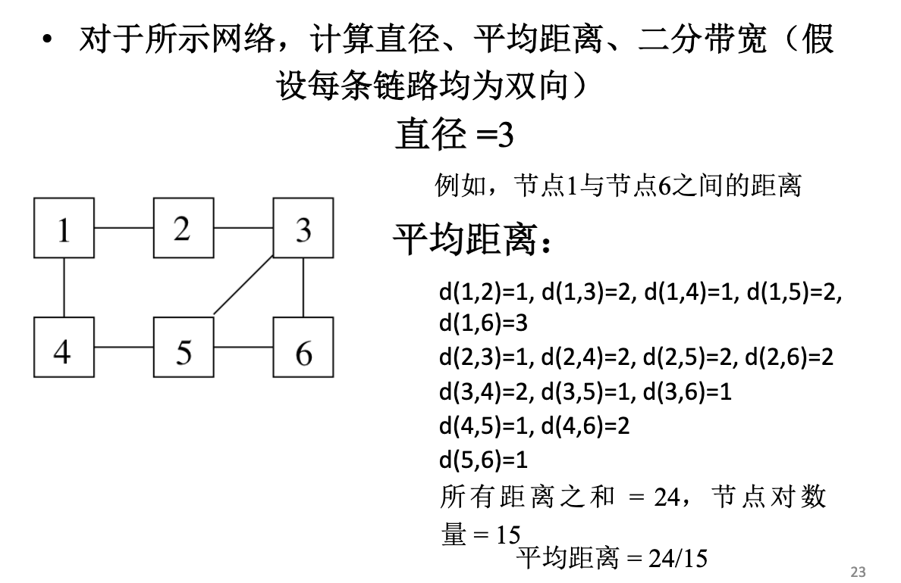


## 互连网络的分类

互连网络影响分布式和共享内存系统的性能，2个类别：
- 共享存储器互连
- 分布式存储器互连

### 共享存储器互连

- 总线互连
  - 一组并行通信线路及控制总线访问的硬件设备。
  - 通信线路由连接到它的设备共享。
  - 随着连接到总线的设备数量的增加，对总线的使用竞争增加，性能下降
- 交换互连
  - 使用交换机来控制连接设备之间的数据
  路由。
  - Crossbar 是一种交换互连，其中每个输入都连接到每个输出的交换机。
    - 允许不同设备之间同时通信。
    - 比总线还快。
    - 但是交换机和链路的成本相对高

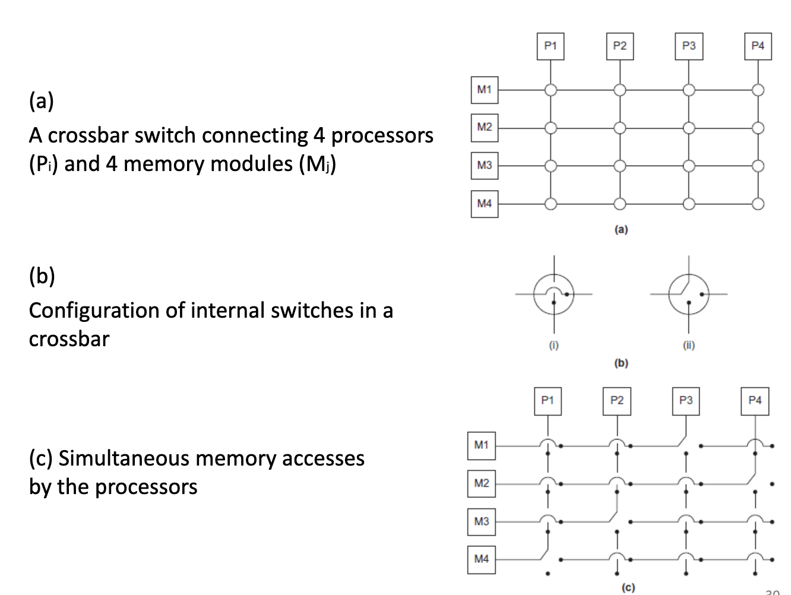

### 分布式存储器互连


- 直接互连
  - 每个交换机直接连接到处理器存储器对，且这些交换机相互连接。
- 间接互连
  - 交换机可能不直接连接到处理器


定义介绍：
- 带宽是链路传输数据的速率，通常以每秒兆比特或兆字节为单位进行计量
- 任何时候传输数据时，我们关注的是数据到达目的地所需的时间
- 潜伏期是源开始传输数据与目的开始接收第一个字节之间所经过的时间。

#### 直接互连

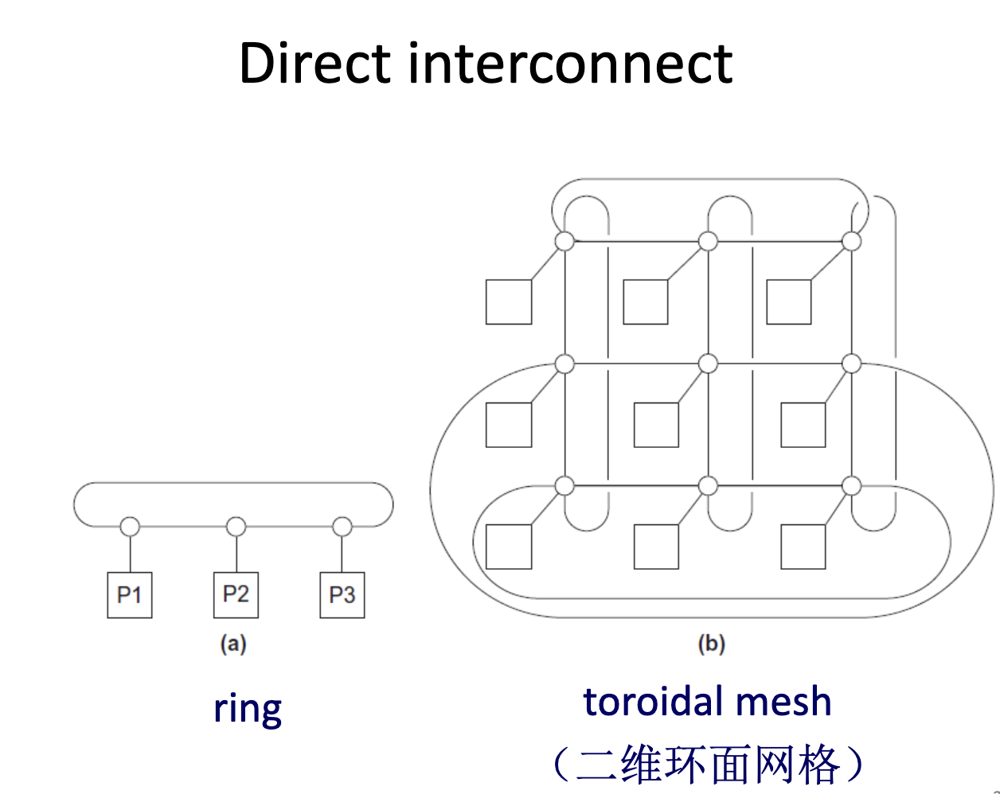

##### Bisection width（等分宽度）

- 用于衡量“同时通信数量”或“连接性”的指标, 网络质量的度量指标。
- 在两部分之间，“跨越鸿沟”可以同时进行多少通信
- 它不是计算连接两半部分的链路数量，而是对链路带宽进行求和

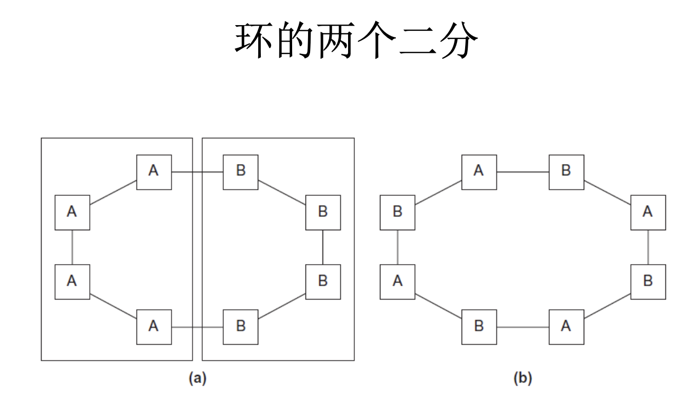

###### 全连接网络

每个交换机都直接连接到其他每个交换机，p为节点数量。
二 分 宽 度 = $p^2$ / 4

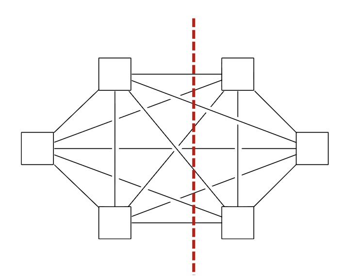

###### 超立方体

高度互联的直接互连。
感应式内置：
- 一维超立方体是一个具有两个处理器的全连接系统。
- 一个二维超立方体由两个一维超立方体通过连接“对应”的交换机构建而成。
- 同样地，一个三维超立方体是由两个二维超立方体构成的

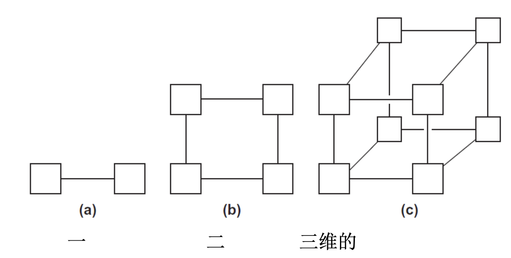

#### 间接互连

- 间接网络的简单示例：
  - 十字形接线板
  - 欧米伽网络
- 通常显示为单向链接和处理器集合
- 其中每一个都有出站和入站链路，以及一个交换网络

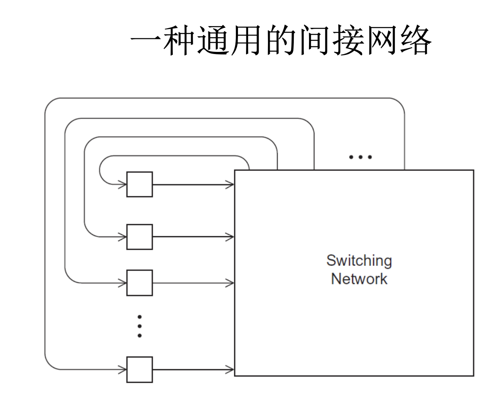

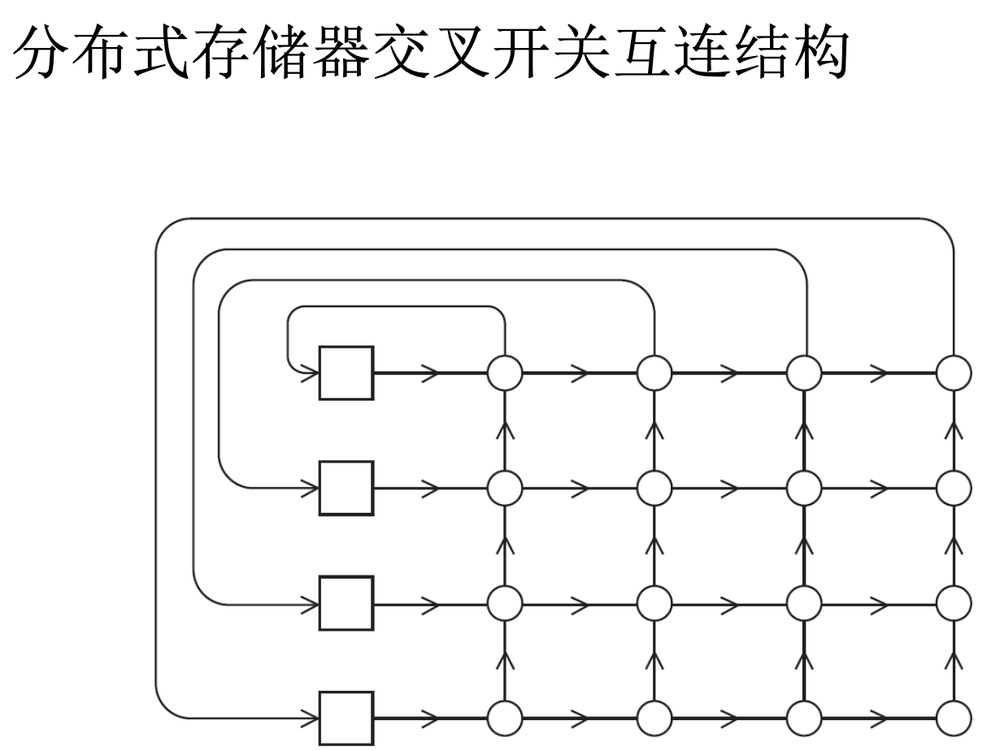

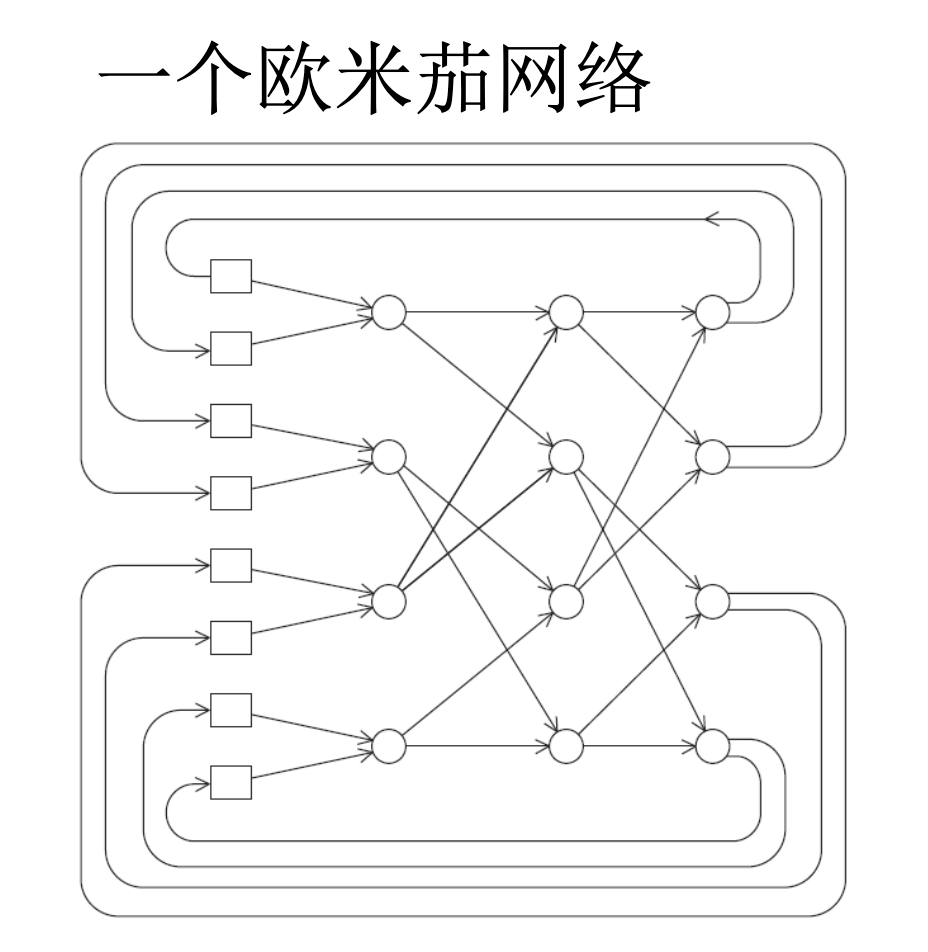

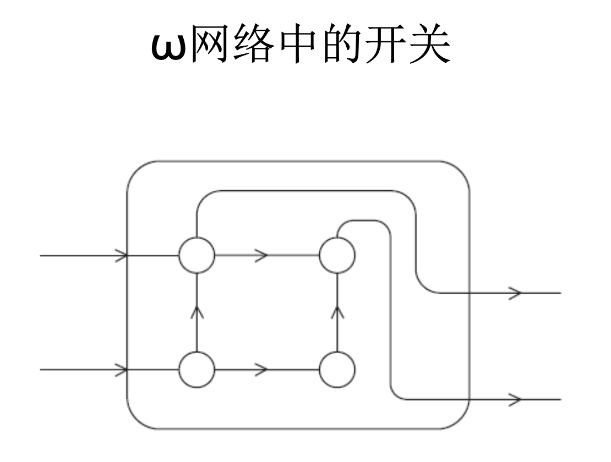

## 路由策略
> 如何通过网络发送数据包？

- 存储转发：
  - 将所有数据包通过链路传输，再通过下一个交换机转发，以此类推，直到数据包到达目的地
  - T = h * (Txmit + Tswitch)
- 穿透性：
  - 通过链路在管道中发送数据包
  - T = h * Tswitch + Txmit
- 含义：
  - 贯通式布线降低了拓扑的重要性

- 最小值与非最小值
  - 最小= 每个数据包经过最少的跳数
- 确定性与非确定性
  - 确定性= 每个发送者 - 目的地对使用单条路径处理所有消息
- 适应性与非适应性
  - 自适应= 消息在传输过程中可改变路径
- 无死锁 vs. 可能死锁
  - 由于多个消息相互等待缓冲区空间而导致的死锁
  - 由于缓冲区空间有限和对缓冲区获取的循环依赖性，网络无法转发数据包
  - 处理死锁
    - 检测并破坏：费用高昂
    - 丢包：对性能产生不利影响并使协议复杂化
    - 避免：路由限制

## 路由器体系结构

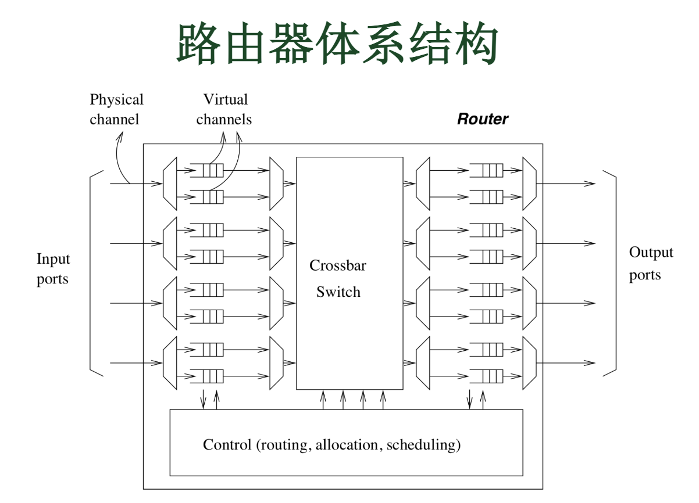
- 该路由器配备四个输入端口和四个输出端口
- 每个通道包含两个虚拟通道（VC），并配备独立缓冲区

- 到达的数据包被发送到适当的VC（缓冲区），这是基于其数据包的首部信息
- 控制逻辑在多个输入通道之间进行仲裁，并将它们分配到交换机的输入端
  - 它还把输出VC分配给交换机的输出
  - 它仲裁多个输入端口，这些端口希望将数据包发送到同一输出端口
- 交换机通常采用 crossbar 交换互联（以减少延迟和冲突）
  - 不同VC的多个flits可以进入交换机，只要它们流向不同的输出VC
- 步骤也可以通过流水线来提高路由器吞吐量

# ch02.4 并行软件

## 软件承担了负担

- 在共享内存程序中：
  - 启动单进程并分叉线程。
  - 线程执行任务。
- 在分布式内存程序中：
  - 启动多个进程。
  - 过程执行任务

#### SIMD 单一程序多数据

SPMD 程序由一个单一可执行文件组成，通过使用**条件分支**，它可以表现得像多个不同的程序

```
if (I’m thread process i)
  do this;
else
  do that;
```

#### 编写并行程序

1. 将工作分配给双进程/线程
  - 每个进程/线程大致获得相同的工作量
  - 通信被最小化
2. 安排进程/线程同步。
3. 安排进程/线程之间的通信

#### 共享存储器
- 动态线程
  - 主线程等待工作，分支新线程，当线程完成时，它们终止
  - 资源的高效使用，但线程创建和终止是耗时的。
- 静态线程
  - 线程池创建并分配工作，但仅在清理时终止。
  - 性能更好，但可能浪费系统资源

#### 问题

- 竞争状态
- 临界区
- 互斥
- 互斥锁（mutex，简称lock）
- 忙等待
- 消息传递
- 全局地址空间分区语言
- 输入和输出
  - 在分布式内存程序中，只有进程0会访问stdin。
  - 在共享内存程序中，只有主线程或线程0会访问stdin。
  - 在分布式内存和共享内存程序中，所有进程/线程都可以访问stdout和stderr
  - 在大多数情况下，除了调试输出之外，仅使用单个进程/线程用于所有stdout输出。
    - 因为输出到stdout顺序的不确定性
  - 调试输出应始终包含生成输出的进程/线程的排序或ID
  - 仅一个进程/线程会尝试访问除标准输入、标准输出或标准输出外的任何单个文件。
    - 例如，每个进程或线程均可创建专属的私有文件用于读写操作。
  - 但是没有两个进程/线程会打开同一个文件

## 表现

### 加速

- 核心数量 = p
- 串行运行时间 = T串行
- 并行运行时间 = T并行
- T并行 = T串行 / p
- 加速比 S = T串行 / T并行

### 效率

并行程序的效率Efficiency E = S/p = T串行/(p*T并行)

不同问题规模下并行程序的加速与效率

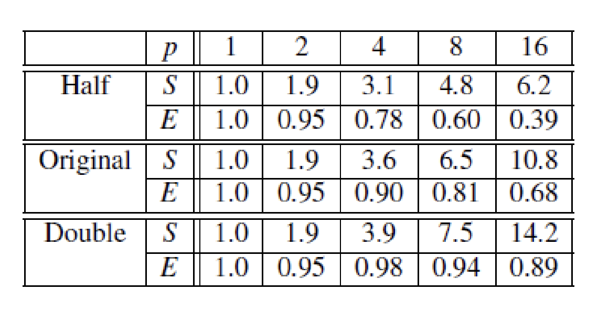

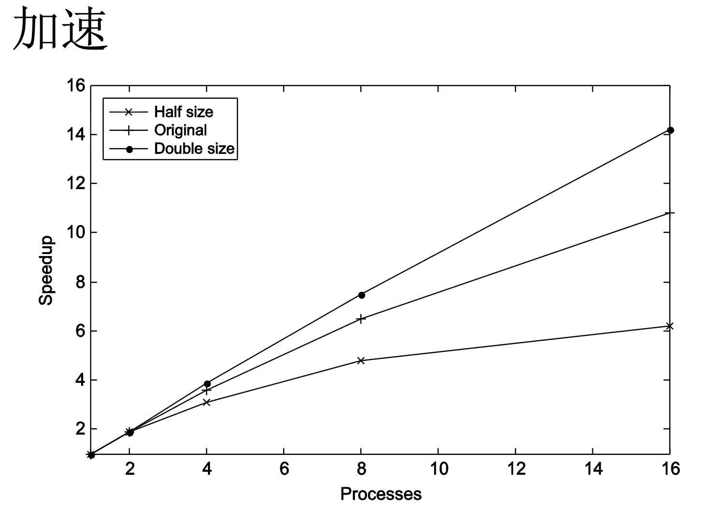

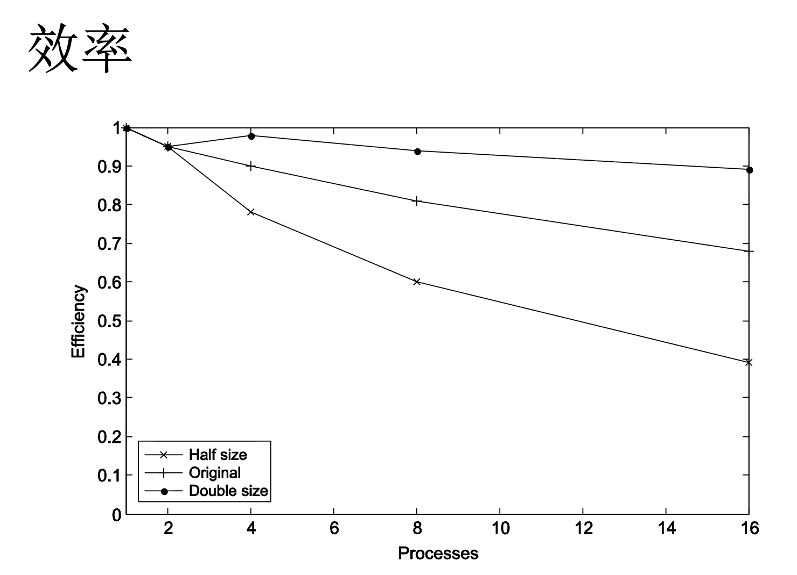

### Effect of overhead 开销效应

T并行 = T穿行/p + T开销

### 阿姆达尔定律

除非串行程序的几乎所有部分都并行化，否则可能的加速将非常有限，无论可用核心数量多少

#### 例子

并行化效果是最优的，无论我们使用多少核心 p
- 90%的串行程序并行化
- T穿行 = 20s
- 可并行部分的运行时间为 0.9*T并行/p = 18/p
- 不可并行部分的运行时间为 0.1*T串行 = 2
- 总体并行时间为 T并行 = 0.9 * T串行/p + 0.1 * T并行 = 18/p +2
- 加速比 S = T串行/T并行 = 20/(18/p + 2)

### 可拓展性

如果一个问题能够处理增加的问题规模，那么它就是可扩展的
- 强可拓展性
- 弱可拓展性

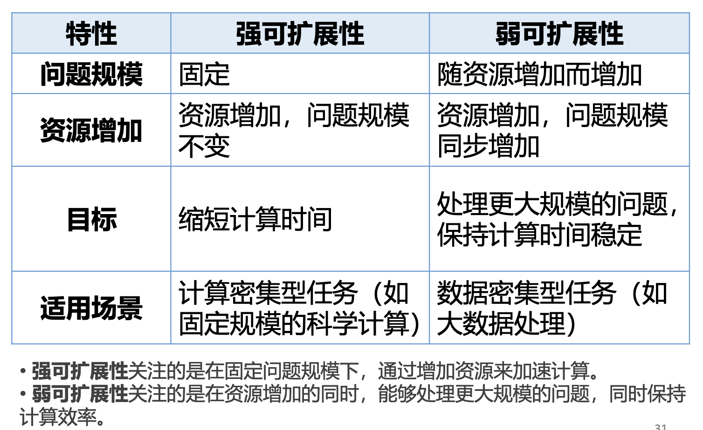

#### 强可拓展性

- 定义：在问题规模（即任务大小）固定的情况下，通过增加计算资源（如处理器数量）来缩短计算时间。
- 目标：提高计算速度，使任务更快完成。
- 关键点：问题规模不变，资源增加，计算时间减少。
- 理想情况：资源增加一倍，计算时间减半（线性加速）。
- 例子：假设你需要对一个固定大小的矩阵（例如1000x1000）进行矩阵乘法运算：
  - 使用 1 个处理器，计算时间为 100 秒。
  - 使用 2 个处理器，计算时间减少到 50 秒。
  - 使用 4 个处理器，计算时间减少到 25 秒

#### 弱可拓展性

- 定义：在增加计算资源的同时，问题规模也按比例增加，目标是保持每个处理器的负载不变，计算时间基本稳定。
- 目标：在资源增加的情况下，能够处理更大规模的问题，同时保持效率。
- 关键点：问题规模与资源同步增加，计算时间不变。
- 理想情况：资源增加一倍，问题规模也增加一倍，计算时间保持不变
- 例子：假设你需要对一个矩阵进行乘法运算（对于方阵n×n，运算量为n^3次乘法），但矩阵的大小会随着处理器数量的增加而增加：
  - 使用 1 个处理器，计算一个 100x100 的矩阵，时间为 10 秒。
  - 使用 8 个处理器，计算一个 200x200 的矩阵，时间仍为 10 秒。
  - 使用64个处理器，计算一个 400x400 的矩阵，时间仍为 10 秒

## 并行程序设计
  
### Foster法

- 分区：将要执行的计算和操作数据划分为小任务。这里应该重点确定可以并行执行的任务
- 沟通：确定在前一步骤中识别出的任务之间需要进行的沟通内容
- 聚集或聚合:将第一步中确定的任务和通信合并为更大的任务。
  > 例如，如果任务A必须在任务B执行之前执行，将它们聚合为一个单一的复合任务可能有意义
- 映射:将上一步识别的复合任务分配给进程/线程。
  > 这样做是为了将通信最小化，并且每个进程/线程得到大致相同的工作量

#### 例子

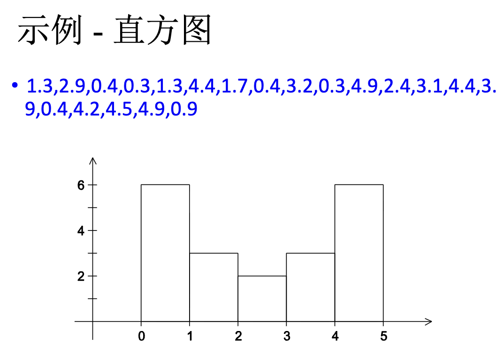

- 输入
  - 1. 测量次数：数据计数
  - 2. 一个数据计数浮点数组：数据
  - 3. 最小值所在箱的最小值：最小测量值
  - 4. 包含最大值的箱的最大值：最大测量值
  - 5. 箱数：箱数
- 输出
  - 1. bin maxes :一个包含bin count浮点数的数组
  - 2. 分箱计数：一个包含整数分箱计数的数组

