# ch03 用 MPI 进行分布式内存编程
 
### 学习目标
- 编写第一个MPI程序
- 使用常见的MPI函数
- 在MPI中实现梯形法则
- 集体通信
- MPI派生数据类型
- MPI程序性能评估
- 并行排序
- MPI程序安全性

## 分布式内存系统

### 分布式内存系统
- 每个处理器拥有独立的私有内存
- 处理器之间通过消息传递进行通信
- 不能直接访问其他处理器的内存

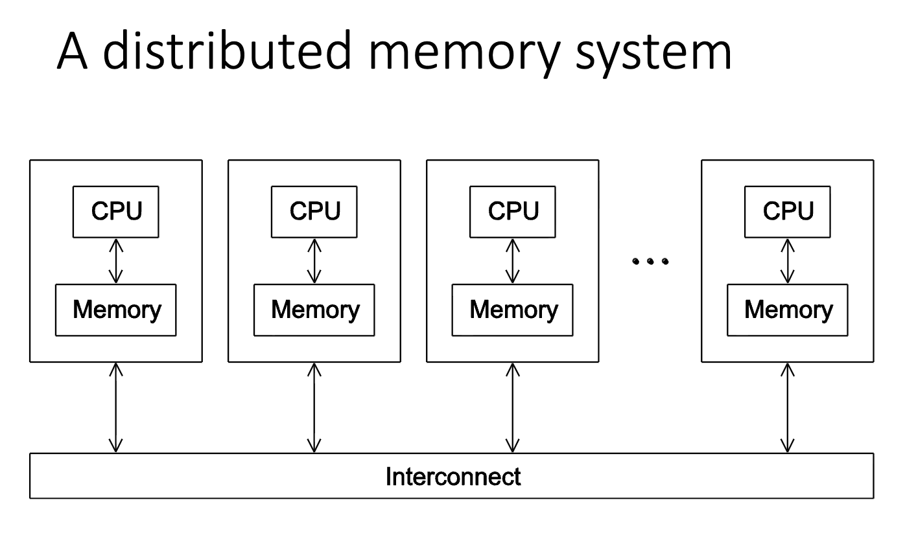

### 共享内存系统
- 所有处理器共享同一内存空间
- 处理器通过共享内存进行通信

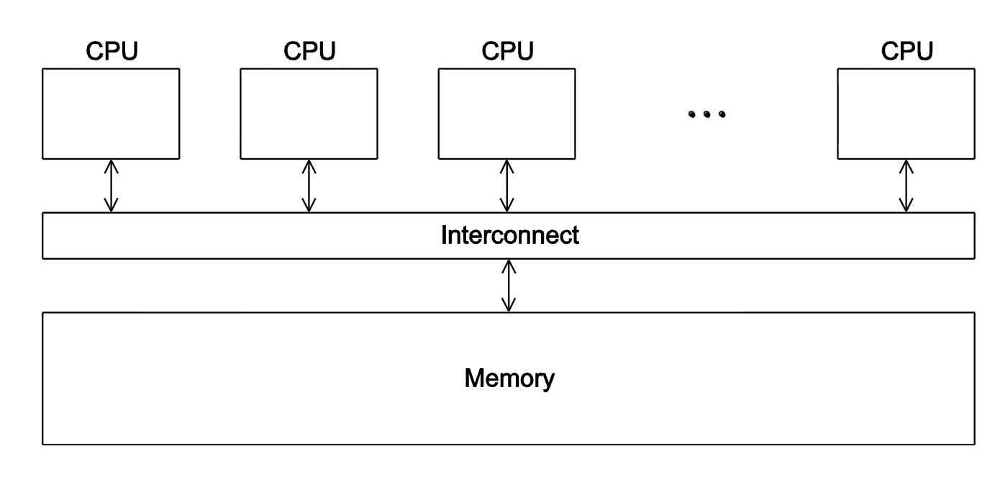

## 第一个MPI程序

### Hello World! 程序

```c
#include <stdio.h>      // 标准输入输出库，用于printf等函数
#include <mpi.h>        // MPI库头文件，包含所有MPI函数和数据类型的声明

int main(int argc, char* argv[]) {
    int my_rank;        // 当前进程的秩（rank），用于标识进程在通信器中的编号
    int comm_sz;        // 通信器中的进程总数
    
    /* 
     * 初始化MPI环境
     * - 必须是MPI程序中的第一个MPI函数调用
     * - 参数传递给MPI_Init允许MPI系统处理命令行参数
     * - 完成所有必要的设置工作，如进程创建、通信器初始化等
     */
    MPI_Init(&argc, &argv);
    
    /* 
     * 获取通信器中的进程总数
     * - MPI_COMM_WORLD是默认的通信器，包含所有启动的进程
     * - comm_sz将存储进程的总数
     * - 例如：如果用"mpiexec -n 4"运行程序，comm_sz = 4
     */
    MPI_Comm_size(MPI_COMM_WORLD, &comm_sz);
    
    /* 
     * 获取当前进程在通信器中的秩（编号）
     * - 每个进程都会得到一个唯一的秩，范围从0到comm_sz-1
     * - 例如：如果有4个进程，它们的秩分别是0, 1, 2, 3
     * - 进程0通常被称为主进程（master）或根进程（root）
     */
    MPI_Comm_rank(MPI_COMM_WORLD, &my_rank);
    
    /* 
     * 打印问候信息
     * - 每个进程都会执行这一行
     * - 输出格式："Greetings from process X of Y!"
     * - X是当前进程的秩，Y是进程总数
     * - 注意：多个进程同时输出时，输出顺序可能不确定
     */
    printf("Greetings from process %d of %d!\n", my_rank, comm_sz);
    
    /* 
     * 清理MPI环境
     * - 必须是MPI程序中的最后一个MPI函数调用
     * - 释放MPI分配的所有资源
     * - 确保程序正常退出
     */
    MPI_Finalize();
    
    return 0;           // 返回0表示程序正常结束
}
```

### MPI程序标识
- 通常使用非负整数秩（rank）来标识进程
- p个进程编号为0, 1, 2, ..., p-1

### 编译与执行

编译
```bash
# 编译
mpicc -g -Wall -o mpi_hello mpi_hello.c
```
- mpicc 是MPI C编译器包装器
- -g 选项启用调试信息
- -Wall 选项启用所有编译器警告
- -o mpi_hello 指定输出可执行文件的名称
- mpi_hello.c 是包含MPI程序的源代码文件

执行： mpiexec -n <number of processses> <executetable>

```bash
# 执行
mpiexec -n 1 ./mpi_hello # 1个进程运行
Greetings from process 0 of 1!
```

```bash
mpiexec -n 4 ./mpi_hello # 4个进程运行
Greetings from process 0 of 4!
Greetings from process 1 of 4!
Greetings from process 2 of 4!
Greetings from process 3 of 4!
```

### MPI程序特点
- 使用C语言编写
  - 包含main函数
  - 使用stdio.h, string.h等标准库
- 需要添加mpi.h头文件
- MPI定义的标识符以"MPI_"开头
- 下划线后的第一个字母大写
  - 用于函数名和MPI定义的类型
  - 为了避免标识符冲突

## MPI组件

### MPI_Init
- 告诉MPI执行所有必要的设置
```c
int MPI_Init(int* argc_p, char*** argv_p);
```

### MPI_Finalize
- 告诉MPI我们已完成，清理为此程序分配的任何资源
```c
int MPI_Finalize();
```

### 基本程序结构
```c
#include <mpi.h>

int main(int argc, char* argv[]) {
    int my_rank, comm_sz;
    
    /* 在这之前，没有MPI函数调用 */
    MPI_Init(&argc, &argv);
    MPI_Comm_size(MPI_COMM_WORLD, &comm_sz);
    MPI_Comm_rank(MPI_COMM_WORLD, &my_rank);
    
    /* 并行计算代码 */
    
    MPI_Finalize();
    /* 在这之后，没有MPI函数调用 */

    return 0;
}
```

## 通信器（Communicators）

### 定义
- 通信器是能够相互发送消息的进程集合
- MPI_Init定义了一个包含程序启动时创建的所有进程的通信器
- 称为MPI_COMM_WORLD

### 获取通信器信息
```c
int comm_sz;
MPI_Comm_size(MPI_COMM_WORLD, &comm_sz);  // comm_sz 通信器中的进程数

int my_rank;
MPI_Comm_rank(MPI_COMM_WORLD, &my_rank);  // my_rank 当前进程的秩
```

## SPMD（单程序多数据）

### 概念
- 编译一个程序
- 进程0执行不同的操作
- 接收消息并打印，而其他进程执行工作
- if-else结构使程序成为SPMD

## 点对点通信

### MPI_Send

```c
int MPI_Send(
    void* msg_buf_p,      // 消息缓冲区
    int msg_size,         // 消息大小
    MPI_Datatype msg_type, // 消息类型
    int dest,             // 目标进程
    int tag,              // 标签：用于区分不同类型的消息
    MPI_Comm comm         // 通信器
);
```

### 数据类型 Data types

| MPI datatype | C datatype      |
|--------------|-----------------|
| MPI_CHAR     | signed char     |
| MPI_SHORT    | signed short int|
| MPI_INT      | signed int      |
| MPI_LONG     | signed long int |
| MPI_FLOAT    | float           |
| MPI_DOUBLE   | double          |
| ...          | ...             |

### MPI_Recv

```c
int MPI_Recv(
    void* msg_buf_p,      // 接收缓冲区
    int buf_size,         // 缓冲区大小
    MPI_Datatype buf_type, // 缓冲区类型
    int source,           // 源进程
    int tag,              // 标签
    MPI_Comm comm,        // 通信器
    MPI_Status* status_p  // 状态
);
```

### 消息匹配
- MPI_Send的源进程 src = q
- MPI_Recv的目标进程 dev = r
- 消息通过标签和通信器进行匹配

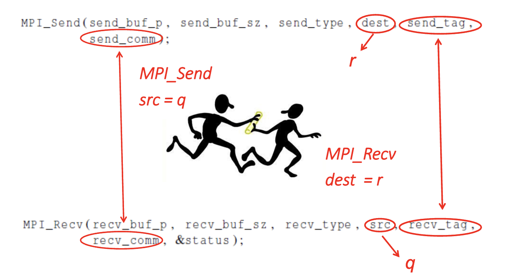

### 消息接受

一个接收进程可以接受消息而不需要知道以下信息:
- 消息的源进程
- 消息的标签
- 消息的大小

### 状态参数

MPI_Status* status
- status.MPI_SOURCE  消息源进程
- status.MPI_TAG 消息标签
- status.MPI_ERROR 错误代码


### 接收未知数据量

```c
MPI_Get_count(
    MPI_Status* status_p, 
    MPI_Datatype type, // 消息类型
    int* count_p);  // 获取接收的数据量
```

### Send和Recv的问题
- 精确行为由MPI实现决定
- MPI_Send可能根据缓冲区大小、阈值和阻塞行为不同
- MPI_Recv总是阻塞直到接收到匹配的消息
- 了解你的实现，不要做假设！

## 梯形法则并行化

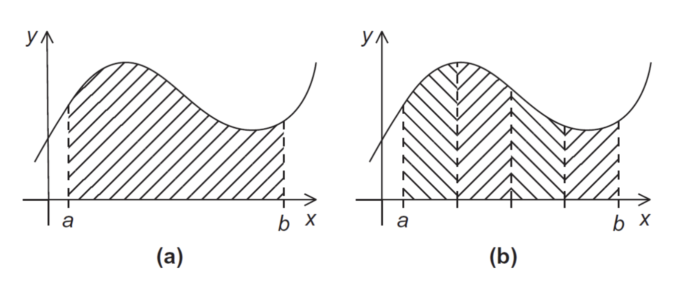

### 梯形法则
- 用于数值积分
- 将积分区间划分为多个梯形
- 计算每个梯形的面积并求和

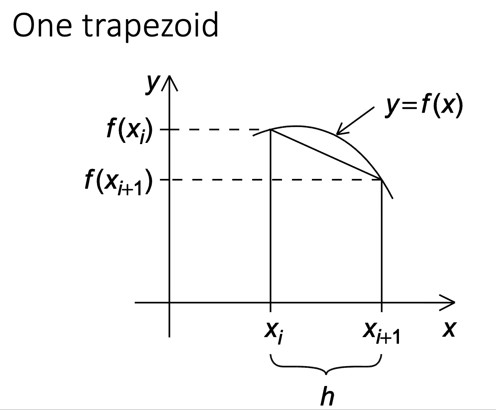

### 并行化步骤
1. 将问题解决方案划分为任务
2. 确定任务之间的通信通道
3. 将任务聚合为复合任务
4. 将复合任务映射到核心

### 并行伪代码
```c
// 每个进程计算局部积分
local_n = n / comm_sz;
local_a = a + my_rank * local_n * h;
local_b = local_a + local_n * h;
local_integral = Trap(local_a, local_b, local_n, h);

// 使用MPI_Reduce收集结果
MPI_Reduce(&local_integral, &total_integral, 1, MPI_DOUBLE, 
           MPI_SUM, 0, MPI_COMM_WORLD);
```

### I/O处理问题
- 每个进程只打印消息
- 输出不可预测（多个进程同时输出）

### 输入处理
- 大多数MPI实现只允许MPI_COMM_WORLD中的进程0访问stdin
- 进程0必须读取数据（scanf）并发送给其他进程
```c
MPI_Comm_rank(MPI_COMM_WORLD, &my_rank); // 获取当前进程的秩
MPI_Comm_size(MPI_COMM_WORLD, &comm_sz); // 获取通信器中的进程总数

Get_data(my_rank, comm_sz, &a, &b, &n); // 获取输入数据

h = (b - a) / n;
```

## 集体通信

### 树状结构通信

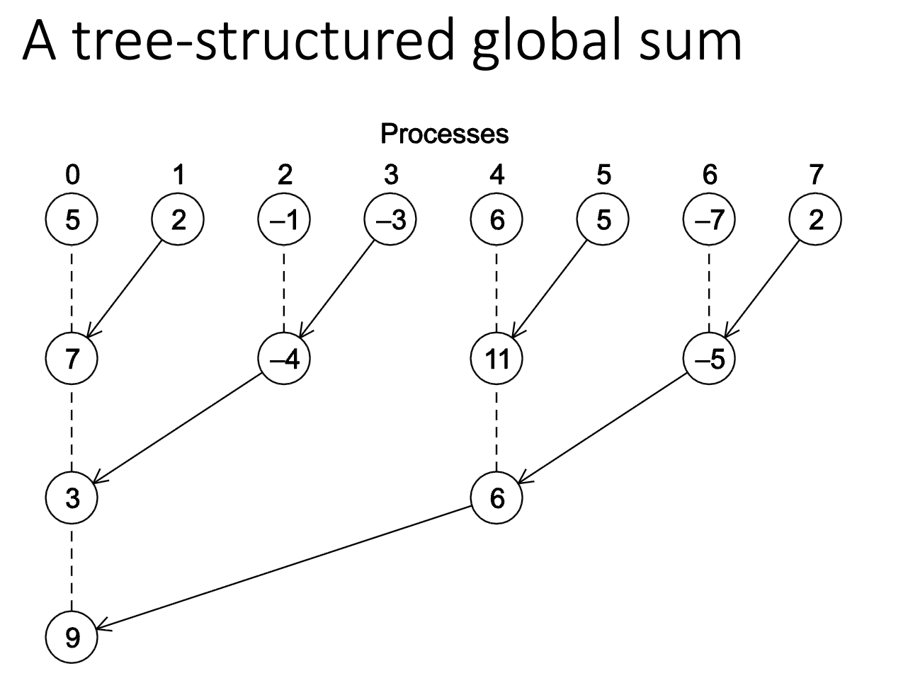

1. 第一阶段：
   - 进程1发送给0，3发送给2，5发送给4，7发送给6
   - 进程0、2、4、6将接收到的值相加
   - 进程2和6将新值发送给进程0和4
   - 进程0和4将接收到的值相加
2. 第二阶段：
   - 进程4将其最新值发送给进程0
   - 进程0将接收到的值加到其最新值中

### 集体通信特点
- **集体通信**：涉及通信器中所有进程的通信函数，如MPI_Reduce
- **点对点通信**：进程之间的通信函数，如MPI_Send, MPI_Recv

### MPI_Reduce
```c
int MPI_Reduce(
    void* send_buf_p,     // 发送缓冲区
    void* recv_buf_p,     // 接收缓冲区（仅目标进程使用）
    int count,            // 数据项数量
    MPI_Datatype datatype, // 数据类型
    MPI_Op operator,      // 操作符
    int dest,             // 目标进程
    MPI_Comm comm         // 通信器
);
```

```c
MPI_Reduce(
    &local_integral, 
    &total_integral, 
    1, 
    MPI_DOUBLE, 
    MPI_SUM, 
    0, 
    MPI_COMM_WORLD
);
```

```c
double local_x[N], sum[N];
/*
...
*/
MPI_Reduce(local_x, sum, N, MPI_DOUBLE, MPI_SUM, 0, MPI_COMM_WORLD);
```

### 预定义的MPI归约操作符
| 操作符 | 说明 |
|--------|------|
| MPI_MAX | 最大值 |
| MPI_MIN | 最小值 |
| MPI_SUM | 求和 |
| MPI_PROD | 乘积 |
| MPI_LAND | 逻辑与 |
| MPI_BAND | 按位与 |
| MPI_LOR | 逻辑或 |
| MPI_BOR | 按位或 |
| MPI_LXOR | 逻辑异或 |
| MPI_BXOR | 按位异或 |

### 集体通信vs点对点通信

#### 规则1
- 通信器中的所有进程必须调用相同的集体函数
- 例如，尝试在一个进程上调用MPI_Reduce与另一个进程上调用MPI_Recv匹配的程序是错误的，程序可能会挂起或崩溃

#### 规则2
- 每个进程传递给MPI集体通信的参数必须"兼容"
- 例如，如果一个进程传递0作为dest_process，另一个传递1，则MPI_Reduce调用的结果是错误的

#### 规则3
- output_data_p参数仅在dest_process上使用
- 但是，所有进程仍然需要传递对应于output_data_p的实际参数，即使只是NULL

#### 规则4
- 点对点通信基于标签和通信器进行匹配
- 集体通信不使用标签
- 它们仅基于通信器和调用顺序进行匹配

#### 例子

MPI_Reduce 多次调用示例解析

| Time | Process 0                     | Process 1                     | Process 2                     |
|------|-------------------------------|-------------------------------|-------------------------------|
| 0    | `a = 1; c = 2`                | `a = 1; c = 2`                | `a = 1; c = 2`                |
| 1    | `MPI_Reduce(&a, &b, ...)`     | `MPI_Reduce(&c, &d, ...)`     | `MPI_Reduce(&a, &b, ...)`     |
| 2    | `MPI_Reduce(&c, &d, ...)`     | `MPI_Reduce(&a, &b, ...)`     | `MPI_Reduce(&c, &d, ...)`     |

---

初步误解
- 假设每个进程都调用 `MPI_Reduce`，使用操作符 `MPI_SUM`，目标进程为 0。
- 初看之下，似乎在两次 `MPI_Reduce` 调用后:
  - `b` 的值会是 `3`
  - `d` 的值会是 `6`
> *这是基于“所有调用同时发生”的错误直觉，忽略了 MPI 的**顺序执行**特性。*

---

**调用顺序决定匹配**
- **内存位置名称（如 `a`, `b`, `c`, `d`）对 MPI_Reduce 的匹配无关紧要**
  - MPI 不关心变量名，只关心：
    - 通信器（`MPI_COMM_WORLD`）
    - 操作类型（`MPI_SUM`）
    - **调用的时序与同步点**
- **真正决定结果的是 `MPI_Reduce` 调用的执行顺序**
  - 假设按时间顺序执行（如表格所示）：
    - 第一次调用（Time=1）：
      - P0: `MPI_Reduce(&a, &b, ..., 0, ...)`
      - P1: `MPI_Reduce(&c, &d, ..., 0, ...)`
      - P2: `MPI_Reduce(&a, &b, ..., 0, ...)`
      - → 所有进程的 `a` 和 `c` 参与求和：`1 + 2 + 1 = 4`
      - → 结果存入 **P0 的 `b`**（因为 dest=0），故 `b = 4`
    - 第二次调用（Time=2）：
      - P0: `MPI_Reduce(&c, &d, ..., 0, ...)`
      - P1: `MPI_Reduce(&a, &b, ..., 0, ...)`
      - P2: `MPI_Reduce(&c, &d, ..., 0, ...)`
      - → 所有进程的 `c` 和 `a` 参与求和：`2 + 1 + 2 = 5`
      - → 结果存入 **P0 的 `d`**，故 `d = 5`
- 因此：
  - `b = 1 + 2 + 1 = 4`
  - `d = 2 + 1 + 2 = 5`

**核心结论**
- 在 MPI 中，**集体通信操作是全局同步的**——所有进程必须**按相同顺序**调用相同的 `MPI_Reduce`，且每次调用独立进行。  
- 前一次调用的结果会影响后续调用的输入数据，因此**执行顺序至关重要**。


### MPI_Allreduce
- 在所有进程都需要全局求和结果以完成更大计算的情况下有用
- 将结果分发给所有进程

```c
int MPI_Allreduce(
    void* send_buf_p,     // 发送缓冲区
    void* recv_buf_p,     // 接收缓冲区（所有进程使用）
    int count,            // 数据项数量
    MPI_Datatype datatype, // 数据类型
    MPI_Op operator,      // 操作符
    MPI_Comm comm         // 通信器
);
```

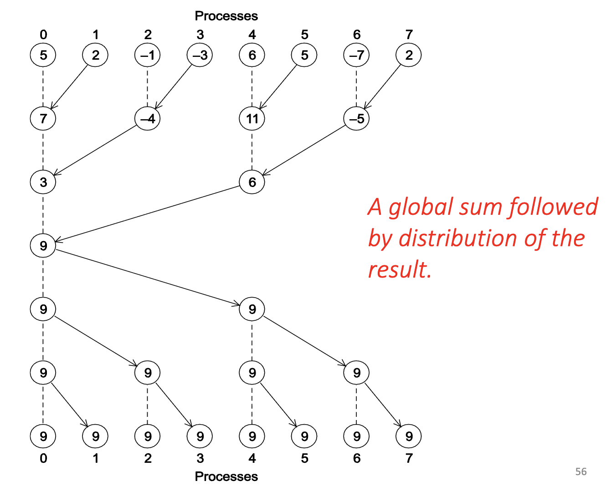

### MPI_Bcast（广播）
- 将属于单个进程的数据发送给通信器中的所有进程
- 树状结构广播

```c
int MPI_Bcast(
    void* data_p,         // 数据缓冲区
    int count,            // 数据项数量
    MPI_Datatype datatype, // 数据类型
    int source_proc,      // 根进程（数据源）
    MPI_Comm comm         // 通信器
);
```

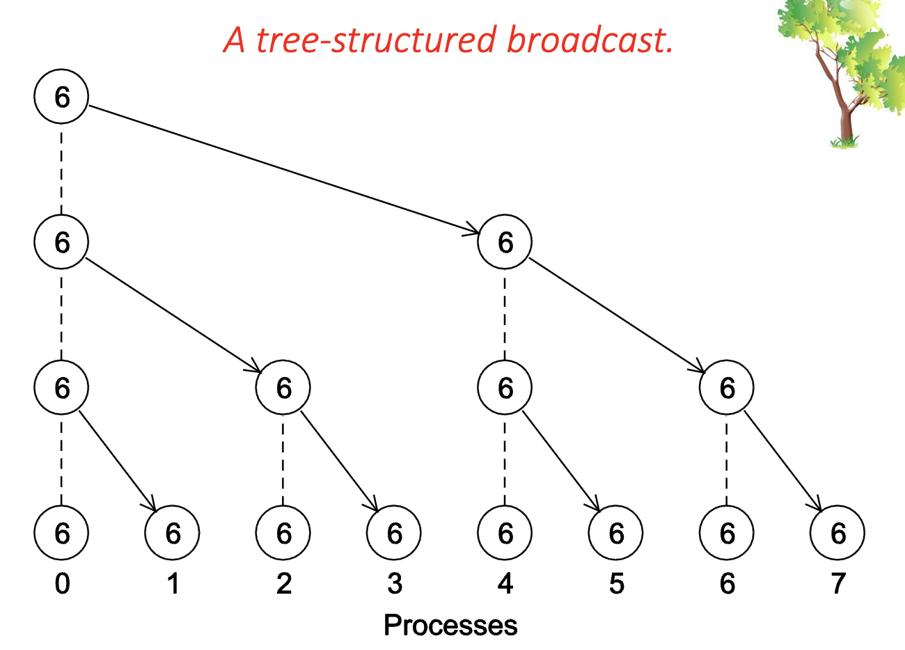

#### Get_input 中使用 MPI_Bcast
```c
void Get_input(
    int my_rank, 
    int comm_sz, 
    double* a_p, 
    double* b_p, 
    int* n_p
) {
    if (my_rank == 0) {
        printf("Enter a, b, and n\n");
        scanf("%lf %lf %d", a_p, b_p, n_p);
    }
    MPI_Bcast(a_p, 1, MPI_DOUBLE, 0, MPI_COMM_WORLD); // 广播 a
    MPI_Bcast(b_p, 1, MPI_DOUBLE, 0, MPI_COMM_WORLD); // 广播 b
    MPI_Bcast(n_p, 1, MPI_INT, 0, MPI_COMM_WORLD); // 广播 n
}
```

### 数据分布

```
X = (x0, x1, x2, ..., xn)
Y = (y0, y1, y2, ..., yn)
X+Y = (x0+y0, x1+y1, x2+y2, ..., xn+yn) = Z
```

#### 向量加法串行实现示例

```c
// 串行实现
for (i = 0; i < n; i++)
    y[i] = x[i] + z[i];
```

#### 向量加法并行实现示例

对于一个 12 维的向量，使用 3 个进程

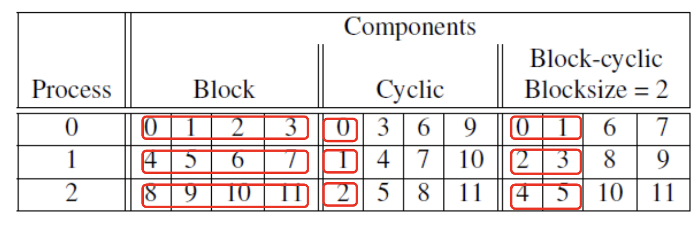

分区选项
- **块分区**：将连续的组件块分配给每个进程
- **循环分区**：以轮询方式分配组件
- **块循环分区**：使用组件块的循环分布

```c
void Parallel_vector_sum(
    double local_x[], // 输入向量的局部部分
    double local_y[],
    double local_z[],
    int local_n
){
    int local_i; // 局部索引，范围从0到local_n-1
    for (local_i = 0; local_i < local_n; local_i++) // 每个进程独立计算其分配的组件
        local_y[local_i] = local_x[local_i] + local_z[local_i];
}
```

### MPI_Scatter
- 用于在进程0上读取整个向量但只将所需组件发送给其他进程的函数

```c
int MPI_Scatter(
    void* send_buf_p,     // 发送缓冲区（仅进程0使用）
    int send_count,       // 每个进程发送的数据项数量
    MPI_Datatype send_type, // 发送数据类型
    void* recv_buf_p,     // 接收缓冲区（每个进程使用）
    int recv_count,       // 每个进程接收的数据项数量
    MPI_Datatype recv_type, // 接收数据类型
    int source_proc,      // 根进程（数据源）
    MPI_Comm comm         // 通信器
);
```

### MPI_Gather
- 收集向量的所有组件到进程0，然后进程0可以处理所有组件

```c
int MPI_Gather(
    void* send_buf_p,     // 发送缓冲区（每个进程使用）
    int send_count,       // 每个进程发送的数据项数量
    MPI_Datatype send_type, // 发送数据类型
    void* recv_buf_p,     // 接收缓冲区（仅进程0使用）
    int recv_count,       // 每个进程接收的数据项数量
    MPI_Datatype recv_type, // 接收数据类型
    int dest_proc,        // 目标进程（数据接收者）
    MPI_Comm comm         // 通信器
);
```

### MPI_Allgather
- 连接每个进程的send_buf_p内容并存储在每个进程的recv_buf_p中
- 与MPI_Gather不同，不需要目标进程参数

```c
int MPI_Allgather(
    void* send_buf_p,     // 发送缓冲区（每个进程使用）
    int send_count,       // 每个进程发送的数据项数量
    MPI_Datatype send_type, // 发送数据类型
    void* recv_buf_p,     // 接收缓冲区（每个进程使用）
    int recv_count,       // 每个进程接收的数据项数量
    MPI_Datatype recv_type, // 接收数据类型
    MPI_Comm comm         // 通信器
);
```

## 矩阵-向量乘法

### 问题描述
- 计算y = A × x
- y的第i个分量是A的第i行与x的点积

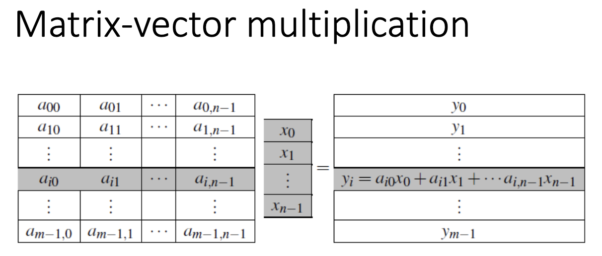

#### 串行伪代码

```c
for (i = 0; i < m; i++) {
    y[i] = 0.0;
    for (j = 0; j < n; j++)
        y[i] += A[i][j] * x[j];
}
```

### C风格数组存储
- 二维数组按行优先顺序存储在内存中

### MPI矩阵-向量乘法函数

c风格代码实现

```c
void Mat_vect_mult(
    double* A, 
    double* x, 
    double* y,
    int m, 
    int n
) {
    int i, j;
    for (i = 0; i < m; i++) {
        y[i] = 0.0;
        for (j = 0; j < n; j++)
            y[i] += A[i*n + j] * x[j]; // A[i][j] 的C风格访问
    }
}
```

一个 MPI 版本的矩阵-向量乘法函数

```c
void Mat_vect_mult(
    double local_A[], 
    double local_x[], 
    double local_y[],
    int local_m, 
    int n,
    int local_n,
    MPI_Comm comm
) {
    double* x;
    int local_i, local_j;
    int local_ok = 1;

    x = malloc(n * sizeof(double)); // 为全局向量x分配内存
    MPI_Allgather(local_x, local_n, MPI_DOUBLE, x, local_n, MPI_DOUBLE, comm); // 收集所有进程的local_x到x

    for (local_i = 0; local_i < local_m; local_i++) {
        local_y[local_i] = 0.0;
        for (local_j = 0; local_j < n; local_j++)
            local_y[local_i] += local_A[local_i*n + local_j] * x[local_j]; // 使用全局向量x进行计算
    }

    free(x); // 释放分配的内存
}
```

## MPI派生数据类型

### 概念
- 用于表示内存中任何数据项集合，并存储数据项的类型及其在内存中的相对位置
- 如果函数知道发送的数据的信息，那么在发送数据之前可以从内存中收集数据项
- 发送数据的函数可以收集内存中的项，接收数据的函数可以将项分发到内存中的正确目的地

### 形式定义
- 由基本MPI数据类型的序列以及每个数据类型的位移组成

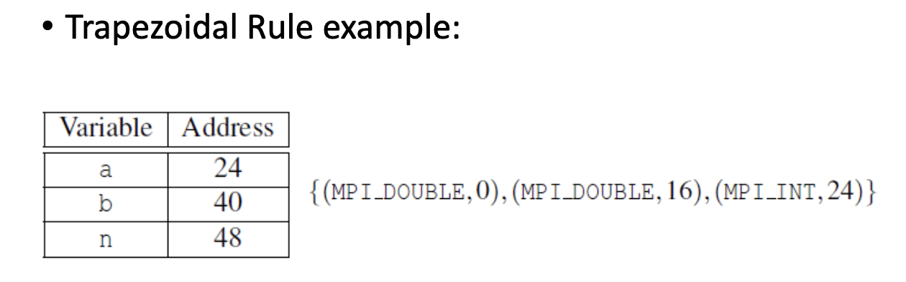

### MPI_Type_create_struct
- 构建由具有不同基本类型的单个元素组成的派生数据类型
```c
int MPI_Type_create_struct(
    int count,                         // 数据项数量
    int array_of_blocklengths[],       // 每个数据项的块长度
    MPI_Aint array_of_displacements[], // 每个数据项的位移
    MPI_Datatype array_of_types[],     // 每个数据项的基本类型
    MPI_Datatype* new_type_p           // 输出：新创建的派生数据类型
);
```

### MPI_Get_address
- 返回location_p引用的内存位置的地址
- MPI_Aint是足够大的整数类型，可以存储系统上的地址
```c
int MPI_Get_address(
    void* location_p, 
    MPI_Aint* address_p
);
```

### MPI_Type_commit
- 允许MPI实现优化其内部表示以便在通信函数中使用
```c
int MPI_Type_commit(MPI_Datatype* type_mpi_t_p);
```

### MPI_Type_free
- 完成新类型后，释放任何额外的存储空间
```c
int MPI_Type_free(MPI_Datatype* old_mpi_t_p);
```

### 在 MPI 中使用 派生数据类型来优化数据广播。

**构建派生数据类型函数**

这个函数负责计算变量的内存布局，并创建一个新的 MPI 数据类型描述符。

```c
void Build_mpi_type(
    double* a_p,              /* in  */ // 指向变量 a 的指针
    double* b_p,              /* in  */ // 指向变量 b 的指针
    int* n_p,                 /* in  */ // 指向变量 n 的指针
    MPI_Datatype* input_mpi_t_p /* out */ // 输出：新创建的 MPI 数据类型句柄
) {
    // 1. 定义每个块包含的元素个数
    // 这里 a, b, n 各只有一个元素，所以长度都是 1
    int array_of_blocklengths[3] = {1, 1, 1};

    // 2. 定义每个块的数据类型
    // 对应 a(double), b(double), n(int)
    MPI_Datatype array_of_types[3] = {MPI_DOUBLE, MPI_DOUBLE, MPI_INT};

    // 3. 用于存储内存地址和偏移量的变量
    MPI_Aint a_addr, b_addr, n_addr;
    // 4. 定义偏移量数组（Displacements）
    // 初始化为0，稍后计算相对于起始地址的字节偏移
    MPI_Aint array_of_displacements[3] = {0};

    // --- 获取内存地址并计算相对偏移 ---

    // 获取变量 a, b, n 在内存中的绝对地址
    MPI_Get_address(a_p, &a_addr);
    MPI_Get_address(b_p, &b_addr);
    MPI_Get_address(n_p, &n_addr);

    // 计算相对偏移量（以第一个变量 a 为基准点 0）
    // b 的偏移量 = b的地址 - a的地址
    array_of_displacements[1] = b_addr - a_addr;
    // n 的偏移量 = n的地址 - a的地址
    array_of_displacements[2] = n_addr - a_addr;

    // --- 创建并提交数据类型 ---

    // 5. 创建新的数据结构
    // 参数：块数(3), 块长度数组, 偏移量数组, 类型数组, 输出句柄
    MPI_Type_create_struct(
        3,
        array_of_blocklengths,
        array_of_displacements,
        array_of_types,
        input_mpi_t_p
    );

    // 6. 提交（Commit）该类型
    // 告诉 MPI 系统这个新类型已经准备好可以使用了
    MPI_Type_commit(input_mpi_t_p);
}
```

**使用派生数据类型进行输入与广播**

下面这个函数展示了如何利用上面创建的类型，仅用一次通信操作将分散的变量发送给所有进程。

```c
void Get_input(
    int my_rank,
    int comm_sz,
    double* a_p,
    double* b_p,
    int* n_p
) {
    MPI_Datatype input_mpi_t; // 声明一个 MPI 数据类型变量

    // 1. 调用辅助函数构建数据类型
    // 传入变量的地址，让 MPI 知道这些变量在内存中的具体位置
    Build_mpi_type(a_p, b_p, n_p, &input_mpi_t);

    // 2. 只有进程 0 读取用户输入
    if (my_rank == 0) {
        printf("Enter a, b, and n\n");
        scanf("%lf %lf %d", a_p, b_p, n_p);
    }

    // 3. 广播数据
    // 关键点：count 参数设为 1，因为我们将 (a, b, n) 视为“一个”整体结构体
    // 源地址是 a_p（因为我们在 Build_mpi_type 中是以 a_p 为基准计算偏移的）
    MPI_Bcast(
        a_p,                // 发送/接收缓冲区的起始地址（必须是基准地址）
        1,                  // 发送 1 个 "input_mpi_t" 类型的对象
        input_mpi_t,        // 我们自定义的复杂数据类型
        0,                  // 根进程 ID
        MPI_COMM_WORLD      // 通信域
    );

    // 4. 释放资源
    // 使用完毕后必须释放派生类型，防止内存泄漏
    MPI_Type_free(&input_mpi_t);
}
```


## 性能评估

### 并行运行时间

返回自过去某个时间以来经过的秒数

```c
double MPI_Wtime(void);
```

```c
double start, finish;
start = MPI_Wtime();
/*
...
*/
finish = MPI_Wtime();
printf("Elapsed time = %e seconds\n", finish - start);
```

### 串行运行时间

在这个案例中不需要使用 MPI 库

```c
#include <timer.h>

double start, finish;

GET_TIME(start);
/*
...
*/
GET_TIME(finish);
printf("Elapsed time = %e seconds\n", finish - start);
```

### MPI_Barrier
- 确保没有进程会从MPI_Barrier调用返回，直到通信器中的所有进程都调用了MPI_Barrier
- 用于同步所有进程
```c
int MPI_Barrier(MPI_Comm comm);
```

```c
double local_start, local_finish, local_elapsed, elapsed;
MPI_Barrier(comm); // 同步所有进程
local_start = MPI_Wtime();
/*
...
*/
local_finish = MPI_Wtime();
local_elapsed = local_finish - local_start;
MPI_Reduce(&local_elapsed, &elapsed, 1, MPI_DOUBLE, MPI_MAX, 0, comm); // 获取最大耗时
if (my_rank == 0)
    printf("Elapsed time = %e seconds\n", elapsed);
```

### 串行的执行时间

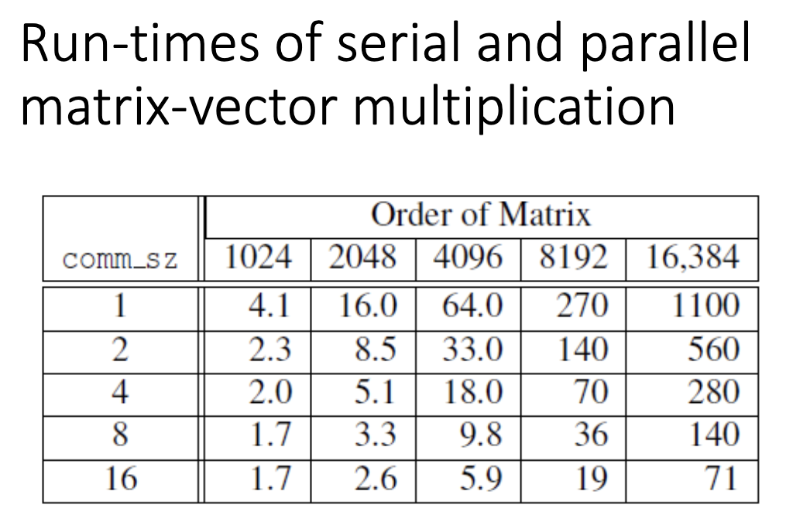

### 加速比（Speedup）
```
S = T_serial / T_parallel
```
其中：
- T_serial = 串行运行时间
- T_parallel = 并行运行时间

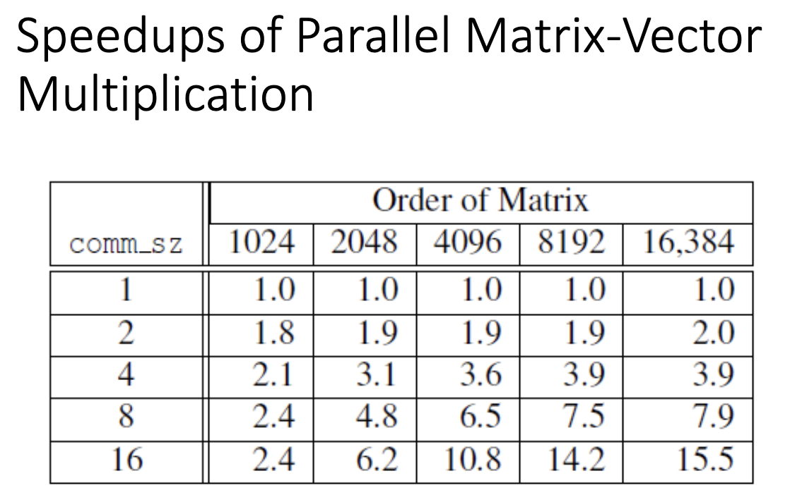

### 效率（Efficiency）
```
E = S / p = T_serial / (p × T_parallel)
```
其中：
- p = 进程数量

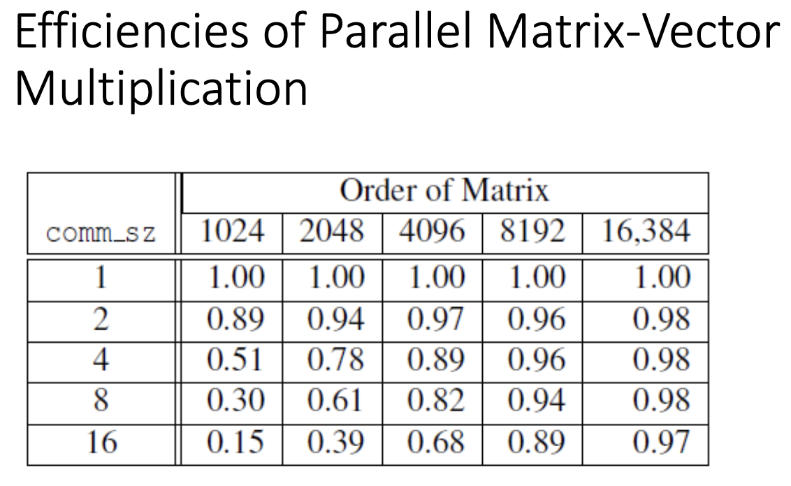

### 可扩展性（Scalability）
- 如果可以增加问题大小，使得效率不会随着进程数的增加而降低，则程序是可扩展的
- **强可扩展性**：在不增加问题大小的情况下保持恒定效率
- **弱可扩展性**：当问题大小以与进程数相同的速度增加时保持恒定效率

## 并行排序算法

### 排序

- 输入：n个元素的数组, p = comm_sz 个进程
- n/p 个元素分配给每个进程
- 没有限制哪个元素分配给哪个进程
- 当算法终止
  - 每个进程中的元素是排序的
  - 进程0中的元素小于进程1中的元素，依此类推

串行冒泡排序
```c
void Bubble_sort(double a[], int n) {
    int list_length, i, temp;
    for (list_length = n; list_length > 1; list_length--)
        for (i = 0; i < list_length - 1; i++)
            if (a[i] > a[i+1]) {
                temp = a[i];
                a[i] = a[i+1];
                a[i+1] = temp;
            }
}
```

### 奇偶换位排序（Odd-Even Transposition Sort）

#### 算法描述
- 一系列阶段
- 偶数阶段：比较交换相邻元素
- 奇数阶段：比较交换相邻元素

#### 串行奇偶换位排序
```c
for (phase = 0; phase < n; phase++)
    if (phase % 2 == 0)
        for (i = 1; i < n; i += 2)
            if (a[i-1] > a[i]) swap(a[i-1], a[i]);
    else
        for (i = 1; i < n-1; i += 2)
            if (a[i] > a[i+1]) swap(a[i], a[i+1]);
```

#### 并行奇偶换位排序
- 每个进程持有部分数据
- 对于偶数阶段，进程i与进程i+1交换数据。如: swap(a[0], a[1]), swap(a[2], a[3])...
- 对于奇数阶段，进程i与进程i+1交换数据。如: swap(a[1], a[2]), swap(a[3], a[4])...

以下是根据图片内容整理的 Markdown 格式文档，包含串行示例、代码实现、并行通信逻辑及伪代码。

### 奇偶交换排序示例 (Example)

演示了一个包含 4 个元素的数组如何通过交替的“偶数阶段”和“奇数阶段”完成排序：

- **Start:** `5, 9, 4, 3`
- **Even phase:** compare-swap (5,9) and (4,3)  
  getting the list `5, 9, 3, 4`
- **Odd phase:** compare-swap (9,3)  
  getting the list `5, 3, 9, 4`
- **Even phase:** compare-swap (5,3) and (9,4)  
  getting the list `3, 5, 4, 9`
- **Odd phase:** compare-swap (5,4)  
  getting the list `3, 4, 5, 9`

### 串行奇偶换位排序 (Serial odd-even transposition sort)

这是标准的串行 C 语言实现代码，通过循环 $n$ 次（$n$ 为数组长度），交替进行偶数索引对和奇数索引对的比较与交换。

```c
void Odd_even_sort(
    int a[] /* in/out */, // 待排序数组
    int n   /* in */) {   // 数组长度
    int phase, i, temp;

    // 外层循环控制阶段，共需 n 个阶段保证排序完成
    for (phase = 0; phase < n; phase++) {
        if (phase % 2 == 0) { /* Even phase (偶数阶段) */
            // 比较索引对: (0,1), (2,3), ...
            for (i = 1; i < n; i += 2) {
                if (a[i - 1] > a[i]) {
                    temp = a[i];
                    a[i] = a[i - 1];
                    a[i - 1] = temp;
                }
            }
        } else { /* Odd phase (奇数阶段) */
            // 比较索引对: (1,2), (3,4), ...
            for (i = 1; i < n - 1; i += 2) {
                if (a[i] > a[i + 1]) {
                    temp = a[i];
                    a[i] = a[i + 1];
                    a[i + 1] = temp;
                }
            }
        }
    }
} /* Odd_even_sort */
```


### 任务间的通信 (Communications among tasks)

在并行环境中，数据分布在不同的进程上。下图展示了相邻进程如何在不同阶段交换边界数据以进行比较。

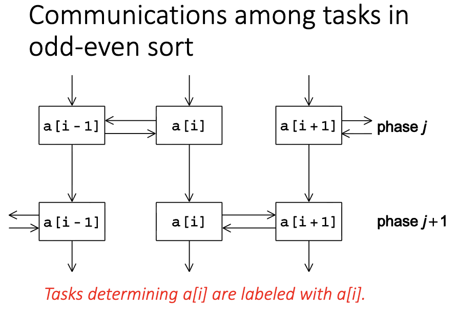

### 并行奇偶换位排序执行表 (Parallel odd-even transposition sort)

下表展示了 4 个进程（Process 0-3）如何协作排序 16 个元素。每个进程负责一部分数据（Local Sort），然后在各个阶段（Phase）与邻居交换并合并数据。

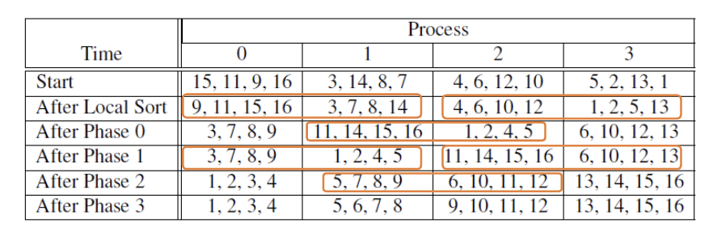

### 并行算法伪代码 (Pseudo-code)

```
Sort local keys; // 1. 先对本地持有的数据进行排序

for (phase = 0; phase < comm_sz; phase++) {
    partner = Compute_partner(phase, my_rank); // 2. 计算当前阶段的通信伙伴

    if (I'm not idle) { // 如果不是空闲进程（即存在有效伙伴）
        Send my keys to partner;       // 3. 发送我的数据
        Receive keys from partner;     // 4. 接收伙伴的数据

        if (my_rank < partner)
            Keep smaller keys;         // 如果我的秩较小，保留较小的那一半数据
        else
            Keep larger keys;          // 如果我的秩较大，保留较大的那一合数据
    }
}
```

### Compute_partner 函数

该函数用于确定在当前阶段（Phase），当前进程（my_rank）应该与哪个进程进行通信。

```c
int Compute_partner(int phase, int my_rank, int comm_sz) {
    int partner;

    if (phase % 2 == 0) {      /* Even phase (偶数阶段) */
        if (my_rank % 2 != 0)  /* Odd rank (奇数秩进程) */
            partner = my_rank - 1; // 找左边的邻居
        else                   /* Even rank (偶数秩进程) */
            partner = my_rank + 1; // 找右边的邻居
    } else {                   /* Odd phase (奇数阶段) */
        if (my_rank % 2 != 0)  /* Odd rank (奇数秩进程) */
            partner = my_rank + 1; // 找右边的邻居
        else                   /* Even rank (偶数秩进程) */
            partner = my_rank - 1; // 找左边的邻居
    }

    // 边界检查：如果计算出的伙伴超出范围（-1 或 comm_sz），则设为空
    if (partner == -1 || partner == comm_sz)
        partner = MPI_PROC_NULL;
}
```


## MPI程序安全性

### MPI_Send的行为
- MPI标准允许MPI_Send以两种不同方式行为：
  - 简单地将消息复制到MPI管理的缓冲区并返回
  - 阻塞直到匹配的MPI_Recv开始

### 安全性问题
- 许多MPI实现设置了一个阈值，系统在此处从缓冲切换到阻塞
- 相对较小的消息将由MPI_Send缓冲
- 较大的消息将导致其阻塞
- 如果每个进程执行的MPI_Send都阻塞，则没有进程能够开始执行MPI_Recv调用，程序将挂起或死锁

### 不安全的程序
- 依赖MPI提供的缓冲的程序被称为不安全的
- 这样的程序可能在各种输入集上正常运行，但可能在其他输入集上挂起或崩溃

### MPI_Ssend（同步发送）
- MPI_Send的替代方案
- 额外的"s"代表同步
- 保证阻塞直到匹配的接收开始

```c
int MPI_Ssend(
    void* send_buf_p, // 发送缓冲区
    int send_count, // 发送数据项数量
    MPI_Datatype send_type, // 发送数据类型
    int dest, // 目标进程
    int send_tag, // 发送标签
    MPI_Comm comm // 通信器
);
```

### 重构通信

```c
MPI_Send(msg, size, MPI_INT, (my_rank + 1) % comm_sz, 0, comm);
MPI_Recv(msg, size, MPI_INT, (my_rank - 1 + comm_sz) % comm_sz, 0, comm, MPI_STATUS_IGNORE);
```

```c
if (my_rank % 2 != 0) { // 奇数秩进程
    MPI_Send(msg, size, MPI_INT, (my_rank + 1) % comm_sz, 0, comm);
    MPI_Recv(msg, size, MPI_INT, (my_rank - 1 + comm_sz) % comm_sz, 0, comm, MPI_STATUS_IGNORE);
} else { // 偶数秩进程
    MPI_Recv(msg, size, MPI_INT, (my_rank - 1 + comm_sz) % comm_sz, 0, comm, MPI_STATUS_IGNORE);
    MPI_Send(msg, size, MPI_INT, (my_rank + 1) % comm_sz, 0, comm);
}
```

通过将发送和接收操作的顺序分开，奇数秩进程先发送再接收，而偶数秩进程先接收再发送，从而避免了死锁的情况。

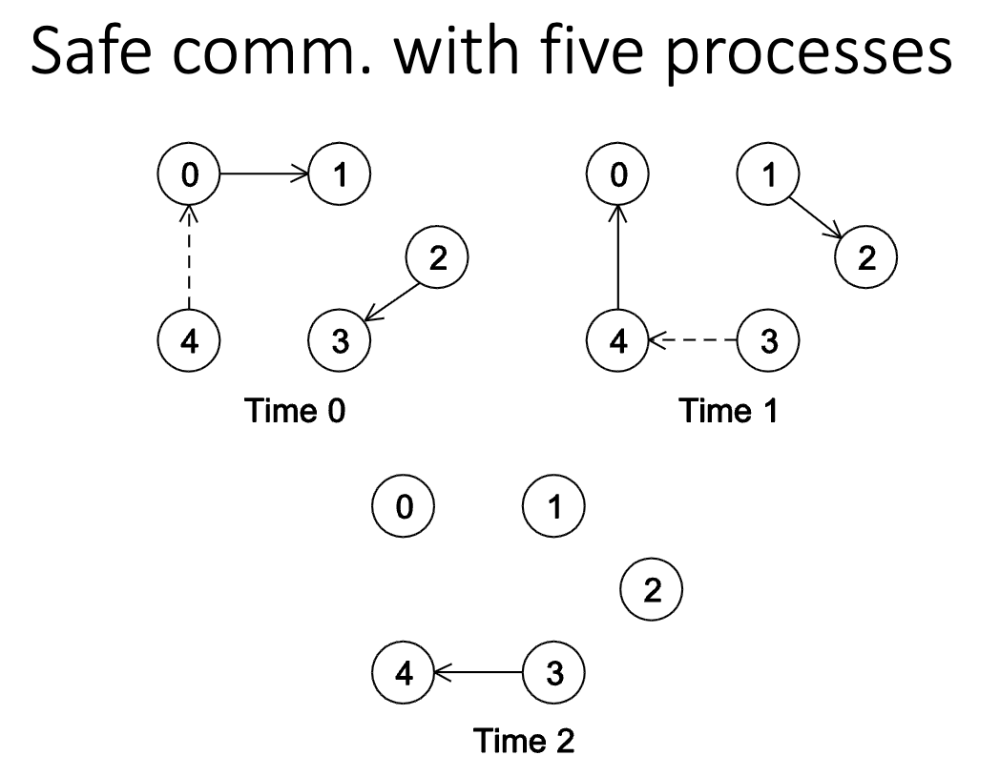

### MPI_Sendrecv
- 执行阻塞发送和接收的单一调用
- 目标和源可以相同或不同
- 特别有用，因为MPI调度通信，程序不会挂起或崩溃

```c
int MPI_Sendrecv(
    void* send_buf_p, // 发送缓冲区 
    int send_count, // 发送数据项数量
    MPI_Datatype send_type, // 发送数据类型
    int dest, // 目标进程
    int send_tag, // 发送标签
    void* recv_buf_p, // 接收缓冲区
    int recv_buf_size, // 接收数据项数量
    MPI_Datatype recv_buf_type, // 接收数据类型
    int source, // 源进程
    int recv_tag, // 接收标签
    MPI_Comm comm, // 通信器
    MPI_Status* status_p // 输出：接收状态
);
```

### 并行奇偶换位排序的安全版本

```c
void Merge_low(
    int my_keys[],
    int recv_keys[],
    int temp_keys[],
    int local_n
){
    int m_i = 0, r_i = 0, t_i = 0;

    while (t_i < local_n) {
        if (my_keys[m_i] <= recv_keys[r_i]) {
            temp_keys[t_i] = my_keys[m_i];
            m_i++;
            t_i++;
        } else {
            temp_keys[t_i] = recv_keys[r_i];
            r_i++;
            t_i++;
        }
    }

    for (t_i = 0; t_i < local_n; t_i++)
        my_keys[t_i] = temp_keys[t_i];

}
```

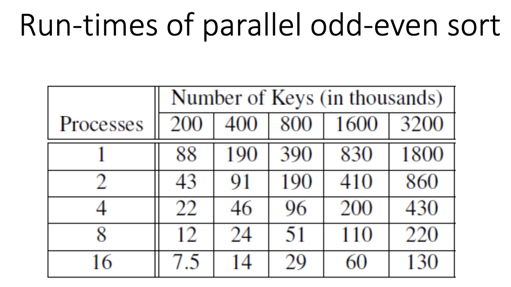

## 总结

1. **MPI（消息传递接口）** 是可以从C、C++或Fortran程序调用的函数库
2. **通信器** 是能够相互发送消息的进程集合
3. 许多并行程序使用**SPMD（单程序多数据）** 方法
4. 大多数串行程序是确定性的，但并行程序通常不具备此属性
5. **集体通信** 涉及通信器中的所有进程
6. 计时并行程序时，通常关注**经过时间**或"墙上时钟时间"
7. **加速比** 是串行运行时间与并行运行时间的比率
8. **效率** 是加速比除以并行进程数
9. 如果可以增加问题大小（n），使得效率不会随着p的增加而降低，则并行程序被称为**可扩展的**
10. 如果MPI程序的正确行为依赖于MPI_Send正在缓冲其输入的事实，则该程序是**不安全的**