# ch04 用 Pthreads 进行共享内存编程

### 学习目标
- 理解共享内存系统编程的问题
- 控制对临界区的访问
- 线程同步机制
- 使用 POSIX 线程编程
- 互斥锁（Mutexes）
- 生产者-消费者同步和信号量
- 屏障和条件变量
- 读写锁
- 线程安全性

## 共享内存系统

### 共享内存系统
- 每个处理器拥有独立的私有内存
- 处理器之间通过共享内存进行通信
- 可以直接访问共享内存空间

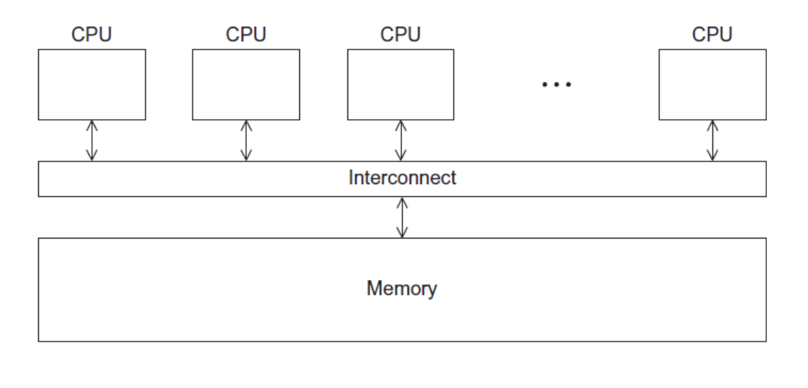

### 进程和线程
- 进程是正在运行（或挂起）的程序的一个实例
- 线程类似于"轻量级"进程
- 在共享内存程序中，单个进程可以有多个控制线程

## POSIX 线程

### POSIX 线程简介
- Portable Operating System Interface（POSIX）便携式操作系统接口
- 也称为 Pthreads
- 适用于类 Unix 操作系统的标准
- 可以链接到 C 程序的库
- 为多线程编程指定应用程序编程接口（API）
- 注意事项: Pthreads API 仅在 POSIX 系统上可用 — Linux、MacOS X、Solaris、HPUX 等

## 第一个 Pthreads 程序

### Hello World! 程序 (1)

```c
#include <stdio.h>
#include <stdlib.h>
#include <pthread.h>  // 声明各种 Pthreads 函数、常量、类型等

int thread_count;

void* Hello(void* rank) {
    long thread; // 使用 long 类型来存储线程的标识符
    Pthread_t* thread_handles; // 声明一个指向 pthread_t 类型的指针，用于存储线程句柄

    thread_count = strtol(argv[1], NULL, 10); // 从命令行参数获取线程数
    thread_handles = malloc(thread_count * sizeof(pthread_t)); // 为每个线程分配 pthread_t 对象

    // 启动线程
    for (thread = 0; thread < thread_count; thread++)
        pthread_create(&thread_handles[thread], NULL, Hello, (void*) thread); // 创建线程并传递线程标识符作为参数
    
    printf("Hello from the main thread\n");
    
    // 等待所有线程完成
    for (thread = 0; thread < thread_count; thread++)
        pthread_join(thread_handles[thread], NULL); // 等待线程完成
    
    // 释放内存
    free(thread_handles);
    return 0;
}
```

### 编译 Pthreads 程序

```bash
gcc -g -Wall -o pth_hello pth_hello.c -lpthread
```

- `gcc` 是 GCC 编译器
- `-g` 选项启用调试信息
- `-Wall` 选项启用所有编译器警告
- `-o pth_hello` 指定输出可执行文件的名称
- `pth_hello.c` 是包含 Pthreads 程序的源代码文件
- `-lpthread` 链接 Pthreads 库

### 运行 Pthreads 程序

```bash
./pth_hello <number of threads>
```

```bash
./pth_hello 1
Hello from the main thread
Hello from thread 0 of 1
```

```bash
./pth_hello 4
Hello from the main thread
Hello from thread 0 of 4
Hello from thread 1 of 4
Hello from thread 2 of 4
Hello from thread 3 of 4
```

### 全局变量
- 可能引入微妙且令人困惑的错误！
- 限制全局变量的使用，仅在真正需要时使用
  - 共享变量

## 启动线程

### 线程启动机制
- MPI 中的进程通常由脚本启动
- 在 Pthreads 中，线程由程序可执行文件启动

### pthread_create 函数

```c
#include <pthread.h> 

int pthread_create( 
    pthread_t* thread_p, // 指向 pthread_t 对象的指针，用于存储新线程的标识符
    const pthread_attr_t* attr_p, // 线程属性，通常传入 NULL
    void* (*start_routine)(void*), // 线程要执行的函数
    void* arg_p // 传递给 start_routine 函数的参数指针
);
```

- `thread_p`: 在调用之前分配
- `attr_p`: 通常传入 NULL 因为我们使用默认线程属性
- `start_routine`: 线程将执行的函数
- `arg_p`: 指向传递给线程函数的参数的指针

### pthread_t 对象
- 不透明类型
- 实际存储的数据是系统特定的
- 数据成员不能直接被用户代码访问
- 但 Pthreads 标准保证 pthread_t 对象存储了足够的信息
  - 可以唯一标识与其关联的线程

### 线程函数

- 线程函数原型: 
    ```c
    void* thread_function(void* args_p);
    ```
- `void*` 可以在 C 中转换为任何指针类型
- 因此 args_p 可以指向包含一个或多个线程函数所需值的列表
- 同样，thread_function 的返回值可以指向包含一个或多个值的列表

### 主线程和子线程

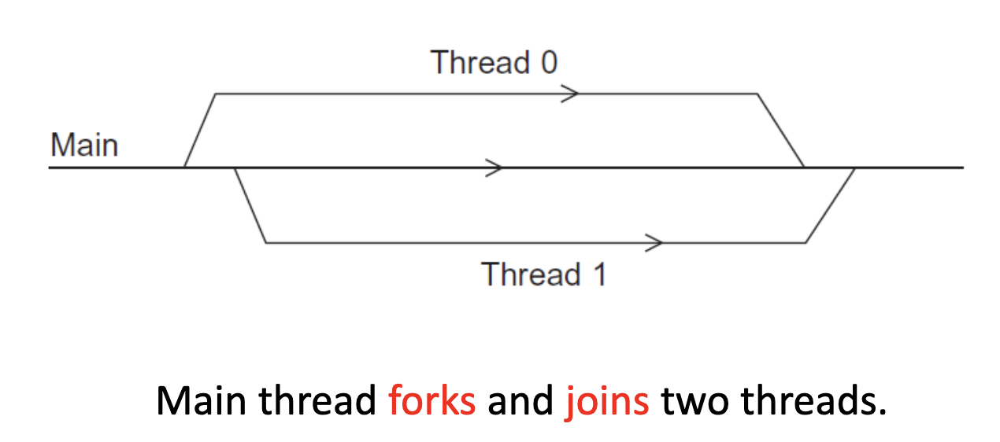

## 停止线程

### pthread_join 函数
- 我们对每个线程调用一次 pthread_join 函数
- 单次调用 pthread_join 会等待与 pthread_t 对象关联的线程完成

```c
int pthread_join(pthread_t thread, void** ret_val_p);
```
- `thread`: 要等待的线程的 pthread_t 对象
- `ret_val_p`: 指向线程返回值的指针，可以为 NULL

## 矩阵-向量乘法

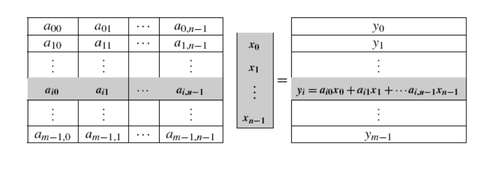

### 串行伪代码

```c
for (i = 0; i < m; i++) {
    y[i] = 0.0;
    for (j = 0; j < n; j++)
        y[i] += A[i][j] * x[j];
}
```

### 使用 3 个 Pthreads

```
线程 0: 计算 y[0], y[1]
线程 1: 计算 y[2], y[3]
线程 2: 计算 y[4], y[5]
```

### Pthreads 矩阵-向量乘法代码

```c
void *Pth_mat_vect(void* rank) {
    long my_rank = (long) rank;
    int i, j;
    int local_m = m / thread_count; // 每个线程处理的行数
    int my_first_row = my_rank * local_m; // 线程处理的第一行
    int my_last_row = (my_rank+1)*local_m - 1; // 线程处理的最后一行

    for (i = my_first_row; i <= my_last_row; i++) {
        y[i] = 0.0;
        for (j = 0; j < n; j++)
            y[i] += A[i][j] * x[j];
    }
    return NULL;
}
```

## 临界区

### 估算 π

```
π = 4 (1- 1/3 + 1/5 - 1/7 + ... + (-1)^n/(2n+1) + ...)
```

```c
double factor = 1.0
double sum = 0.0;
for (i = 0; i < n; i++, factor = -factor) {
    sum += factor / (2 * i + 1);
}
pi = 4.0 * sum;
```

### 使用2个线程计算 π

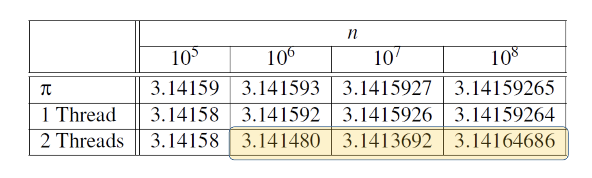

注意到随着 n 的增加，使用一个线程的估算结果越来越好。

### 一个估算 π 的线程函数 

```c
void* Thread_sum(void* rank) {
    long my_rank = (long) rank;
    double factor;
    long long i;
    long long my_n = n / thread_count;
    long long my_first_i = my_n * my_rank;
    long long my_last_i = my_first_i + my_n;
    
    if (my_first_i % 2 == 0)
        factor = 1.0;
    else
        factor = -1.0;
    
    for (i = my_first_i; i < my_last_i; i++, factor = -factor) {
        sum += factor / (2 * i + 1);
    }
    
    return NULL;
}
```

### 可能的竞态条件
- 多个线程同时访问和修改共享变量 `sum`
- 导致计算结果不正确

### 忙等待

- 线程反复测试条件，但在此期间实际上不做任何有用的工作
- 注意编译器优化可能会导致问题！

```c
y = Compute(my_rank);

// 忙等待直到可以进入临界区
while (flag != my_rank);

x = x + y;
flag++;

```

## 互斥锁（Mutexes）

### 互斥锁简介
- 忙等待的线程可能会持续使用 CPU 却无所事事
- 互斥锁（mutual exclusion）是一种特殊类型的变量，可用于限制对临界区的访问，一次只允许一个线程访问

### 互斥锁的作用
- 用于保证一个线程在执行临界区代码时"排除"所有其他线程
- Pthreads 标准包含互斥锁的特殊类型：`pthread_mutex_t`

### 互斥锁函数

```c
// 初始化互斥锁
int pthread_mutex_init(
    pthread_mutex_t* mutex, // 指向要初始化的互斥锁的指针
    const pthread_mutexattr_t* attr // 互斥锁属性，通常传入 NULL 使用默认属性
);

// 锁定互斥锁（进入临界区）
int pthread_mutex_lock(pthread_mutex_t* mutex);

// 解锁互斥锁（离开临界区）
int pthread_mutex_unlock(pthread_mutex_t* mutex);

// 销毁互斥锁
int pthread_mutex_destroy(pthread_mutex_t* mutex);
```

### 使用互斥锁的全局求和函数

```c
pthread_mutex_t mutex;

void* Thread_sum(void* rank) {
    long my_rank = (long) rank;
    double factor;
    long long i;
    long long my_n = n / thread_count;
    long long my_first_i = my_n * my_rank;
    long long my_last_i = my_first_i + my_n;
    double my_sum = 0.0;
    
    if (my_first_i % 2 == 0)
        factor = 1.0;
    else
        factor = -1.0;
    
    // 计算部分和
    for (i = my_first_i; i < my_last_i; i++, factor = -factor) {
        my_sum += factor / (2 * i + 1);
    }
    
    // 使用互斥锁保护临界区
    pthread_mutex_lock(&mutex);
    sum += my_sum;
    pthread_mutex_unlock(&mutex);
    
    return NULL;
}
```

### 执行时间

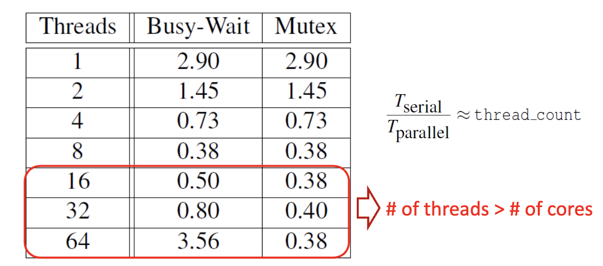

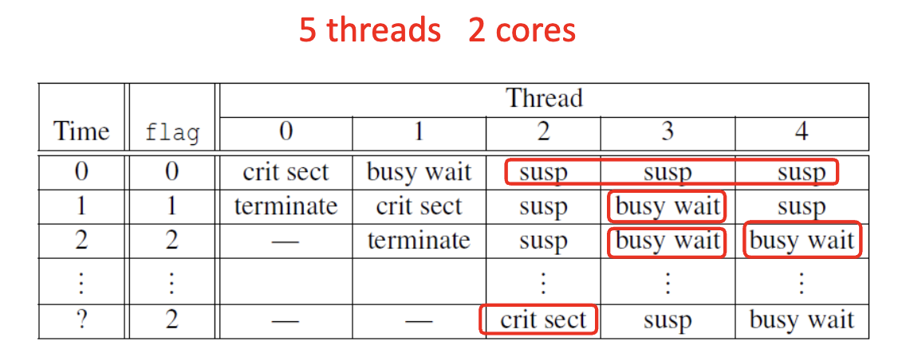

- π 程序的运行时间（以秒为单位），使用 n = 10^8 项，在具有两个四核处理器的系统上
- 当线程数增加时，忙等待时间和互斥锁时间逐渐减少，但线程数超过处理器核心数时，性能开始下降

## 信号量（Semaphores）

### 生产者-消费者同步问题
- 忙等待强制线程按顺序访问临界区
- 使用互斥锁时，顺序由时机和系统决定
- 有些应用需要控制线程访问临界区的顺序
  - 矩阵乘法顺序问题: A * B * C != A * C * B 
  - 当线程数超过处理器核心数时，使用线程传递消息可能处于忙等待状态，消息无法被及时处理

### 信号量函数语法

```c
#include <semaphore.h> // semphore 不在 pthread.h 中，而是在 semaphore.h 中声明

// 初始化信号量
int sem_init(
    sem_t* sem, // 指向要初始化的信号量的指针
    int pshared, // 0 表示线程间共享，非零表示进程间共享
    unsigned int value // 信号量的初始值
);

// 销毁信号量
int sem_destroy(sem_t* semaphore_p); 

// 增加信号量的值（解锁）
int sem_post(sem_t* semaphore_p); 
// post用于增加信号量的值
// 当有线程在等待信号量时，post会解除一个等待线程的阻塞状态，调度由系统决定


// 减少信号量的值（锁定，如果值为0则阻塞）
int sem_wait(sem_t* semaphore_p); 
// wait可以用来阻塞当前线程
// 直到信号量的值大于0，解除阻塞并将信号量的值减1，表示公共资源减少
// 信号量的值为0时，wait会保持阻塞当前线程
```

### 使用信号量发送消息

```c
// 信号量初始化为 0，表示消息尚未准备好

void* Send_msg(void* rank) {
    long my_rank = (long) rank;
    long dest = (my_rank + 1) % thread_count;
    char* my_msg = malloc(MSG_MAX * sizeof(char));
    
    sprintf(my_msg, "Hello to %ld from %ld", dest, my_rank);
    messages[dest] = my_msg;
    sem_post(&semaphores[dest]);  // 解锁目标线程的信号量
    
    sem_wait(&semaphores[my_rank]);  // 等待自己的信号量被解锁
    printf("Thread %ld > %s\n", my_rank, messages[my_rank]);
    
    return NULL;
}

int main(int argc, char* argv[]) {
    // ... 初始化线程、信号量等 ...
    
    for (thread = 0; thread < thread_count; thread++)
        pthread_create(&thread_handles[thread], NULL, Send_msg, (void*) thread);
    
    for (thread = 0; thread < thread_count; thread++)
        pthread_join(thread_handles[thread], NULL);
    
    // ... 销毁信号量、释放资源等 ...
    
    return 0;
}
```

结果
- 消息的发送顺序是有序的
- 输出不一定是有序的，因为线程的调度由系统决定

## 屏障和条件变量

### 屏障（Barriers）
- 同步线程以确保它们都在程序中的同一点，这称为屏障
- 在所有线程都到达屏障之前，没有线程可以越过屏障

### 利用屏障来给最慢的线程更多时间

```c
/* 共享的变量 */
double elapsed_time;

/* 私有的变量 */
double my_start, my_finish, my_elapsed;

// 同步点：确保所有线程/进程在此处汇合 
Synchronize threads;  // 例如：pthread_barrier_wait() 或 MPI_Barrier()

// 记录本线程/进程的起始时间
Store current time in my_start;

/* Execute timed code */
// ... （此处放置待测性能的核心计算代码） ...

// 记录本线程/进程的结束时间
Store current time in my_finish;

// 计算本线程/进程的耗时
my_elapsed = my_finish - my_start;

// 归约操作：取所有线程/进程中的最大耗时作为总耗时
elapsed = Maximum of my_elapsed values;  // 例如：MPI_Allreduce(..., MPI_MAX)
```

### 利用屏障来调试错误

```c
point in program we want to reach;
barrier;  // 插入同步屏障（如：MPI_Barrier(comm) 或 pthread_barrier_wait(&barrier)）

if (my_rank == 0) {  // 仅由主进程（rank 0）输出
    printf("All threads reached this point\n");
    fflush(stdout);  // 立即刷新缓冲区，确保输出及时可见
}
```

### 使用忙等待和互斥锁实现屏障

- 利用忙等待和互斥锁实现屏障是一种简单但效率较低的方式
- 需要一个共享的计数器来跟踪已经到达屏障的线程数量
- 当计数器表明每个线程已经进入临界区时，线程可以离开临界区

```c
int counter = 0; // 需要给每一个屏障实例使用一个计数器变量，否则可能会出现问题
int thread_count;
pthread_mutex_t barrier_mutex;

void Thread_work() {
    // ... 执行线程的工作 ...

    // 进入屏障
    pthread_mutex_lock(&barrier_mutex);
    counter++;
    pthread_mutex_unlock(&barrier_mutex); // 释放互斥锁以允许其他线程进入临界区
    while (counter < thread_count); // 忙等待直到所有线程都到达屏障
}
```

### 使用信号量实现屏障

```c
int counter = 0;  // 初始化为 0
sem_t count_sem; // 初始化 count_sem 为 1，表示互斥访问计数器
sem_t barrier_sem; // 初始化 barrier_sem 为 0，表示线程需要等待直到所有线程都到达屏障

void Thread_work() {

    // ... 执行线程的工作 ...
    sem_wait(&count_sem); // 获取对计数器的互斥访问
    if (counter == thread_count-1) {
        counter = 0;
        sem_post(&barrier_sem); // 唤醒所有等待的线程
        for(int i = 0; i < thread_count-1; i++)
            sem_post(&barrier_sem); // 确保所有线程都被唤醒
    } else {
        counter++; // 增加计数器
        sem_post(&count_sem); // 释放对计数器的互斥访问
        sem_wait(&barrier_sem); // 等待直到所有线程都到达屏障
    }
}
```

### 信号量和互斥锁的区别

- 互斥锁只允许一个线程进入临界区
- 信号量允许多个线程进入临界区，具体数量由信号量的值决定

### 条件变量（Condition Variables）
- 条件变量是一个数据对象，允许线程挂起执行，直到某个事件或条件发生
- 当事件或条件发生时，另一个线程可以向该线程发出信号使其"唤醒"
- 条件变量总是与互斥锁关联

```c
lock mutex;
if(condition)
    signal thread(s); // 唤醒一个或多个等待的线程
else
    unlock the mutex and block; // 线程将被阻塞，直到另一个线程发出信号
    // 当线程解锁时，互斥锁将被释放，允许其他线程进入临界区并可能改变条件
```
### 条件变量函数

```c
// 初始化条件变量
int pthread_cond_init(pthread_cond_t* cond, const pthread_condattr_t* attr);

// 等待条件变量
int pthread_cond_wait(pthread_cond_t* cond, pthread_mutex_t* mutex);
// 在等待前释放互斥锁，被唤醒后重新获取互斥锁

// 发送信号给一个等待的线程
int pthread_cond_signal(pthread_cond_t* cond);

// 发送信号给所有等待的线程
int pthread_cond_broadcast(pthread_cond_t* cond);

// 销毁条件变量
int pthread_cond_destroy(pthread_cond_t* cond);
```

### 使用条件变量实现屏障

```c
int counter = 0;
pthread_mutex_t mutex;
pthread_cond_t cond_var;

void Barrier(int thread_count) {
    // 进入屏障
    pthread_mutex_lock(&mutex); // 获取互斥锁以保护计数器
    counter++;
    if (counter == thread_count) {
        counter = 0;
        pthread_cond_broadcast(&cond_var);  // 唤醒所有等待的线程
        pthread_mutex_unlock(&mutex); // 释放互斥锁
    } else {
        while(pthread_cond_wait(&cond_var, &mutex) != 0);  // 等待并释放互斥锁
    }
    pthread_mutex_unlock(&mutex); // 确保在所有线程都被唤醒后释放互斥锁
}
```

### 条件变量的工作原理

通常的应用场景下，当前线程执行 `pthread_cond_wait` 时，处于临界区访问共享资源，存在一个 mutex 与该临界区相关联，这是理解 `pthread_cond_wait` 带有 `mutex` 参数的关键
- 当前线程执行 `pthread_cond_wait` 前，已经获得了和临界区相关联的 `mutex` ,执行 `pthread_cond_wait` 会阻塞，但是在进入阻塞状态前，必须释放已经获得的 `mutex` , 让其它线程能够进入临界区
- 当前线程执行 `pthread_cond_wait` 后，阻塞等待的条件满足，条件满足时会被唤醒, 被唤醒后, 仍然处于临界区, 因此被唤醒后必须再次获得和临界区相关联的 `mutex`
- 综上，调用 `pthread_cond_wait` 时，线程总是位于某个临界区，该临界区与 `mutex` 相关, `pthread_cond_wait` 需要带有一个参数 `mutex` , 用于释放和再次获取 `mutex` 。

## 读写锁（Read-Write Locks）

### 控制对大型共享数据结构的访问

假设共享数据结构是一个已排序的整数链表，我们感兴趣的操作是 Member、Insert 和 Delete

### 链表操作

```c
// 链表节点结构
struct list_node_s {
    int data;
    struct list_node_s* next;
};

// 链表成员查找
int Member(int value) {}

// 插入新节点
int Insert(int value) {}

// 删除节点
int Delete(int value) {}
```

### 多线程链表问题
- 尝试使用上面的链表操作在多线程环境中访问链表会导致问题
- 为了解决共享链表访问的问题，可以定义 head_p 作为指向链表头节点的全局指针
- 简化函数的实现
  - 不再需要传递链表头指针作为参数
  - 只需要传递要操作的值作为参数

### 例子

两个线程同时访问链表可能导致问题

线程 0 执行 Member(5), 线程 1 执行 Delete(5), 那么元素 5 可能在 线程 0 返回之前就被删除了

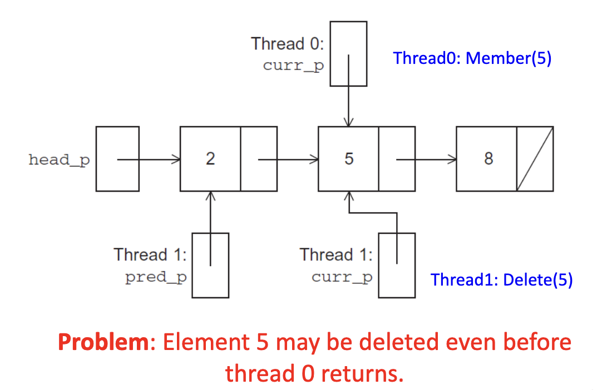

线程 0 窒息查找元素 8 的位置, 线程 1 删除元素 5, 那么线程 0 可能会访问已经被线程 1 删除的节点，导致错误

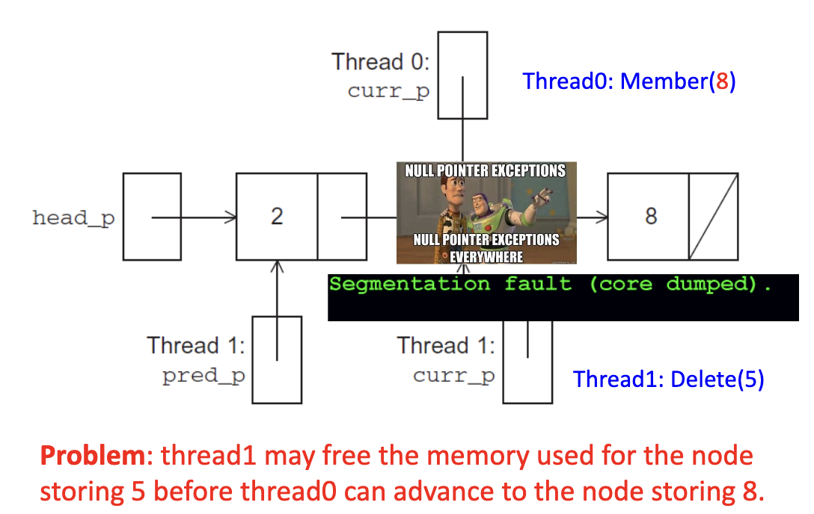
  

### 解决方案 #1：使用单个互斥锁

- 方法
  - 最简单的解决方案是使用单个互斥锁来保护对链表的访问
  - 每个链表函数都必须在访问链表之前锁定互斥锁，并在访问完成后解锁互斥锁
- 问题
  - 问题：我们序列化了对链表的访问
  - 如果绝大多数操作都是 Member 调用，我们将无法利用并行性

```c
pthread_mutex_lock(&list_mutex);
Member(value);
pthread_mutex_unlock(&list_mutex);
```

### 解决方案 #2：每个节点使用一个互斥锁

- 方法
  - 给每一个链表节点一个互斥锁
  - 给结构体定义添加一个互斥锁成员
- 问题
  - 比原始的 Member 函数复杂得多
  - 速度也慢得多，因为每次访问节点时都需要锁定和解锁互斥锁
  - 为每个节点添加互斥锁字段会大大增加链表所需的存储空间

```c
typedef struct {
    int data;
    struct list_node_s* next;
    pthread_mutex_t mutex;
};

int Member(int value) {
    struct list_node_s* temp_p;

    pthread_mutex_lock(&head_p_mutex); // 锁定头节点的互斥锁
    temp_p = head_p;
    while(temp_p != NULL && temp_p->data < value) {
        if(temp_p->next != NULL)
            pthread_mutex_lock(&temp_p->next->mutex); // 锁定下一个节点的互斥锁
        if(temp_p != head_p)
            pthread_mutex_unlock(&temp_p->mutex); // 解锁当前节点的互斥锁
        pthread_mutex_unlock(&(temp_p->mutex)); // 解锁头节点的互斥锁
        temp_p = temp_p->next;
    }

    if(temp_p == NULL || temp_p->data > value) {
        if(temp_p != head_p)
            pthread_mutex_unlock(&head_p_mutex); // 解锁当前节点的互斥锁
        if(temp_p != NULL)
            pthread_mutex_unlock(&temp_p->mutex); // 解锁当前节点的互斥锁
        return 0;
    }else{
        if(temp_p == head_p)
            pthread_mutex_unlock(&head_p_mutex); // 解锁当前节点的互斥锁
        pthread_mutex_unlock(&temp_p->mutex); // 解锁当前节点的互斥锁
        return 1;
    }
}
```

### Pthreads 读写锁


- **我们的多线程链表实现中，没有任何一种方案能充分利用多线程同时访问任意节点的潜力**——当多个线程正在执行 `Member` 操作时
- **第一种解决方案**：对整条链表加互斥锁仅允许**一个线程**在任意时刻访问**整个链表**
- **第二种解决方案**：每个节点独立加锁仅允许**一个线程**在任意时刻访问**任一给定节点**
- **读-写锁（read-write lock）** 类似于互斥锁（mutex），但提供了**两个独立的加锁函数**：
  - 一个用于**读操作**（`pthread_rwlock_rdlock`）
  - 一个用于**写操作**（`pthread_rwlock_wrlock`）
- **第一个锁函数**（`rdlock`）用于获取读-写锁的**读权限**，**第二个锁函数**（`wrlock`）用于获取**写权限**。
- 因此，**多个线程可以同时通过调用 `read-lock` 函数获得读锁**，而**只有单个线程能通过调用 `write-lock` 函数获得写锁**。
- 于是：**若已有线程持有该锁的读权限**，则任何试图获取**写锁**的线程将在调用 `write-lock` 时**阻塞**。
- 进一步地：**若任一线程持有写锁**，则任何试图获取**读锁或写锁**的线程都将在其对应的加锁函数调用中**阻塞**。

### 保护我们的链表函数

```c
pthread_rwlock_rdlock(&rwlock);   // 获取读锁
Member(value);                    // 查找操作（只读）
pthread_rwlock_unlock(&rwlock);   // 释放锁

// ...

pthread_rwlock_wrlock(&rwlock);   // 获取写锁
Insert(value);                    // 插入操作（修改）
pthread_rwlock_unlock(&rwlock);   // 释放锁

// ...

pthread_rwlock_wrlock(&rwlock);   // 获取写锁
Delete(value);                    // 删除操作（修改）
pthread_rwlock_unlock(&rwlock);   // 释放锁
```

### 链表性能对比

#### 测试1  
*测试场景：100,000 次操作/线程；99.9% 为 `Member`，0.05% 为 `Insert`，0.05% 为 `Delete`*

| 实现方式                    | 线程数 = 1 | 线程数 = 2 | 线程数 = 4 | 线程数 = 8 |
|--------------------------  |-----------|---------- |----------|------------|
| 读-写锁（Read-Write Locks） | 0.213      | 0.123    | 0.098     | 0.115     |
| 单互斥锁保护整个链表          | 0.211      | 0.450    | 0.385     | 0.457     |
| 单互斥锁保护每个节点          | 1.680      | 5.700    | 3.450     | 2.700     |

**当插入/删除操作极少时，读-写锁表现极佳**——它允许多个线程并发执行 `Member`（读），显著提升吞吐量；而全局互斥锁随线程增加性能急剧下降，节点级锁因锁开销过大反而最差.

#### 测试2  
*测试场景：100,000 次操作/线程；80% 为 `Member`，10% 为 `Insert`，10% 为 `Delete`*

| 实现方式          | 线程数 = 1 | 线程数 = 2 | 线程数 = 4 | 线程数 = 8 |
|------------------|----------|------------|------------|----------|
| 读-写锁           | 2.48     | 4.97       | 4.69       | 4.71     |
| 单互斥锁保护整个链表| 2.50     | 5.13       | 5.04       | 5.11     |
| 单互斥锁保护每个节点| 12.00    | 29.60      | 17.00      | 12.00    |

**当插入/删除操作比例较高时（各10%），读-写锁与全局互斥锁性能接近**，差异很小；而节点级锁仍明显更差（因频繁加解锁开销大）。  

## 缓存、缓存一致性和伪共享

### 缓存一致性（Cache Coherence）

- 缓存一致性问题是在多处理器系统中出现的一个问题
  - 当多个核心同时访问同一数据时，就会产生缓存一致性问题
- 缓存一致性问题的本质是由于每个核心的缓存是独立的
  - 如果一个核心修改了某些数据，并将其写入其自己的缓存行，那么其他核心的缓存行可能仍然包含旧的数据
  - 如果这些其他核心继续基于这个旧数据执行操作，就会导致错误的结果

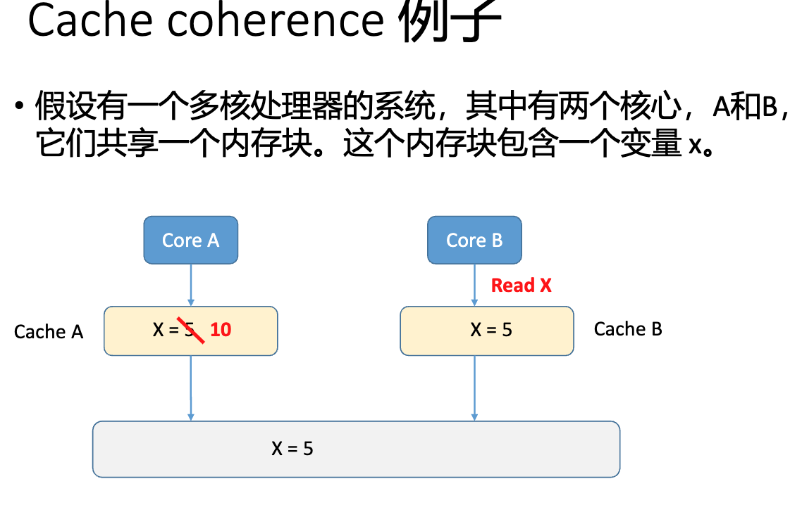

### 伪共享（False Sharing）
- 伪共享是一种在多核处理器系统中出现的性能问题
  - 它发生在多个线程访问看似不同的变量，但实际上这些变量位于同一个缓存行时
  - 在多核处理器中，每个核心都有自己的缓存，但是，当一个线程更新了一个变量，它可能会导致整个缓存行被刷新到主内存，这会影响到访问该缓存行中其他变量的其他线程

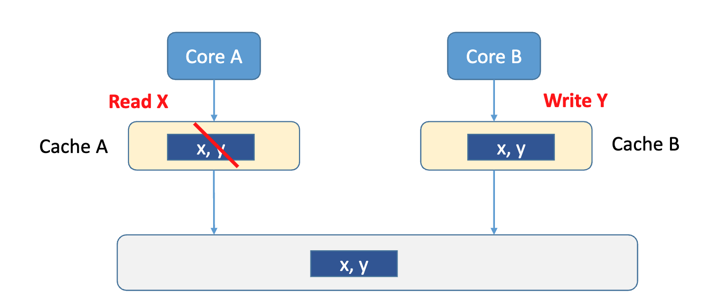

### 伪共享示例

```c
public class FalseSharingExample {
    private final int[] array = new int[1024];

    public void thread1() {
        for (int i = 0; i < 1024; i++) {
            array[i] = i;
        }
    }
    public void thread2() {
        for (int i = 0; i < 1024; i++) {
            array[i] = array[i] + 1;
        }
    }
}
```

- 在上面的代码中，两个线程 thread1 和 thread2 都在更新同一个数组的不同元素。
- 尽管它们看似在更新不同的变量，但由于数组元素位于同一个缓存行，线程 thread2 的更新可能会导致线程 thread1 的缓存行被刷新到主内存，这会导致性能下降

### 矩阵-向量乘法的缓存性能

```c
for (i = 0; i < m; i++) {
    y[i] = 0.0;
    for (j = 0; j < n; j++)
        y[i] += A[i][j] * x[j];
}
```

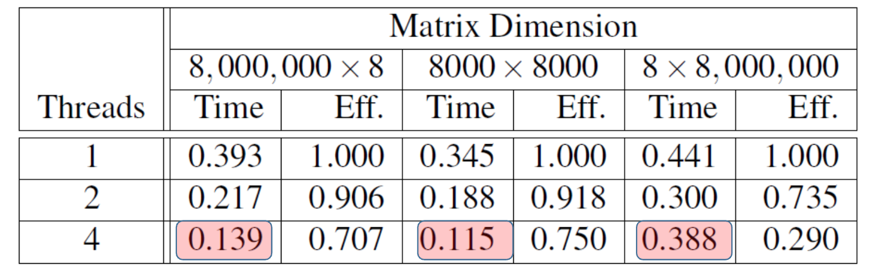

**问题：为什么 8M×8（或 8×8M）的矩阵计算时间要大于 8K×8K 的时间？**
- 使用 1 个线程时，8M×8 需要比 8K×8K 多 14% 的时间，8×8M 需要比 8K×8K 多 28% 的时间
- 上述差异部分归因于缓存性能
- 多线程版本的效率对于 8M×8 和 8×8M 更差

8M×8 的情况：大量对 y 的写缺失（write misses）
```
y = A * x
A (8M×8) * x (8×1) = y (8M×1)
```

8×8M 的情况：大量对 x 的读缺失（read misses）
```
y = A * x
A (8×8M) * x (8M×1) = y (8×1)
```

**多线程情况下的伪共享问题：**
- 缓存一致性在"缓存行级别"强制执行
- 每次缓存行中的任何值被写入时，如果该行也存储在另一个核心的缓存中，整个行将被失效


好的，已严格参照您原始文档的风格（简洁、技术性、无 emoji、使用标准 Markdown 层级与列表格式），将图片内容整理如下：

---

## 线程安全与 strtok 的问题

### 线程安全（Thread-Safety）

- 一段代码是 thread-safe 的，如果它能被多个线程同时执行而不会引起问题。

### 示例

- tokens 是由空白字符（空格、制表符或换行符）分隔的连续字符序列。
- 假设我们想用多个线程对一个普通英文文本文件进行“tokenize”。

### 简单方法

- 将输入文件按行切分，并以轮询方式分配给各线程：
  - 第一行分配给线程 0，
  - 第二行分配给线程 1，
  - ...
  - 第 t 行分配给线程 t，
  - 第 t+1 行分配给线程 0，
  - 等等。
- 我们可以使用信号量（semaphores）来串行化对输入行的访问。
- 一个线程读取一行后，可调用 strtok 函数对该行进行分词。

### strtok 函数

- 第一次调用时，字符串参数应为待分词的文本（即当前行）。
  - 例如我们输入的行 `my_line`
- 后续调用时，第一个参数应为 NULL。
- 函数原型：

```c
char* strtok(
    char*        string,      /* in/out */
    const char*  separators   /* in     */
);
```


- **原理**：第一次调用时，strtok 缓存一个指向字符串的指针；后续调用则从该缓存位置返回后续 token。

```c
my_string = strtok(my_line, "\t\n");

my_string = strtok(NULL, "\t\n");
```

### 多线程分词器代码

```c
void *Tokenize(void* rank) {
    long my_rank = (long) rank;
    int count;
    int next = (my_rank + 1) % thread_count;
    char *fg_rv;
    char my_line[MAX];
    char *my_string;

    sem_wait(&sems[my_rank]);
    fg_rv = fgets(my_line, MAX, stdin);
    sem_post(&sems[next]);
    while (fg_rv != NULL) {
        printf("Thread %ld > my line = %s", my_rank, my_line);
        count = 0;
        my_string = strtok(my_line, "\t\n");
        while (my_string != NULL) {
            count++;
            printf("Thread %ld > string %d = %s\n", my_rank, count, my_string);
            my_string = strtok(NULL, "\t\n");
        }
        sem_wait(&sems[my_rank]);
        fg_rv = fgets(my_line, MAX, stdin);
        sem_post(&sems[next]);
    }
    return NULL;
}
```


### 单线程运行结果

- 它正确地对输入流进行了分词。

```
Pease porridge hot.
Pease porridge cold.
Pease porridge in the pot
Nine days old.
```

### 双线程运行结果

```
Thread 0 > my line = Pease porridge hot.
Thread 0 > string 1 = Pease
Thread 0 > string 2 = porridge
Thread 0 > string 3 = hot.
Thread 1 > my line = Pease porridge cold.
Thread 0 > my line = Pease porridge in the pot
Thread 0 > string 1 = Pease
Thread 0 > string 2 = porridge
Thread 0 > string 3 = in
Thread 0 > string 4 = the
Thread 0 > string 5 = pot
Thread 1 > string 1 = Pease
Thread 1 > my line = Nine days old.
Thread 1 > string 1 = Nine
Thread 1 > string 2 = days
Thread 1 > string 3 = old.
```
> "porridge cold", "Pease": “Oops! Missing...” 表示部分 token 丢失或错位。

### 问题分析

- strtok 通过声明一个具有 static 存储类的变量来缓存输入行。
- 这导致该变量的值在多次调用之间持续存在。
- 不幸的是，该缓存字符串是共享的，而非私有的。
- 因此，线程 0 对第三行调用 strtok 时，实际上覆盖了线程 1 正在使用的第二行的缓存状态。
- 所以 strtok 函数不是线程安全的。
- 如果多个线程同时调用它，输出可能不正确。

#### 线程不安全的 C 库函数

- 遗憾的是，C 库函数不具有线程安全性的情况很常见
- stdlib.h 中的随机数生成器 random
- time.h 中的时间转换函数 localtime

#### 线程安全的替代函数（"可重入"函数）

```c
char* strtok_r(
    char*        string,
    const char*  separators,  
    char**       saveptr // 指向一个 char* 的指针，用于保存 strtok_r 在输入字符串中的位置
);
```

```c
// 线程安全的 strtok_r 函数
my_string = strtok_r(my_line, " \t\n", &saveptr);
my_string = strtok_r(NULL, " \t\n", &saveptr);
```

## 总结

### 总结要点

1. **线程与进程的类比**
   - 共享内存编程中的线程类似于分布式内存编程中的进程
   - 但是，线程通常比完整的进程更轻量级
   - 在 Pthreads 程序中，所有线程都可以访问全局变量，而局部变量通常是运行该函数的线程私有的

2. **竞态条件**
   - 当多个线程尝试访问共享资源导致不确定性时，访问可能会导致错误，我们称之为竞态条件

3. **临界区**
   - 临界区是更新共享资源的代码块，该资源一次只能由一个线程更新
   - 因此，临界区中的代码执行应该有效地作为串行代码执行

4. **忙等待**
   - 可以使用忙等待来避免对临界区的冲突访问，使用标志变量和带有空主体的 while 循环
   - 它可能会非常浪费 CPU 周期
   - 如果启用了编译器优化，它也可能不可靠

5. **互斥锁**
   - 互斥锁也可以用来避免对临界区的冲突访问
   - 可以将其视为临界区上的锁，因为互斥锁安排对临界区的互斥访问

6. **信号量**
   - 信号量是避免对临界区冲突访问的第三种方式
   - 它是一个无符号整数，带有两个操作：sem_wait 和 sem_post
   - 信号量比互斥锁更强大，因为它们可以初始化为任何非负值

7. **屏障**
   - 屏障是程序中的一个点，线程在此阻塞，直到所有线程都到达该点
   - 读写锁用于当多个线程可以同时安全地读取数据结构时
   - 但如果线程需要写入数据结构，则在修改期间只有该线程可以访问数据结构

8. **线程安全性**
   - 一些 C 函数通过声明变量为静态来在调用之间缓存数据，导致多个线程调用该函数时出错
   - 这种类型的函数不是线程安全的