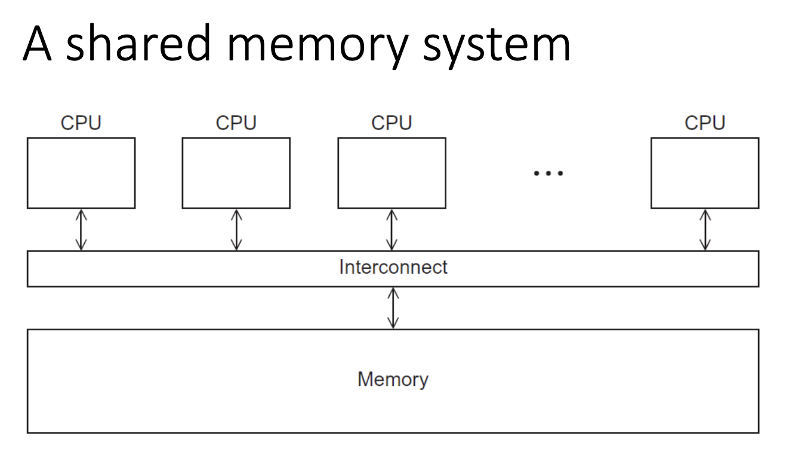
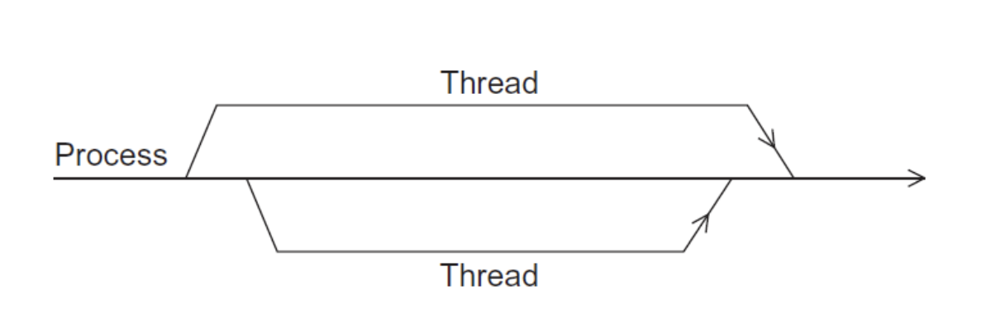
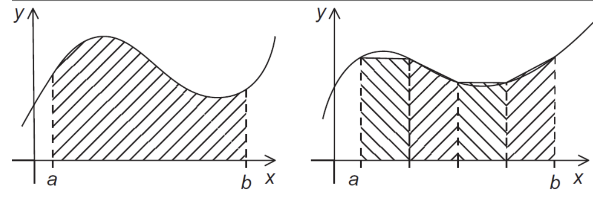
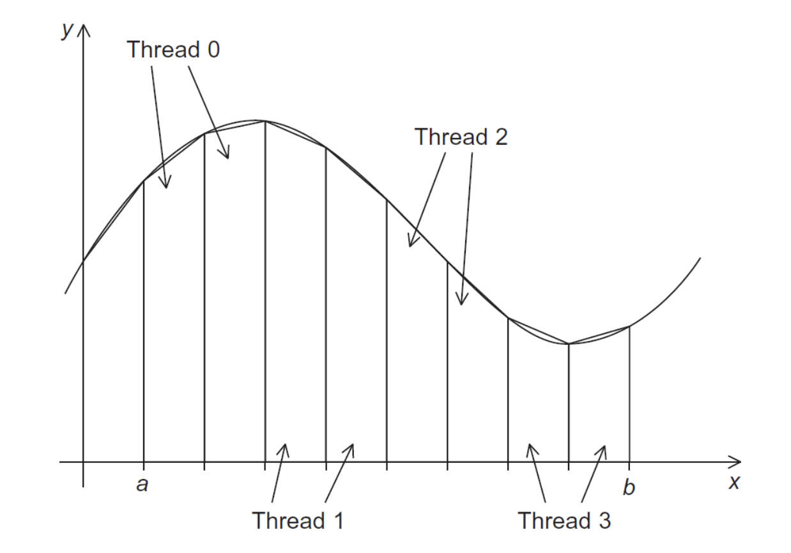
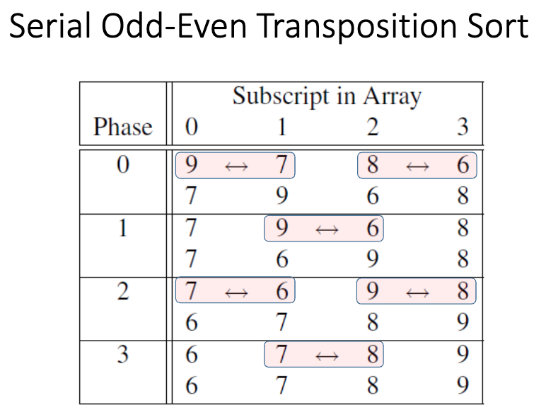
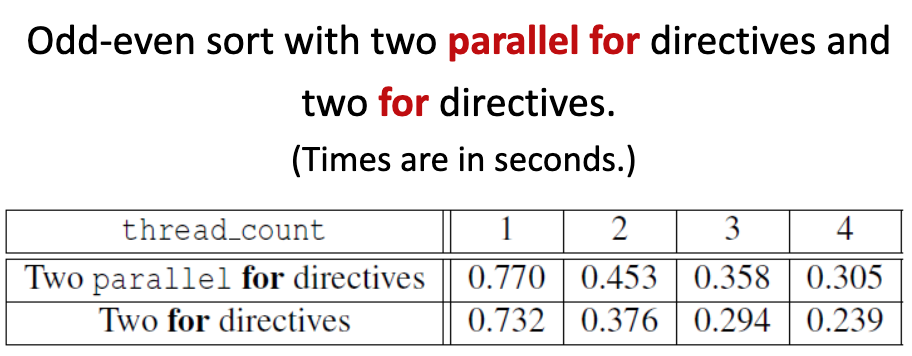
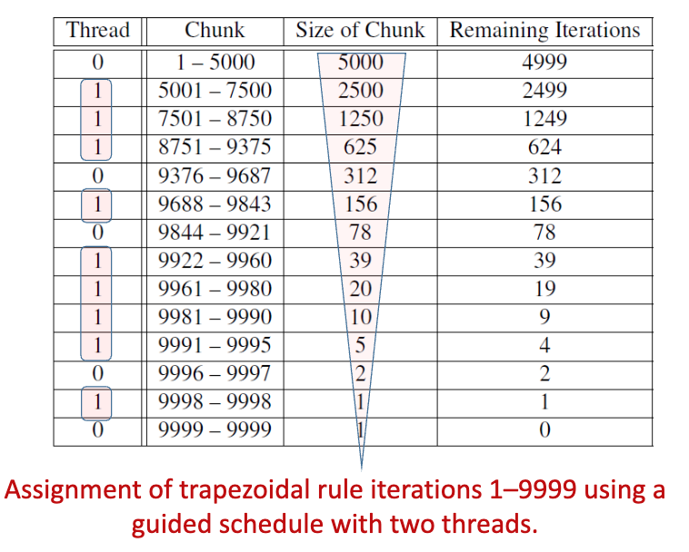
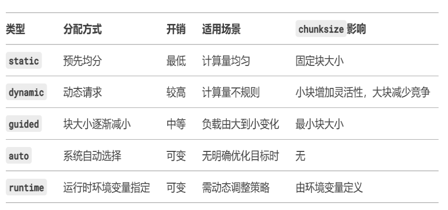
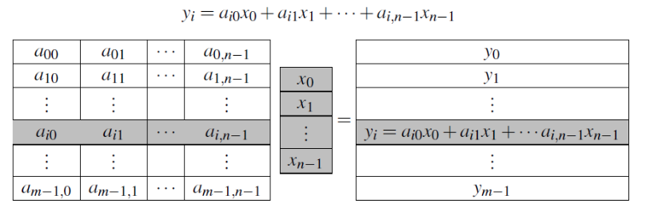
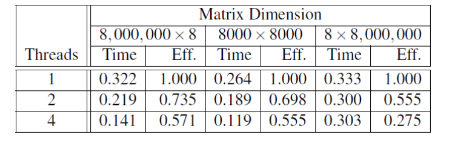

# ch05 用 OpenMP 进行共享内存编程

## 学习目标

- 编写使用 OpenMP 的程序
- 使用 OpenMP 仅通过少量源代码修改即可并行化许多串行 for 循环
- 任务并行性（Task parallelism）
- 显式线程同步（Explicit thread synchronization）
- 共享内存编程中的标准问题

## OpenMP 简介

### 什么是 OpenMP？

- **OpenMP** 是一个用于共享内存并行编程的 API
- **MP** = multiprocessing（多处理）
- 专为每个线程或进程都可以访问所有可用内存的系统设计
- 系统被视为一组核心或 CPU 的集合，它们都可以访问主内存

### 共享内存系统



## 编译指示（Pragmas）

### 编译指示简介

- 特殊的预处理器指令
- 通常添加到系统中以允许不属于基本 C 规范的行为
- 不支持这些编译指示的编译器会忽略它们

```c
#pragma
```

### omp 关键字

```c
#include <stdio.h>
#include <stdlib.h>
#include <omp.h> // 包含 OpenMP 函数原型

void Hello(void);

int main(int argc, char* argv[]) {
    // 从命令行获取线程数
    int thread_count = strtol(argv[1], NULL, 10);

    // 通过编译指示创建线程团队
    #pragma omp parallel num_threads(thread_count)
    // 每个线程执行 Hello 函数
    Hello();

    return 0;
}

void Hello(void) {
    int my_rank = omp_get_thread_num();
    int thread_count = omp_get_num_threads();

    printf("Hello from thread %d of %d\n", my_rank, thread_count);
}
```

### OpenMP 编译示例

```bash
gcc −g −Wall −fopenmp −o omp_hello omp_hello.c ./omp_hello 4
```
- omp_hello 是编译的可执行文件
- omp_hello.c 是包含 OpenMP 代码的源文件
- 4 是我们希望使用的线程数

### 可能的输出结果

```
Hello from thread 0 of 4
Hello from thread 1 of 4
Hello from thread 2 of 4
Hello from thread 3 of 4
```

```
Hello from thread 3 of 4
Hello from thread 1 of 4
Hello from thread 2 of 4
Hello from thread 0 of 4
```

## OpenMP 编译指示

### 基本并行指令

```c
#pragma omp parallel
```

- 最基本的并行指令
- 运行以下结构化代码块的线程数由运行时系统决定

### 一个叫分叉和合并的过程



### 子句（Clause）

- 修改指令的文本
- `num_threads` 子句可以添加到并行指令中
- 允许程序员指定应该执行以下代码块的线程数

```c
#pragma omp parallel num_threads(thread_count)
```

### 注意事项

- 系统可能对程序可以启动的线程数有限制
- OpenMP 标准不保证实际会启动 `thread_count` 个线程
- 大多数当前系统可以启动数百甚至数千个线程
- 除非尝试启动大量线程，否则几乎总是会获得所需的线程数

### 术语

- 执行并行代码块的线程集合称为**团队（team）**
- 原始线程称为**主线程（master）**
- 附加线程称为**从线程（slaves）**

## 编译器兼容性处理

### 检查 OpenMP 支持

```c
#include <omp.h>

#ifdef _OPENMP
#include <omp.h>
#endif
```

### 防止不支持 OpenMP 的编译器例子

```c
#ifdef _OPENMP
    int my_rank = omp_get_thread_num();
    int thread_count = omp_get_num_threads();
#else
    int my_rank = 0;
    int thread_count = 1;
#endif
```

---

## 梯形法则（Trapezoidal Rule）

### 梯形法则简介



### 串行算法

梯形面积求和公式：  
$$
\text{Sum of trapezoid areas} = h \left[ \frac{f(x_0)}{2} + f(x_1) + f(x_2) + \cdots + f(x_{n-1}) + \frac{f(x_n)}{2} \right]
$$

```c
/* 输入：a, b, n */  
h = (b - a) / n;
approx = (f(a) + f(b)) / 2.0;

for (i = 1; i <= n - 1; i++) {
    x_i = a + i * h;
    approx += f(x_i);
}

approx = h * approx;
```

### 第一个 OpenMP 版本

- 我们确定了两种类型的任务：
  - 计算单个梯形的面积
  - 将梯形的面积相加
- 第一个集合中的任务之间没有通信，但第一个集合中的每个任务都与任务 1b 通信
- 我们假设梯形的数量远多于核心数
   - 因此我们通过将连续的梯形块分配给每个线程（每个核心一个线程）来聚合任务

### 梯形分配给线程



### 竞争条件问题

当两个（或更多）线程同时尝试执行以下代码时，结果不可预测：

```c
global_result += my_result;
```

### 互斥锁（Mutual Exclusion）

- 一次只能有一个线程执行以下结构化代码块
```c
#pragma omp critical
global_result += my_result;
```

### 互斥锁示例

```c
#include <stdio.h>
#include <stdlib.h>
#include <omp.h>

void Trap(double a, double b, int n, double* global_result_p);

int main(int argc, char* argv[]) {
    double global_result = 0.0;   /* 存储结果到 global_result */
    double a, b;                  /* 左端点和右端点 */
    int n;                        /* 梯形总数 */
    int thread_count;

    thread_count = strtol(argv[1], NULL, 10);
    printf("Enter a, b, and n\n");
    scanf("%lf %lf %d", &a, &b, &n);

    // 创建线程团队来执行 Trap 函数
    #pragma omp parallel num_threads(thread_count)
    Trap(a, b, n, &global_result);

    printf("With n = %d trapezoids, our estimate\n", n);
    printf("of the integral from %f to %f = %.14e\n", a, b, global_result);
    return 0;
}  /* main */

void Trap(
    double a, 
    double b, 
    int n, 
    double* global_result_p // 指向 global_result 的指针
) {
    double h, x, my_result;
    double local_a, local_b;
    int i, local_n;

    // 获取线程编号和线程总数
    int my_rank = omp_get_thread_num();
    int thread_count = omp_get_num_threads();

    h = (b - a) / n;
    local_n = n / thread_count;
    local_a = a + my_rank * local_n * h;
    local_b = local_a + local_n * h;
    my_result = (f(local_a) + f(local_b)) / 2.0;
    for (i = 1; i <= local_n - 1; i++) {
        x = local_a + i * h;
        my_result += f(x);
    }
    my_result = my_result * h;

    // 将 my_result 加到 global_result 中
    #pragma omp critical
    *global_result_p += my_result;
}  /* Trap */
```

## 变量作用域（Scope of Variables）

### 变量作用域定义

- 在串行编程中，变量的作用域是指程序中可以使用该变量的部分
- 在 OpenMP 中，变量的作用域指的是**可以访问该变量的线程集合**

### OpenMP 中的作用域

- **共享作用域（Shared scope）**：可以被团队中所有线程访问的变量
- **私有作用域（Private scope）**：只能被单个线程访问的变量
- 在并行代码块之前声明的变量的默认作用域是**共享的**

## 归约子句（The Reduction Clause）


我们需要更复杂的版本，将每个线程的局部计算结果累加到 `global_result` 中
```c
void Trap(double a, double b, int n, double* global_result_p) {};
```

虽然我们更倾向于以下写法：
```c
double Trap(double a, double b, int n);

global_result = Trap(a, b, n);
```

但若采用此方式，则无需临界区（critical section）,**问题**在于这会使所有线程串行执行（即强制顺序执行），丧失并行性。

### 改进方案：避免串行化

我们可以通过以下方式解决该问题：

- 在 `parallel` 块内声明一个**私有变量**（如 `my_result`）；
- 将临界区（`critical`）移至函数调用之后。

```c
global_result = 0.0;
#pragma omp parallel num_threads(thread_count) // 并行执行以下代码块
{
    double my_result = 0.0;  /* 私有变量 */
    my_result += Local_trap(a, b, n);
    #pragma omp critical // 仅在合并结果时进入临界区
    global_result += my_result;
}
```

这样，各线程可并行计算局部积分值 `my_result`，仅在最后合并结果时进入临界区，显著提升并行效率

### 归约操作

- **归约操作符（Reduction operator）**：二元操作（如加法或乘法）
- **归约（Reduction）**：重复应用相同的归约操作符到操作数序列以获得单个结果的计算
- 操作的所有中间结果都应存储在同一个变量中：**归约变量（reduction variable）**

### 归约子句示例

- 归约子句可以添加到并行指令中
- 支持的操作符：`+`, `*`, `-`, `&`, `|`, `^`, `&&`, `||`

```c
#pragma omp parallel reduction(operator: variable)
```

```c
global_result = 0.0;
#pragma omp parallel num_threads(thread_count) reduction(+: global_result) // num_threads 是可选的, reduction 子句指定 global_result 的归约操作为加法
{
    double my_result = Local_trap(a, b, n);
    global_result += my_result; // 归约操作
}
```

## 并行 for 指令（The "Parallel For" Directive）

### 并行 for 指令

```c
#pragma omp parallel for
```

- 派生一个线程团队来执行以下结构化代码块
- 但是，并行 for 指令后面的结构化代码块必须是 for 循环
- 此外，使用并行 for 指令时，系统通过将循环的迭代分配给线程来并行化 for 循环

### 梯形法数值积分的串行代码vs并行化版本

**串行版本：**
```c
h = (b - a) / n;
approx = (f(a) + f(b)) / 2.0;
for (i = 1; i <= n - 1; i++)
    approx += f(a + i * h);
approx = h * approx;
```

**并行版本（使用 OpenMP `reduction`）：**
```c
h = (b - a) / n;
approx = (f(a) + f(b)) / 2.0;
#pragma omp parallel for num_threads(thread_count) reduction(+: approx) // 并行化 for 循环，并指定 approx 的归约操作为加法
for (i = 1; i <= n - 1; i++)
    approx += f(a + i * h);
approx = h * approx;
```

### 可并行化的 for 语句的合法形式

for 语句必须具有以下形式：

```c
for(A, B, C)
```
- A
  - index = start
- B
  - index < end
  - index <= end
  - index > end
  - index >= end
- C
  - index++
  - ++index
  - index--
  - --index
  - index += incr
  - index -= incr
  - index = index + incr
  - index = incr + index
  - index = index - incr

### 注意事项

- 变量 `index` 必须具有整数或指针类型（例如，不能是 float）
- 表达式 `start`、`end` 和 `incr` 必须具有兼容的类型
- 在循环执行期间，表达式 `start`、`end` 和 `incr` 不能改变
- 在循环执行期间，变量 `index` 只能通过 for 语句中的"增量表达式"修改

## 数据依赖性（Data Dependencies）

### 斐波那契数列示例

#### 串行版本：正确

```c
fibo[0] = fibo[1] = 1;
for(i = 2; i < n; i++)
    fibo[i] = fibo[i-1] + fibo[i-2];
```

正确结果示例
```
1 1 2 3 5 8 13 21 34 55
```

## 并行版本（2个线程）：有时错误

```c
fibo[0] = fibo[1] = 1;
#pragma omp parallel for num_threads(2)
for(i = 2; i < n; i++)
    fibo[i] = fibo[i-1] + fibo[i-2];
```

错误结果示例
```
1 1 2 3 5 8 0 0 0 0
```

### 问题分析

- OpenMP 编译器不会检查使用并行 for 指令并行化的循环中迭代之间的依赖关系
- 如果循环中一个或多个迭代的结果依赖于其他迭代，则无法通过 OpenMP 正确并行化

## 估算 π

公式：
$$
\pi = 4 \left[ 1 - \frac{1}{3} + \frac{1}{5} - \frac{1}{7} + \cdots \right] 
= 4 \sum_{k=0}^{\infty} \frac{(-1)^k}{2k+1}
$$

串行代码实现：
```c
double factor = 1.0;
double sum = 0.0;
for (k = 0; k < n; k++) {
    sum += factor / (2 * k + 1);
    factor = -factor;
}
pi_approx = 4.0 * sum;
```

注意：该循环存在**循环依赖（loop dependency）**——`factor` 的值在每次迭代中依赖前一次的结果（符号翻转），因此不能直接并行化。


### OpenMP 解决方案 #1

```c
double factor = 1.0;
double sum = 0.0;
#pragma omp parallel for num_threads(thread_count) \
        reduction(+: sum)
for (k = 0; k < n; k++) {
    sum += factor / (2 * k + 1);
    factor = -factor;   // 问题：factor 在并行循环中被多个线程共享修改，导致数据竞争
}
pi_approx = 4.0 * sum;
```

**错误原因**：`factor` 是共享变量，各线程同时读写它会造成**数据竞争（race condition）**，且因循环依赖无法正确并行。

### OpenMP 解决方案 #2（推荐）

```c
double sum = 0.0;
#pragma omp parallel for num_threads(thread_count) \
        reduction(+: sum) private(factor)
for (k = 0; k < n; k++) {
    if (k % 2 == 0)
        factor = 1.0;
    else
        factor = -1.0;
    sum += factor / (2 * k + 1);
}
pi_approx = 4.0 * sum;
```

**关键改进**：
- 使用 `private(factor)` 显式声明 `factor` 为**私有变量**，每个线程拥有独立副本；
- 每次迭代根据 `k` 的奇偶性重新计算 `factor`，消除了循环依赖；
- 配合 `reduction(+: sum)` 安全累加局部和；
- 实现了真正的并行计算，无数据竞争。


### default 子句

- 允许程序员指定代码块中每个变量的作用域
- 使用此子句时，编译器将要求我们指定在代码块外部声明的每个变量的作用域

```c
#pragma omp parallel default(none) shared(...) private(...)
```

### default(none) 子句示例

```c
double sum = 0.0;
#pragma omp parallel for num_threads(thread_count) \
        default(none) reduction(+: sum) \
        private(k, factor) shared(n)
for (k = 0; k < n; k++) {
    if (k % 2 == 0)
        factor = 1.0;
    else
        factor = -1.0;
    sum += factor / (2 * k + 1);
}
```

## OpenMP 中的更多循环：排序

### 冒泡排序（Bubble Sort）

```c
for(list_length = n; list_length > 1; list_length--)
    for(i = 0; i < list_length - 1; i++)
        if (list[i] > list[i+1]) {
            temp = list[i];
            list[i] = list[i+1];
            list[i+1] = temp;
        }
```

### 串行奇偶换位排序（Serial Odd-Even Transposition Sort）

```c
for(list_length = n; list_length > 1; list_length--) {
    // 奇数阶段
    for(i = 1; i < list_length - 1; i += 2)
        if (list[i] > list[i+1]) {
            swap(list[i], list[i+1]);
        }
    // 偶数阶段
    for(i = 0; i < list_length - 1; i += 2)
        if (list[i] > list[i+1]) {
            swap(list[i], list[i+1]);
        }
}
```



### 第一个 OpenMP 奇偶排序

```c
for (phase = 0; phase < n; phase++) {
    #pragma omp parallel num_threads(thread_count) \
            default(none) shared(a, n) private(i, tmp)
    {
        if (phase % 2 == 0) {  /* 偶数阶段 */
            #pragma omp for
            for (i = 1; i < n; i += 2)
                if (a[i] < a[i-1]) {
                    tmp = a[i];
                    a[i] = a[i-1];
                    a[i-1] = tmp;
                }
        } else {  /* 奇数阶段 */
            #pragma omp for
            for (i = 1; i < n-1; i += 2)
                if (a[i] < a[i+1]) {
                    tmp = a[i];
                    a[i] = a[i+1];
                    a[i+1] = tmp;
                }
        }
    }  /* 并行块结束 */
}
```

### 第二个 OpenMP 奇偶排序

```c
for (phase = 0; phase < n; phase++) {
    if (phase % 2 == 0) {  /* 偶数阶段 */
        #pragma omp for num_threads(thread_count) \
                default(none) shared(a, n) private(i, tmp)
        for (i = 1; i < n; i += 2)
            if (a[i] < a[i-1]) {
                tmp = a[i];
                a[i] = a[i-1];
                a[i-1] = tmp;
            }
    } else {  /* 奇数阶段 */
        #pragma omp for num_threads(thread_count) \
                default(none) shared(a, n) private(i, tmp)
        for (i = 1; i < n-1; i += 2)
            if (a[i] < a[i+1]) {
                tmp = a[i];
                a[i] = a[i+1];
                a[i+1] = tmp;
            }
    }
}
```

- 告诉 OpenMP 使用现有的线程团队并行化 for 循环

### 奇偶排序性能对比




## 循环调度（Scheduling Loops）


### 我们对函数 $ f $ 的定义

```c
double f(int i) {
    int j, start = i*(i+1)/2, finish = start + i;
    double return_val = 0.0;

    for (j = start; j <= finish; j++)
        return_val += sin(j);
    return return_val;
} /* f */
```

**调用 `f` 所需的时间与 `i` 的大小成正比**

### 我们希望并行化此循环

```c
sum = 0.0;
for (i = 0; i <= n; i++)
    sum += f(i);
```

| Thread | Iterations                     |
|--------|--------------------------------|
| 0      | 0, n/t, 2n/t, …                |
| 1      | 1, n/t + 1, 2n/t + 1, …        |
| …      | …                              |
| t−1    | t−1, n/t + t−1, 2n/t + t−1, … |

**使用循环划分（cyclic partitioning）进行工作分配。**


### 循环时间分析

- 调用 f 的时间与 i 的大小成正比
- 我们想要并行化这个循环
- 使用循环分区分配工作

### 结果对比

**单线程：**
- n = 10,000
- 运行时间 = 3.67 秒

**双线程（默认分配）：**
- n = 10,000
- 运行时间 = 2.76 秒
- 加速比 = 1.33

**双线程（循环分配）：**
- n = 10,000
- 运行时间 = 1.84 秒
- 加速比 = 1.99

### schedule 子句

串行分配（默认）示例：
```c
sum = 0.0;
#pragma omp parallel for num_threads(thread_count) \
        reduction(+: sum)
for (i = 0; i <= n; i++)
    sum += f(i);    
```

并行分配（循环分配）示例：
```c
sum = 0.0;
#pragma omp parallel for num_threads(thread_count) \
        reduction(+: sum) schedule(static, 1)
for (i = 0; i <= n; i++)
    sum += f(i);
```

```c
schedule(type, chunksize)
```

**类型可以是：**
- `static`：迭代可以在循环执行之前分配给线程
- `dynamic` 或 `guided`：迭代在循环执行时分配给线程
- `auto`：编译器和/或运行时系统确定调度
- `runtime`：调度在运行时确定

## 静态调度类型（The Static Schedule Type）

### 示例：12 次迭代，3 个线程

```
schedule(static, 1)
Thread 0: 0, 3, 6, 9
Thread 1: 1, 4, 7, 10
Thread 2: 2, 5, 8, 11
```

```
schedule(static, 2)
Thread 0: 0, 1, 6, 7
Thread 1: 2, 3, 8, 9
Thread 2: 4, 5, 10, 11
```

```
schedule(static, 4)
Thread 0: 0, 1, 2, 3
Thread 1: 4, 5, 6, 7
Thread 2: 8, 9, 10, 11
```

## 动态调度类型（The Dynamic Schedule Type）

- 迭代也被分成 `chunksize` 个连续迭代的块
- 每个线程执行一个块，当线程完成一个块时，它向运行时系统请求另一个块
- 这一直持续到所有迭代完成

## 指导调度类型（The Guided Schedule Type）

- 每个线程也执行一个块，当线程完成一个块时，它请求另一个块
- 但是，在指导调度中，随着块的完成，新块的大小会减小

### 梯形法则迭代分配示例

使用两个线程的指导调度分配梯形法则迭代 1-9999



## 运行时调度类型（The Runtime Schedule Type）

- 系统使用环境变量 `OMP_SCHEDULE` 在运行时确定如何调度循环
- `OMP_SCHEDULE` 环境变量可以采用任何可用于静态、动态或指导调度的值

### OpenMP 调度类型区别小结



## 生产者和消费者（Producers and Consumers）

### 队列（Queues）

- 可以视为超市中等待付款的顾客队伍的抽象
- 在许多多线程应用程序中使用的自然数据结构
- 例如，假设有多个"生产者"线程和多个"消费者"线程
  - 生产者线程可能"生产"数据请求
  - 消费者线程可能通过查找或生成请求的数据来"消费"请求

### 消息传递（Message-Passing）

- 每个线程可以有一个共享的消息队列
- 当一个线程想要"向另一个线程发送消息"时，它可以将消息入队到目标线程的队列中
- 线程可以通过出队其消息队列头部的消息来接收消息

```c
for(sent_msgs = 0; sent_msgs < max_msgs; sent_msgs++) {
    Send_msg();
    Try_receive();
}

while (!Done) {
    Try_receive();
}
```

### 消息发送

```c
mesg = random();
dest = random() % thread_count; 
#pragma omp critical
Enqueue(queue, dest, my_rank, mesg);
```

### 消息接收

```c
if(queue_size==0)
    return;
else if(queue_size == 1)
#pragma omp critical
    Dequeue(queue, &src, &mesg);
else
    Dequeue(queue, &src, &mesg);
Print_message(src, mesg);
```

### 终止检测

```c
queue_size = enqueued - dequeued;
if(queue_size == 0 && \
    sent_msgs == max_msgs// 每个线程在完成 for 循环后递增此变量
)
    return true;
else
    return false;
```

## 启动过程（Startup）

### 启动

- 当程序开始执行时，单个线程（主线程）将获取命令行参数并分配消息队列数组：每个线程一个
- 该数组需要在线程之间共享，因为任何线程都可以发送到任何其他线程，因此任何线程都可以将消息入队到任何队列中
- 一个或多个线程可能在其他线程之前完成分配它们的队列
- 我们需要一个显式屏障，以便当线程遇到屏障时，它会阻塞直到团队中的所有线程都到达屏障
- 当所有线程都到达屏障后，团队中的所有线程都可以继续执行

## atomic 指令（The Atomic Directive）

### atomic 指令（1）

- 与 critical 指令不同，它只能保护由单个 C 赋值语句组成的临界区

```c
#pragma omp atomic
```

- 此外，语句必须具有以下形式之一：

```
x <op>= expr;
x++;
++x;
x--;
--x;
```

- 这里 `<op>` 可以是以下二元操作符之一: `+`, `*`, `-`, `/`, `&`, `|`, `^`, `<<`, `or`, `>>`
- 许多处理器提供特殊的加载-修改-存储指令
- 仅执行加载-修改-存储的临界区可以通过使用此特殊指令更有效地保护

## 临界区（Critical Sections）

### 命名临界区

- OpenMP 提供了为 critical 指令添加名称的选项：

```c
#pragma omp critical(name)
```

- 当我们这样做时，使用不同名称的 critical 指令保护的两个代码块可以同时执行
- 但是，名称是在编译时设置的，我们希望每个线程的队列都有不同的临界区

## 锁（Locks）

### 锁简介

- 锁由数据结构和函数组成，允许程序员显式地在临界区中强制执行互斥

```c
/* Executed by one thread */
Initialize the lock data structure;
...
/* Executed by multiple threads */
Attempt to lock or set the lock data structure;
Critical section;
Unlock or unset the lock data structure;
...
/* Executed by one thread */
Destroy the lock data structure;
```

### 在消息传递程序中使用锁

#### 入队

这是我们之前使用 critical 指令保护的进行消息入队的代码：
```c
#pragma omp critical
/* q_p = msg_queues[dest] */
Enqueue(q_p, my_rank, mesg); // 将消息入队到目标线程的消息队列中
```

使用锁保护的代码：
```c
/* q_p = msg_queues[dest] */
omp_set_lock(&q_p->lock);
Enqueue(q_p, my_rank, mesg);
omp_unset_lock(&q_p->lock);
```

#### 出队

这是我们之前使用 critical 指令保护的进行消息出队的代码：
```c
#pragma omp critical
/* q_p = msg_queues[my_rank] */
Dequeue(q_p, &src, &mesg);
```

使用锁保护的代码：
```c
/* q_p = msg_queues[my_rank] */
omp_set_lock(&q_p->lock);
Dequeue(q_p, &src, &mesg);
omp_unset_lock(&q_p->lock);
```

### 注意事项（Some Caveats）

1. **不要混合使用不同类型的互斥**：例如，critical 可能不会排除 atomic
2. **互斥构造不保证公平性**：例如，线程可能永远被阻塞
3. **嵌套互斥构造可能是危险的**

## 矩阵-向量乘法（Matrix-vector multiplication）

### 算法描述



使用串行代码实现矩阵-向量乘法：¥
```c
for (i = 0; i < m; i++) {
    y[i] = 0.0;
    for (j = 0; j < n; j++)
        y[i] += A[i][j] * x[j];
}
```

使用 OpenMP 并行化矩阵-向量乘法：
```c
#pragma omp parallel for num_threads(thread_count) \
        default(none) private(i, j) shared(A, x, y, m, n)
for (i = 0; i < m; i++) {
    y[i] = 0.0;
    for (j = 0; j < n; j++)
        y[i] += A[i][j] * x[j];
}
```

### 性能对比

矩阵-向量乘法的运行时间和效率（时间单位：秒）



## 线程安全性（Thread-Safety）

```c
void Tokenize(
    char* lines[]      /* in/out */,
    int   line_count   /* in */,
    int   thread_count /* in */) {
    int my_rank, i, j;
    char *my_token;

    // 创建线程团队来执行以下代码块
    #pragma omp parallel num_threads(thread_count) \ 
            default(none) private(my_rank, i, j, my_token) \
            shared(lines, line_count)
    {
        // 获取线程编号
        my_rank = omp_get_thread_num();
        // 每个线程处理不同的行，使用静态调度分配迭代
        #pragma omp for schedule(static, 1) 
        for (i = 0; i < line_count; i++) {
            printf("Thread %d > line %d = %s", my_rank, i, lines[i]);
            j = 0;
            my_token = strtok(lines[i], "\t\n");
            while (my_token != NULL) {
                printf("Thread %d > token %d = %s\n", my_rank, j, my_token);
                my_token = strtok(NULL, "\t\n");
                j++;
            }
        } /* for i */
    } /* omp parallel */
} /* Tokenize */
```

## 总结（Concluding Remarks）

### 1. OpenMP 基础

- OpenMP 是共享内存系统编程的标准
- OpenMP 使用特殊函数和称为编译指示（pragmas）的预处理器指令
- OpenMP 程序启动多个线程而不是多个进程
- 许多 OpenMP 指令可以通过子句进行修改

### 2. 竞争条件

- 共享内存程序开发中的主要问题是竞争条件的可能性
- OpenMP 提供了几种机制来确保临界区中的互斥：
  - Critical 指令
  - 命名 critical 指令
  - Atomic 指令
  - 简单锁

### 3. 循环调度与变量作用域

- 默认情况下，大多数系统使用块分区来分配并行化 for 循环中的迭代
- OpenMP 提供了多种调度选项
- 在 OpenMP 中，变量的作用域是变量可访问的线程集合

### 4. 归约操作

- 归约是重复应用相同的归约操作符到操作数序列以获得单个结果的计算