# 第06章 并行程序开发

## 学习目标

- 解决非平凡问题
- N-body问题的并行化
- 旅行商问题（TSP）的并行化
- 应用Foster方法论
- 从零开始开发没有串行类比的算法

## N-body问题

### 问题描述

N-body问题：在一段时间内找到一组相互作用粒子的位置和速度。

N-body求解器：通过模拟粒子行为来找到N-body问题解决方案的程序。

```
输入：质量、初始位置、初始速度

N-body求解器

输出：时间x时的位置、时间x时的速度
```

### 运动模拟

确定位置和速度的方法：
- 牛顿第二运动定律
- 牛顿万有引力定律

#### 粒子q受到粒子k的力

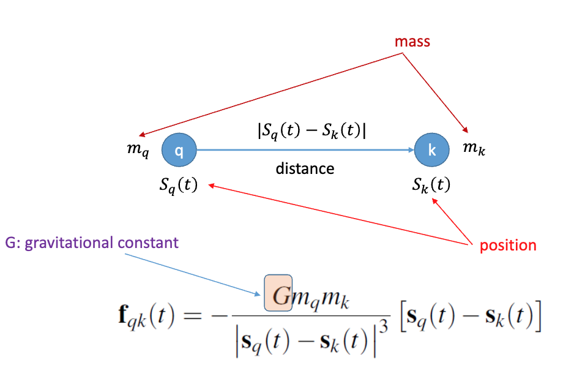

其中：
- G：引力常数
- m_q, m_k：粒子质量
- S_q(t), S_k(t)：粒子位置
- |S_q(t) - S_k(t)|：粒子间距离

#### 粒子q受到的总力

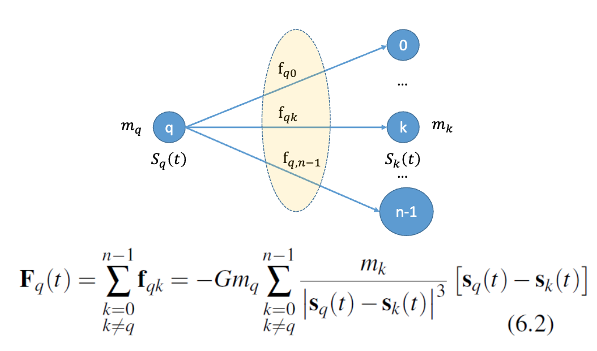

#### 粒子q的加速度

根据牛顿第二运动定律：

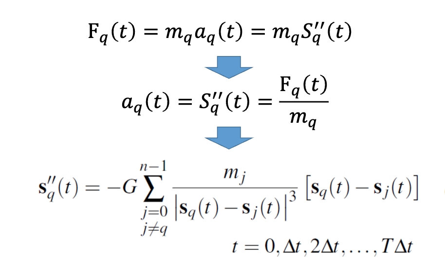

#### 串行伪代码

```
for each timestep {
    if (timestep output) Print positions and velocities of particles;
    for each particle q // 遍历
        Compute total force on q;
    for each particle q // 遍历
        Compute position and velocity of q;
}
Print positions and velocities of particles;
```

#### 力的计算

```c
for each particle q {
    for each particle k != q {
        x_diff = pos[q][X] - pos[k][X];
        y_diff = pos[q][Y] - pos[k][Y];
        dist = sqrt(x_diff*x_diff + y_diff*y_diff);
        dist_cubed = dist*dist*dist;
        forces[q][X] -= G*masses[q]*masses[k]/dist_cubed * x_diff; // 计算万有引力
        forces[q][Y] -= G*masses[q]*masses[k]/dist_cubed * y_diff; // 计算万有引力
    }
}
```

### 牛顿第三运动定律

对于每个作用，都有一个相等且相反的反作用：

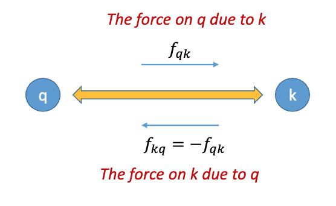

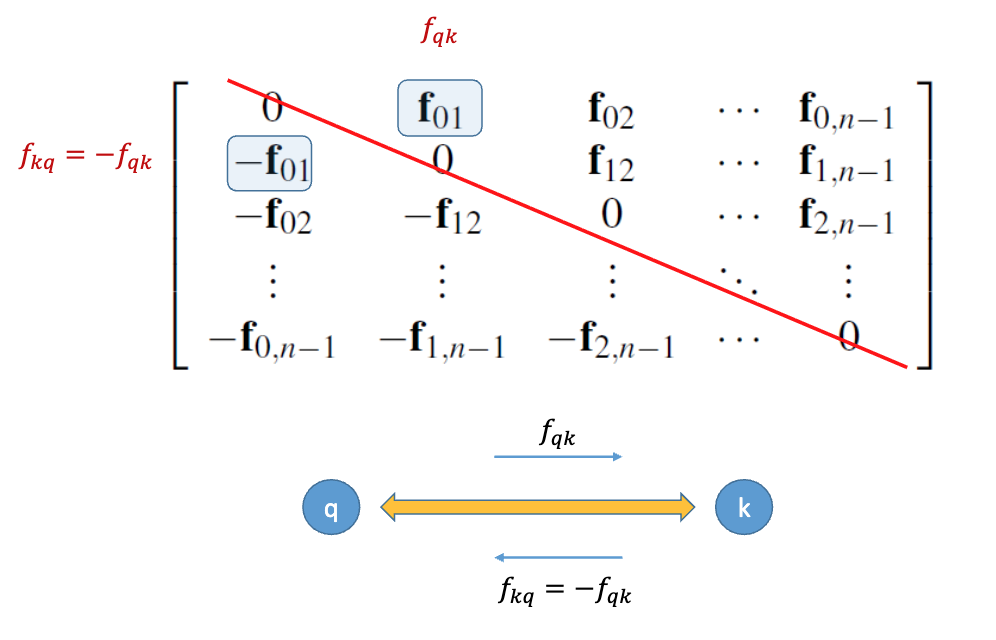

### 简化算法计算N-body力

利用牛顿第三定律减少计算量。

```c
for each particle q
    forces[q] = 0;                     // 初始化：清零所有粒子的合力

for each particle q {
    for each particle k > q {          // ★ 关键优化：仅遍历 k > q，避免重复对 (q,k) 和 (k,q)
        x_diff = pos[q][X] - pos[k][X];   // 计算相对位移分量（q 相对于 k）
        y_diff = pos[q][Y] - pos[k][Y];
        dist = sqrt(x_diff*x_diff + y_diff*y_diff);
        dist_cubed = dist * dist * dist;

        // ★ 计算 q 受到 k 的引力分量（注意：方向从 q 指向 k 的反方向 → 即指向 k）
        force_qk[X] = G * masses[q] * masses[k] / dist_cubed * x_diff;
        force_qk[Y] = G * masses[q] * masses[k] / dist_cubed * y_diff;

        // ★ 牛顿第三定律：同时更新两个粒子的受力
        forces[q][X] += force_qk[X];   // q 受到 k 的力：+f_qk（指向 k）
        forces[q][Y] += force_qk[Y];

        forces[k][X] -= force_qk[X];   // k 受到 q 的力：-f_qk（指向 q）
        forces[k][Y] -= force_qk[Y];
    }
}
```

### 使用切线近似函数  
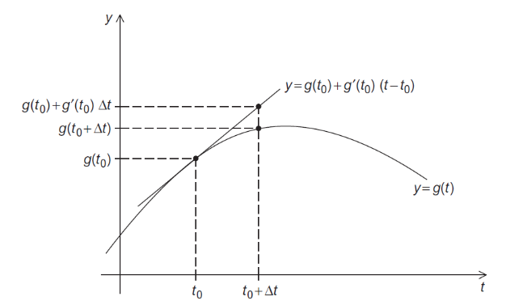  

- 在 $t_0$ 处，用切线 $y = g(t_0) + g'(t_0)(t - t_0)$ 近似曲线 $y = g(t)$；  
- 当 $\Delta t$ 较小时，$g(t_0 + \Delta t) \approx g(t_0) + g'(t_0)\Delta t$。

### 欧拉法（Euler’s Method）  
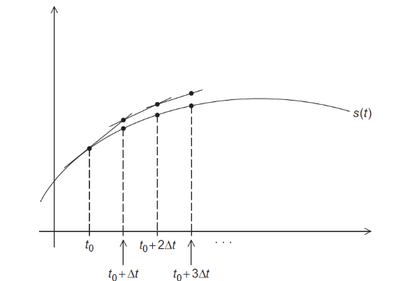  

- 用于求解微分方程（如运动方程 $\frac{d\mathbf{s}}{dt} = \mathbf{v},\ \frac{d\mathbf{v}}{dt} = \mathbf{a} = \mathbf{F}/m$）；  
- 时间步进：  
  $$
  \mathbf{s}(t + \Delta t) = \mathbf{s}(t) + \mathbf{v}(t)\,\Delta t, \quad
  \mathbf{v}(t + \Delta t) = \mathbf{v}(t) + \mathbf{a}(t)\,\Delta t
  $$  
- 图中黑点为真实轨迹 $s(t)$ 上的采样点，折线为欧拉法的近似路径。

## 二、并行化策略：Foster 方法论

> **目标**：将 N 体问题分解为大量可并行执行的任务。

- 应用 Foster 方法论（任务分解）；
- 初始目标：生成大量独立/弱依赖的任务；
- **关键思路**：将每个时间步内的计算拆分为三类任务：
  - 计算所有粒子的位置（`positions`）  
  - 计算所有粒子的速度（`velocities`）  
  - 计算所有粒子的总受力（`total forces`）  
  - 这三类任务在单个时间步内存在数据依赖（力 → 加速度 → 速度 → 位置），但**同类任务内部（如所有粒子的力计算）可并行**。

## 通信模式对比

### 1. 基础 N 体求解器中的任务间通信  

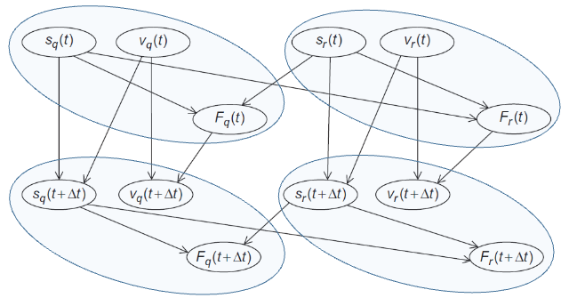  

- 每个粒子 `q` 和 `r` 各自拥有独立任务单元（含状态 $s, v, F$）；  
- 计算 $F_q(t)$ 需要读取其他粒子（如 $r$）的当前位置 $s_r(t)$；  
- 更新 $s_q(t+\Delta t)$ 时需写入新位置，供下一时间步使用；  
- **通信密集**：每对粒子间均需交换位置/力信息（全连接通信）。

### 2. 聚合任务（Agglomerated Tasks）下的通信（基础版）  

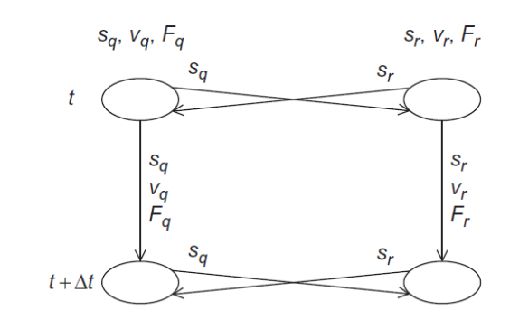  

- 将多个粒子聚合为一个“任务”（例如：任务 A 包含粒子 q，任务 B 包含粒子 r）；  
- 通信仍发生在任务之间：  
  - 任务 A 向 B 发送 $s_q, v_q, F_q$（用于计算 $F_r$）；  
  - 任务 B 向 A 发送 $s_r, v_r, F_r$（用于计算 $F_q$）；  
- 通信量减少（因聚合），但仍是双向交叉通信。

### 3. 约简版 N 体求解器中的通信（Reduced N-Body Solver）  

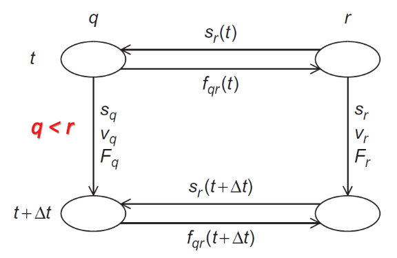  

- 仅考虑粒子对 $(q, r)$，且约定 $q < r$（避免重复）；  
- 通信简化为单向依赖：  
  - 在时刻 $t$：任务 `q` 需要 $s_r(t)$ 来计算 $f_{qr}(t)$；  
  - 在时刻 $t+\Delta t$：任务 `q` 将更新后的 $s_q(t+\Delta t)$ 发送给 `r`（用于下一轮）；  
- **显著降低通信开销**：每对粒子仅通信一次（而非两次），且可按空间邻近性进一步优化（如 Barnes-Hut）。

### 约简算法中粒子 q 的合力计算

```c
for each particle k > q {
    x_diff = pos[q][X] - pos[k][X];
    y_diff = pos[q][Y] - pos[k][Y];
    dist = sqrt(x_diff*x_diff + y_diff*y_diff);
    dist_cubed = dist * dist * dist;

    // 计算 q 受到 k 的引力分量（方向：从 q 指向 k）
    force_qk[X] = G * masses[q] * masses[k] / dist_cubed * x_diff;
    force_qk[Y] = G * masses[q] * masses[k] / dist_cubed * y_diff;

    // ★ 同时更新两个粒子的受力（牛顿第三定律）
    forces[q][X] += force_qk[X];   // q 受力增加（指向 k）
    forces[q][Y] += force_qk[Y];

    forces[k][X] -= force_qk[X];   // k 受力反向（指向 q）
    forces[k][Y] -= force_qk[Y];
}
```
 
- 循环次数减半（仅 $k > q$）；  
- 一次计算完成一对粒子的相互作用；  
- 为并行化提供天然任务粒度（每对 $(q,k)$ 可视为一个任务）。

## 串行伪代码回顾

```c
for each timestep {
    if (timestep output) Print positions and velocities of particles;
    
    for each particle q          // ← 外层：时间步
        Compute total force on q;   // ← 内层1：力计算（可并行）
    
    for each particle q          // ← 内层2：更新位置/速度（可并行）
        Compute position and velocity of q;
}
Print positions and velocities of particles;
```

- 内层循环遍历粒子
- 将两个内层循环（力计算与状态更新）并行化，可自然地将粒子映射到多核处理器上

## N 体问题的并行化版本汇总

| Language | Basic N-body Solver | Reduced N-body Solver |
|----------|---------------------|------------------------|
| OpenMP   | Version 1           | Version 2              |
| Pthreads | Version 3           | Version 4              |
| MPI      | Version 5           | Version 6              |

## 使用OpenMP并行化N-body求解器

### 基本求解器的并行化

#### 第一次尝试

```c
#pragma omp parallel num_threads(thread_count)
{
    for (timestep = 0; timestep < max_timesteps; timestep++) {
        #pragma omp for 
        for (q = 0; q < n; q++) {
            // Compute total force on particle q
        }
        
        #pragma omp for
        for (q = 0; q < n; q++) {
            // Compute position and velocity of q
        }
        
        #pragma omp single
        {
            // Output positions and velocities
        }
    }
}
```

#### 第一个循环

```c
# pragma omp parallel for
for each particle q {
    forces[q][X] = forces[q][Y] = 0;
    for each particle k != q {
        x_diff = pos[q][X] - pos[k][X];
        y_diff = pos[q][Y] - pos[k][Y];
        dist = sqrt(x_diff*x_diff + y_diff*y_diff);
        dist_cubed = dist*dist*dist;
        forces[q][X] -= G*masses[q]*masses[k]/dist_cubed * x_diff;
        forces[q][Y] -= G*masses[q]*masses[k]/dist_cubed * y_diff;
    }
}
```

- 没有竞争条件
  - 每个线程只访问其分配的forces[q]
  - 对pos和masses数组的访问是只读的

#### 第二个循环

```c
# pragma omp parallel for
for each particle q {
    pos[q][X] += delta_t * vel[q][X];
    pos[q][Y] += delta_t * vel[q][Y];
    vel[q][X] += delta_t / masses[q] * forces[q][X];
    vel[q][Y] += delta_t / masses[q] * forces[q][Y];
}
```
- 没有竞争条件
  - 单个线程访问其分配粒子的pos[q], vel[q], masses[q], forces[q]
  - 标量变量只读

#### 重复创建和销毁线程的问题

```c
# pragma omp parallel
for each timestep {
    if (timestep output) 
        # pragma omp for          // ← 每次迭代都创建/销毁线程团队！
            Print positions and velocities;

    # pragma omp for              // ← 同样每次迭代新建团队
    for each particle q
        Compute total force on q;

    # pragma omp for              // ← 再次新建团队
    for each particle q
        Compute position and velocity of q;
}
```

解决方案：使用`#pragma omp parallel`创建线程团队，然后在循环内部使用`#pragma omp for`和`#pragma omp single`。

#### single指令

```c
# pragma omp parallel
for each timestep {
    if (timestep output) {
        # pragma omp single      // 关键修复: 只有其中一个县线程可以执行后续的代码块
        Print positions and velocities of particles;
    }

    # pragma omp for
    for each particle q
        Compute total force on q;

    # pragma omp for
    for each particle q
        Compute position and velocity of q;
}
```

### 简化求解器的并行化


```c
# pragma omp parallel
for each timestep {
    if (timestep output) {
        # pragma omp single // 
        Print positions and velocities of particles;
    }

    // 并行化力的初始化是安全的，因为各次迭代之间没有依赖关系。
    # pragma omp for
    for each particle q
        forces[q] = 0.0;

    # pragma omp for
    for each particle q
        Compute total force on q;
    # pragma omp for
    for each particle q
        Compute position and velocity of q;
}
```

#### 问题

$$
\mathbf{F}_3 = -\mathbf{f}_{03} - \mathbf{f}_{13} - \mathbf{f}_{23}
$$

对 `forces[3]` 的更新会产生**竞态条件**。  

**为什么？**: 与基础版本不同，在约简版本中，一个线程**可能**会更新 `forces` 数组中**不属于其分配粒子对应位置**的元素。

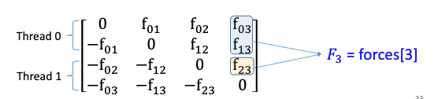 

#### 第一次尝试解决方案

> **在对 forces 的所有更新之前**

```cpp
# pragma omp critical
{
    forces[q][X] += force_qk[X];
    forces[q][Y] += force_qk[Y];
    forces[k][X] -= force_qk[X];
    forces[k][Y] -= force_qk[Y];
}
```

**缺点**：对 `forces` 数组的访问将被**有效串行化！！！**

#### 第二次尝试解决方案

```cpp
omp_set_lock(locks[q]);
forces[q][X] += force_qk[X];
forces[q][Y] += force_qk[Y];
omp_unset_lock(locks[q]);

omp_set_lock(locks[k]);
forces[k][X] -= force_qk[X];
forces[k][Y] -= force_qk[Y];
omp_unset_lock(locks[k]);
```

**为每个粒子使用一个锁。**

性能不如串行代码。

#### 第三次尝试解决方案

**解决方案**：将力的计算分为两个阶段：

- **（阶段 I）** 每个线程执行计算，并将其结果存储在**自身**的力数组中；
- **（阶段 II）** 被分配了粒子 q 的线程将**其他线程已计算出的不同贡献**相加到 `forces[q]` 中。

$$
\mathbf{F}_3 = -\mathbf{f}_{03} - \mathbf{f}_{13} - \mathbf{f}_{23}
$$

**修正算法 — 阶段 I**

每个线程执行计算，并将其结果存储在**自身**的力数组中

```cpp
# pragma omp for
for each particle q {
    force_qk[X] = force_qk[Y] = 0;
    for each particle k > q {
        x_diff = pos[q][X] - pos[k][X];
        y_diff = pos[q][Y] - pos[k][Y];
        dist = sqrt(x_diff*x_diff + y_diff*y_diff);
        dist_cubed = dist*dist*dist;
        force_qk[X] = G*masses[q]*masses[k]/dist_cubed * x_diff;
        force_qk[Y] = G*masses[q]*masses[k]/dist_cubed * y_diff;

        loc_forces[my_rank][q][X] += force_qk[X];
        loc_forces[my_rank][q][Y] += force_qk[Y];
        loc_forces[my_rank][k][X] -= force_qk[X];
        loc_forces[my_rank][k][Y] -= force_qk[Y];
    }
}
```

**修正算法 — 阶段 II**

被分配了粒子 q 的线程将**其他线程已计算出的不同贡献**相加。

```cpp
# pragma omp for
for (q = 0; q < n; q++) {
    forces[q][X] = forces[q][Y] = 0;
    for (thread = 0; thread < thread_count; thread++) {
        forces[q][X] += loc_forces[thread][q][X];
        forces[q][Y] += loc_forces[thread][q][Y];
    }
}
```

### 例子

- **块分区：** 可能导致负载不平衡
- **循环分区：** 更好的负载平衡

#### 分块 例子

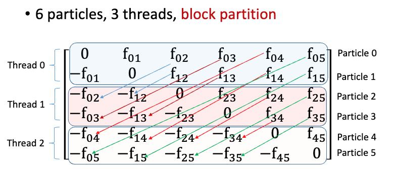

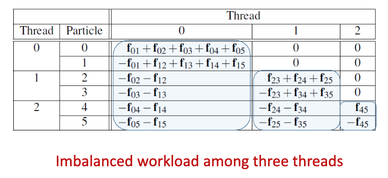

#### 并行 例子

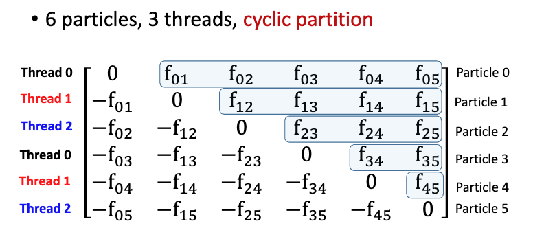

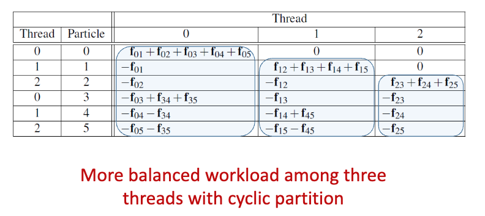

## 使用Pthreads并行化求解器

### 主要特点

- Pthreads中的局部变量默认是私有的
- Pthreads中的所有共享变量都是全局的
- Pthreads版本的主要数据结构与OpenMP版本相同
- Pthreads的启动与OpenMP基本相同

### Pthreads 和 OpenMP 主要区别

- **循环并行化的细节：** 必须显式确定哪些循环变量值对应于每个线程的计算
- **屏障：** 
   - OpenMP在并行for结束后有隐含的屏障
   - Pthreads需要在可能发生竞争条件后添加显式屏障，虽然Pthreads标准包含一个屏障但有些系统没有执行它

## 使用MPI并行化求解器

### 基本求解器的MPI实现

#### 数据结构选择

- 每个进程存储整个全局粒子质量数组
- 每个进程只使用单个n元素数组用于位置
- 每个进程使用指针loc_pos，指向其pos块的开始
- 在进程0上：local_pos = pos；在进程1上：local_pos = pos + loc_n；等等

#### 基本N-body求解器的MPI伪代码

```c
Get input data;  
for each timestep {  
    if (timestep output)  
        Print positions and velocities of particles;  
    for each local particle loc_q  
        Compute total force on loc_q;  
    for each local particle loc_q  
        Compute position and velocity of loc_q;  
    Allgather local positions into global pos array;  
}  
Print positions and velocities of particles;
```

#### 输出的伪代码

```c
Gather velocities onto process 0;  
if (my_rank == 0) {  
    Print timestep;  
    for each particle  
            Print pos[particle] and vel[particle] 
}
```

#### 通信

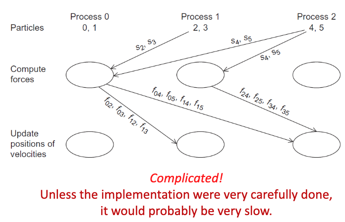

#### 进程环

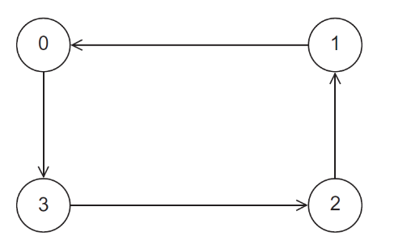

通过重复使用环发送和接收数据，每个进程都可以访问所有粒子的位置。

#### 环传递位置

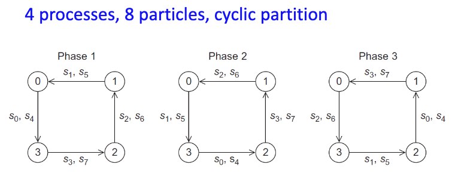

**阶段1：** 每个进程将其分配粒子的位置发送给"低排名"邻居，并接收"高排名"邻居分配粒子的位置
**阶段2：** 每个进程转发其在第一阶段接收到的位置

#### 环传递中的力计算

在每个阶段，进程可以：
- 计算其分配粒子与接收到位置的粒子之间的粒子间力
- 一旦计算出粒子间力，进程可以将力添加到局部力数组中，并从接收到的力数组中减去力

#### 简化N-body求解器的MPI实现伪代码

```
source = (my_rank + 1) % comm_sz;          // 发送方：当前进程的下一个进程（环形通信）
dest   = (my_rank - 1 + comm_sz) % comm_sz; // 接收方：当前进程的上一个进程（环形通信）
Copy loc_pos into tmp_pos;                 // 将本地位置拷贝到临时缓冲区
loc_forces = tmp_forces = 0;               // 初始化本地力和临时力为零

Compute forces due to interactions among local particles;  // 先计算本地粒子之间的相互作用力

for (phase = 1; phase < comm_sz; phase++) {
    Send current tmp_pos and tmp_forces to dest;      // 向接收方发送当前临时位置与力
    Receive new tmp_pos and tmp_forces from source;   // 从发送方接收新的临时位置与力

    /* Owner of the positions and forces we're receiving */
    owner = (my_rank + phase) % comm_sz;              // 当前收到的数据属于哪个进程（即“拥有者”）
    Compute forces due to interactions among my particles and owner's particles;  // 计算本地粒子与该拥有者粒子间的相互作用力
}

Send current tmp_pos and tmp_forces to dest;          // 最后一轮发送（完成环形遍历）
Receive new tmp_pos and tmp_forces from source;       // 最后一轮接收
```

#### 通信

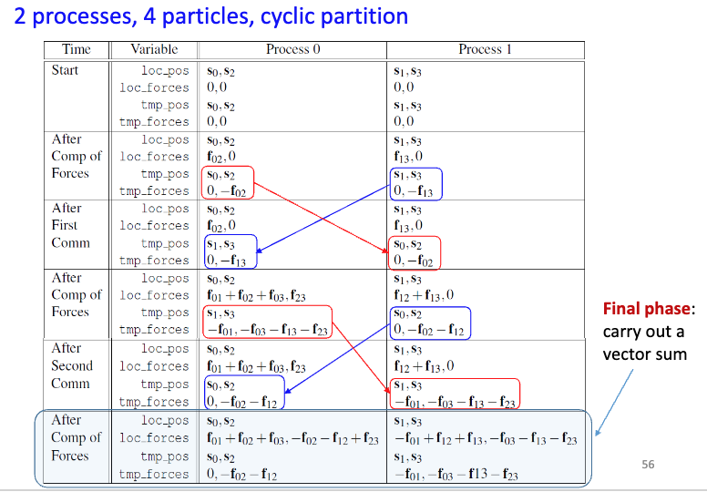

#### MPI N-body求解器的性能

- 简化求解器优于基本求解器

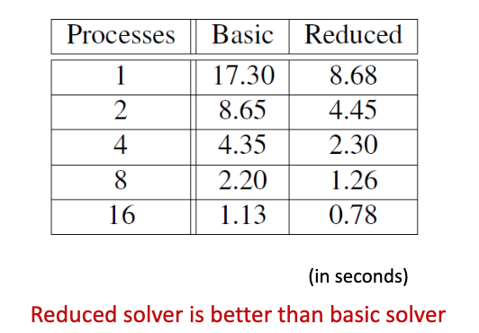

- 基本OpenMP求解器比基本MPI求解器快
- 简化求解器：OpenMP ≈ MPI

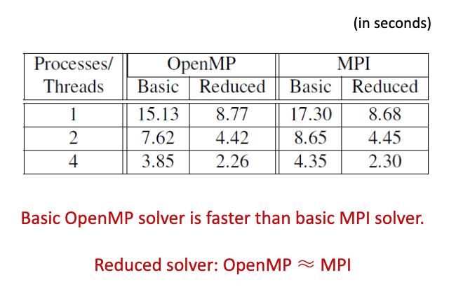

## 树搜索问题（旅行商问题，TSP）

### 问题描述

- NP完全问题
- 没有已知的解决方案在所有情况下都优于穷举搜索
- 例如：旅行商问题，寻找最小成本的巡回路线

### 四城市TSP示例

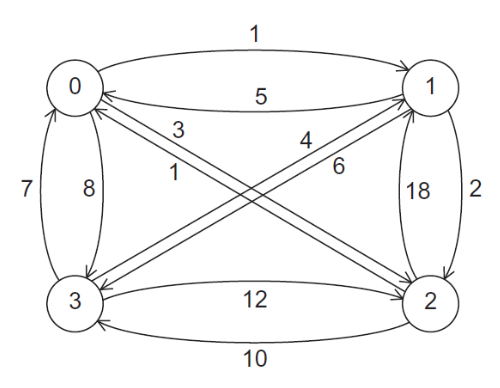

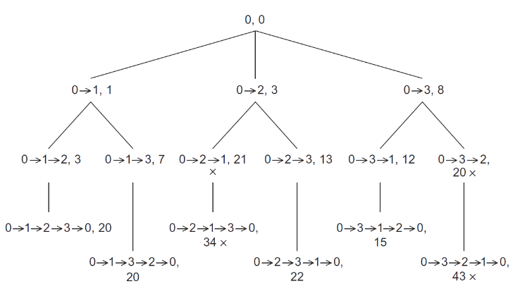


### 使用深度优先搜索的递归解决方案伪代码

```c
void Depth_first_search(tour_t tour) {
    city_t city;

    if (City_count(tour) == n) {          // 检查当前路径中是否已包含 n 个城市
        if (Best_tour(tour)) {            // 检查完整路径的代价是否低于当前“最优路径”
            Update_best_tour(tour);       // 若是，则用该路径替换当前最优路径
        }
    } else {
        for each neighboring city {       // 遍历每个相邻城市
            if (Feasible(tour, city)) {   // 检查该城市是否已被访问过，以及是否可能构成最小代价路径
                Add_city(tour, city);     // 将该城市加入当前路径
                Depth_first_search(tour); // 递归搜索后续路径
                Remove_last_city(tour);   // 回溯：将该城市从路径中移除（因后续递归调用不应包含它）
            }
        }
    }
} 
```

### 不使用递归的迭代解决方案伪代码

```c
for (city = n-1; city >= 1; city--) {         // 从编号最大的城市开始，逆序压入栈（模拟递归调用顺序）
    Push(stack, city);                         // 将城市压入栈
}
while (!Empty(stack)) {                        // 当栈非空时循环
    city = Pop(stack);                         // 弹出栈顶城市
    if (city == NO_CITY) {                     // 若弹出的是 NO_CITY 标记 → 表示子节点遍历结束，需回溯
        Remove_last_city(curr_tour);           // 回溯：移除当前路径最后一个城市
    } else {
        Add_city(curr_tour, city);             // 将该城市加入当前路径
        if (City_count(curr_tour) == n) {      // 若路径已含 n 个城市（完整路径）
            if (Best_tour(curr_tour)) {        // 若优于当前最优解
                Update_best_tour(curr_tour);   // 更新最优路径
            }
            Remove_last_city(curr_tour);       // 回溯：移除该城市（继续探索其他分支）
        } else {
            Push(stack, NO_CITY);              // 在压入子节点前，先压入 NO_CITY 标记（用于回溯时识别“子树结束”）
            for (nbr = n-1; nbr >= 1; nbr--) { // 遍历所有可能的下一个城市（按逆序，以匹配递归顺序）
                if (Feasible(curr_tour, nbr)) {
                    Push(stack, nbr);          // 将可行的邻居城市压入栈
                }
            }
        }
    }
} 
```

### 执行结果

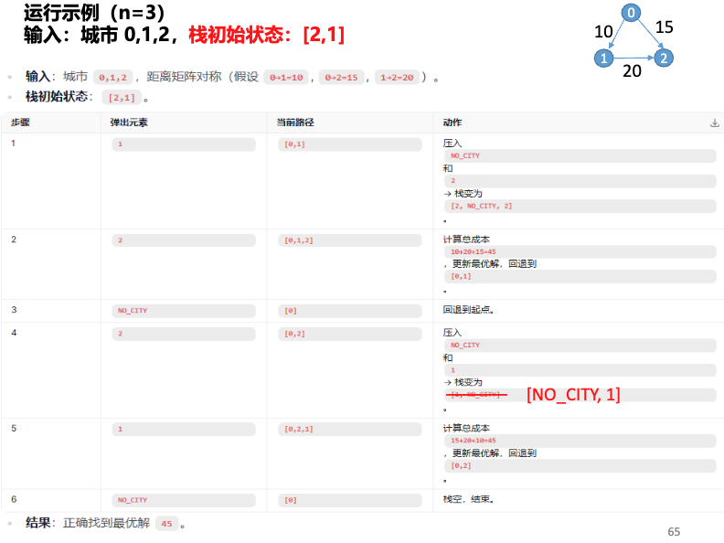

### TSP 的第二种非递归解法伪代码

```cpp
Push_copy(stack, tour);      // 将仅包含起点城市的路径（即“家乡城市”路径）压入栈
while (!Empty(stack)) {
    curr_tour = Pop(stack);  // 弹出当前路径

    if (City_count(curr_tour) == n) {        // 若当前路径已访问全部 n 个城市
        if (Best_tour(curr_tour)) {          // 若该路径优于当前最优解
            Update_best_tour(curr_tour);     // 更新最优路径
        }
    } else {
        for (nbr = n-1; nbr >= 1; nbr--) {   // 遍历所有未访问城市（编号从大到小）
            if (Feasible(curr_tour, nbr)) {  // 若城市 nbr 可加入当前路径
                Add_city(curr_tour, nbr);    // 将 nbr 加入当前路径
                Push_copy(stack, curr_tour); // 将当前路径的副本压入栈（供后续搜索使用）
                Remove_last_city(curr_tour); // 回溯：移除刚加入的城市 nbr
            }
        }
    }
}
Free_tour(curr_tour);  // 释放当前路径内存
```

**右侧图示说明**：该实现通过显式复制路径（`Push_copy`）避免递归，但带来额外内存开销。

### 使用预处理器宏（Pre-processor Macros）

```cpp
/* 查找路径中第 i 个城市的函数 */
int Tour_city(tour_t tour, int i) {
    return tour->cities[i];
}  /* Tour_city */
```

宏替换: 宏展开在编译期完成，无函数调用开销，提升性能；适用于频繁调用的简单访问操作。

```cpp
/* 查找路径中第 i 个城市的宏定义 */
#define Tour_city(tour, i) (tour->cities[i])
```

### 三种串行树搜索实现的运行时间对比  

| 方法        | 递归版  | 第一迭代版   | 第二迭代版   |
|-------------|--------|-----------|-------------|
| 运行时间     | 30.5s  | 29.2s      | 32.9s      |

- **第一迭代版更快**：因其消除了递归调用带来的重复函数调用开销。
- **第二迭代版较慢**：因需反复复制整个路径数据结构（`Push_copy` 操作开销大）。
- **第二迭代版更易并行化**：无函数调用栈依赖，便于拆分任务并行执行。

### 确保我们拥有“最优路径”

- 当一个进程完成一条路径搜索后，需**检查**该路径是否比目前已记录的**更优解**更好。
- 全局 `Best_tour` 函数**仅读取**全局最优代价，因此无需加锁同步——与其他进程的读操作**无冲突**（no contention）。
- 若该路径并非更优解，则**不尝试更新**全局最优值。
- 若另一线程正在**更新**全局最优值，而我们正在读取，可能看到**旧值**或**新值**。
- 虽然**新值更优**，但为确保正确性，直接采用新值可能导致“用较差值覆盖较好值”的风险——这种做法**代价更高、得不偿失**。
- 当某线程**测试并决定**它找到了一个更优的全局解时，我们必须确保两件事：
  1. 该线程必须用 **互斥锁（mutex）** 锁定全局值，防止竞态条件；
  2. 在极少数情况下：若第一次检查时对比的是**旧值**（此时另一进程正在更新），我们**不能**将一个比“正在写入的新值”更差的值写入全局变量。
- 我们通过 **“先加锁，再重新测试”** 的方式处理此问题（即 *lock-then-test-again* 模式）。

### 场景分析图示

#### 第一场景

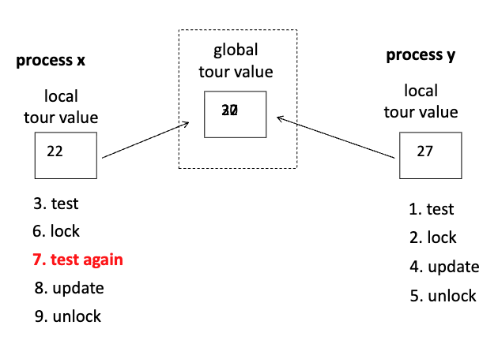

- **进程 x**：本地路径值 = 22；操作序列：3. test → 6. lock → **7. test again**（加锁后重测）→ 8. update → 9. unlock  
- **进程 y**：本地路径值 = 27；操作序列：1. test → 2. lock → 4. update → 5. unlock  
- 全局最优值初始为 20 → 进程 y 先更新为 27 → 进程 x 加锁后重测发现 22 < 27，放弃更新。

#### 第二场景

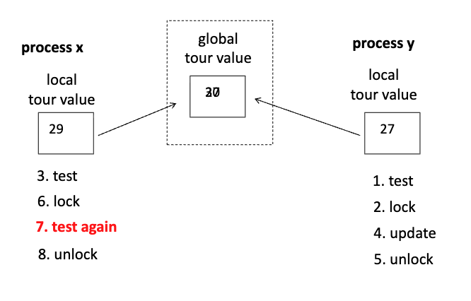

- **进程 x**：本地路径值 = 29；操作序列：3. test → 6. lock → **7. test again** → 8. unlock（未更新，因重测发现已有更优解）  
- **进程 y**：本地路径值 = 27；操作序列：1. test → 2. lock → 4. update → 5. unlock  
- 全局值仍为 20 → 进程 y 更新为 27 → 进程 x 加锁重测发现 29 > 27，应更新

### 树搜索问题的并行化版本

“静态”指任务划分在开始前确定；“动态”指运行时按需分配任务（如工作窃取）。不同语言对应不同实现策略，体现并行设计的多样性。

| 语言      | 并行化方式 | 版本 |
|----------|----------|------|
| Pthreads | 静态      | 版本1 |
| Pthreads | 动态      | 版本2 |
| OpenMP   | 静态      | 版本3 |
| OpenMP   | 动态      | 版本4 |
| MPI      | 静态      | 版本5 |
| MPI      | 动态      | 版本6 |

## 使用Pthreads并行化树搜索程序

### 静态并行化

**思想：** 单个线程使用BFS生成至少thread_count个部分巡回路线分发给线程，然后每个线程获取其部分巡回路线并对其运行迭代树搜索。

**与迭代串行版本的四个区别：**
1. 使用my_stack而不是stack
2. 栈的初始化
3. Best_tour函数的实现
4. Update_best_tour函数的实现

#### Pthreads静态并行化TSP实现的伪代码

```c
Partition_tree(my_rank, my_stack);  // 初始化：按进程 rank 分配初始搜索子树（如根节点或部分分支）到本地栈

while (!Empty(my_stack)) {          // 主循环：只要本地任务栈非空，持续处理
    curr_tour = Pop(my_stack);      // 弹出当前待扩展的路径（tour）

    if (City_count(curr_tour) == n) {        // ✅ 情况1：路径已包含全部 n 个城市（完整解）
        if (Best_tour(curr_tour)) {          // 检查是否优于当前全局最优解
            Update_best_tour(curr_tour);     // 是 → 更新全局最优路径
        }
        // 注意：此处无回溯操作（因已是完整路径，无需继续扩展）
    } else {                                 // ❌ 情况2：路径未完成 → 需扩展下一个城市
        for (city = n-1; city >= 1; city--) {   // 逆序遍历所有候选城市（编号 1 到 n-1，避开起点 0）
            if (Feasible(curr_tour, city)) {    // 检查城市 city 是否可加入当前路径（未访问 + 满足约束）
                Add_city(curr_tour, city);      // 将 city 加入当前路径（临时修改）
                Push_copy(my_stack, curr_tour); // 将当前路径的**副本**压入栈（供后续搜索使用）
                Remove_last_city(curr_tour);    // 回溯：立即移除刚加入的 city，恢复 curr_tour 状态
            }
        }
    }
}

Free_tour(curr_tour);  // 释放当前路径内存（避免内存泄漏）
```

### 动态并行化

- **基本思想**
  - 当线程用完工作时，它等待看另一个线程是否可以提供更多工作
  - 如果线程仍有工作并且发现至少有一个线程没有工作，它可以分割其栈并为其中一个线程提供工作
  - **注意：** 使用pthread_cond_wait, pthread_cond_signal, pthread_cond_broadcast进行实现。
- 线程分割前执行的代码
  - 检查其栈中是否至少有两个巡回路线
  - 检查是否有线程在等待
  - 检查new_stack变量是否为NULL
- 终止问题
  - 只有当所有线程都用完工作时才终止。
  - 使用Terminated函数而不是Empty(stack)。

#### Pthreads终止函数伪代码

```c
if (my_stack_size >= 2 && threads_in_cond_wait > 0 && new_stack == NULL) {
    // 条件满足：本地栈至少有 2 个任务，且有线程在条件变量上等待，且尚未分配新栈
    lock term_mutex;                     // 加锁保护共享终止状态变量

    if (threads_in_cond_wait > 0 && new_stack == NULL) {
        // 分裂当前栈：将 my_stack 拆分为两部分，其中一部分赋给 new_stack
        Split my_stack creating new_stack;
        // 通知一个等待中的线程（唤醒它去处理 new_stack）
        pthread_cond_signal(&term_cond_var);
    }

    unlock term_mutex;
    return 0;  // Terminated = false；不退出，继续工作
}

else if (!Empty(my_stack)) {
    // 栈非空 → 仍有工作可做，继续执行搜索
    return 0;  // Terminated = false；不退出，继续工作
}

else {  // my_stack is empty（本地栈为空）
    lock term_mutex;

    if (threads_in_cond_wait == thread_count - 1) {
        // 最后一个活跃线程：所有其他线程都已在等待（即仅剩自己未终止）
        threads_in_cond_wait++;               // 自己也进入等待状态（计数+1）
        // 广播通知：所有线程均已无任务，可以全局终止
        pthread_cond_broadcast(&term_cond_var);
        unlock term_mutex;
        return 1;  // Terminated = true；退出线程
    }

    else {
        // 其他线程仍在工作 → 当前线程需等待任务分配
        while (pthread_cond_wait(&term_cond_var, &term_mutex) != 0);
        // 被唤醒后检查：是否已获得新工作？
        if (threads_in_cond_wait < thread_count) {
            my_stack = new_stack;     // 接收新分配的栈
            new_stack = NULL;         // 清空待分配栈
            threads_in_cond_wait--;   // 减少等待线程数（自己转为工作状态）
            unlock term_mutex;
            return 0;  // Terminated = false；继续工作
        }
        else {
            // 所有线程均已完成（包括自己被唤醒后发现无新任务）
            unlock term_mutex;
            return 1;  // Terminated = true；退出线程
        }
    }
}
```

#### 终止相关变量的结构体封装

```c
typedef struct {
    my_stack_t new_stack;          // 待分配的新栈（用于工作窃取）
    int threads_in_cond_wait;      // 当前在条件变量上等待的线程数量
    pthread_cond_t term_cond_var;  // 终止用条件变量
    pthread_mutex_t term_mutex;    // 保护上述共享变量的互斥锁
} term_struct;

typedef term_struct* term_t;      // 定义全局指针类型
term_t term;                      // 全局变量：指向终止状态结构体
```

### Pthreads树搜索程序的运行时间

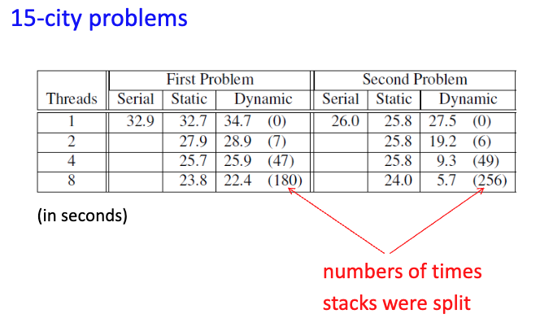

## 使用OpenMP并行化树搜索程序

- 实现静态和动态并行树搜索程序时，Pthreads 与 OpenMP 面临相同的基本问题
- 仅需少量修改即可完成转换
- `#pragma omp single` 用于指定仅由一个线程执行的代码块，功能上等价于 Pthreads 中通过 `my_rank` 判断的单线程分支

**Pthreads 代码片段：**
```cpp
if (my_rank == whatever)
```

**对应 OpenMP 代码片段：**
```cpp
#pragma omp single
```

### OpenMP 模拟条件等待

```cpp
/* 全局变量 */
int awakened_thread = -1;
work_remains = 1;  /* true */

...

omp_unset_lock(&term_lock);
while (awakened_thread != my_rank && work_remains) {
    omp_set_lock(&term_lock);
}
```
该结构模拟了 `pthread_cond_wait` 的行为，其中 `awakened_thread` 记录被唤醒的线程编号，`work_remains` 表示是否仍有工作待处理。此为“忙等待”（Busy-waiting）实现，无操作系统级阻塞。

### OpenMP和Pthreads树搜索实现的性能

对于大多数部分，OpenMP实现与Pthreads实现相当。

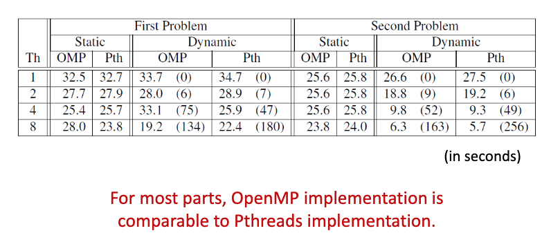

## 使用MPI和静态分区实现树搜索

### 实现步骤

1. 在进程0上读取邻接矩阵，并广播到所有进程
2. 分区树
3. 检查和更新最佳巡回路线
4. 搜索终止后，确保进程0有最佳巡回路线的副本用于输出

### 分区树

**问题：** 不能使用 `MPI_Scatter`，因为初始部分巡回路线的数量可能不能被comm_sz整除。

**解决方案：** 使用 `MPI_Scatterv`，这是 `MPI_Scatter` 的变体，可以向不同进程发送不同数量的对象。

```c
int MPI_Scatter(
    void* sendbuf,        /* 输入：发送缓冲区的起始地址 */
    int* sendcounts,      /* 输入：每个进程接收的数据元素个数数组 */
    int* displacements,   /* 输入：每个进程在发送缓冲区中的偏移量数组 */
    MPI_Datatype sendtype,/* 输入：发送数据的类型 */
    void* recvbuf,        /* 输出：接收缓冲区的起始地址 */
    int recvcount,        /* 输入：本进程接收的数据元素个数 */
    MPI_Datatype recvtype,/* 输入：接收数据的类型 */
    int root,             /* 输入：根进程的秩（rank） */
    MPI_Comm comm         /* 输入：通信子 */
);
```

发送到进程q的数据将从位置开始(sendtype = MPI_INT): sendbuf + displacement[q]


### 从通信器中的每个进程收集不同数量的对象

使用 `MPI_Gatherv` ，这是 `MPI_Gather` 的变体，可以从不同进程收集不同数量的对象。

```c
int MPI_Gather(
    void* sendbuf,        /* 输入：发送缓冲区的起始地址 */
    int sendcount,        /* 输入：本进程发送的数据元素个数 */
    MPI_Datatype sendtype,/* 输入：发送数据的类型 */
    void* recvbuf,        /* 输出：接收缓冲区的起始地址（仅在根进程中有效） */
    int* recvcounts,      /* 输入：各进程发送数据元素个数的数组（仅在根进程中使用） */
    int* displacements,   /* 输入：各进程数据在接收缓冲区中的偏移量数组（仅在根进程中使用） */
    MPI_Datatype recvtype,/* 输入：接收数据的类型（仅在根进程中有效） */
    int root,             /* 输入：根进程的秩（rank） */
    MPI_Comm comm         /* 输入：通信子 */
);
```

### 维护最优路径

- 当一个进程找到一条新的最优路径时，应将其发送给其他进程。
- `MPI_Bcast` 不能使用，因为它是阻塞的。
  - 通信子中的每个进程都必须调用 `MPI_Bcast`。
- 新路径应以**发送方不会无限期阻塞**的方式发送。
- 最简单的方法是使用 `MPI_send` 将新的最优代价发送给所有其他进程。
  - 使用一个特殊标签 `NEW_COST_TAG`。
- 目标进程可以**周期性地检查**是否有新的最优路径代价到达。
- **问题**：不能使用 `MPI_Recv`，因为该函数在匹配消息到达前会阻塞。
- `MPI_Iprobe`：检查是否有消息可用  
  - 它并不实际尝试接收消息。

```c
int MPI_Iprobe(
    int source,        /* 输入：消息源进程的秩；MPI_ANY_SOURCE 表示任意源 */
    int tag,           /* 输入：消息标签；MPI_ANY_TAG 表示任意标签 */
    MPI_Comm comm,     /* 输入：通信子 */
    int* msg_avail_p,  /* 输出：若消息可用则置为非零值（TRUE），否则为 0 */
    MPI_Status* status_p /* 输出：若消息可用，则 status_p->MPI_SOURCE 被赋值为消息源进程的秩 */
);
```

### 检查新的最优路径的 MPI 代码

```c
MPI_Iprobe(MPI_ANY_SOURCE, NEW_COST_TAG, comm, &msg_avail, &status);
while (msg_avail)
{
    MPI_Recv(&received_cost, 1, MPI_INT, status.MPI_SOURCE, NEW_COST_TAG, comm, MPI_STATUS_IGNORE);
    if (received_cost < best_tour_cost)
        best_tour_cost = received_cost;
    MPI_Iprobe(MPI_ANY_SOURCE, NEW_COST_TAG, comm, &msg_avail, &status);
}
```

### MPI发送模式

MPI提供四种发送模式：
1. **标准：** MPI_Send
2. **同步：** MPI_Ssend
3. **就绪：** MPI_Rsend
4. **缓冲：** MPI_Bsend

- 标准模式（MPI_Send）：MPI实现决定是将消息内容复制到其自己的存储中，还是阻塞直到发布匹配的接收。
- 同步模式（MPI_Ssend）：发送将阻塞直到发布匹配的接收。
- 就绪模式（MPI_Rsend）：除非在开始发送之前发布了匹配的接收，否则发送是错误的。
- 缓冲模式（MPI_Bsend）：如果尚未发布匹配的接收，MPI实现必须将消息复制到本地临时存储中。临时存储必须由用户程序提供，而不是MPI实现。

### 打印最佳巡回路线

- 让每个进程存储其本地最佳巡回路线
- 搜索完成后，调用MPI_Allreduce
- 具有全局最佳巡回路线的进程可以将其发送给进程0进行输出

```c
struct {
    int cost;
    int rank;
} loc_data, global_data;

loc_data.cost = Tour_cost(loc_best_tour); 
loc_data.rank = my_rank;

MPI_Allreduce(&loc_data, &global_data, 1, MPI_2INT, MPI_MINLOC, comm);

if (global_data.rank == 0) return;  /* 0 号进程已拥有最优路径 */

if (my_rank == 0)
    Receive best tour from process global_data.rank;
else if (my_rank == global_data.rank)
    Send best tour to process 0;
```

## 使用 MPI 和动态分区实现树搜索

与OpenMP/Pthreads的关键区别：
- 没有关于哪些进程正在等待工作的中央信息库。
- 用完工作的进程不应简单地进入忙等待或终止，而应向另一个进程发送工作请求。

### 动态分区TSP求解器的终止函数（MPI）

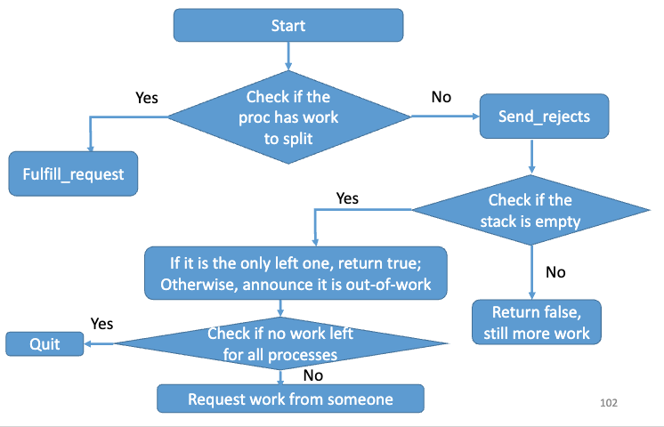

```cpp
if (My_avail_tour_count(my_stack) >= 2) {
    // 进程仍有至少2个可用路径，可继续拆分工作
    Fulfill_request(my_stack);      // 满足本地请求（例如生成子问题）
    return false;                   // 仍有工作待处理
} else {                            // 至多1个可用路径
    Send_rejects();                 // 通知其他进程：本进程无工作可提供
    // 注：此操作告知所有已请求工作的进程，本进程当前无可用工作
}

if (!Empty_stack(my_stack)) {
    // 栈非空：仍有工作待处理，不能终止
    return false;
} else {                            // 栈为空
    if (comm_sz == 1) return true;  // 仅剩1个进程，且无工作 → 可终止
    Out_of_work();                  // 标记本进程进入“无工作”状态
    work_request_sent = false;      // 重置工作请求发送标志

    while (1) {
        Clear_msgs();               // 清除与工作无关的消息（如终止探测、结果广播等）

        if (No_work_left()) {
            return true;            // 所有进程均无工作 → 全局终止
        }
    }
}
else if (!work_request_sent) {
    Send_work_request();            // 向其他进程请求工作
    work_request_sent = true;       // 标记已发送请求
} else {
    Check_for_work(&work_request_sent, &work_avail);  // 检查是否有工作到达
    if (work_avail) {
        Receive_work(my_stack);     // 接收远程进程发来的工作（路径/子问题）
        return false;               // 已获得新工作，继续执行
    }
}
// 注：此处为 while 循环体内部；若栈为空且未收到工作，则持续轮询
```

### 分割栈和数据打包

- **`MPI_Pack`**：将数据打包到一块连续内存的缓冲区中  
- **`Split_stack`**：将新栈（`new stack`）的内容打包为连续内存块，并将该内存块发送给接收方  

```c
int MPI_Pack(
    void* data_to_be_packed,      /* 输入：待打包的数据起始地址 */
    int to_be_packed_count,       /* 输入：待打包元素个数 */
    MPI_Datatype datatype,        /* 输入：数据类型（如 MPI_INT、MPI_DOUBLE 等） */
    void* contig_buf,             /* 输出：目标连续缓冲区地址 */
    int contig_buf_size,          /* 输入：目标缓冲区大小（字节） */
    int* position_p,              /* 输入/输出：当前打包位置偏移量（字节） */
    MPI_Comm comm                 /* 输入：通信子 */
);
```

```c
int MPI_Unpack(
    void* contig_buf,             /* 输入：源连续缓冲区地址 */
    int contig_buf_size,          /* 输入：源缓冲区大小（字节） */
    int* position_p,              /* 输入/输出：当前解包位置偏移量（字节） */
    void* unpacked_data,          /* 输出：解包后数据存放地址 */
    int unpack_count,             /* 输入：待解包元素个数 */
    MPI_Datatype datatype,        /* 输入：数据类型 */
    MPI_Comm comm                 /* 输入：通信子 */
);
```

### 分布式终止检测

- `Out_of_work()` 和 `No_work_left()` 实现了终止检测算法。  
- 在共享内存程序中有效的终止检测算法，在 MPI 环境下**会存在问题**。  
- 假设每个进程维护一个变量 `oow`（out-of-work），用于记录当前“无工作”状态的进程数量：  
  - 初始时，`oow = 0`  
  - 每当一个进程耗尽工作（或接收工作后仍无可用工作），它向其他所有进程发送一条消息，通知它们更新各自的 `oow` 值（即 `oow++`）。  

#### 因消息顺序不确定性导致的错误场景

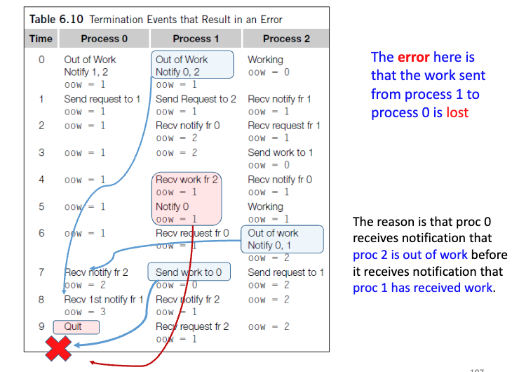

以下是关键事件时序与错误成因分析（按时间从0到9）：

- 初始状态（Time 0）
  - **Process 0**：处于“Out of Work”（无工作），`oow = 1`（它自己无工作，但此时 `oow` 计数逻辑可能已包含自身或尚未同步；根据后续行为，此处 `oow=1` 表示它认为已有1个进程无工作——即自己）  
  - **Process 1**：处于“Out of Work”，`oow = 1`，并**向 Process 0 和 Process 2 发送 Notify 0,2**（通知它们自己无工作）  
  - **Process 2**：正在“Working”，`oow = 0`
  - 注意：此时 Process 1 尚未收到任何工作，但它已宣布无工作——这是动态负载平衡中的常见情况（本地栈空，需请求工作）。
- Time 1–2
  - Process 0 和 Process 1 各自向对方发送工作请求（`Send request to 1` / `Send request to 2`）  
  - Process 2 收到 Process 1 的通知（`Recv notify fr 1`），更新 `oow = 1`  
  - Process 1 收到 Process 0 的通知（`Recv notify fr 0`），更新 `oow = 2`（此时它知道 P0 和自己无工作）
- Time 3–4
  - Process 2 向 Process 1 发送工作（`Send work to 1`），`oow` 重置为 0（因有工作可做）  
  - Process 1 收到工作（`Recv work fr 2`），更新 `oow = 1`（仅 P0 仍无工作），并立即向 P0 发送 `Notify 0`（告知 P0：我已有工作，不再无工作）  
  - **关键点**：此时 P1 已恢复工作，且已通知 P0 自己不再“out of work”。
- Time 5–6
  - Process 2 再次进入“Working”状态（继续处理）  
  - Process 0 仍无工作，`oow = 1`  
  - Process 1 继续工作，`oow = 1`  
  - Process 2 在 Time 6 变为“Out of Work”，并向 P0、P1 发送 `Notify 0,1`
- 错误发生点（Time 7–8）
  - **Process 0** 先收到 **Process 2 的通知**（`Recv notify fr 2`），将其 `oow` 从 1 增至 **2**（认为 P2 和自己无工作）  
  - **但此时 Process 0 尚未收到 Process 1 发来的 `Notify 0` 消息**（即 P1 已恢复工作的通知）  
  - 同时，**Process 1 正在向 Process 0 发送工作**（`Send work to 0`），该消息**尚未被 Process 0 接收**  
  - Process 0 在 `oow == 2`（总进程数为3，即 `oow == comm_sz - 1`）且自身无工作时，**错误判定全局终止**，执行 `Quit`（红色叉号标记）  
  - 而实际上：Process 1 仍有工作要发给 Process 0（消息已在传输中），Process 2 虽无工作，但 Process 1 有工作可分发，**全局尚未终止，但 Process 0 过早退出**
- 错误原因总结
  - **直接原因**：从 Process 1 发送给 Process 0 的工作消息**丢失**（图中红线箭头未到达 P0，被红叉截断）  
  - **根本原因**：终止检测算法依赖 `oow` 计数等于 `comm_sz - 1` 且自身无工作来判定终止，但该算法**未考虑工作消息仍在传输中**的情形。即：**通知消息（Notify）与工作消息（Work）存在竞争条件（race condition）**
    - 若 `Notify` 先于 `Work` 到达，则接收方可能误判为“无工作可用”而退出；  
    - 若 `Work` 先到达，则正常继续。

#### 简单的分布式终止检测算法

**思想：** 跟踪一个守恒且可以精确测量的量（例如能量）

**算法：**
- 最初，每个进程有1单位能量
- 当进程用完工作时，它将其能量发送给进程0
- 当进程满足工作请求时，它将其能量分成两半，为自己保留一半，并将一半发送给另一个进程
- 当进程0接收到总共comm_sz单位的能量时，程序应终止

## MPI和Pthreads树搜索实现的性能

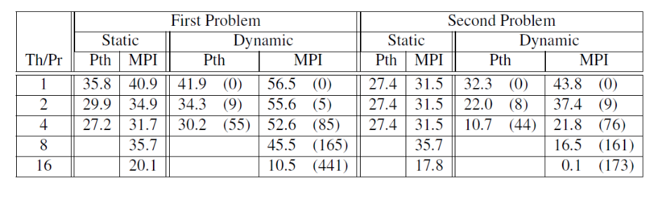

- Pthreads在小型共享内存系统上优于MPI实现
- 对于大型问题，MPI程序更具可扩展性，可以提供更好的性能

## 总结与建议

- 在开发N-body问题的简化MPI解决方案时，"环传递"算法被证明更容易实现，可能更具可扩展性
- 在分布式内存环境中，进程相互发送工作时，确定何时终止是一个非平凡的问题
- 在决定使用哪个API时，应考虑是使用共享内存还是分布式内存
- 应查看应用程序的内存需求以及进程/线程之间的通信量
- 如果内存需求很大，或者分布式内存版本主要可以使用缓存工作，那么分布式内存程序可能会快得多
- 另一方面，如果有大量通信，共享内存程序可能会更快
- 在OpenMP和Pthreads之间选择时，如果有现有的串行程序，并且可以通过插入OpenMP指令进行并行化，那么OpenMP可能是明确的选择
- 但是，如果需要复杂的线程同步，那么Pthreads将更容易使用