# 第07章(1/3) 向量化编程

## 学习目标

- 理解数据并行体系结构的基本概念
- 掌握向量体系结构的工作原理
- 了解SIMD指令集扩展及其应用
- 学习向量编程模型和指令集优势
- 掌握向量执行时间和优化技术
- 理解向量内存子系统的设计

## 数据并行体系结构简介

- SIMD 架构可充分利用数据级并行性，适用于：  
  - 面向矩阵的科学计算  
  - 面向媒体的图像与声音处理  

- SIMD 比 MIMD 更具能源效率：  
  - 每次数据操作仅需取一条指令  
  - 使 SIMD 成为个人移动设备的理想选择  

- SIMD 允许程序员以顺序方式继续思考

### SIMD并行性

- **三种SIMD变体：**
  - 向量体系结构（Vector architectures）
  - 多媒体SIMD指令集扩展（Multimedia SIMD instruction set extensions）
  - 图形处理器单元（GPUs）

- **x86处理器发展趋势：**
  - 每年每个芯片增加两个核心
  - 每四年SIMD宽度翻倍
  - SIMD的潜在加速比是MIMD的两倍

## 向量体系架构

### 超级计算机

**超级计算机的定义：**
- 世界上给定任务最快的机器
- 将计算密集型问题转变为I/O密集型问题的设备
- 任何成本超过3000万美元的机器
- 任何由 Seymour Cray 设计的机器（^_^）

**CDC6600（Cray, 1964）** 被认为是第一台超级计算机

**典型应用领域：**
- 军事研究（核武器、密码学）
- 科学研究
- 天气预报
- 石油勘探
- 工业设计（汽车碰撞模拟）

- **所有应用都涉及对大型数据集的巨大计算**: 70-80年代的超级计算机 = 向量机器

## 向量超级计算机

**Cray-1（1976）为代表：**
- 标量单元 + 向量扩展
- 加载/存储架构
- 向量寄存器
- 向量指令
- 硬连线控制
- 高度流水线化的功能单元
- 交叉存储系统
- 无数据缓存
- 无虚拟内存

### Cray-1（1976）架构

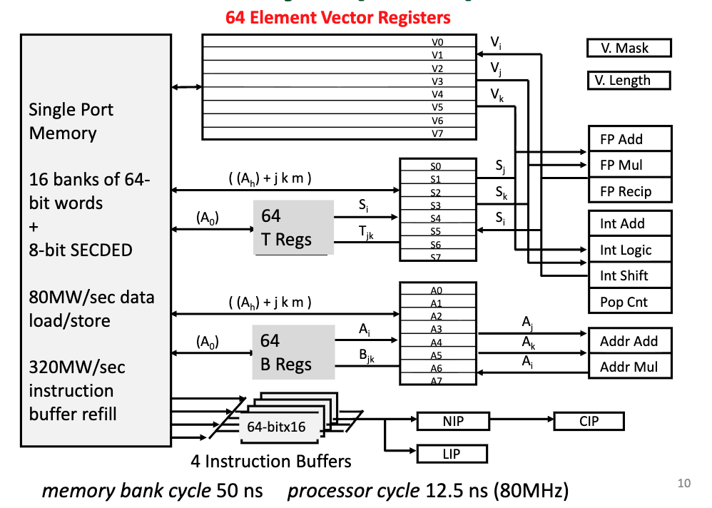

### 向量体系结构

- **基本思想**
  - 将数据元素集读入"向量寄存器"
  - 对这些寄存器进行操作
  - 将结果分散回内存
- **寄存器由编译器控制：**
  - 用于隐藏内存延迟
  - 利用内存带宽

### 向量编程模型

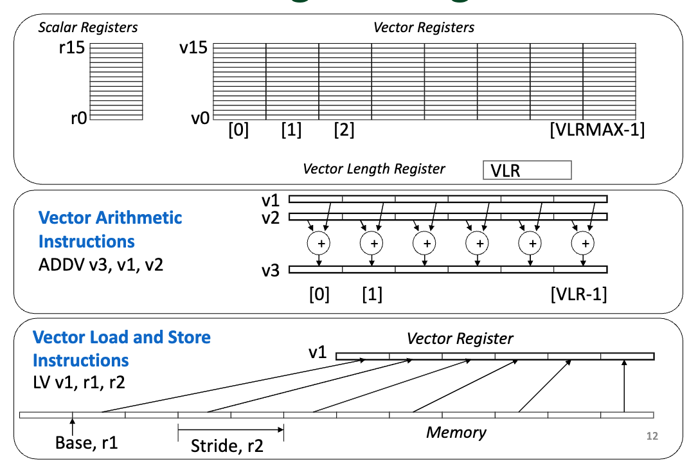

### 向量代码例子

**C code**
```c
for (i=0; i<64; i++)
    C[i] = A[i] + B[i];
```

**scalar code**
```assembly
LI R4, 64
loop:
    L.D F0, 0(R1)
    L.D F2, 0(R2)
    ADD.D F4, F2, F0
    S.D F4, 0(R3)
    DADDIU R1, 8
    DADDIU R2, 8
    DADDIU R3, 8
    DSUBIU R4, 1
    BNEZ R4, loop
```

**vector code**
```assembly
LI VLR, 64
LV V1, R1
LV V2, R2
ADDV.D V3, V1, V2
SV V3, R3
```

### 向量指令集优势

- **紧凑：** 一条短指令编码N个操作
- **表达性强：** 告诉硬件这些N个操作：
  - 是独立的
  - 使用相同的功能单元
  - 访问不相交的寄存器
  - 以与先前指令相同的模式访问寄存器
  - 访问连续的内存块（单位步幅加载/存储）
  - 以已知模式访问内存（跨步加载/存储）
- **可扩展：** 可以在同一对象代码上运行更多并行流水线或通道

### 向量算术执行

- **使用深度流水线（=> 快速时钟）**
  - 执行元素操作
- **简化深度流水线的控制：**
  - 因为向量中的元素是独立的（=> 无危险！）

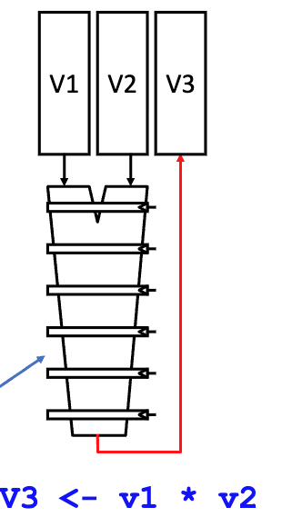

### 向量指令执行

**使用多个功能单元执行向量加法指令：**
- 左侧有一个加法流水线，每个时钟周期可以完成一次加法
- 右侧有四个加法流水线，每个时钟周期可以完成四次加法

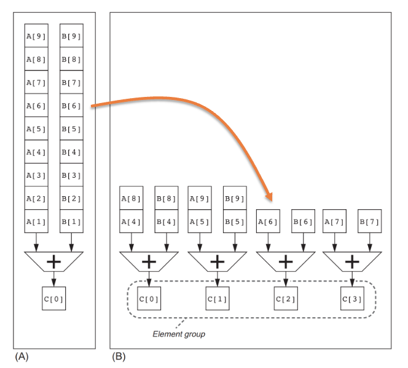

### 向量单元结构

**包含四个通道的向量单元结构**

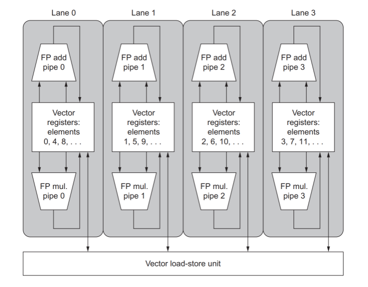

### T0向量微处理器（1995）

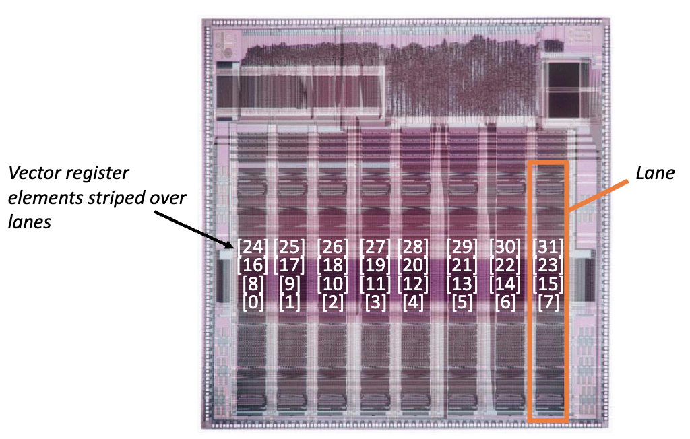

### 自动代码向量化

```c
for(i=0; i<N; i++)
    C[i] = A[i] + B[i];
```

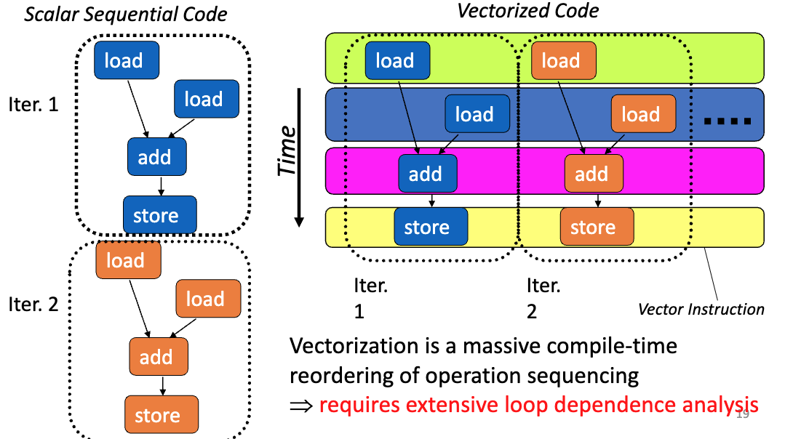

- 向量化是在编译时对操作序列进行大规模重新排序
- 需要广泛的循环依赖分析

## RV64V

### RV64V架构

**RV64V：** 基于RISC-V的指令 + 向量扩展

- **32个64位向量寄存器**
  - 寄存器文件有16个读端口和8个写端口
- **向量功能单元**
  - 完全流水线化
  - 检测数据和控制危险
- **向量加载-存储单元**
  - 完全流水线化
  - 初始延迟后每个时钟周期一个字
- **标量寄存器**
  - 31个通用寄存器
  - 32个浮点寄存器

### 基础架构

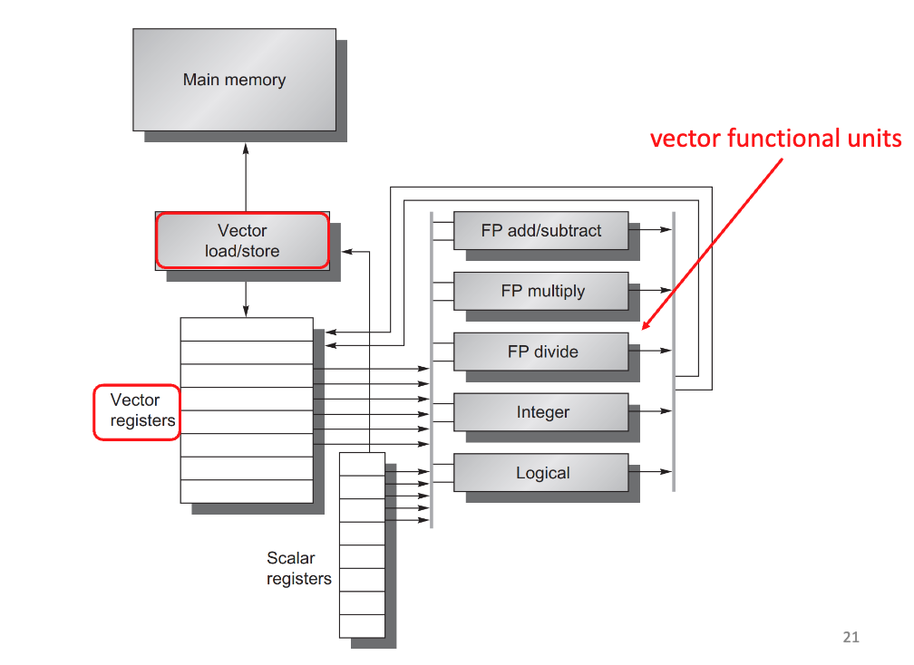

### RV64V指令

**RV64V使用后缀指示操作数类型：**
- `.vv`：两个向量操作数
- `.vs` 和 `.sv`：向量和标量操作数
- 示例：`vsub.vv`, `vsub.vs`

### 向量处理器工作示例：DAXPY

- **Y = a*X + Y**
- **DAXPY：** Double precision a*X plus Y

#### RV64G代码（258条指令）

```assembly
fld    f0, a                    # 加载标量 a 到浮点寄存器 f0
addi   x28, x5, # 256           # 计算 X 数组最后一个元素的地址（假设数组长度为256，x5 为 X 的起始地址）
Loop:   fld    f1, 0(x5)        # 加载 X[i] 到 f1（x5 指向当前 X[i]）
        fmul.d f1, f1, f0       # 计算 a × X[i]，结果存入 f1
        fld    f2, 0(x6)        # 加载 Y[i] 到 f2（x6 指向当前 Y[i]）
        fadd.d f2, f2, f1       # 计算 a × X[i] + Y[i]，结果存入 f2
        fsd    f2, 0(x6)        # 将结果存回 Y[i]
        addi   x5, x5, #8       # X 数组索引加 1（按双精度浮点数，8 字节步长）
        addi   x6, x6, #8       # Y 数组索引加 1（8 字节步长）
        bne    x28, x5, Loop    # 若 x5 ≠ x28（未达末尾），跳转至 Loop 继续循环
```

#### RV64V代码（8条指令）
```assembly
vsetdcfg 4*FP64    # 启用4个双精度浮点向量寄存器
fld f0, a          # 加载标量a
vld v0, x5         # 加载向量X
vmul v1, v0, f0    # 向量-标量乘法
vld v2, x6         # 加载向量Y
vadd v3, v1, v2    # 向量-向量加法
vst v3, x6         # 存储和
vdisable           # 禁用向量寄存器
```

## 向量执行时间

### 执行时间因素

执行时间取决于三个因素：
1. 操作数向量的长度
2. 操作之间的结构危险
3. 数据依赖性

**RV64V功能单元每个时钟周期消耗一个元素**, 执行时间大约是向量长度

### 船队（Convoy）

**Convoy** 
- 一组可能一起执行的向量指令
- 船队中的指令不能包含任何结构危险
- 如果存在此类危险，指令需要在不同的船队中启动

### 向量链接（Vector Chaining）

具有**先读后写**依赖危险的序列通过链接放置在**同一convoy**中
- 一个功能单元的结果可以直接传递给下一个功能单元
- 无需先存储在向量寄存器中

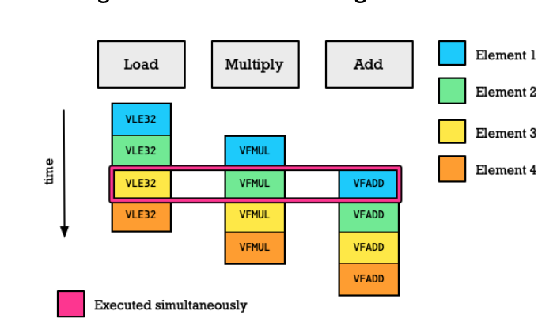

**向量版本的寄存器旁路：**由Cray-1引入

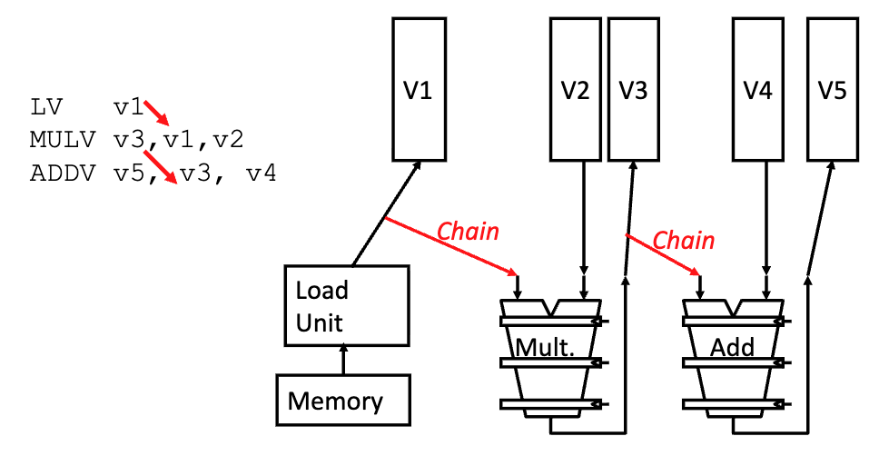

### 向量链接优势

**有链接时：** 可以在第一个结果出现时立即启动依赖指令


**无链接时：** 必须等待结果的最后一个元素被写入后才能启动依赖指令


### 示例

```assembly
vld v0, x5         # 加载向量X
vmul v1, v0, f0    # 向量-标量乘法
vld v2, x6         # 加载向量Y
vadd v3, v1, v2    # 向量-向量加法
vst v3, x6         # 存储和
```

**三个船队：**
1. vld vmul
2. vld vadd d
3. vst

## 向量长度寄存器

### 问题

在实际程序中，特定向量操作的长度通常在编译时未知，也可能是执行期间可能更改的参数

```c
for (i=0; i<n; i++)
    Y[i] = a*X[i] + Y[i];
```

### 解决方案

**添加向量长度寄存器（vl）：**
- vl控制任何向量操作的长度
- vl中的值不能大于最大向量长度（mvl）

### 条分带处理（Strip Mining）

**问题：** 如果n的值在编译时未知，因此可能大于mvl？

**解决方案：条分带处理**
- 生成代码，使得每个向量操作的大小 <= mvl
- 一个循环处理是mvl倍数的任何迭代次数
- 另一个循环处理任何剩余的迭代，且必须小于mvl

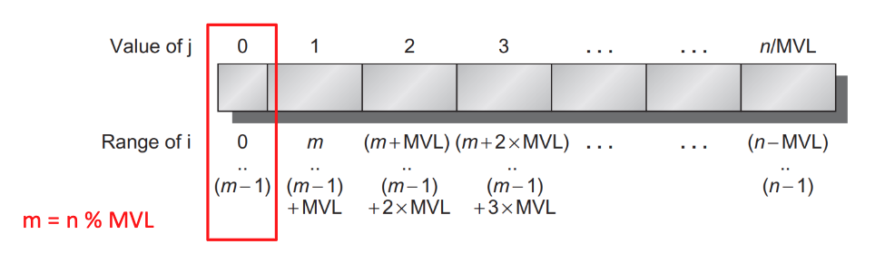

### RISC-V的更好解决方案

**setvl指令：** 将mvl和循环变量n中较小的值写入vl

- 如果n大于mvl，则循环最快可以一次计算mvl个值，因此setvl将vl设置为mvl
- 如果n小于mvl，则应仅在此循环的最后一次迭代中计算最后的n个元素，因此setvl将vl设置为n

```assembly
vsetdcfg 2 DP FP            # 启用 2 个 64 位浮点（DP FP）向量寄存器
fld       f0, a             # 加载标量 a 到浮点寄存器 f0
loop: setvl   t0, a0        # 设置向量长度寄存器 vl：vl = t0 = min(mvl, n)  
                            # （mvl 为最大向量长度，n 为剩余元素数；t0 保存实际向量长度）
      vld     v0, x5        # 加载向量 X（从地址 x5 开始，长度为 vl）
      slli    t1, t0, 3     # t1 = vl × 8（将元素个数转换为字节数，因每个双精度浮点占 8 字节）
      add     x5, x5, t1    # x5 += vl×8：X 的指针后移 vl 个元素
      vmul    v0, v0, f0    # 向量-标量乘法：v0 = v0 × a
      vld     v1, x6        # 加载向量 Y（从地址 x6 开始）
      vadd    v1, v0, v1    # 向量-向量加法：v1 = v0 + v1 → 即 a·X[i] + Y[i]
      sub     a0, a0, t0    # a0 -= vl：更新剩余未处理元素数 n
      vst     v1, x6        # 将结果向量 v1 存回 Y（地址 x6）
      add     x6, x6, t1    # x6 += vl×8：Y 的指针后移 vl 个元素
      bnez    a0, loop      # 若剩余元素数 a0 ≠ 0，则跳转继续循环
      vdisable              # 禁用向量寄存器（清理资源）
```

**解读**：该代码利用向量寄存器实现 `Y[i] = a * X[i] + Y[i]` 的循环计算，通过 `setvl` 动态设置每次迭代的向量长度 `vl`（以适配剩余元素数 `n`），避免越界；采用向量化加载、乘加与存储，显著提升数据级并行效率。

## 向量条件执行

### 问题

包含循环中IF语句的程序无法向量化
- IF语句在循环中引入控制依赖
- 如果可以为X[i]!=0的迭代运行内循环，则可以向量化减法

```c
for (i=0; i<n; i++)
    if (X[i] != 0)
        X[i] = X[i] - Y[i];
```

### 向量掩码控制

- **断言寄存器：** 保存掩码并本质上提供向量指令中每个元素操作的条件执行
- **这些寄存器使用布尔向量来控制向量指令的执行：**
  - 当断言寄存器p0被设置时，所有后续向量指令仅对断言寄存器中对应条目为1的向量元素进行操作

### 掩码向量指令

- **简单实现：**
  - 执行所有N个操作，根据掩码关闭结果写回
- **密度-时间实现：**
  - 扫描掩码向量，仅执行具有非零掩码的元素

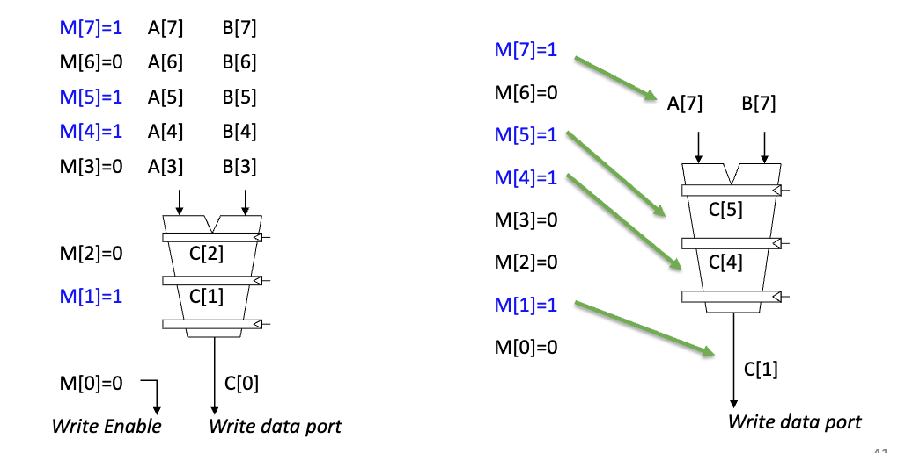

### 向量掩码寄存器示例

```assembly
vsetdcfg    2*FP64      # 启用2个64位浮点向量寄存器
vsetpcfgi   1           # 启用1个断言寄存器
vld         v0, x5      # 将向量X加载到v0
vld         v1, x6      # 将向量Y加载到v1
fmv.d.x     f0, x0      # 将(FP)零放入f0
vpne        p0, v0, f0  # 如果v0(i)!=f0，设置p0(i)为1
vsub        v0, v0, v1  # 在向量掩码下减法
vst         v0, x5      # 将结果存储在X中
vdisable                # 禁用向量寄存器
vpdisable               # 禁用断言寄存器
```

## 向量内存子系统

### 设计要求

- **内存系统必须设计为支持向量加载和存储的高带宽**
- **跨多个银行分布访问：**
  - 独立控制银行地址
  - 加载或存储非顺序字（需要独立的银行寻址）
  - 支持多个向量处理器共享同一内存

### Cray-1内存子系统

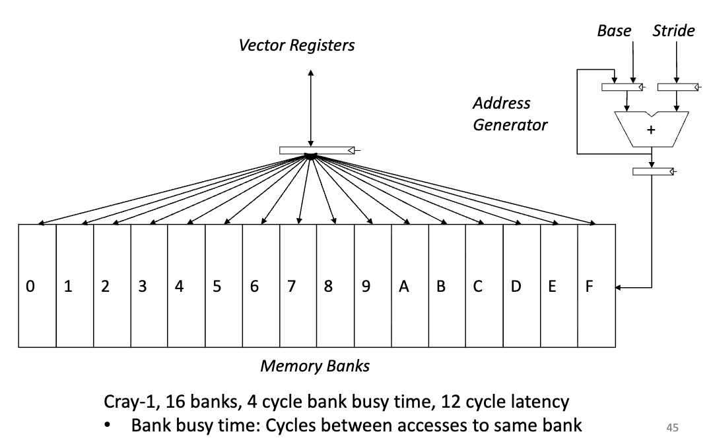

**银行忙时间：** 访问同一银行之间的周期数

### 内存银行数量计算示例

- 32个处理器，每个处理器每周期生成4次加载和2次存储
- 处理器周期时间为2.167纳秒，SRAM周期时间为15纳秒


- **问题：**需要多少内存银行？
- **解答：**32 × (4+2) × 15 / 2.167 = 1344个银行

## VMMA 向量内存-内存 vs. VRM 向量寄存器机器

### 向量内存-内存指令

**向量内存-内存指令将所有向量操作数保存在主内存中：**
- 第一个向量机器，CDC Star-100（'73）和TI ASC（'71），是内存-内存机器
- Cray-1（'76）是第一个向量寄存器机器

#### 示例源代码

```c
for(i=0; i<N; i++) {
    C[i] = A[i] + B[i];
    D[i] = A[i] - B[i];
}
```

#### 向量内存-内存代码

```assembly
ADDV C, A, B
SUBV D, A, B
```

#### 向量寄存器代码

```assembly
LV V1, A
LV V2, B
ADDV V3, V1, V2
SV V3, C
SUBV V4, V1, V2
SV V4, D
```

### 比较

- 向量内存-内存架构（VMMA）需要更大的主内存带宽，为什么？
  - 所有操作数都必须从内存中读入和读出
- VMMAs难以重叠多个向量操作的执行，为什么？
  - 必须检查内存地址上的依赖性
- VMMAs产生更大的启动延迟
- 自Cray-1以来的所有主要向量机器都具有向量寄存器架构

## 处理多维数组

- 向量中相邻元素在内存中的位置**未必是连续的**。  
- 我们可以将矩阵 **B 的每一行** 与矩阵 **D 的每一列** 的乘法进行向量化处理，  
  - 但必须考虑如何正确寻址矩阵 B 中的相邻元素以及矩阵 D 中的相邻元素。

```c
for (i = 0; i < 100; i = i + 1) {          // 遍历结果矩阵 A 的行索引 i
    for (j = 0; j < 100; j = j + 1) {      // 遍历结果矩阵 A 的列索引 j
        A[i][j] = 0.0;                     // 初始化 A[i][j]
        for (k = 0; k < 100; k = k + 1) {  // 累加求和：k 为内积维度索引
            A[i][j] = A[i][j] + B[i][k] * D[k][j];  // 关键计算：A = B × D 的标准三重循环实现
        }
    }
}
```

核心语句 `A[i][j] = A[i][j] + B[i][k] * D[k][j]` 表示矩阵乘法中单个元素的累加更新；向量化时需注意：  
- `B[i][k]`（固定 i，k 变化）在内存中通常是**连续存储**（按行主序），适合向量化加载；  
- `D[k][j]`（固定 j，k 变化）在内存中是**跨行非连续存储**（列方向），需通过向量 gather 或转置预处理才能高效向量化。

### 步幅（Stride）

**步幅：** 聚集到单个向量寄存器中的元素之间的距离

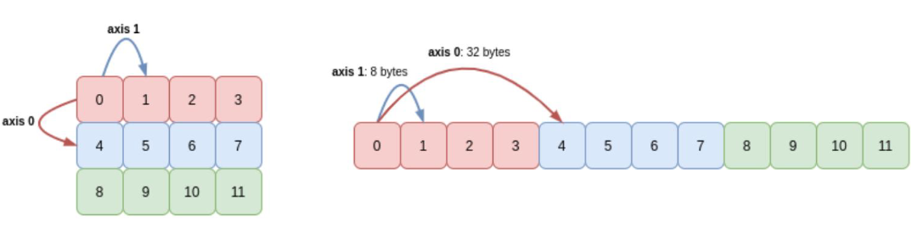

**矩阵D的步幅为100个双字（800字节）**
**矩阵B的步幅为1个双字（8字节）**

```c
for (i=0; i<100; i++) {
    for (j=0; j<100; j++) {
        A[i][j] = 0.0;
        for (k=0; k<100; k++) {
            A[i][j] += B[i][k] * D[k][j];
        }
    }
}
```

### 非单位步幅

**非单位步幅：** 大于1的步幅

- 一旦向量加载到向量寄存器中，它就像具有逻辑相邻元素一样
- 使用仅具有步幅能力的向量加载和向量存储操作处理非单位步幅
  - 访问非顺序内存位置的能力
  - 将它们重塑为密集结构
  - 这是向量体系结构的主要优势之一
- 内存银行冲突
  - 可能频繁请求来自同一银行的访问
  - 当多个访问争夺一个银行时，会发生内存银行冲突

## 处理稀疏矩阵

### 稀疏矩阵

- 稀疏矩阵很常见
- 在稀疏矩阵中，向量的元素通常以某种压缩形式存储，然后间接访问

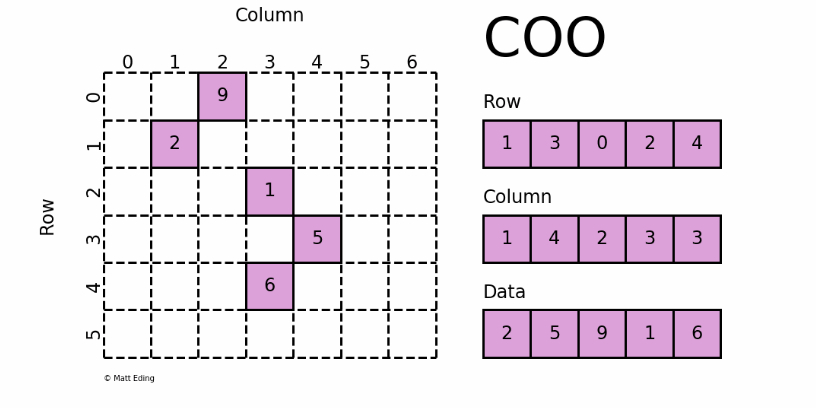

### 稀疏向量和示例

此代码使用索引向量K和M来指定A和C的非零元素，实现数组A和C的稀疏向量和。使用索引向量K和M来指定A和C的非零元素。

```c
for (i=0; i<n; i++) {
    C[M[i]] = A[K[i]] + C[M[i]];
}
```

### 聚集-分散（Gather-Scatter）

支持稀疏矩阵的主要机制是使用索引向量的聚集-分散操作：支持在稀疏矩阵的压缩表示（即不包括零）和正常表示（即包括零）之间移动

### 聚集操作

**聚集操作采用索引向量并获取向量：**
- 其元素位于通过将基址添加到索引向量中给出的偏移量而得到的地址处
- 结果是向量寄存器中的密集向量

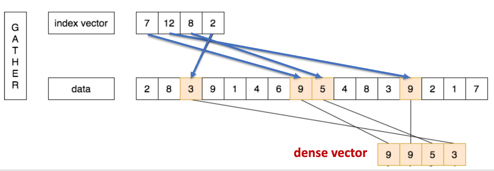

### 分散存储

稀疏向量可以通过使用相同索引向量的分散存储以扩展形式存储

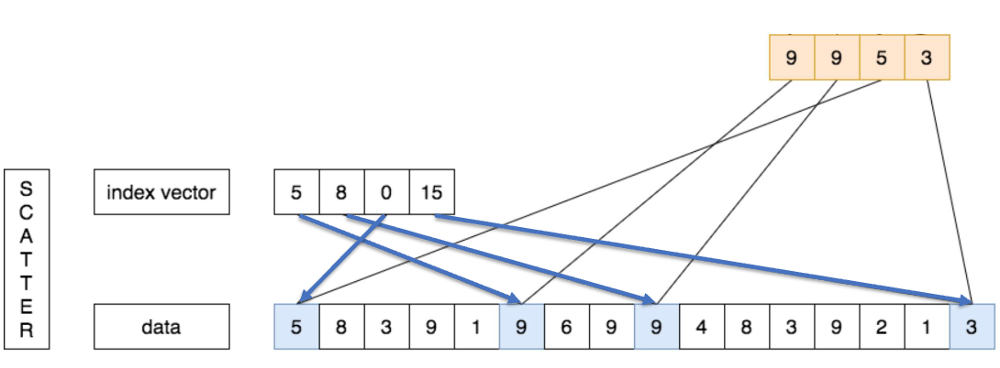

### 硬件支持

对此类操作的硬件支持称为聚集-分散

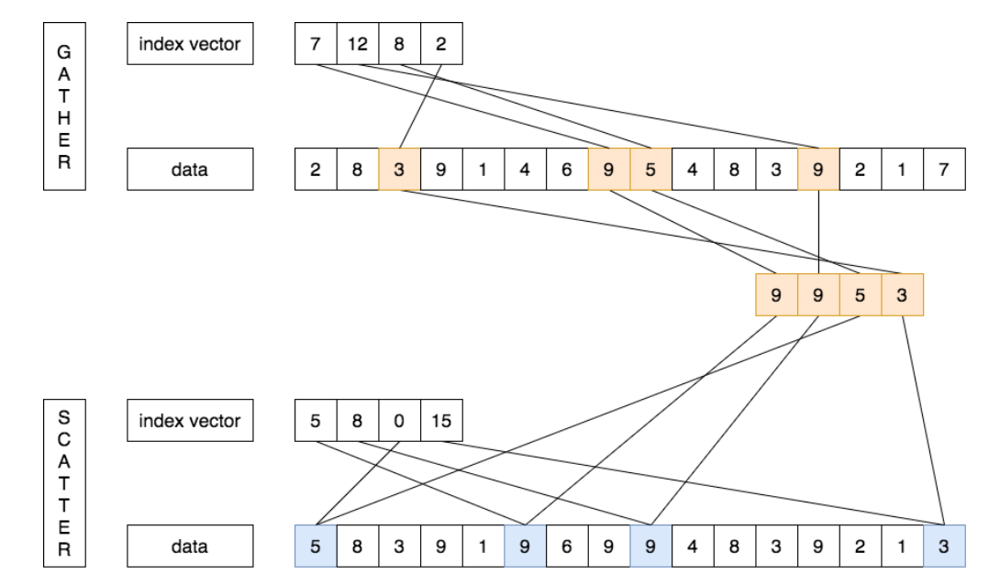

### 聚集-分散示例

- vldx（加载向量索引或聚集）
- vstx（存储向量索引或分散）

```assembly
vsetdcfg 4*FP64      # 启用4个64位浮点向量寄存器
vld      v0, x7      # 加载向量 K[]
vldx     v1, x5, v0  # 加载 A[K[]]
vld      v2, x28     # 加载向量 M[]
vldi     v3, x6, v2  # 加载 C[M[]]
vadd     v1, v1, v3  # 执行向量加法
vstx     v1, x5, v0  # 存储结果到 A[K[]]
vdisable             # 禁用向量寄存器
```

x5, x6, x7, 和 x28 包含向量的起始地址

## 总结

- **向量是利用ILP的替代模型**
- **如果代码可向量化，则比乱序机器更简单的硬件、更节能、更好的实时模型**
- **设计问题包括：**
  - 通道数量、功能单元数量、向量寄存器数量、向量寄存器长度、异常处理、条件操作
- **基本设计问题是内存带宽**

# 第07章 向量化编程(2/3)：多媒体SIMD指令集扩展

## SIMD 拓展

- 许多媒体应用操作的数据类型比32位字宽更窄：
  - 图形：8位颜色
  - 音频采样：8-16位
- 通过在256位加法器内划分进位链，处理器可以对短向量执行同时操作：
  - 32个8位操作数
  - 16个16位操作数
  - 8个32位操作数

## 128-bit 加法器

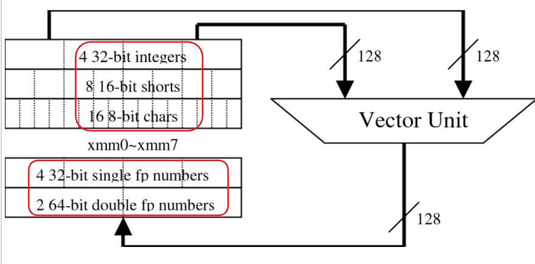

## SIMD扩展与向量架构的对比

### 局限性（与向量指令相比）：
- **操作数数量固定**编码在操作码中：导致需要添加数百条指令
- **寻址模式简单**：不支持跨步、散射-聚集（scatter-gather）寻址
- **无掩码寄存器**：不支持条件分支

## 典型的SIMD多媒体支持（256位宽操作）

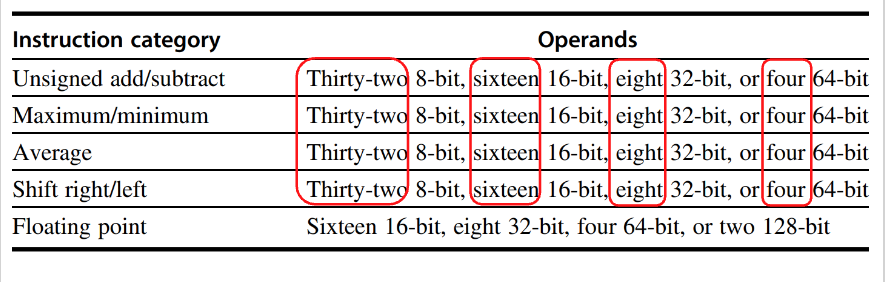

## SIMD实现演进

- **Intel MMX**(1996) 
  - 8个8位整数操作 或 4个16位整数操作 
- **SSE（流式SIMD扩展）**(1999)
  - 8个16位整数操作 或 4个32位整数/浮点操作 或 2个64位整数/浮点操作
- **AVX（高级向量扩展）**(2010)
  - 4个64位整数/浮点操作
- **AVX-512**(2017)
  - 8个64位整数/浮点操作

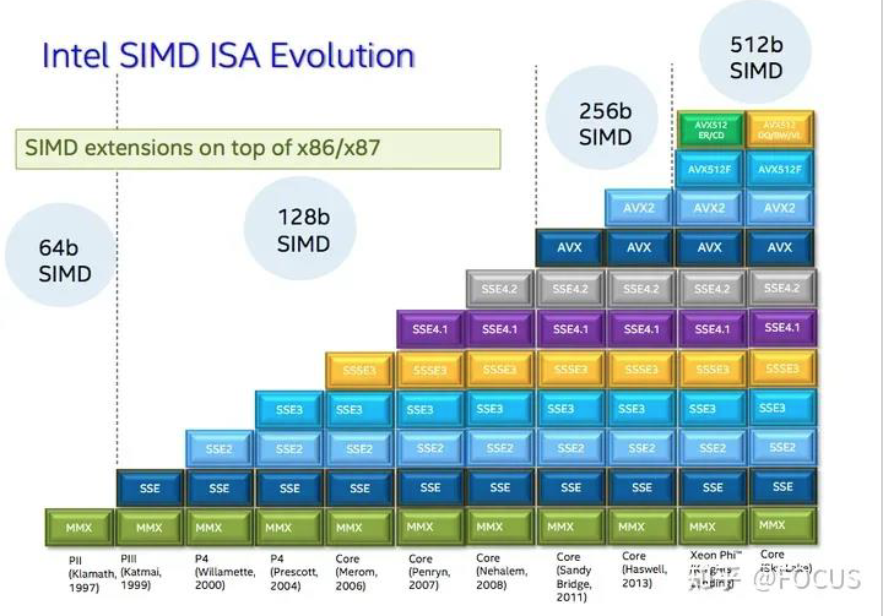

## RISC-V SIMD代码示例（DAXPY）

```asm
fld      f0, a                  # 加载标量 a 到浮点寄存器 f0
splat.4D f0, f0                 # 将标量 a 复制为 4 个副本，形成长度为4的向量（f0 = [a, a, a, a]）
addi     x28, x5, # 256         # 计算 X 数组末尾地址（假设数组共256个双精度元素，x5 为起始地址）

Loop: fld.4D   f1, 0(x5)        # 向量加载：从地址 x5 开始，一次加载 4 个双精度元素 X[i] … X[i+3]
      fmul.4D  f1, f1, f0       # 向量-标量乘法：f1 = [a×X[i], a×X[i+1], a×X[i+2], a×X[i+3]]
      fld.4D   f2, 0(x6)        # 向量加载：从地址 x6 开始，加载 4 个双精度元素 Y[i] … Y[i+3]
      fadd.4D  f2, f2, f1       # 向量加法：f2 = [a×X[i]+Y[i], ..., a×X[i+3]+Y[i+3]]
      fsd.4D   f2, 0(x6)        # 向量存储：将结果写回 Y[i] … Y[i+3]
      addi     x5, x5, #32      # X 地址增加 32 字节（4 × 8 字节），指向下一组 4 个元素
      addi     x6, x6, #32      # Y 地址增加 32 字节，指向下一组 4 个元素
      bne      x28, x5, Loop    # 若未达末尾地址，跳转继续循环
```

**注**：指令后缀 `.4D` 表示该指令一次操作 **4 个双精度（64位）浮点数**，即向量宽度为 256 位（4 × 64）。

# 第07章 向量化编程(3/3)：GPU 编程

## 图形处理单元(GPU)

**基本思想**：
- **异构执行模型**
  - CPU作为主机（host），GPU作为设备（device）
- 为GPU开发类似C的编程语言，即CUDA
- 将所有形式的GPU并行性统一为CUDA线程
- 编程模型为"**单指令多线程（SIMT）**"

### NVIDIA GPU架构

- 与向量机的**相似之处**
  - 适用于数据级并行问题
  - 支持散射-聚集（scatter-gather）传输
  - 支持掩码寄存器
  - 大型寄存器文件
- **不同之处**
  - 使用多线程来隐藏内存延迟
  - 拥有众多功能单元，而非像向量处理器那样只有少数深度流水线单元

## 异构计算

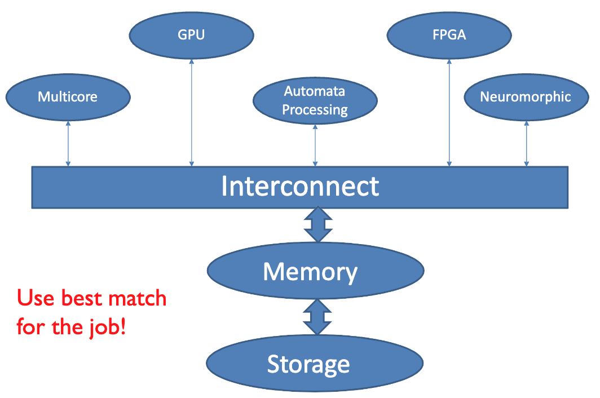

### 同构与异构计算

- **同构计算**
  - 使用一个或多个相同架构的处理器来执行应用程序
- **异构计算**
  - 使用多种处理器架构套件来执行应用程序
  - 将任务分配给最适合的架构
  - 从而获得性能提升

### 异构架构

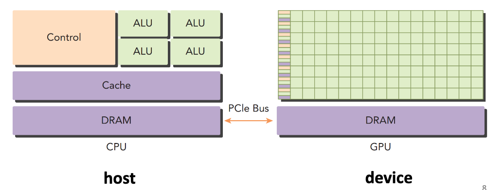

- **典型的异构计算节点**
  - 由两个多核CPU插槽和两个或更多众核GPU组成
- **异构应用程序组成**
  - **主机代码**：在CPU上运行
  - **设备代码**：在GPU上运行
  - GPU用于加速数据并行部分的执行, 被称为**硬件加速器**

## NVIDIA的GPU计算平台

### 产品线

- **Tegra**
  - 用于移动和嵌入式设备
- **GeForce**
  - 用于消费级图形
- **Quadro**
  - 用于专业可视化
- **Tesla**
  - 用于数据中心并行计算
  - 演进路线：Tesla(2006) → Fermi(2010) → Kepler(2012) → Maxwell(2014) → Pascal(2016) → Volta(2017) → Turing(2018) → Ampere(2020) → Hopper(2022) → Ada Lovelace(2023) → Blackwell(2024) → **Rubin(2026)&Feynman(2028)**

### GPU能力指标

- CUDA 核心数
- 内存大小
- 计算能力峰值
- 计算带宽

| 指标       | Kepler K20 | Kepler K40  | Maxwell M40 | Pascal P100 | Volta V100 |
|-----------|------------|-------------|-------------|-------------|------------|
| CUDA核心数 | 2496       | 2880        | 3072        | 3584        | 5120       |
| 每SM核心数 | 192        | 192         | 128         | 64          | 64          |
| 单精度性能 | 3.52 Tflops | 4.29 Tflops | 7.0 Tflops | 9.5 Tflops  | 15 Tflops   |
| 双精度性能 | 1.17 Tflops | 1.43 Tflops | 0.21 Tflops | 4.7 Tflops | 7.5 Tflops  |
| 内存带宽   | 208 GB/s   | 288 GB/s    | 288 GB/s    | 720 GB/s    | 900 GB/s    |
| 内存大小   | 5 GB       | 12 GB       | 12 GB       | 12/16 GB    | 16 GB       |

### 计算能力

- NVIDIA使用特殊术语"**计算能力**"来描述GPU加速器的硬件版本
  - 表示为X.Y格式
  - 具有相同主修订号的设备属于相同的核心架构
- 演进：Tesla: 1 → Fermi: 2 → Kepler: 3 → Maxwell: 5 → Pascal: 6 → Volta/Turing: 7 → Ampere: 8 → Hopper: 9 → Blackwell: 12...

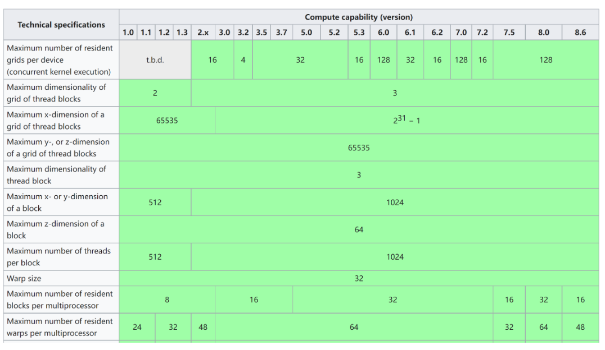

## 异构计算范式

### 核心理念

- GPU计算**不是**要取代CPU计算
  - CPU计算擅长控制密集型任务
  - GPU计算擅长数据并行计算密集型任务
- 需要同时使用CPU和GPU
  - 在CPU上执行顺序部分或任务并行部分
  - 在GPU上执行密集的数据并行部分

### CPU线程 vs GPU线程

- CPU线程
  - CPU上的线程通常是重量级实体
  - 操作系统必须在线程之间切换以提供多线程能力
  - 4个四核处理器的CPU最多只能同时运行16个线程（如果支持超线程则为32个）
- GPU线程
  - GPU上的线程极其轻量级
  - 在典型系统中，有数千个线程排队等待工作
  - 现代NVIDIA GPU每个流式多处理器可同时支持多达1,536个活跃线程

## GPU历史演进

### 为什么要关注GPU历史？

- 了解事物如何演进可以突出未来方向
- 没有历史视角，某些当前的架构决策将无法理解

### 图形元素

- **顶点（Vertex）**：具有3D坐标和颜色的点
- **多边形（Polygons）**：由顶点和边组成
- **网格（Mesh）**：多边形网格表示对象
- **对象（Objects）**：任何2D或3D实体，其形状可由任意多边形网格表示
- **图元（Primitive）**：经典几何形状可直接用作图元（如点、线、立方体、圆柱体、球体等）
- **纹理（Texture）**：映射到对象多边形表面的图像，提供特定材质概念
- **颜色（Color）**：每个像素的颜色由三个主颜色强度数字描述：红、绿、蓝，例如(255, 0, 255)
- **像素（Pixel）**：计算机图像由称为像素的点阵列表示，每个像素有自己的颜色和坐标（地址）
- **分辨率（Resolution）**：图像中像素的数量决定图像分辨率，例如320x200, 2560x2048
- **片段（Fragment）**：生成输出内存中单个像素所需的所有必要数据，例如坐标、颜色、深度等

### 图形管线

几种数学的计算阶段将 3D 视觉场景转换为 2D 图像

- 几何阶段：
  - 多个数学计算阶段将3D虚拟场景转换为2D图像
- 光栅化阶段：
  - 绘制被图元（线或三角形）覆盖的像素称为光栅化
  - 需要考虑光源和观察者在所需位置及其角度，找到所有顶点的光照属性
- 着色阶段：
  - 对象应根据其与光源的相互作用进行着色

### 从数字到屏幕

- 渲染三角形
- NVIDIA GTX480每秒可渲染16亿个三角形！

### GPU出现之前

- **顶点到像素**
  - 变换在CPU上完成
  - 逐个"手工"计算每个像素，串行处理...速度慢！
- 示例：100万个三角形 × 每个三角形100个像素 × 10个光源 × 每个光源计算4个周期 = 40亿个周期

### 早期GPU：80年代初至90年代末

#### 彩色图形适配器(CGA 1981)

- 4位RGBI
- 40 x 25字符
- 320 x 200像素，16色
- 最大640 x 200像素
- 16千字节内存

#### 固定功能管线

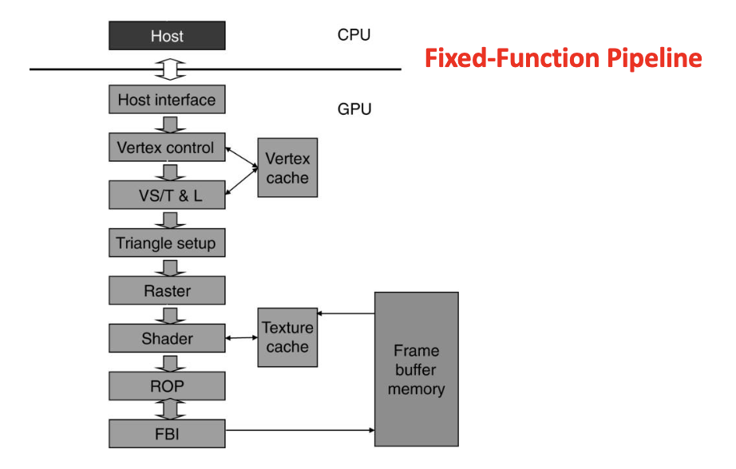

- **接收阶段**：从CPU接收图形命令和数据
- **准备阶段**：接收三角形数据，转换为硬件理解的形式，存储在顶点缓存中
- **顶点着色阶段**：变换和光照，为每个顶点分配值（颜色等）
- **边缘方程创建**：创建边缘方程以在三角形接触的像素之间插值颜色
- **光栅化阶段**：确定哪些像素落入哪个三角形，为每个像素从顶点插值每像素值
- **着色阶段**：确定每个像素的最终颜色
- **光栅操作**：执行颜色光栅操作，为透明度和抗锯齿混合重叠对象的颜色
- **帧缓冲区接口**：管理内存读写

### 后续发展

- **2001年**：NVIDIA向应用程序开发者暴露了VS/T&L阶段的指令集
- **后来**：通用可编程性扩展到着色器阶段
  - 趋势是统一不同阶段的功能（从应用程序程序员角度看）
  - 在图形管线中，某些阶段对完全独立的数据进行大量浮点运算
    - **数据独立性被利用** → GPU的关键假设
- 2006年：统一着色器架构
  - NVIDIA GeForce 8800将独立的图形阶段映射到统一的处理器阵列
    - 用于顶点着色、几何处理和像素处理
    - 允许动态分区

## 通用GPU (GPGPU)


- 探索 GPU 的使用来解决计算密集型问题
- GPGPU 出现，但是仍然有很多限制

### 早期GPGPU约束

- 处理图形API
  - 处理图形API的边界情况
- 寻址模式
  - 纹理大小/维度限制
- 着色器能力
  - 输出限制
- 指令集
  - 缺少整数和位操作
- 通信受限
- 无用户定义数据类型

### GPU计算的诞生

六个步骤
- 设计高效率的浮点和整数处理器
- 通过大量处理器利用数据并行性
- 着色器处理器完全可编程，具有大指令缓存、指令内存和指令控制逻辑
- 通过让多个着色器处理器共享缓存和控制逻辑来降低硬件成本
- 添加具有随机字节寻址能力的内存加载/存储指令
- 开发CUDA C/C++编译器、库和运行时软件模型

### GPU面临的问题

功耗问题
- 需要足够的并行性
- 利用率不足
- 与CPU的带宽

## 现代GPU硬件

### 特点

- GPU具有许多并行执行单元（通常称为核心，NVIDIA术语中称为SP或CUDA核心）和更高的晶体管数量
- GPU具有更深的流水线（数百个阶段，而CPU为10-20个）
- GPU具有显著更快、更先进的内存接口

### CPU与GPU的差距

在相同的芯片面积下，GPU可实现的性能是CPU的10倍。

### 处理器演进对比

- 单核CPU演进
  - 如果推断趋势，在几代之后，Pentium将看起来像GPU
- 多核CPU演进
  - **芯片面积分析**：不到10%的总面积用于真正的执行

### 内存层次结构

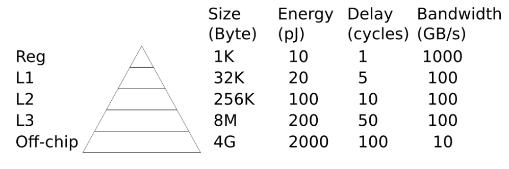

45nm工艺下的能耗数据
- 64位整数加法：约1 pJ
- 64位浮点乘加：约200 pJ
- 似乎无法进一步增加计算密度

## 砖墙 Brick Wall——加州大学伯克利分校的观点

- **功耗墙 + 内存墙 + ILP墙 = 砖墙**
- **功耗墙**：功耗昂贵，晶体管免费
  - 可以在芯片上放置更多晶体管，但无法全部开启
- **内存墙**：内存慢，乘法快
  - 访问DRAM内存需要200个时钟周期，乘法只需4个时钟周期
- **ILP墙**：更多ILP硬件的收益递减

## 如何突破砖墙？

如何利用应用程序内部的并行性？

### 步骤1：用吞吐量换取延迟

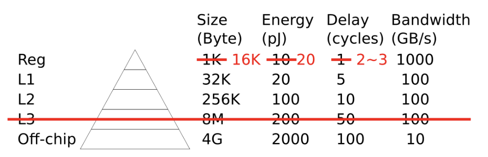

通过细粒度交叉多线程隐藏内存延迟

#### 交叉多线程

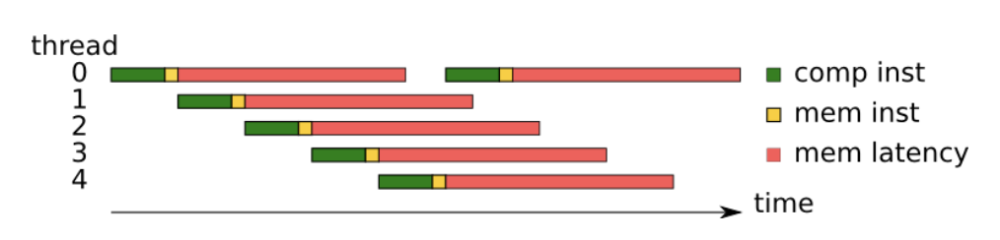

- 交叉多线程的粒度
  - **100个周期**：隐藏片外内存延迟
  - **10个周期**：+隐藏缓存延迟
  - **1个周期**：+隐藏分支延迟、指令依赖
- 细粒度交叉多线程
  - **优点**：减少缓存大小，无需分支预测器，无需乱序调度器  
  - **缺点**：寄存器压力，线程调度器，需要更大的并发

没有交叉细粒度 vs. 有交叉细粒度

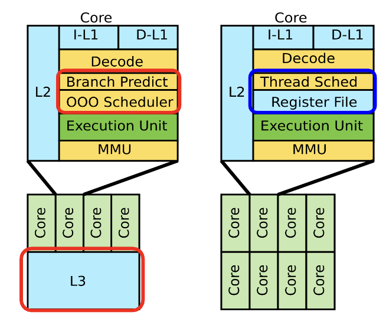

#### 硬件支持

寄存器文件支持交叉线程之间的零开销上下文切换

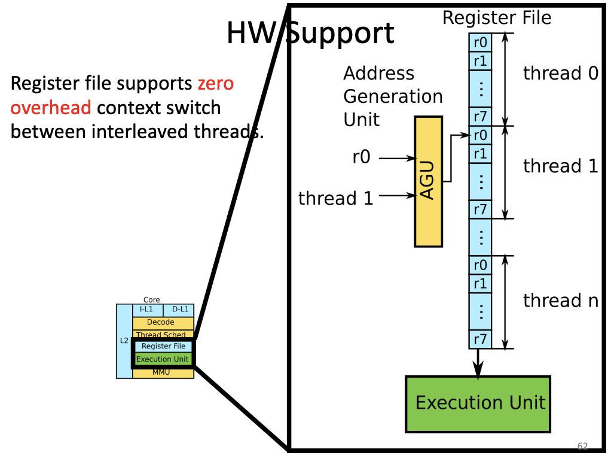

#### 能否进一步改进？
  
- 减少大缓存可获得2倍计算密度
- **问题**：我们能否进一步改进？
- **提示**：到目前为止，我们只利用了线程级并行性（TLP）

### 步骤2：单指令多数据（SIMD）

- **GPU使用宽SIMD**：8/16/24/...个处理单元（PE）
- **CPU使用短SIMD**：向量宽度通常为4

- **SSE**：4个数据通道
- **GPU**：8/16/24/...个数据通道

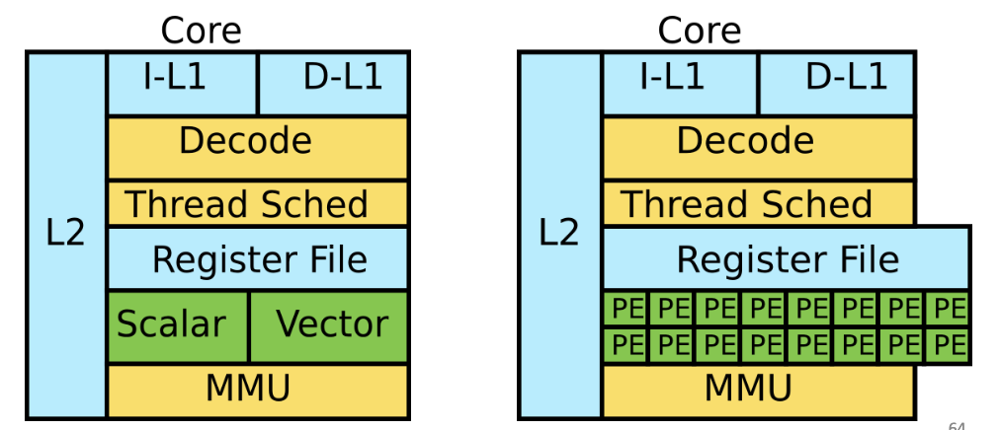

#### 硬件支持

支持交叉多线程 + SIMD 执行

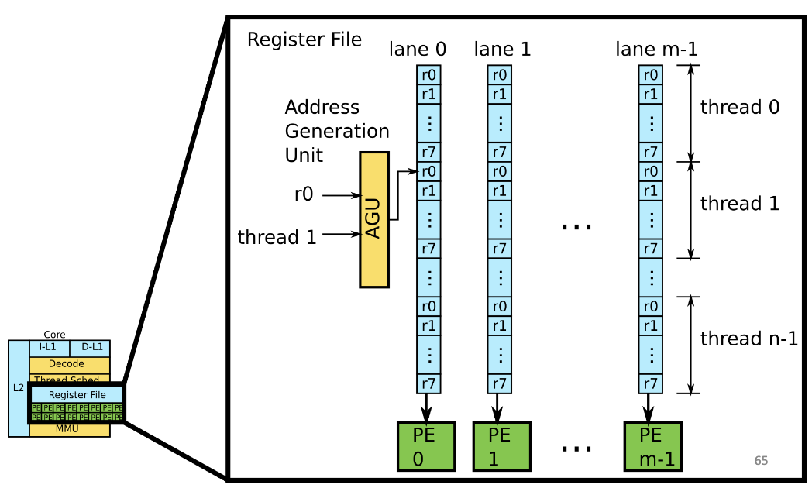

#### 单指令多线程（SIMT）

使用标量线程隐藏向量宽度

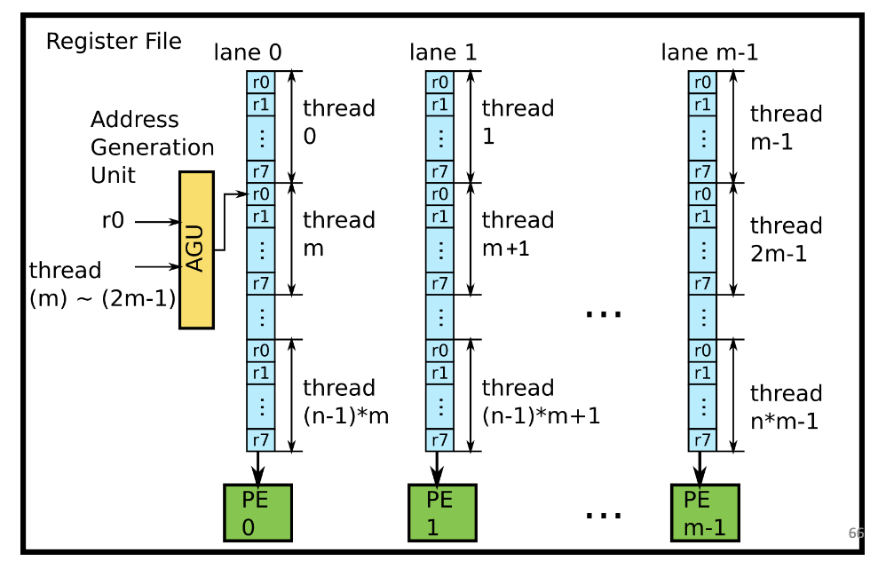

#### SIMT执行示例

假设32个线程被分组为一个 **warp**

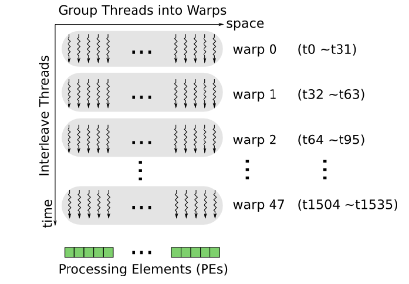

### 步骤3：简化核心

流式多处理器（SM）是比IA核心更轻量级的核心

- **轻量级PE**：融合乘加（FMA）
- **SFU**：特殊功能单元

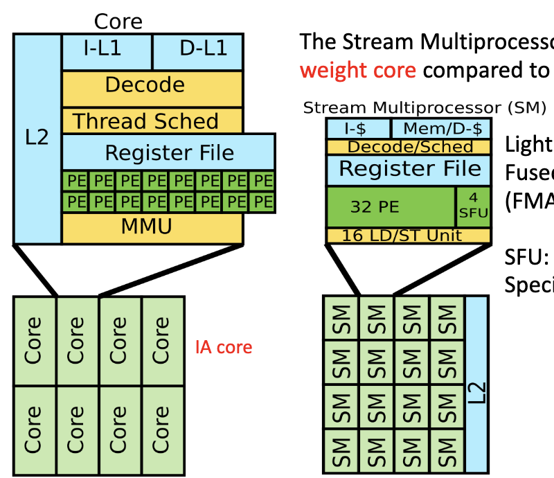

#### NVIDIA简化核心的动机

> "这种”多个IA核心“方法类似于试图通过给火车装上翅膀来建造飞机。"
> -- Bill Dally, NVIDIA

### 面向吞吐量的架构

关键架构特性
1. **细粒度交叉多线程**（~2倍计算密度）
2. **SIMD/SIMT**（>10倍计算密度）
3. **简化核心**（~2倍计算密度）

### SIMD架构与GPU对比

- GPU具有更多的SIMD通道
- GPU具有对更多线程的硬件支持
- 两者都具有双精度与单精度性能2:1的比例
- 两者都具有64位地址，但GPU内存较小