# ch08-1 CUDA简介

## 什么是CUDA？

- **CUDA** (Compute Unified Device Architecture)
- CUDA是一个通用并行计算平台和编程模型
- CUDA利用NVIDIA GPU中的并行计算引擎来解决许多复杂的计算问题
- 使用CUDA，您可以像在CPU上一样访问GPU进行计算

## CUDA平台

- CUDA平台可以通过以下方式访问：
  - CUDA加速库、编译器指令、API
  - 对编程语言的扩展，包括C、C++、Fortran和Python

## CUDA C

- CUDA C是标准ANSI C的扩展
  - 包含少量语言扩展，以支持异构编程
  - 提供简单的API来管理设备、内存和其他任务

## CUDA C API级别

CUDA提供了两个API级别来管理GPU设备和组织线程：

- **CUDA Driver API**：低级API，编程相对困难
  - 但提供了对GPU设备使用方式的更多控制
- **CUDA Runtime API**：高级API，基于驱动程序API之上
  - 运行时API的每个函数都被分解为更基本的操作，这些操作被发送到驱动程序API

## CUDA软件栈

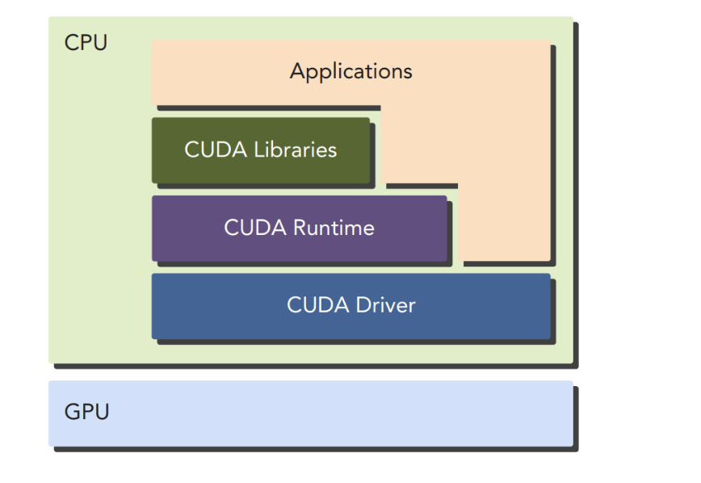

## CUDA主要组件

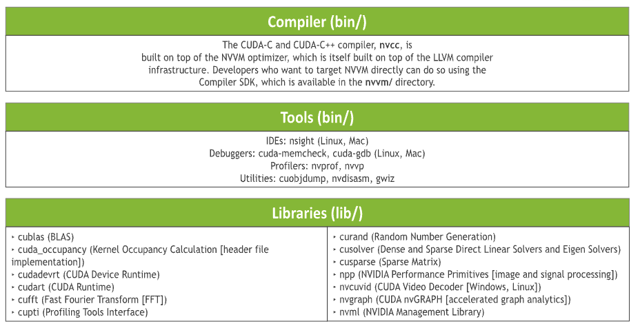

## CUDA库和工具


## CUDA安装

### 步骤1：支持CUDA的GPU

如果您的 GPU 是 NVIDIA 显卡，并且列在 CUDA 支持的 GPU 页面上，则您的 GPU 支持 CUDA

### 步骤2：选择平台

- 操作系统
  - Windows
  - Linux
  - Mac OSX
- 架构
  - x86_64
  - ppc64le
- 分布
  - Fedora
  - OpenSUSE
  - RHEL
  - CentOS
  - SLES
- 版本
  - 16.04
  - 14.04
- 安装类型
  - runfile(本地)
  - deb(本地)
  - deb(联网)
  - cluster(本地)

### 步骤3：安装CUDA

```
# 1. Install the repository meta-data, update the apt-get cache, and install CUDA:
$ sudo dpkg --install cuda-repo-‹distro›-‹version›.‹architecture>.deb
$ sudo apt-get update
$ sudo apt-get install cuda

# 2. Reboot the system to load the NVIDIA drivers.
# 3. Set up the development environment by modifying the PATH and LD_LIBRARY_PATH variables:
$ export PATH=/usr/local/cuda-8.0/bin${PATH:+:${PATH}} 
$ export LD_LIBRARY_PATH=/usr/local/cuda-8.0/1ib64{LD_LIBRARY_PATH:+:${LD_LIBRARY_PATH}}

# 4. Install a writable copy of the samples then build and run the nbody sample:
$ cuda-install-samples-8.0.sh ~
$ cd ~/NVIDIA_CUDA-8.0_Samples/5_Simulations/nbody
$ make
$ ./nbody
```

## GPU的Hello World

### 如何编写CUDA C程序？

1. 创建一个具有特殊文件扩展名`.cu`的源代码文件
2. 使用CUDA nvcc编译器编译程序
3. 从命令行运行可执行文件，该文件包含在GPU上可执行的内核代码

### CUDA编译器

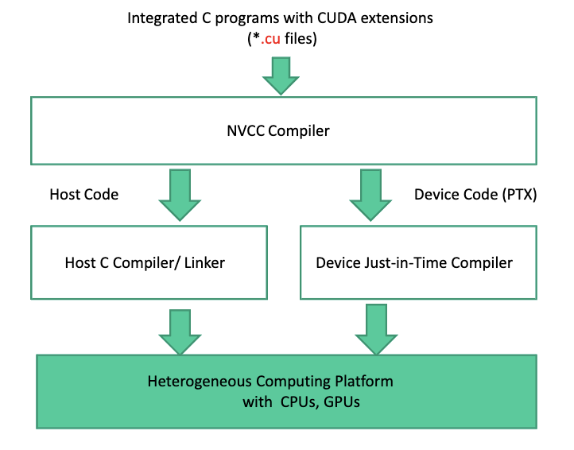

- 集成CUDA扩展的C程序 (*.cu文件)
- NVCC编译器
- 主机代码, 设备代码(PTX)
- 主机C编译器/链接器, 设备即时编译器
- 具有CPU、GPU的异构计算平台


### CPU的Hello World

```c
#include<stdio.h>

int main(void){
    printf("Hello World from CPU!\n");
    return 0;
}
```

标准C程序，在主机上运行
NVIDIA编译器(nvcc)可用于编译没有设备代码的程序

#### 输出结果

```bash
$ nvcc hello.cu -o hello
$ ./hello

Hello World from CPU!
```

### GPU的Hello World (hello.cu)

```c
#include<stdio.h>

__global__ void helloFromGPU(void) { // __global__ 告诉编译器该函数将从CPU调用并在GPU上执行
    printf("Hello World from GPU!\n");
}

int main(void) {
    // CPU输出
    printf("Hello World from CPU!\n");
    
    helloFromGPU<<<1, 10>>>(); //<<<1, 10>>> 启动内核函数并执行10个GPU线程
    
    cudaDeviceReset(); // cudaDeviceReset() 销毁并清理当前进程中与当前设备关联的所有资源
    return 0;
}
```

#### 运行结果

```bash
$ ./hello
Hello World from CPU!
Hello World from GPU!
Hello World from GPU!
Hello World from GPU!
Hello World from GPU!
Hello World from GPU!
Hello World from GPU!
Hello World from GPU!
Hello World from GPU!
Hello World from GPU!
Hello World from GPU!
```

（输出10次）

## CUDA C编程难吗？

- CPU编程和GPU编程之间的主要区别是程序员对GPU架构特性的暴露程度
- 需要并行思考，并对GPU架构有基本了解
- 作为并行程序员编写高效代码，需要对CPU架构有基本了解：
  - 时间局部性
  - 空间局部性
- **Pthreads/OpenMP**：
  - 需要显式组织您的线程
- **CUDA C**：
  - 只需编写一段串行代码，由单个线程调用
  - GPU将这个内核并行化，通过启动成千上万个线程，所有线程都执行相同的计算
  - CUDA抽象了硬件细节，不需要将应用程序映射到传统的图形API

## 结论

- CPU + GPU系统已成为高性能计算领域的主流
- 数据并行工作负载在GPU上执行，而串行和任务并行工作负载在CPU上执行

# ch08-2 CUDA编程模型

## 学习目标

- 了解CUDA编程模型的基本结构
- 掌握CUDA内存管理方法
- 学习如何组织并行线程
- 掌握CUDA内核的启动和编写
- 了解如何验证和调试CUDA内核
- 学习如何计时和优化CUDA程序
- 掌握设备管理的基本方法

## CUDA编程模型简介

### 编程模型

- 编程模型呈现了计算机体系结构的抽象
  - 充当应用程序与其在可用硬件上的实现之间的桥梁。

```
应用程序
编程模型
编译器/库	
    ➔ 通信抽象
操作系统	
    ➔ 用户/系统边界
体系结构	
    ➔ 硬件/软件边界
编程模型
```

- 程序是为编程模型编写的，它决定了程序的组件如何共享信息和协调它们的活动。
- 编程模型提供了特定计算架构的逻辑视图。
- 通常，它体现在编程语言或编程环境中。

### 并行层级计算的层级

- 从程序员的角度来看，你可以从不同的层次看待并行计算：
  - 域层次 (Domain level)：如何分解数据和函数以解决问题
  - 逻辑层次 (Logic level)：如何组织你的并发线程
  - 硬件层次 (Hardware level)：线程如何映射到核心可能有助于提高性能

### CUDA 编程模型

- CUDA 编程模型提供了：
  - 一种通过层次结构在 GPU 上组织线程的方法
  - 一种通过层次结构访问 GPU 上内存的方法
- CUDA 编程模型使你能够在异构计算系统上执行应用程序
  - 只需通过一组少量的 C 语言扩展对代码进行注释即可

### 术语定义

- **Host（主机）**：CPU及其内存（主机内存）
- **Device（设备）**：GPU及其内存（设备内存）

### CUDA 编程模型

- 在CUDA中，GPU被视为可以执行大量并发线程的计算设备
- GPU和主CPU一样为共同处理器
- 计算密集型应用从Host端(CPU)被转载到设备端(GPU)

典型的CUDA程序结构：

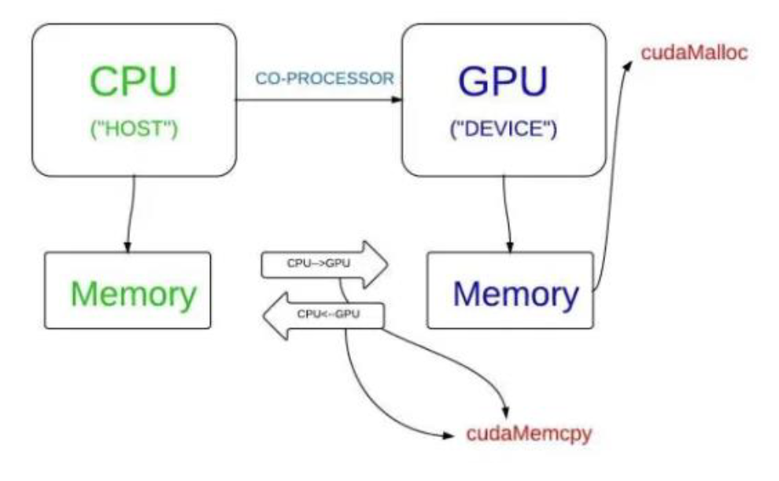

### CUDA 程序

CUDA 程序 = Host 代码 + Device 代码

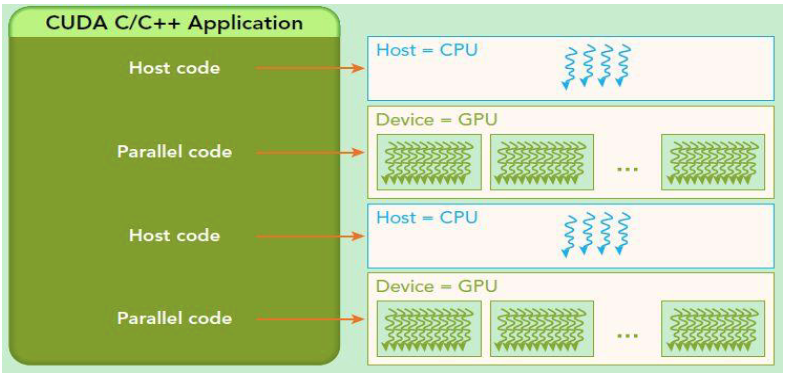

### CUDA内核

- **内核（Kernel）**：在GPU设备上运行的代码
  - 作为开发者，您可以将内核表达为顺序程序
- CUDA管理在GPU线程上调度程序员编写的内核
- 从主机端，您根据应用程序数据和GPU设备能力定义算法如何映射到设备
- 应用程序的并行部分可以被隔离到一个函数中，该函数在设备上作为许多不同的线程执行
- 这样的函数被编译为设备的指令集，生成的程序被称为内核（kernel）
- 执行内核的一批线程被组织成由线程块组成的网格（grid）

### 线程批处理

- 主机向设备发出一系列内核调用
- 每个内核作为线程批处理执行，组织为线程块的网格

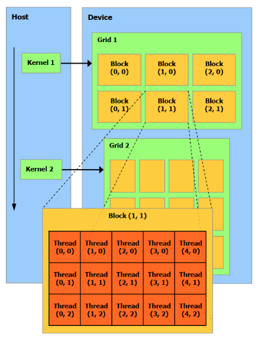

### CUDA程序结构

典型的CUDA程序结构包含5个步骤：
1. 分配GPU内存
2. 将数据从CPU内存复制到GPU内存
3. 调用CUDA内核执行特定计算
4. 将数据从GPU内存复制回CPU内存
5. 销毁GPU内存

## 1. 内存管理

### 1.1 内存管理

- CUDA编程模型预设一个系统包含一个主机端和蛇别端，每个部分都有自己的单独的内存
- CUDA执行时提供一系列管理内存的方法

| 标准 C 函数 | CUDA C 函数 |
|------------|------------|
| malloc     | cudaMalloc |
| memcppy    | cudaMemcpy |
| memset     | cudaMemset |
| free       | cudaFree   | 

### 1.2 GPU内存层次结构

- CUDA的一个显著特征是暴露的内存层次结构
- 每个GPU设备都有一组不同类型的内存，用于不同的目的

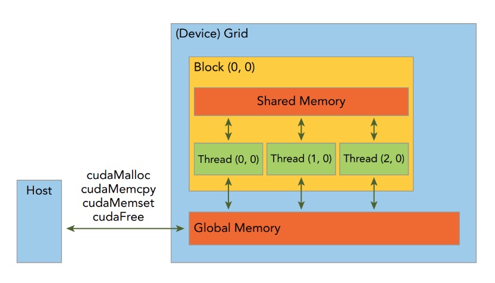

#### CUDA内存模型

- 全局内存
  - 主机和设备之间通信读写数据的主要方式
  - 内容对所有线程可见
  - 访问延迟较长
- 设备代码可以
  - 读写每个线程的寄存器
  - 读写每个网格的全局内存

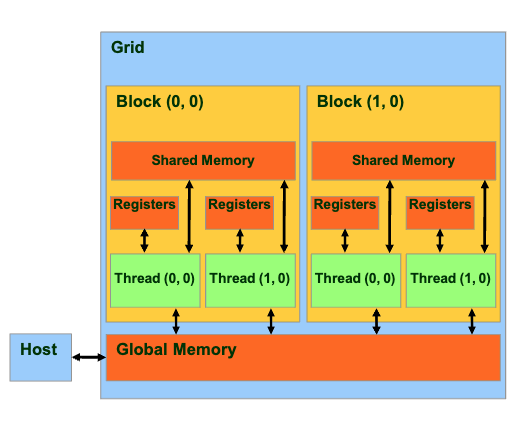

#### CUDA设备内存分配

- **cudaMalloc()**
  - 在设备全局内存中分配对象
  - 需要两个参数：
    - 指向已分配对象的指针地址
    - 已分配对象的大小
- **cudaFree()**
  - 从设备全局内存中释放对象
  - 指向要释放对象的指针

示例：
```c
WIDTH = 64;
float *Md;
int size = WIDTH * sizeof(float);
cudaMalloc((void**)&Md, size);
cudaFree(Md);
```

#### CUDA设备内存分配 - 数据传输

- **cudaMemcpy()**
  - 内存数据传输
  - 需要四个参数：
    - 目标指针
    - 源指针
    - 复制的字节数
    - 传输类型：
      - Host to Host
      - Host to Device
      - Device to Host
      - Device to Device
- 异步传输

示例：
```c
cudaMemcpy(Md, M, size, cudaMemcpyHostToDevice); 
// Md 目标指针, M 源指针, size 复制的字节数, cudaMemcpyHostToDevice 传输类型

cudaMemcpy(M, Md, size, cudaMemcpyDeviceToHost);
```

#### 示例：数组求和

- 通过一个简单的数组求和示例来介绍CUDA C编程

**基于主机的数组求和（sumArraysOnHost.c）**：
```c
void sumArraysOnHost(float *A, float *B, float *C, const int N) {
    for (int idx = 0; idx < N; idx++) {
        C[idx] = A[idx] + B[idx];
    }
}
```

**修改代码以在GPU上执行数组求和**：
```c
float *d_A, *d_B, *d_C;
// 使用 cudaMalloc 在 GPU 分配内存
cudaMalloc((float**)&d_A, nBytes);
cudaMalloc((float**)&d_B, nBytes);
cudaMalloc((float**)&d_C, nBytes);

// 从主机内存到GPU全局内存传输数据
cudaMemcpy(d_A, h_A, nBytes, cudaMemcpyHostToDevice);
cudaMemcpy(d_B, h_B, nBytes, cudaMemcpyHostToDevice);

// 从主机端调用内核函数，在 GPU 上执行数组求和
cudaMemcpy(gpuRef, d_C, nBytes, cudaMemcpyDeviceToHost);

// 使用 cudaFree 来释放 GPU 上的内存
cudaFree(d_A);
cudaFree(d_B);
cudaFree(d_C);
```

#### 不同内存空间

- CUDA C中最常见的错误之一是不正确地解引用不同的内存空间
- 对于在GPU上分配的内存，设备指针不能在主机代码中解引用

错误示例：
```c
gpuRef = d_C  // 应用程序将在运行时崩溃
```

正确示例：
```c
cudaMemcpy(gpuRef, d_C, nBytes, cudaMemcpyDeviceToHost)
```
- gpuRef: 指向主机代码的指针
- d_C: 设备指针
- 解引用（Dereferencing）: 一种用于操作或访问指针所指向的内存位置中包含的数据的方法。

### 1.3 组织线程

#### 组织线程

- CUDA通过线程层次结构抽象来组织线程
- 这是一个两级线程层次结构，分解为线程块和块网格

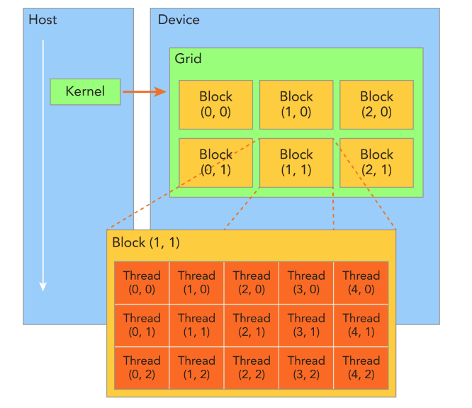

#### 网格和块

- **网格（Grid）**：
  - 由单个内核启动产生的所有线程统称为网格
  - 网格中的所有线程共享相同的全局内存空间
  - 网格由许多线程块组成
- **线程块（Thread Block）**：
  - 线程块是一组可以相互协作的线程
  - 不同块中的线程不能协作
  - 线程依靠 blockIdx 和 threadIdx 来区分彼此：
    - blockIdx（网格内的块索引）
    - threadIdx（块内的线程索引）

#### 网格

- 网格：执行相同内核的具有相同维度和大小的块集合可以批量组织成网格

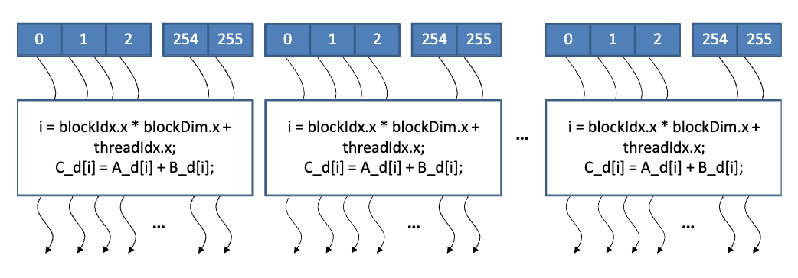

#### 块

- 块：可以一起协作的线程批处理，通过共享数据和同步执行
  - 所有线程运行相同的代码（SPMD中的SP）
  - 每个线程都有一个ID，用于计算内存地址和做出控制决策

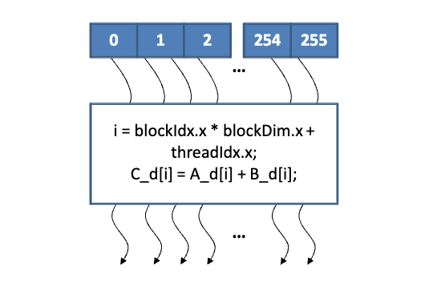

#### blockIdx 和 threadIdx

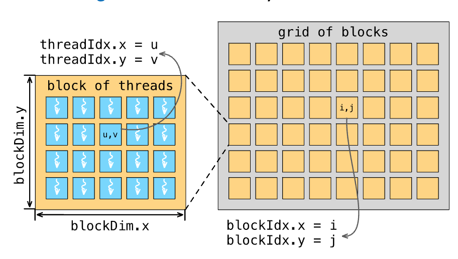

- 内置的、预初始化的变量，可以在内核函数中访问
  - 当执行内核函数时，CUDA运行时为每个线程分配 blockIdx 和 threadIdx
- 坐标变量的类型为uint3，一种CUDA内置的向量类型
  - 包含三个无符号整数的结构
  - 可以通过其x、y和z字段访问

```
blockIdx.x 
blockIdx.y 
blockIdx.z
```

```
threadIdx.x 
threadIdx.y 
threadIdx.z
```

#### gridDim 和 blockDim

```c
kernel_routine<<<gridDim, blockDim>>>(args);
```

- 块的集合形成网格（1D、2D或3D）
  - 内置变量gridDim指定网格的大小（或维度）
  - 每个内核副本都可以使用内置变量blockIdx确定它正在执行哪个块
- 块中的线程排列成1D、2D或3D数组
  - 内置变量blockDim指定块的大小（或维度）
  - threadIdx索引（或2D/3D索引）块内的线程
- 网格和块的维度由以下指定：
  - blockDim（块维度，以线程为单位测量）
  - gridDim（网格维度，以块为单位测量）
- 这些变量的类型为dim3，一种基于uint3的整数向量类型
  - 网格和块都使用具有三个无符号整数字段的dim3类型
  - 未使用的字段将初始化为1并被忽略

```
blockDim.x 
blockDim.y 
blockDim.z
```

```
gridDim.x 
gridDim.y 
gridDim.z
```

通常，网格被组织为块的2D数组，块被组织为线程的3D数组

#### 内核 -> 网格 -> 块 -> 线程

- **内核**：
  - 由主机启动
  - 非常类似于C函数
  - 在设备上执行
  - 所有线程将执行内核中的相同代码
- **网格**：
  - 块的1D或2D（或3D）组织
  - blockDim.x和blockDim.y
  - gridDim.x和gridDim.y
- **块**：
  - 线程的1D、2D或3D组织
  - 块被分配给SM
  - blockIdx.x、blockIdx.y和blockIdx.z
- **线程**
  - blockIdx.x、blockIdx.y和blockIdx.z

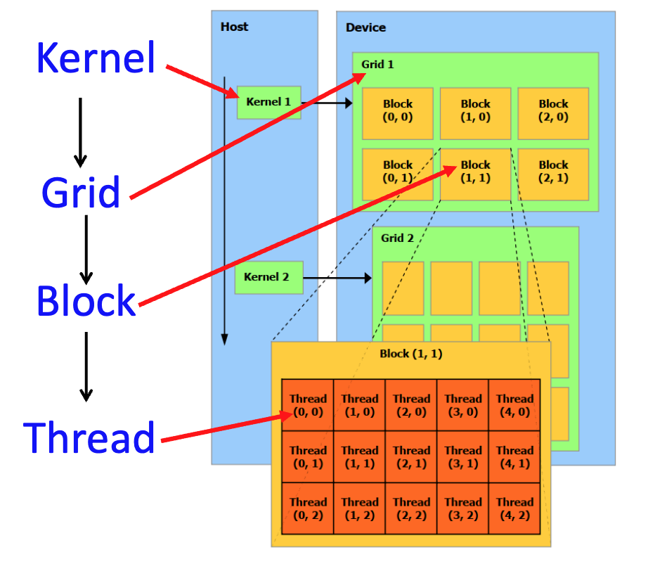

#### 检查网格和块索引

**检查网格和块索引（checkDimension.cu）**：

```c
int nElem = 6;
dim3 block(3);
dim3 grid((nElem + block.x - 1) / block.x);
// 定义块大小并根据块和数据大小计算网格大小
// 网格大小向上取整为块大小的倍数

printf("grid.x %d grid.y %d grid.z %d\n", grid.x, grid.y, grid.z);
printf("block.x %d block.y %d block.z %d\n", block.x, block.y, block.z);

// 从设备端检查网格和块维度
checkIndex<<<grid, block>>>();
```

**在内核函数中**，每个线程打印出自己的线程索引、块索引、块维度和网格维度：
```c
__global__ void checkIndex(void) {
    printf("threadIdx:(%d,%d,%d) blockIdx:(%d,%d,%d) blockDim:(%d,%d,%d) gridDim:(%d,%d,%d)\n",
           threadIdx.x, threadIdx.y, threadIdx.z,
           blockIdx.x, blockIdx.y, blockIdx.z,
           blockDim.x, blockDim.y, blockDim.z,
           gridDim.x, gridDim.y, gridDim.z);
}
```

#### 从主机和设备端访问网格/块变量

- 区分网格和块变量的主机和设备访问非常重要
- 在主机端，使用声明为block的变量：block.x、block.y和block.z
- 在设备端，使用预初始化的内置块大小变量：blockDim.x、blockDim.y和blockDim.z

### 1.4 启动CUDA内核

#### 启动CUDA内核

- CUDA内核调用是C函数语法的直接扩展，添加了内核的执行配置：
  - 网格维度 grid: 启动的块数量
  - 块维度 block: 每个块中启动的线程数量

```c
kernel_name<<<grid, block>>>(argument list);
```

- 通过指定网格和块维度，您可以配置：
  - 内核的总线程数
  - 您想要为内核使用的线程布局

#### 示例

- 假设您有32个数据元素用于计算
- 您可以将8个元素分组到每个块中，并启动四个块，如下所示：
```c
kernel_name<<<4, 8>>>(argument list);
```

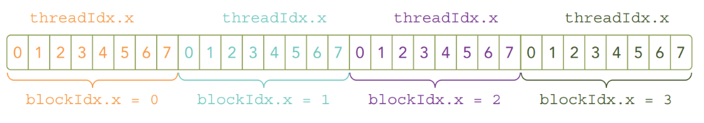

- 使用内置变量blockIdx.x和threadIdx.x来：
  - 识别网格中的唯一线程
  - 建立线程和数据元素之间的映射

#### 异步行为

- 与C函数调用不同，所有CUDA内核启动都是异步的
  - 在调用CUDA内核后，控制立即返回到CPU
- 您可以调用以下函数强制主机应用程序等待所有内核完成：
    ```c
    cudaDeviceSynchronize(void);
    ```

### 1.5 编写内核

#### 编写内核

- 内核函数是在设备端执行的代码
  - 在内核函数中，您定义单个线程的计算和该线程的数据访问
  - 当调用内核时，许多不同的CUDA线程并行执行相同的计算
- 内核使用__global__声明规范定义，如下所示：
    ```c
    __global__ void kernel_name(argument list);
    ```

#### 函数类型限定符

函数类型限定符指定：
1. 函数是在主机上执行还是在设备上执行
2. 它是否可以从主机或设备调用

| QUALIFIERS | EXECUTION                 | CALLABLE | NOTES |
|------------|---------------------------|----------|-------|
| __global__ | Executed on the device    |Callable from the host; Callable from the device for devices of compute capability 3 | Must have a void return type|
| __device__ | Executed on the device    |Callable from the device only
| __host__ | Executed on the host       | Callable from the host only | Can be omitted |

#### CUDA内核是有限制的函数

以下限制适用于所有内核：
- 仅访问设备内存
- 必须具有void返回类型
- 不支持可变数量的参数
- 不支持静态变量
- 不支持函数指针
- 表现出异步行为

#### 简单示例：sumArray

```c
void sumArraysOnHost(float *A, float *B, float *C, const int N) {
    for (int i = 0; i < N; i++)
        C[i] = A[i] + B[i];
}
```

```c
__global__ void sumArraysOnGPU(float *A, float *B, float *C) {
    int i = threadIdx.x;
    C[i] = A[i] + B[i];
}
```

**区别：循环不见了！**

- 假设一个长度为32个元素的向量，您可以使用32个线程调用内核，如下所示：
    ```c
    sumArraysOnGPU<<<1, 32>>>(float *A, float *B, float *C);
    ```

### 1.6 验证内核

#### 验证内核

- 有两种非常基本的方法来验证内核代码：
  1. 在内核中使用printf（适用于Fermi及以后的设备）
  2. 将执行配置设置为<<<1,1>>>，强制内核仅使用一个块和一个线程运行

```c
void checkResult(float *hostRef, float *gpuRef, const int N) {
    double epsilon = 1.0E-8;
    int match = 1;
    
    for (int i = 0; i < N; i++) {
        if (abs(hostRef[i] - gpuRef[i]) > epsilon) {
            match = 0;
            printf("Arrays do not match!\n");
            printf("host %5.2f gpu %5.2f at current %d\n",
                   hostRef[i], gpuRef[i], i);
            break;
        }
    }
}
```

### 1.7 处理错误

#### 处理错误

- 定义一个错误处理宏来包装所有CUDA API调用，简化错误检查过程：
- 示例：CHECK(cudaMemcpy(d_C, gpuRef, nBytes, cudaMemcpyHostToDevice));

```c
#define CHECK(call)                                         \
{                                                           \
    const cudaError_t error = call;                         \
    if (error != cudaSuccess)                               \
    {                                                       \
        printf("Error: %s:%d,", __FILE__, __LINE__);        \
        printf("code: %d, reason: %s\n", error, cudaGetErrorString(error)); \
        exit(1);                                            \
    }                                                       \
}
```

### 1.8 编译和执行

#### 编译和执行

- 基于GPU的向量求和（sumArraysOnGPU-small-case.cu）

```c
// 分配设备全局内存
float *d_A, *d_B, *d_C;
cudaMalloc((float**)&d_A, nBytes);
cudaMalloc((float**)&d_B, nBytes);
cudaMalloc((float**)&d_C, nBytes);

// 将数据从主机传输到设备
cudaMemcpy(d_A, h_A, nBytes, cudaMemcpyHostToDevice);
cudaMemcpy(d_B, h_B, nBytes, cudaMemcpyHostToDevice);

// 在主机端调用内核
dim3 block(nElem);
dim3 grid(nElem / block.x);
sumArraysOnGPU<<<grid, block>>>(d_A, d_B, d_C);
printf("Execution configuration <<<%d,%d>>>\n", grid.x, block.x);

// 将内核结果复制回主机端
cudaMemcpy(gpuRef, d_C, nBytes, cudaMemcpyDeviceToHost);

// 在主机端添加向量以进行结果检查
sumArraysOnHost(h_A, h_B, hostRef, nElem);

// 检查设备结果
checkResult(hostRef, gpuRef, nElem);
```

#### 编译和执行

- 对于一般情况，您可以根据1D网格和块信息计算给定线程的全局数据访问的唯一索引，如下所示：

```c
__global__ void sumArraysOnGPU(float *A, float *B, float *C) {
    int i = blockIdx.x * blockDim.x + threadIdx.x;
    C[i] = A[i] + B[i];
}
```

## 2. 计时内核

### 2.1 使用CPU计时器

#### 使用CPU计时器

- 可以通过使用gettimeofday系统调用来创建CPU计时器，以获取系统的墙上时钟时间

```c
double cpuSecond() {
    struct timeval tp;
    gettimeofday(&tp, NULL);
    return ((double)tp.tv_sec + (double)tp.tv_usec * 1.e-6);
}
```

- 您可以使用cpuSecond测量内核：
```c
double iStart = cpuSecond();
kernel_name<<<grid, block>>>(argument list);
cudaDeviceSynchronize(); // 等待所有GPU线程完成
double iElaps = cpuSecond() - iStart;
```

#### 测量向量求和内核

- 测量向量求和内核（sumArraysOnGPU-timer.cu）

```bash
$ nvcc sumArraysOnGPU-timer.cu -o sumArraysOnGPU-timer
$ ./sumArraysOnGPU-timer
./sumArraysOnGPU-timer Starting...
Using Device 0: Tesla M2070
Vector size 16777216
sumArraysOnGPU<<<16384, 1024>>> Time elapsed 0.002456 sec
Arrays match.
```

#### 了解限制

- 在调整执行配置时要理解的一个关键概念是线程层次结构每个级别的限制
- 线程层次结构每个级别的最大大小取决于设备
- 对于Fermi设备，每个块的最大线程数为1,024
- 每个x、y和z维度的最大网格维度为65,535

```bash
sumArraysOnGPU<<<65536, 256>>>
Time elapsed 0.000183 sec
Error: sumArraysOnGPU-timer.cu:153, code:9, reason: invalid configuration argument
```

### 2.2 使用nvprof计时

#### 使用nvprof计时

- nvprof：CUDA的命令行分析工具
  - 收集应用程序的CPU和GPU活动的时间线信息，包括内核执行、内存传输和CUDA API调用

```bash
$ nvprof [nvprof_args] <application> [application_args]
```

```bash
$ nvprof ./sumArraysOnGPU-timer
./sumArraysOnGPU-timer Starting...
Using Device 0: Tesla M2070
==17770== NVPROF is profiling process 17770, command: ./sumArraysOnGPU-timer
Vector size 16777216
sumArraysOnGPU<<<16384, 1024>>>
Time elapsed 0.003266 sec
Arrays match.
==17770== Profiling application: ./sumArraysOnGPU-timer
==17770== Profiling result:
Time(%)  Time        Calls  Avg        Min        Max        Name
70.35%   52.667ms    3      17.556ms   17.415ms   17.800ms   [CUDA memcpy HtoD]
25.77%   19.291ms    1      19.291ms   19.291ms   19.291ms   [CUDA memcpy DtoH]
3.88%    2.9024ms    1      2.9024ms   2.9024ms   2.9024ms   sumArraysOnGPU (float*, float*, int)
```

#### 理论性能限制

- 确定您的应用程序是受算术限制还是受内存带宽限制
- 示例：Tesla K10
  - Tesla K10峰值单精度FLOPS：
    - 745 MHz核心时钟 × 2个GPU/板 × (8个多处理器 × 192个fp32核心/多处理器) × 2次操作/周期 = 4.58 TFLOPS
  - Tesla K10峰值内存带宽：
    - 2个GPU/板 × 256位 × 2500 MHz内存时钟 × 2 DDR / 8位/字节 = 320 GB/s
  - 指令:字节比率：
    - 4.58 TFLOPS / 320 GB/s 得出 13.6 指令:1 字节
- 如果每访问1字节发出超过13.6条指令，则受算术性能限制
  - 大多数HPC工作负载受内存带宽限制

## 3. 组织并行线程

- 如果你恰当地使用网格和分块来组织线程，你可以在内核表现上获得显著的性能提升
- 使用下面的矩阵加法布局来学习网格和块的组织
  - 使用 2D 块来处理 2D 矩阵
  - 使用 1D 块来处理 1D 矩阵
  - 使用 1D 块来处理 2D 矩阵

### 3.1 使用块和线程索引矩阵

- 对于线程，使用块和线程索引从全局内存访问分配的数据是您需要解决的第一个问题。
- 通常，对于2D情况有三种索引：
  - 线程和块索引：threadIdx, blockIdx
  - 矩阵中给定点的坐标：ix, iy
  - 线性全局内存中的偏移量：idx

**两个步骤**：
- 将线程和块索引映射到矩阵的坐标：
    ```c
    ix = threadIdx.x + blockIdx.x * blockDim.x
    iy = threadIdx.y + blockIdx.y * blockDim.y
    ```
- 将矩阵坐标映射到全局内存位置/索引：
    ```c
    idx = iy * nx + ix
    ```

块和线程索引、矩阵坐标和线性全局内存索引之间的关系。

我们需要从块和线程索引获得全局内存中的偏移量

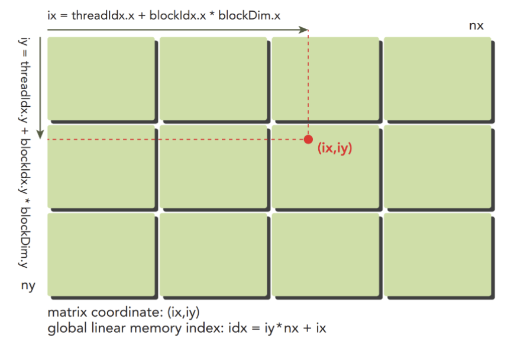

#### 检查块和线程索引

- printThreadInfo打印出有关每个线程的以下信息：
  - 线程索引
  - 块索引
  - 矩阵坐标
  - 全局线性内存偏移量
  - 相应元素的值

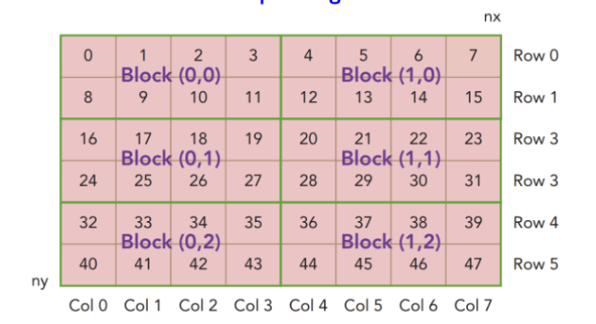

### 3.2 使用2D网格和2D块求和矩阵

#### 使用2D网格和2D块求和矩阵

- 编写一个使用2D网格和2D块的矩阵加法内核
- 创建一个新内核，使用2D线程块对矩阵求和：

```c
__global__ void sumMatrixOnGPU2D(float *MatA, float *MatB, float *MatC, int nx, int ny) {
    unsigned int ix = threadIdx.x + blockIdx.x * blockDim.x;
    unsigned int iy = threadIdx.y + blockIdx.y * blockDim.y;
    unsigned int idx = iy * nx + ix;
    if (ix < nx && iy < ny)
        MatC[idx] = MatA[idx] + MatB[idx];
}
```

#### 使用2D网格和2D块求和矩阵

- 此内核的关键步骤是将每个线程从其线程索引映射到全局线性内存索引

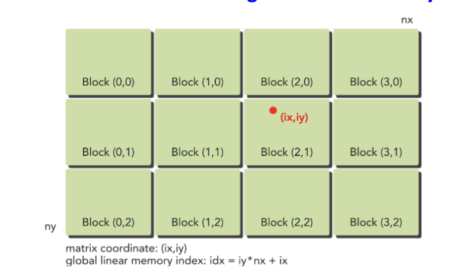

#### 使用2D网格和2D块求和矩阵

- 矩阵大小可以设置为每个维度16,384个元素，如下所示：
    ```c
    int nx = 1 << 14;
    int ny = 1 << 14;
    ```
- 然后，可以将内核执行配置设置为使用2D网格和2D块，如下所示：
    ```c
    int dimx = 32;
    int dimy = 32;
    dim3 block(dimx, dimy);
    dim3 grid((nx + block.x - 1) / block.x,
            (ny + block.y - 1) / block.y);
    ```

#### 使用2D网格和2D块求和矩阵

- 增加块的数量并不一定总是提高内核的性能
  - 更多的块，更多的并行性？  
| 核心配置    | 核心时间   | 块数量   |
|-----------|-----------|----------|
| (32,32)   | 0.060 sec | 512*512  |
| (32,16)   | 0.038 sec | 512*1024 |
| (16,16)   | 0.045 sec | 1024*1024|

### 3.3 使用1D网格和1D块求和矩阵

#### 使用1D网格和1D块求和矩阵

- 要使用包含1D块的1D网格，您需要编写一个新内核，其中每个线程处理ny个数据元素

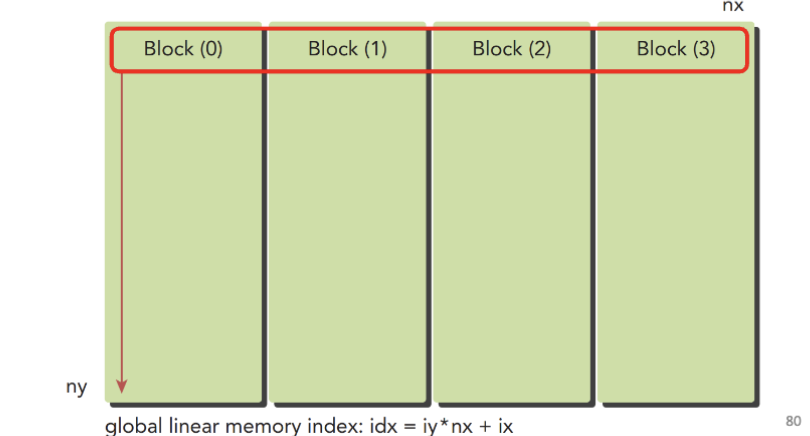

#### 使用1D网格和1D块求和矩阵

- 因为内核启动使用1D块布局，所以只有threadIdx.x有用，并使用循环处理每个线程中的ny个元素。
    ```c
    __global__ void sumMatrixOnGPU1D(float *MatA, float *MatB, float *MatC, int nx, int ny) {
        unsigned int ix = threadIdx.x + blockIdx.x * blockDim.x;
        if (ix < nx) {
            for (int iy = 0; iy < ny; iy++) {
                int idx = iy * nx + ix;
                MatC[idx] = MatA[idx] + MatB[idx];
            }
        }
    }
    ```
- 接下来，将1D网格和块配置设置如下：
    ```c
    dim3 block(32, 1);
    dim3 grid((nx + block.x - 1) / block.x, 1);
    ```
- 使用1D配置调用内核，如下所示：
    ```c
    sumMatrixOnGPU1D<<<grid, block>>>(d_MatA, d_MatB, d_MatC, nx, ny)
    ```

#### 使用1D网格和1D块求和矩阵

- 执行结果
    ```bash
    $ nvcc sumMatrixOnGPU-1D-grid-1D-block.cu -o matrix1D
    $ ./matrix1D
    sumMatrixOnGPU1D<<<(512,1),(32,1)>>>
    elapsed 0.061352 sec
    ```
- 接下来，增加块大小，如下所示：
    ```c
    dim3 block(128, 1);
    dim3 grid((nx + block.x - 1) / block.x, 1);
    sumMatrixOnGPU1D<<<(128,1),(128,1)>>>
    elapsed 0.044701 sec
    ```
- 结果表明，与使用2D网格和块(32 × 32)配置的结果相比，性能基本相同。

### 3.4 使用2D网格和1D块求和矩阵

#### 使用2D网格和1D块求和矩阵

- 当使用包含1D块的2D网格时，每个线程只处理一个数据元素，网格的第二维等于ny

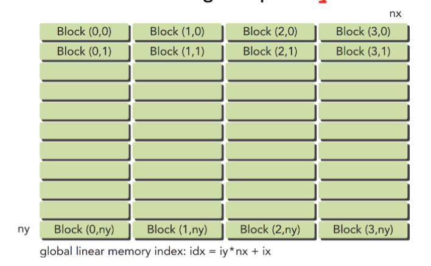

#### 使用2D网格和1D块求和矩阵

- 这可以看作是包含2D块的2D网格的特殊情况，其中块的第二维为1
- 从块和线程索引到矩阵坐标的映射变为：
    ```c
    ix = threadIdx.x + blockIdx.x * blockDim.x;
    iy = blockIdx.y;
    ```
- 新内核如下所示：
    ```c
    __global__ void sumMatrixOnGPUMix(float *MatA, float *MatB, float *MatC, int nx, int ny) {
        unsigned int ix = threadIdx.x + blockIdx.x * blockDim.x;
        unsigned int iy = blockIdx.y;
        unsigned int idx = iy * nx + ix;
        if (ix < nx && iy < ny)
            MatC[idx] = MatA[idx] + MatB[idx];
    }
    ```

#### 不同内核实现的结果比较

| 核心               | 执行配置             | 时间       |
|-------------------|--------------------|-----------|   
| sumMatrixOnGPU2D  | (512,1024),(32,16) | 0.038 sec |
| sumMatrixOnGPU1D  | (128,1),(128,1)    | 0.044 sec |
| sumMatrixOnGPUMix | (64,16384),(256,1) | 0.030 sec |

从矩阵加法示例中，您可以看到几件事：
- 改变执行配置会影响性能
- 原生的内核实现通常不会产生最佳性能
- 对于给定的内核，尝试不同的网格和块维度可能会产生更好的性能

## 4. 设备管理

### 4.1 使用运行时API查询GPU信息

#### 使用运行时API查询GPU信息

- CUDA运行时API中提供了许多函数来帮助您管理设备
  - GPU设备的属性在cudaDeviceProp结构中返回
    ```c
    cudaGetDeviceProperties(cudaDeviceProp *prop, int device);
    ```

### 4.2 确定最佳GPU

#### 确定最佳GPU

- 一些系统支持多个GPU
  - 识别计算能力最强的GPU的一种方法是通过它包含的多处理器数量
```c
int numDevice = 0;
cudaGetDeviceCount(&numDevice);
if(numDevices > 1){
    int maxMultiProcessorCount = 0;
    int maxDevice = 0;
    for(int device = 0; device < numDevices; device++){
        cudaDeviceProp props;
        cudaGetDeviceProperties(&props, device);
        if(props.multiProcessorCount > maxMultiProcessorCount){
            maxMultiProcessorCount = props.multiProcessorCount;
            bestDevice = device;
        }
    }
    cudaSetDevice(bestDevice);
}
```

### 4.3 使用nvidia-smi查询GPU信息

#### 使用nvidia-smi查询GPU信息

- 命令行工具nvidia-smi允许您查询和修改设备状态

```bash
$ nvidia-smi -L
GPU 0: Tesla M2070 (UUID: GPU-68df8aec-e85c-9934-2b81-0c9e689a43a7)
GPU 1: Tesla M2070 (UUID: GPU-382f23c1-5160-01e2-3291-ff9628930b70)

$ nvidia-smi -q -i 0

$ nvidia-smi -q -i 0 -d MEMORY | tail -n 5
Memory Usage
    Total: 5375 MB
    Used: 9 MB
    Free: 5366 MB

$ nvidia-smi -q -i 0 -d UTILIZATION | tail -n 4
Utilization
    Gpu: 0%
    Memory: 0%
```

- 确定系统上安装了多少个GPU
- 报告有关GPU 0的详细信息
- 仅显示设备内存信息
- 仅显示设备利用率信息

### 4.4 在运行时设置设备

#### 在运行时设置设备

- 对于安装了N个GPU的系统，nvidia-smi报告的设备ID标记为0到N-1
- 使用环境变量CUDA_VISIBLE_DEVICES，可以在运行时指定要使用的GPU

**示例**：
- 在运行时设置环境变量CUDA_VISIBLE_DEVICES = 2
- nvidia驱动程序屏蔽其他GPU，因此设备2对您的应用程序显示为设备0

## 总结

- 与C中的并行编程相比，CUDA编程中的线程层次结构是一个显著特征
- 对于给定的问题，您有几个选项来实现内核，以及不同的配置来执行内核
- 因此，学习如何组织线程是CUDA编程的核心实践之一
- 网格和块代表了内核执行的线程布局的逻辑视图

# ch08-3 CUDA执行模型

## 学习目标

- 了解CUDA执行模型的基本概念
- 理解Warp执行的本质
- 学习如何暴露并行性
- 掌握避免分支发散的方法
- 学习循环展开技术
- 了解动态并行性

## 1. CUDA执行模型介绍

- 一般来说，**执行模型**（execution model）为特定计算架构上的**指令如何执行**提供了一个操作层面的视图。  
- CUDA 执行模型揭示了 GPU 并行架构的抽象视图，使您能够推理**线程并发性**（thread concurrency）的行为。  
- CUDA 执行模型提供了对编写高效代码有用的洞察，具体体现在：  
  - **指令吞吐量**（instruction throughput）  
  - **内存访问**（memory accesses）  

### 1.1 GPU架构概述

- GPU架构围绕可扩展的流式多处理器（Streaming Multiprocessors, SM）阵列构建
- GPU硬件并行性通过复制这种架构构建块（SM）来实现

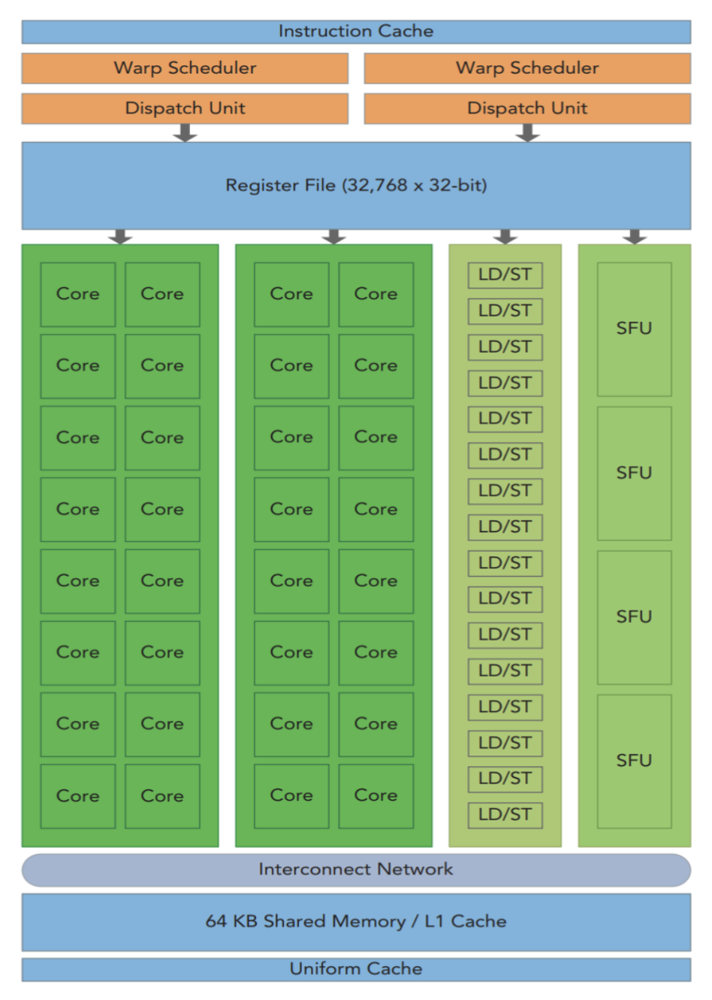

#### 流式多处理器（SM）

- GPU中的每个SM设计用于支持数百个线程的并发执行
  - 当启动内核网格时，该内核网格的线程块被分配到可用的SM上执行
  - 一旦在SM上调度，线程块中的线程仅在该分配的SM上并发执行
- 多个线程块可以同时分配给同一个SM，并根据SM资源的可用性进行调度
- 单个线程内的指令通过流水线处理以利用指令级并行性

#### Warp

- CUDA采用单指令多线程（SIMT）架构来管理和执行32个一组的线程，称为warps
  - warp中的所有线程同时执行相同的指令
  - 每个线程都有自己的指令地址计数器和寄存器状态，并在自己的数据上执行当前指令
- 每个SM将其分配的线程块划分为32线程的warp，然后调度执行

#### SIMT vs. SIMD

- SIMT架构类似于SIMD（单指令多数据）架构
- 关键区别：
  - SIMD要求向量中的所有元素作为一个统一的同步组一起执行
  - SIMT允许多个线程在同一warp中独立执行
- SIMT包含三个SIMD不具备的关键特性：
  - 每个线程都有自己的指令地址计数器
  - 每个线程都有自己的寄存器状态
  - 每个线程可以有独立的执行路径

#### 逻辑视角和硬件视角

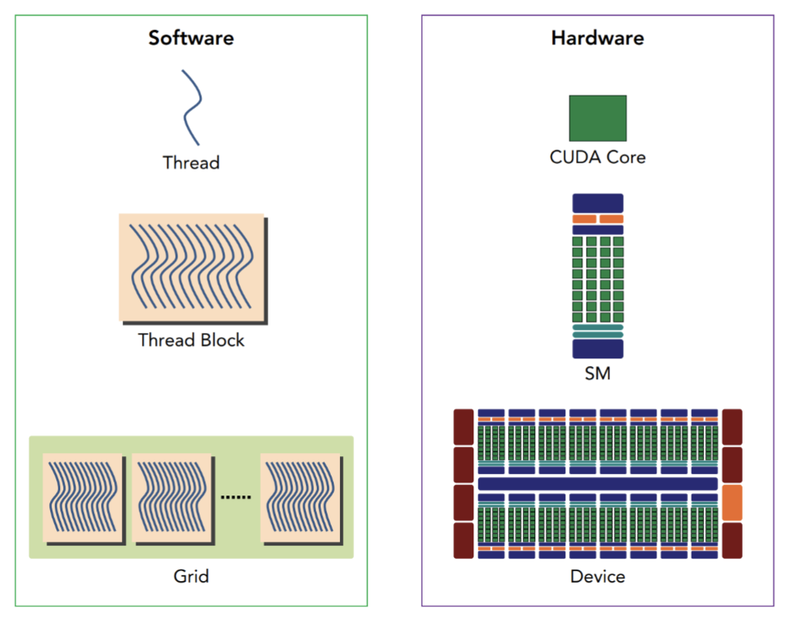

- 线程块仅在一个SM上调度
- 一旦线程块在SM上调度，它将一直驻留在该SM上直到执行完成
- 一个SM可以同时容纳多个线程块

#### 线程执行

- 共享内存在线程块之间划分，寄存器在线程之间划分
  - 线程块中的线程可以通过这些资源相互协作和通信
- 虽然线程块中的所有线程逻辑上并行运行，但并非所有线程都能同时物理执行
  - CUDA提供了同步线程块内线程的方法
  - 没有提供块间同步的原语

#### Warp调度

- 虽然线程块内的warp可以按任意顺序调度，但活动warp的数量受SM资源限制
- 当warp因任何原因空闲时，SM可以自由地从同一SM上驻留的任何线程块中调度另一个可用的warp
- 在并发warp之间切换没有开销
  - 硬件资源在SM上的所有线程和块之间划分
  - 新调度的warp的状态已经存储在SM上

### 1.2 Fermi架构

- Fermi架构是第一个完整的GPU计算架构，专为高性能计算设计

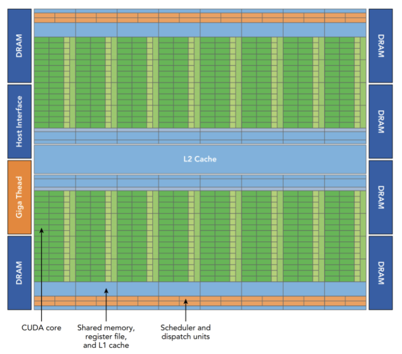

- 512个CUDA核心
- 16个流式多处理器（SM），每个SM有32个CUDA核心
- 6个GDDR5 DRAM内存接口
- GigaThread引擎是一个全局调度器，将线程块分配给SM warp调度器

#### Fermi架构特点

- 每个SM具有两个warp调度器和两个指令分发单元
- Fermi架构可以同时处理每个SM 48个warp，单个SM中最多可驻留1,536个线程

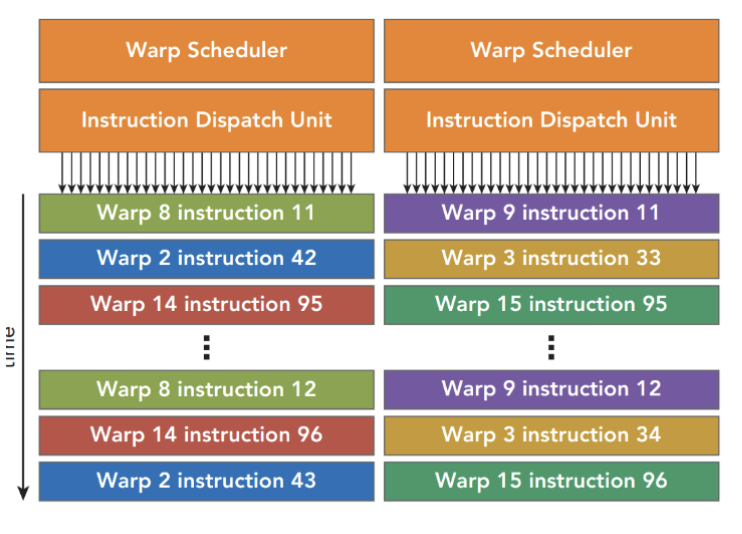

#### 片上可配置内存

- Fermi的一个关键特性是64KB片上可配置内存
  - 在共享内存和L1缓存之间划分
- CUDA提供了一个运行时API，可用于调整共享内存和L1缓存的数量
- 修改片上内存配置可以带来性能改进
  - 具体取决于给定内核中共享内存或缓存的使用情况

#### 并发内核执行

- Fermi还支持并发内核执行
  - 从同一应用程序上下文启动的多个内核可以同时在同一个GPU上执行
  - 并发内核执行允许执行多个小内核的程序充分利用GPU

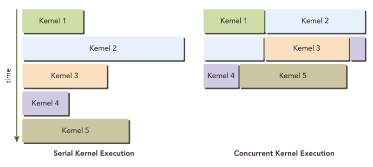

- Fermi允许最多16个内核同时在设备上运行
- 使GPU看起来更像MIMD架构

### 1.3 Kepler架构

#### Kepler架构特点

- Kepler GPU架构：于2012年秋季发布
  - 3个关键创新：增强的SM、动态并行性、Hyper-Q

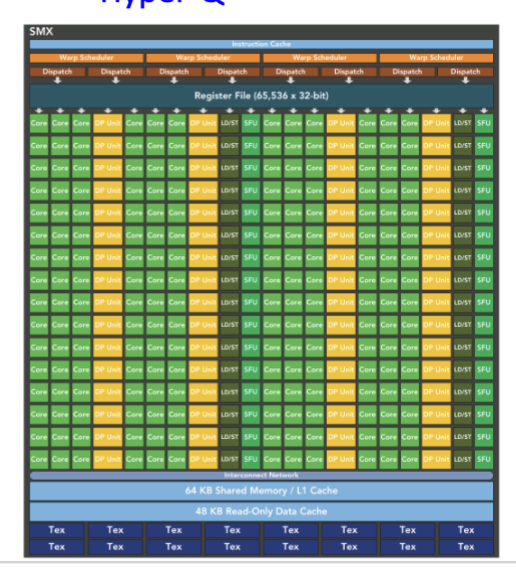

- 15个SM
- 每个Kepler SM单元包含：
  - 192个单精度CUDA核心
  - 64个双精度单元
  - 32个特殊功能单元（SFU）
  - 32个加载/存储单元（LD/ST）
  - 4个warp调度器
  - 8个指令分发器
- 每个SM可调度64个warp，总共2,048个线程

#### 动态并行性

- 允许GPU动态启动新的网格
  - 任何内核都可以启动另一个内核并管理任何内核间依赖关系
  - 使创建和优化递归和数据依赖执行模式变得更加容易

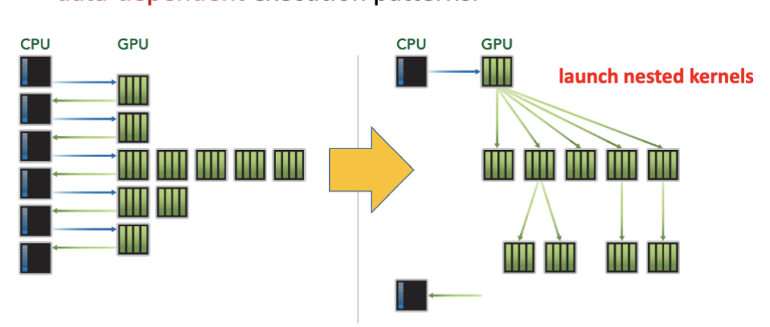

#### Hyper-Q

- Hyper-Q在CPU和GPU之间添加了更多的同时硬件工作队列
  - 使CPU能够同时在GPU上运行更多任务

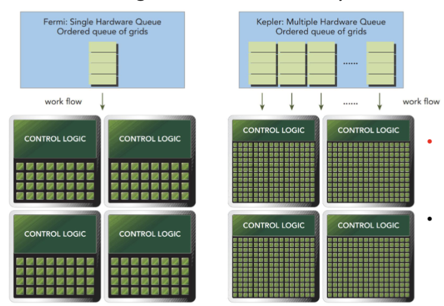

- 避免单个任务阻塞其后的所有其他任务
- Kepler GPU提供32个硬件工作队列

### 1.4 配置文件驱动的优化

- 配置文件分析是通过测量来分析程序性能的行为：
  - 应用程序代码的空间（内存）或时间复杂度
  - 特定指令的使用
  - 函数调用的频率和持续时间
- 配置文件分析是程序开发的关键步骤，特别是对于优化高性能计算应用程序代码
  - 通常需要对平台的执行模型有基本的了解
  - 配置文件工具提供对内核性能的深入洞察，帮助您识别内核中的瓶颈

#### 配置文件工具

- CUDA提供两个主要的配置文件工具：
  - nvvp，一个独立的可视化配置文件工具
  - nvprof，一个命令行配置文件工具
- 选择适当的性能指标并比较性能非常重要
  - 内存带宽
  - 计算资源
  - 指令和内存延迟......
- 即使对GPU架构有基本的了解，也能使您编写更好的代码并充分利用设备的能力

## 2. 理解Warp执行的本质

### 2.1 Warps和线程块

- Warp是SM中执行的基本单位
  - Warp由32个连续的线程组成
  - 当启动线程块网格时，网格中的线程块被分配到SM上
  - 一旦线程块被调度到SM，线程块中的线程被进一步划分为warp

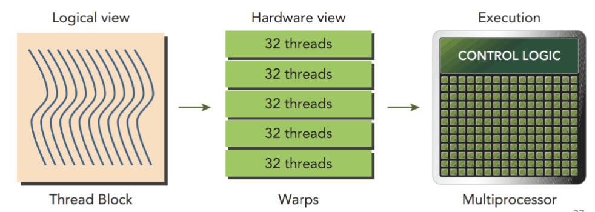

#### Warps和线程块

- warp中的所有线程以单指令多线程（SIMT）方式执行
  - 所有线程执行相同的指令
  - 每个线程在自己的私有数据上执行该操作
- 线程块可以配置为一维、二维或三维
- 但是，从硬件角度来看，所有线程都是一维排列的

#### Warps和线程块

- 对于一维线程块，唯一的线程ID存储在CUDA内置变量threadIdx.x中
- 具有连续threadIdx.x值的线程被分组为warp
- 示例：具有128个线程的一维线程块将被组织成4个warp

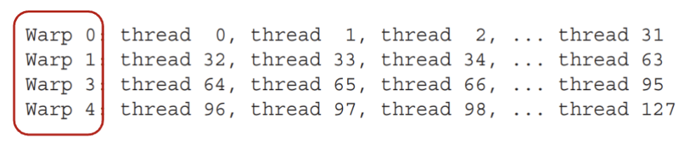

#### Warps和线程块

- 2D或3D线程块的逻辑布局可以转换为其1D物理布局
- 例如，给定一个2D线程块，线程块中每个线程的唯一标识符由以下公式给出
    ```
    threadIdx.y * blockDim.x + threadIdx.x
    ```
- 3D线程块的相同计算如下：
    ```
    threadIdx.z * blockDim.y * blockDim.x + threadIdx.y * blockDim.x + threadIdx.x
    ```

#### 线程块的Warp数量

- 线程块的warp数量可以按以下方式确定：
    ```
    WarpsPerBlock = ceil(ThreadsPerBlock / WarpSize)
    ```
- 如果线程块大小不是warp大小的整数倍，则最后一个warp中的一些线程将处于非活动状态
  - 注意最后一个半warp是非活动的。即使这些线程未使用，它们仍然消耗SM资源，如寄存器。

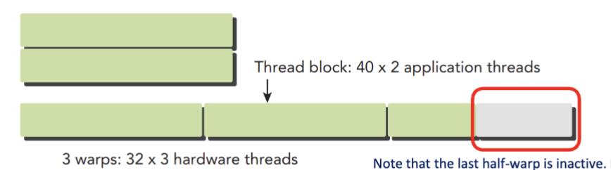

#### 线程块：逻辑角度与硬件角度

- 从逻辑角度来看，线程块是组织成1D、2D或3D布局的线程集合
- 从硬件角度来看，线程块是warp的一维集合
  - 线程块中的线程以一维布局组织，每32个连续线程形成一个warp

### 2.2 Warp发散

- 同一warp中的线程执行不同指令被称为warp发散
  - warp中的所有线程必须在同一周期执行相同的指令
  - 如果同一warp中的线程在应用程序中采用不同的路径，这可能成为一个问题

```c
if(cond) {
... // 16个线程执行此代码
} else {
... // 16个线程执行此代码
}
```

- 假设warp中的16个线程执行此代码时，cond为true，但其他16个线程的cond为false
- 那么warp的一半需要执行if块中的指令，另一半需要执行else块中的指令

#### Warp发散

- 如果warp中的线程发散，warp会串行执行每个分支路径，禁用不采用该路径的线程
  - 导致性能显著下降
  - 分支发散仅发生在warp内部

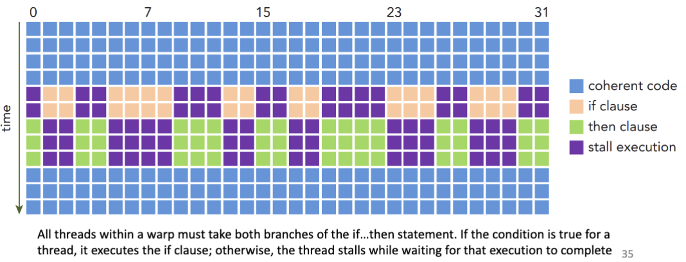

warp中的所有线程都必须执行if...then语句的两个分支。如果条件对线程为true，则执行if子句；否则，线程在等待该执行完成时停滞

#### Warp发散

- 为了获得最佳性能，您应该避免同一warp内的不同执行路径
- 具有warp发散的案例
```c
__global__ void mathKernel1(float *c){
    int tid = blockIdx.x * blockDim.x + threadIdx.x;
    float a, b;
    a = b = 0.0f;
    if(tid % 2 == 0){ //条件(tid%2==0)使偶数线程执行if子句
        a = 100.0f;
    } else { // 奇数线程执行else子句
        b = 200.0f;
    }
    c[tid] = a + b;
}
```

#### 避免Warp发散

- 如果使用warp方法（而不是线程方法）交错数据，可以避免warp发散
  - 条件(tid/warpSize)%2==0强制分支粒度为warp大小的倍数

```c
__global__ void mathKernel2(void){
    int tid = blockIdx.x * blockDim.x + threadIdx.x;
    float a, b;
    a = b = 0.0f;
    if((tid / warpSize) % 2 == 0){ // 偶数warp执行if子句
        a = 100.0f;
    } else { // 奇数warp执行else子句
        b = 200.0f;
    }
    c[tid] = a + b;
}
```

#### 分支效率

- 分支效率定义为非发散分支与总分支的比率
    ```
    Branch Efficiency = 100 * (#Branches - #Divergent Branches) / #Branches
    ```
- CUDA编译器优化可以使用谓词指令替换短条件代码段的分支指令
  - 您可以强制CUDA编译器不使用分支谓词优化您的内核

#### 关键提醒

- 当warp内的线程采用不同的代码路径时，会发生warp发散
- 不同的if-then-else分支串行执行
- 尝试调整分支粒度为warp大小的倍数以避免warp发散
- 不同的warp可以执行不同的代码而不会对性能造成损失

### 2.3 资源划分

- warp的本地执行上下文主要由以下资源组成：
  - 程序计数器
  - 寄存器
  - 共享内存
- SM处理的每个warp的执行上下文在warp的整个生命周期内保持在片上
  - 从一个执行上下文切换到另一个执行上下文没有成本

#### 资源划分

- 当每个线程消耗更多寄存器时，可以在SM上放置的warp数量会减少
- 每个SM的寄存器数量和共享内存量因不同计算能力的设备而异

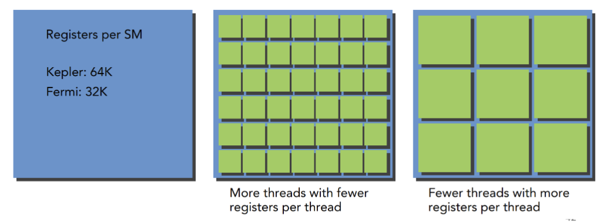

#### 与计算能力相关的资源限制

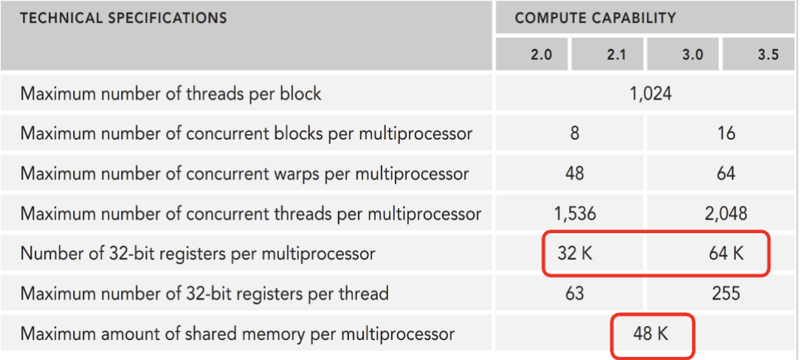

#### Warp分类

- 活跃块：具有分配的计算资源（如寄存器和共享内存）的线程块
- 活跃warps：活跃块中的warps
- 活跃warp可以进一步分类为：
  - 选定的warp：正在积极执行的warp
  - 有资格的warp：准备好执行但当前未执行的活跃warp
  - 停滞的warp：未准备好执行的warp

#### Warp调度

- SM上的warp调度器在每个周期选择活动的warp并将其分发到执行单元
- 如果warp未准备好执行，则为停滞的warp
- 如果同时满足以下两个条件，warp有资格执行：
  - 32个CUDA核心可用于执行
  - 当前指令的所有参数都已准备好

#### 示例

- 示例：Kepler SM
  - 从启动到完成的任何时间，活动warp的数量<=架构限制的64个并发warp
  - 任何周期选定的warp数量小于或等于4
  - 如果warp停滞，warp调度器会选择一个有资格的warp来代替执行
- 计算资源划分需要在CUDA编程中特别注意
  - 计算资源限制了活动warp的数量

### 2.4 隐藏延迟

- 指令延迟：从发出指令到完成指令之间的时钟周期数
- GPU指令延迟通过来自其他warp的计算隐藏
  - 每个指令的延迟可以通过在其他驻留的warp中发出其他指令来隐藏
- 算术/内存指令的延迟：
  - 算术操作：10-20个周期
  - 全局内存访问：400-800个周期

#### 隐藏延迟

- 一个执行流水线的简单案例，其中warp 0停滞

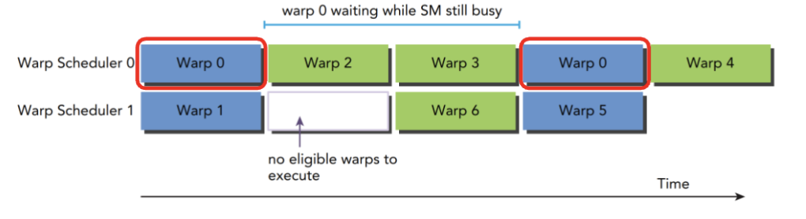

- warp调度器选择其他warp执行，然后在warp 0再次有资格时执行它

#### 隐藏延迟

- 问题：如何估计隐藏延迟所需的活动warp数量？
- 答案：Little定律可以提供合理的近似

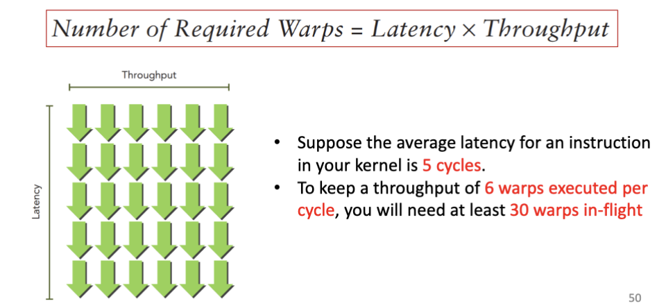

- 假设内核中指令的平均延迟为5个周期
- 为了保持每周期执行6个warp的吞吐量，您至少需要30个正在执行的warp

### 2.5 占用率

- 占用率是每个SM的活动warp与最大warp数量的比率
    ```
    occupancy = ActiveWarps / MaxWarps
    ```
- 您可以使用cudaGetDeviceProperties获取GPU配置信息
    ```bash
    Device 0: Tesla M2070
    Number of multiprocessors: 14
    Maximum number of warps per multiprocessor: 48
    Maximum number of threads per multiprocessor: 1536
    Maximum number of threads per block: 1024
    ```

#### CUDA占用率计算器

- CUDA工具包包含一个名为CUDA占用率计算器的电子表格
  - 它帮助您选择网格和块维度以最大化内核的占用率
  - https://docs.nvidia.com/cuda/cuda-occupancy-calculator

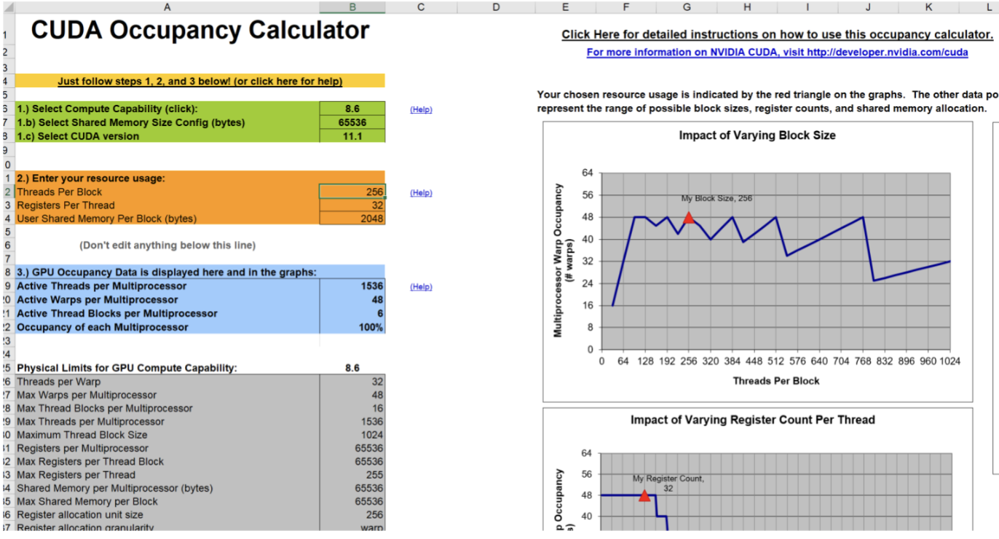

#### 网格和块大小的指导原则

- 保持每个块的线程数为warp大小（32）的倍数
- 避免小的块大小：每个块至少从128或256个线程开始
- 根据内核资源需求向上或向下调整块大小
- 保持块的数量远大于SM的数量，以向设备暴露足够的并行性
- 进行实验以发现最佳的执行配置和资源使用

### 2.6 同步

- 在CUDA中，可以在两个级别执行同步：
  - 系统级：等待主机和设备上的所有工作完成
  - 块级：等待线程块中的所有线程在设备上达到执行的同一点
- cudaDeviceSynchronize：用于阻塞主机应用程序，直到所有CUDA操作完成：
    ```c
    cudaDeviceSynchronize(void);
    ```

#### 同步

- 由于线程块中的warp以未定义的顺序执行，CUDA提供了使用块本地屏障同步它们执行的能力
- 您可以使用以下方法在内核中标记同步点：
  - 当调用__syncthreads时，同一线程块中的每个线程必须等待，直到该线程块中的所有其他线程都达到这个同步点。
    ```c
    __device__ void __syncthreads(void);
    ```

#### 同步

- 线程块内的线程可以通过共享内存和寄存器共享数据
- 在线程之间共享数据时，需要小心避免竞争条件
  - 竞争条件或危险是多个线程对同一内存位置的无序访问
- 不同块之间没有线程同步
  - 跨块同步的唯一安全方法是在每次内核执行结束时使用全局同步点
  - 通过不允许不同块中的线程相互同步，GPU可以按任意顺序执行块

### 2.7 可扩展性

- 可扩展性意味着为并行应用程序提供额外的硬件资源会产生相对于添加资源数量的加速
  - 可扩展性意味着性能可以通过添加计算核心来提高
- 透明可扩展性：在不同数量的计算核心上执行相同应用程序代码的能力

### 可扩展性

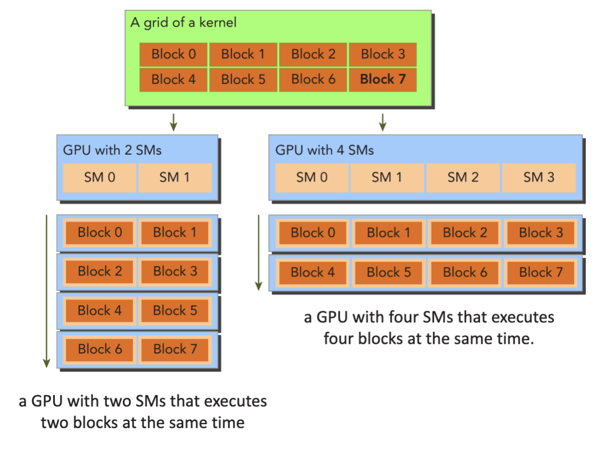

- 具有两个SM的GPU同时执行两个块
- 具有四个SM的GPU同时执行四个块

## 3. 暴露并行性

- 网格和块启发式方法——CUDA程序员必须掌握的技能
  - 理解为什么某些网格/块维度的组合比其他组合更好
- 示例：2D矩阵求和内核

```c
__global__ void sumMatrixOnGPU2D(float *A, float *B, float *C, int NX, int NY){
    unsigned int ix = blockIdx.x * blockDim.x + threadIdx.x;
    unsigned int iy = blockIdx.y * blockDim.y + threadIdx.y;
    unsigned int idx = iy * NX + ix;
    
    if(ix < NX && iy < NY){
        C[idx] = A[idx] + B[idx];
    }
}
```

### 3.1 使用nvprof检查活动warp

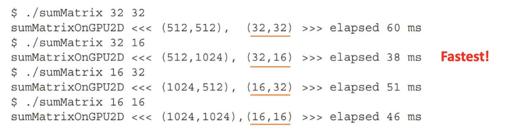

- 测试一组基本的线程块配置：(32,32), (32,16), (16,32), 和(16,16)
- (32,32)是最快的！
- 可能的原因：更多的线程块？

#### 使用nvprof检查活动warp

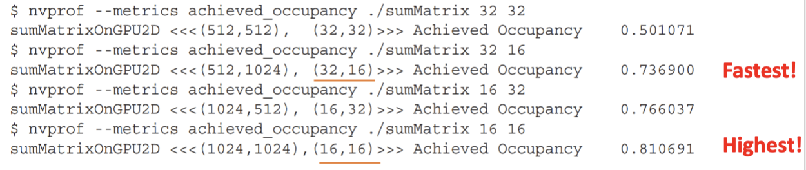

- 内核的实现占用率：每个周期的平均活动warp与SM支持的最大warp数量的比率
- (32,16)是最快的！
- (16,16)是最高的！具有最高的实现占用率，但它不是最快的
- 更高的占用率并不总是等同于更高的性能

### 3.2 使用nvprof检查内存操作

- sumMatrix内核中的3个内存操作（C[idx] = A[idx] + B[idx]）：
  - 两次内存加载和一次内存存储
  - 可以使用nvprof检查这些内存操作的效率

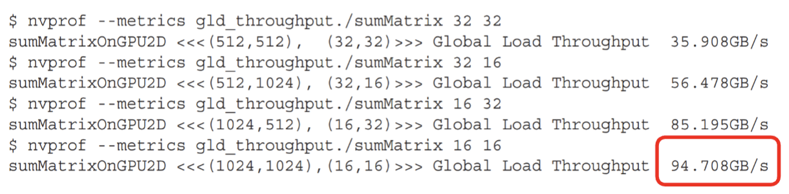

- 虽然第4种情况具有最高的加载吞吐量，但它比第2种情况慢
- 更高的加载吞吐量并不总是等同于更高的性能

#### 使用nvprof检查内存操作

- gld_efficiency：请求的全局加载吞吐量与所需的全局加载吞吐量的比率
  - 它衡量应用程序的加载操作如何利用设备内存带宽

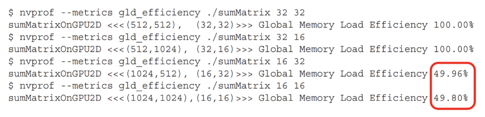

- 最后两种情况的加载效率是前两种情况的一半
- 解释为什么最后两种情况更高的加载吞吐量和实现占用率没有带来性能提升

### 3.3 暴露更多并行性

- 一个结论是块的最内层维度（block.x）应该是warp大小的倍数
  - 这样做大大提高了加载效率
- 问题：
  - 是否可以通过调整block.x进一步增加加载吞吐量？
  - 是否可以暴露更多并行性？

#### 暴露更多并行性

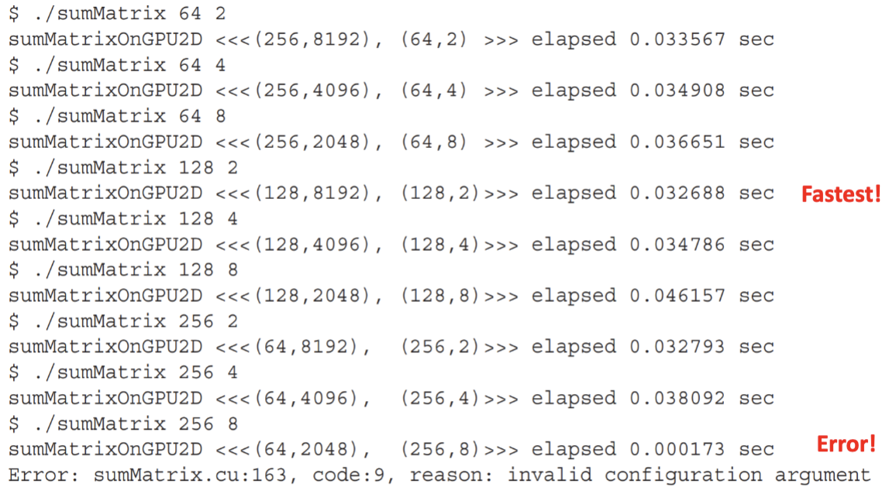

- 虽然(64, 2)启动了最多的线程块，但它不是最快的配置
- (64, 4)相对于(128, 2)表现不佳。线程块最内层维度的大小在性能中起着关键作用
- 所有剩余的情况都比最佳情况(128, 2)有更少的线程块

#### 暴露更多并行性

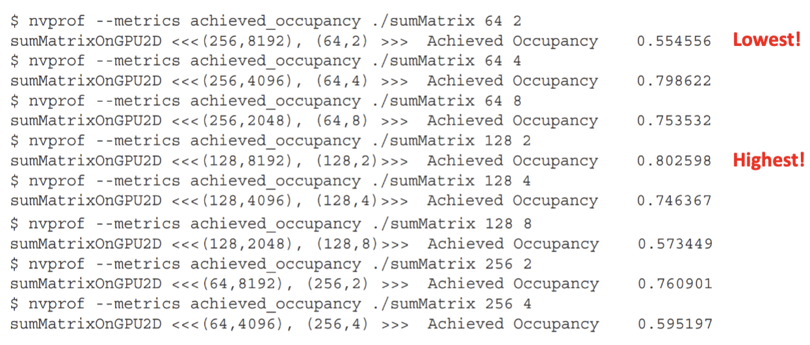

- (64, 2)在所有情况中具有最低的实现占用率，但它具有最多的线程块

#### 指标和性能

- 在大多数情况下，没有单一指标可以规定最佳性能
- 哪个指标或事件最直接关系到整体性能取决于内核代码的性质
- 在相关指标和事件之间寻求良好的平衡
- 从不同角度检查内核，以在相关指标之间找到平衡
- 网格/块启发式方法为性能调优提供了一个良好的起点

## 4. 避免分支发散

### 4.1 并行归约问题

#### 并行归约问题

- 问题：计算具有N个元素的整数数组的总和
```
int sum = 0;
for(int i = 0; i < N; i++)
    sum += array[i];
```
- 问题：如何通过并行执行来加速这个求和？
- 并行加法
  - 将输入向量划分为更小的块
  - 让一个线程计算每个块的部分和
  - 将每个块的部分结果相加得到最终总和

#### 并行归约问题

- 两种成对并行求和实现：
  - 邻居对：元素与其直接邻居配对
  - 交错对：配对元素由给定的步长分隔

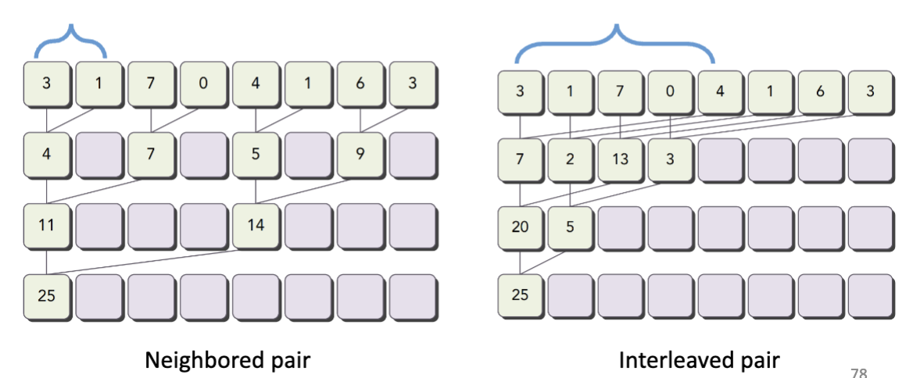

#### 并行归约问题

- 归约问题：在向量上执行交换和结合操作（例如，加、最大、平均、最小、乘积）的通用问题
- 并行归约：归约操作的并行执行
  - 并行归约是最常见的并行模式之一，也是许多并行算法中的关键操作
- 注意：虽然上面的示例实现了加法，但任何交换和结合操作都可以替换加法。

### 4.2 并行归约中的发散

#### 并行归约中的发散

- 考虑邻居对方法
- 两个全局内存数组：
  - 一个大数组用于存储要归约的整个数组
  - 一个较小的数组用于保存每个线程块的部分和

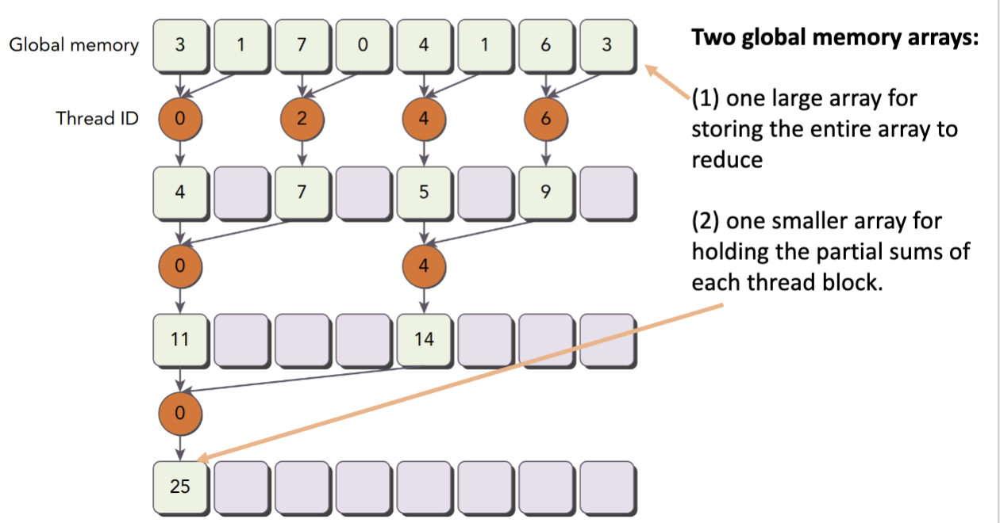

#### 并行归约中的发散

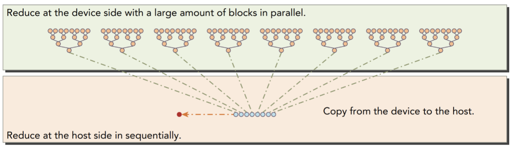

- 两个邻居元素之间的距离，步长，最初初始化为1
- 在每次归约轮次后，这个距离乘以2
- 在第一轮之后，idata的偶数元素将被部分和替换
- 在第二轮之后，idata的每第四个元素将被进一步的部分和替换
- 由于线程块之间没有同步，每个线程块产生的部分和被复制回主机并在那里顺序求和

### 4.3 改善并行归约中的发散

#### Warp发散

- 检查内核reduceNeighbored和条件语句：
```c
if((tid % (2 * stride)) == 0)
```
- 仅对偶数线程为true，导致高度发散的warp
  - 在并行归约的第一轮迭代中，只有偶数线程执行此条件语句的主体，但所有线程都必须被调度
  - 在第二轮迭代中，只有四分之一的线程处于活动状态，但仍然必须调度所有线程

#### 改善发散

- 可以通过重新排列每个线程的数组索引来减少warp发散，强制相邻线程执行加法
- 图中部分和的存储位置没有改变，但工作线程已更新。

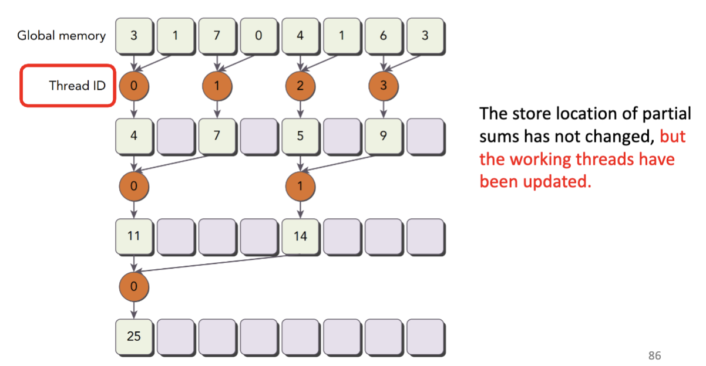

#### 改善发散


```c
__global__ void reduceNeighboredLess(int *g_idata, int *g_odata, unsigned int n) {
    // set thread ID
    unsigned int tid = threadIdx.x;
    unsigned int idx = blockIdx.x * blockDim.x + threadIdx.x;

    // convert global data pointer to the local pointer of this block
    int *idata = g_idata + blockIdx.x * blockDim.x;

    // boundary check
    if (idx >= n) return;

    // in-place reduction in global memory
    for (int stride = 1; stride < blockDim.x; stride *= 2) {
        // convert tid into local array index
        int index = 2 * stride * tid; // 设置每个线程的数组访问索引
        if (index < blockDim.x) {
            idata[index] += idata[index + stride];
        }
    }

    // synchronize within threadblock
    __syncthreads();

    // write result for this block to global mem
    if (tid == 0) g_odata[blockIdx.x] = idata[0];
}
```
- 对于512个线程的线程块大小，前8个warp执行归约的第一轮，其余8个warp不执行任何操作
- 在第二轮中，前4个warp执行归约，其余12个warp不执行任何操作
- 因此，根本没有发散

#### 改善发散

- 使用reduceNeighboredLess和早期内核进行测试会产生以下报告：

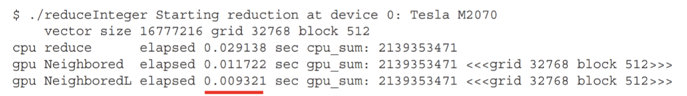

- 新实现比原始实现快1.26倍

### 4.4 使用交错对进行归约

#### 使用交错对进行归约

- 交错对方法与邻居方法相比反转了元素的步长
  - 步长从线程块大小的一半开始，然后在每次迭代时减半

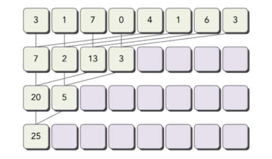

每个线程将由当前步长分隔的两个元素相加，以在每轮中产生部分和
- 交错归约中的工作线程没有改变
- 但每个线程在全局内存中的加载/存储位置不同

#### 使用交错对进行归约

```c
// 交错配对实现（减少分支发散）
__global__ void reduceInterleaved(int *g_idata, int *g_odata, unsigned int n) {
    // 设置线程ID
    unsigned int tid = threadIdx.x;
    unsigned int idx = blockIdx.x * blockDim.x + threadIdx.x;

    // 将全局数据指针转换为本线程块的局部指针
    int *idata = g_idata + blockIdx.x * blockDim.x;

    // 边界检查
    if (idx >= n) return;

    // 在全局内存中原地归约
    for (int stride = blockDim.x / 2; stride > 0; stride >>= 1) {
        if (tid < stride) {
            idata[tid] += idata[tid + stride];
        }
    }

    // 线程块内同步
    __syncthreads();

    // 将本块结果写回全局内存
    if (tid == 0) g_odata[blockIdx.x] = idata[0];
}
```

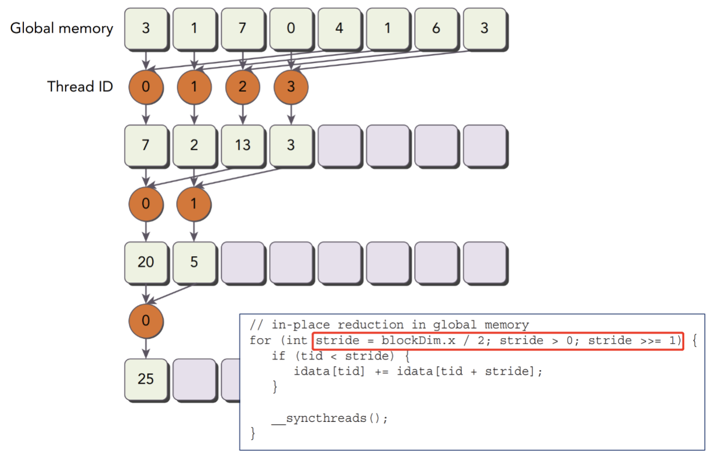


#### 使用交错对进行归约

- 使用reduceInterleaved和早期内核进行测试会产生以下输出：


- 交错实现比第一次实现快1.69倍，比第二次实现快1.34倍
- 这种性能改进主要是reduceInterleaved中全局内存加载和存储模式的结果

## 5. 循环展开

### 5.1 使用展开进行归约

#### 循环展开

- 循环展开：一种通过减少分支和循环维护指令的频率来优化循环执行的技术
  - 循环体在代码中多次编写
  - 循环迭代次数减少或完全移除
```c
// 原始循环
for(int i = 0; i < 100; i++){
    a[i] = a[i] + b[i];
}

// 展开循环
for(int i = 0; i < 100; i += 4){
    a[i] = a[i] + b[i];
    a[i + 1] = a[i + 1] + b[i + 1];
    a[i + 2] = a[i + 2] + b[i + 2];
    a[i + 3] = a[i + 3] + b[i + 3];
}
```
- 循环展开因子：循环体的副本数量

#### 使用展开进行归约

- 对reduceInterleaved内核的修订
  - 对于每个线程块，来自两个数据块的数据被求和
```c
__global__ void reduceUnrolling2(int *g_idata, int *g_odata, unsigned int n) {
    // 设置线程ID
    unsigned int tid = threadIdx.x;
    unsigned int idx = blockIdx.x * blockDim.x * 2 + threadIdx.x;  // 注意：此处乘以2，对应双数据块布局

    // 将全局数据指针转换为本线程块所处理的局部数据起始地址（按2倍块大小偏移）
    int *idata = g_idata + blockIdx.x * blockDim.x * 2;

    // 【展开优化】：每个线程一次性处理两个相邻数据块中的对应元素
    // 即：线程idx将其自身位置的元素与“下一个数据块中相同偏移”的元素相加
    if (idx + blockDim.x < n) 
        g_idata[idx] += g_idata[idx + blockDim.x];
    __syncthreads();

    // 在全局内存中原地归约（标准树状归约，步长从 blockDim/2 开始逐次减半）
    for (int stride = blockDim.x / 2; stride > 0; stride >>= 1) {
        if (tid < stride) {
            idata[tid] += idata[tid + stride];
        }
    }

    // 线程块内同步
    __syncthreads();

    // 将本块归约结果写回全局内存（仅由线程0执行）
    if (tid == 0) 
        g_odata[blockIdx.x] = idata[0];
}
```
- 每个线程将来自相邻数据块的元素相加
- 从概念上讲，您可以将其视为归约循环的迭代，该迭代跨数据块进行归约

#### 使用展开进行归约

- 相应地调整全局数组索引
  - 因为您只需要一半的线程块来处理相同的数据集
- 每个线程的数据访问：
  ```c
  unsigned int idx = blockIdx.x * blockDim.x * 2 + threadIdx.x;
  int *idata = g_idata + blockIdx.x * blockDim.x * 2;
  ```


#### 使用展开进行归约

- reduceUnrolling2内核现在比原始实现执行速度快3.42倍


- 单个线程中更多的独立内存加载/存储操作产生更好的性能
  - 因为可以更好地隐藏内存延迟


### 5.2 使用展开的warp进行归约

#### 使用展开的warp进行归约

- 考虑剩下32个或更少线程的情况（即，单个warp）
  - 由于warp执行是SIMT，每条指令后都有隐式的warp内同步
  - 归约循环的最后6次迭代可以展开：

```c
if(tid < 32){
    volatile int *vmem = idata; // 关键代码
    vmem[tid] += vmem[tid + 32];
    vmem[tid] += vmem[tid + 16];
    vmem[tid] += vmem[tid + 8];
    vmem[tid] += vmem[tid + 4];
    vmem[tid] += vmem[tid + 2];
    vmem[tid] += vmem[tid + 1];
}
```

- volatile告诉编译器它必须在每次赋值时将vmem[tid]存储回全局内存
- 对volatile变量的任何引用都会强制直接从内存中读取或写入，而不仅仅是缓存或寄存器

#### 使用展开的warp进行归约

```c
__global__ void reduceUnrollWarps8(int *g_idata, int *g_odata, unsigned int n) {
    // 设置线程ID（thread ID）
    unsigned int tid = threadIdx.x;
    // 计算全局索引：每个线程处理 8 个连续数据元素（步长为 blockDim.x * 8）
    unsigned int idx = blockIdx.x * blockDim.x * 8 + threadIdx.x;

    // 将全局数据指针转换为本线程块所负责的局部数据起始地址（按 8 倍块大小偏移）
    int *idata = g_idata + blockIdx.x * blockDim.x * 8;

    // 【8路展开（unrolling 8）】：每个线程一次性加载并累加 8 个相邻元素（跨 8 个数据块）
    // 条件确保不越界：idx + 7*blockDim.x < n ⇒ 当前线程的第8个元素仍在有效范围内
    if (idx + 7 * blockDim.x < n) {
        int a1 = g_idata[idx];
        int a2 = g_idata[idx + blockDim.x];
        int a3 = g_idata[idx + 2 * blockDim.x];
        int a4 = g_idata[idx + 3 * blockDim.x];
        int b1 = g_idata[idx + 4 * blockDim.x];
        int b2 = g_idata[idx + 5 * blockDim.x];
        int b3 = g_idata[idx + 6 * blockDim.x];
        int b4 = g_idata[idx + 7 * blockDim.x];
        g_idata[idx] = a1 + a2 + a3 + a4 + b1 + b2 + b3 + b4;  // 累加8个元素
    }
    __syncthreads();

    // 【全局内存原地归约】：标准树状归约，但起始步长为 blockDim.x / 2，终止条件为 stride > 32
    // 即：仅对前 32 个线程执行归约（因后续使用 warp 级优化覆盖了高位线程）
    for (int stride = blockDim.x / 2; stride > 32; stride >>= 1) {
        if (tid < stride) {
            idata[tid] += idata[tid + stride];
        }
    }
    __syncthreads();

    // 【warp 级展开归约】：仅由 tid < 32 的线程执行（即每个 warp 的前 32 线程，实际是单个 warp）
    // 使用 volatile 指针避免编译器优化，确保顺序执行（模拟 warp 内部串行加法）
    if (tid < 32) {
        volatile int *vmem = idata;  // 强制使用全局内存访问（避免寄存器重排）
        vmem[tid] += vmem[tid + 32];  // 加第32个元素（warp 两半配对）
        vmem[tid] += vmem[tid + 16];  // 加第16个元素
        vmem[tid] += vmem[tid + 8];   // 加第8个元素
        vmem[tid] += vmem[tid + 4];   // 加第4个元素
        vmem[tid] += vmem[tid + 2];   // 加第2个元素
        vmem[tid] += vmem[tid + 1];   // 加第1个元素（最终归约到 tid=0）
    }
    __syncthreads();

    // 将本块归约结果写回全局内存（仅由线程0执行）
    if (tid == 0) 
        g_odata[blockIdx.x] = idata[0];
}
```

此内核的执行时间是
- 比reduceUnrolling8快1.05倍
- 比原始内核reduceNeighbored快8.65倍

### 5.3 使用完全展开进行归约

#### 使用完全展开进行归约

- 如果您在编译时知道循环中的迭代次数，可以完全展开它
  - 假设每个块的最大线程数为1024

```c
__global__ void reduceCompleteUnrollWarps8(int *g_idata, int *g_odata, unsigned int n) {
    // 设置线程ID
    unsigned int tid = threadIdx.x;
    // 计算全局索引：每个线程负责 8 个连续数据元素（步长为 blockDim.x * 8）
    unsigned int idx = blockIdx.x * blockDim.x * 8 + threadIdx.x;

    // 将全局数据指针转换为本线程块所处理的局部数据起始地址（按 8 倍块大小偏移）
    int *idata = g_idata + blockIdx.x * blockDim.x * 8;

    // 【8路展开（unrolling 8）】：每个线程一次性加载并累加 8 个相邻元素（跨 8 个数据块）
    if (idx + 7 * blockDim.x < n) {
        int a1 = g_idata[idx];
        int a2 = g_idata[idx + blockDim.x];
        int a3 = g_idata[idx + 2 * blockDim.x];
        int a4 = g_idata[idx + 3 * blockDim.x];
        int b1 = g_idata[idx + 4 * blockDim.x];
        int b2 = g_idata[idx + 5 * blockDim.x];
        int b3 = g_idata[idx + 6 * blockDim.x];
        int b4 = g_idata[idx + 7 * blockDim.x];
        g_idata[idx] = a1 + a2 + a3 + a4 + b1 + b2 + b3 + b4;
    }
    __syncthreads();

    // 【原地归约 + 完全展开（complete unroll）】
    // 根据线程块大小动态分段展开，避免循环开销，提升指令级并行性
    // 每个条件对应一个“归约层级”，仅当线程ID满足范围时执行一次加法
    if (blockDim.x >= 1024 && tid < 512) 
        idata[tid] += idata[tid + 512];
    __syncthreads();

    if (blockDim.x >= 512 && tid < 256) 
        idata[tid] += idata[tid + 256];
    __syncthreads();

    if (blockDim.x >= 256 && tid < 128) 
        idata[tid] += idata[tid + 128];
    __syncthreads();

    if (blockDim.x >= 128 && tid < 64) 
        idata[tid] += idata[tid + 64];
    __syncthreads();

    // 【warp 级展开归约】：仅由 tid < 32 的线程执行（即单个 warp 内部）
    // 使用 volatile 指针确保内存访问顺序，模拟 warp 内串行加法（消除分支与循环开销）
    if (tid < 32) {
        volatile int *vmem = idata;
        vmem[tid] += vmem[tid + 32];  // 加第32位（warp 上半部分）
        vmem[tid] += vmem[tid + 16];  // 加第16位
        vmem[tid] += vmem[tid + 8];   // 加第8位
        vmem[tid] += vmem[tid + 4];   // 加第4位
        vmem[tid] += vmem[tid + 2];   // 加第2位
        vmem[tid] += vmem[tid + 1];   // 加第1位（最终归约至 tid=0）
    }
    __syncthreads();

    // 将本块归约结果写回全局内存（仅由线程0执行）
    if (tid == 0) 
        g_odata[blockIdx.x] = idata[0];
}
```

- 比reduceUnrollWarps8快1.06倍
- 比原始实现快9.16倍

### 5.4 使用模板函数进行归约

#### 使用模板函数进行归约

- 虽然可以手动展开循环，但使用模板函数可以进一步减少分支开销
  - CUDA支持设备函数上的模板参数

```c
// 【核心差异】：使用模板参数 iBlockSize 替代运行时 blockDim.x
// → 将线程块大小变为编译期常量
// → 编译器可进行更激进的优化（如完全展开、常量传播、消除分支等）
template <unsigned int iBlockSize>
__global__ void reduceCompleteUnroll(int *g_idata, int *g_odata, unsigned int n) {
    // 设置线程ID
    unsigned int tid = threadIdx.x;
    // 计算全局索引：每个线程处理 8 个连续元素（步长为 iBlockSize * 8）
    // 注意：此处 blockDim.x 已被替换为编译时常量 iBlockSize
    unsigned int idx = blockIdx.x * iBlockSize * 8 + threadIdx.x;

    // 将全局数据指针转换为本线程块所负责的局部数据起始地址（按 8 倍块大小偏移）
    int *idata = g_idata + blockIdx.x * iBlockSize * 8;

    // 【8路展开（unrolling 8）】：每个线程一次性加载并累加 8 个相邻元素
    // 条件判断中仍使用 iBlockSize（编译期常量），而非 blockDim.x
    if (idx + 7 * iBlockSize < n) {
        int a1 = g_idata[idx];
        int a2 = g_idata[idx + iBlockSize];
        // ...（后续 a3~b4 同理，均用 iBlockSize 替代 blockDim.x）
```

#### 使用模板函数进行归约

- 检查块大小的IF语句将在编译时进行评估，如果条件不为真，则会被删除
  - 从而产生非常高效的内部循环
- 例如，如果此内核以256的线程块大小调用
  ```
  iBlockSize >= 1024 && tid < 512
  ```
- 该语句将始终为false
- 编译器会自动将其从执行的内核中删除

#### 归约内核性能


注意最大的相对性能增益是由reduceUnrolling8内核实现的，其中每个线程在开始归约之前处理8个数据块。

#### 加载/存储效率


## 6. 动态并行性

### 6.1 嵌套执行

#### 动态并行性

- 以前，所有内核都是从主机线程调用的
  - GPU工作负载完全由CPU控制
- CUDA动态并行性允许直接在GPU上创建和同步新的GPU内核
  - 启用更分层的方法，其中可以在GPU内核中的多个级别表达并发性
  - 使您的递归算法更加透明和易于理解
- 在动态并行性中，内核执行分为两种类型：父级和子级
  - 父线程、父线程块或父网格已启动新网格，即子网格
- 子网格必须在父线程、父线程块或父网格被认为完成之前完成
- 父级在所有子网格完成之前不被认为完成

#### 嵌套执行


- 父网格由主机线程配置和启动，子网格由父网格配置和启动
- 在父线程中设置屏障，以显式与其子网格同步

### 6.2 GPU上的嵌套Hello World

#### GPU上的嵌套Hello World

- 使用动态并行性的嵌套、递归执行


- 主机应用程序使用单个线程块中的8个线程调用父网格
- 然后，该网格中的线程0调用具有半数线程的子网格
- 接下来，第一个子网格中的线程0再次调用具有半数线程的新子网格
- 依此类推，直到最终嵌套中只剩下一个线程

#### GPU上的嵌套Hello World

- 每个线程执行内核从打印"Hello World"开始
  - 然后，每个线程检查是否应该终止
  - 如果此嵌套层的线程数大于一，线程0递归调用具有半数线程的子网格

```c
__global__ void nestedHelloWorld(int const iSize, int iDepth) {
    // 获取当前线程ID
    int tid = threadIdx.x;
    
    // 打印当前线程的递归深度、线程ID及所属块ID
    printf("递归深度=%d：来自线程 %d 的“Hello World”\n", iDepth, tid, blockIdx.x);

    // 递归终止条件：当块大小减至1时停止递归
    if (iSize == 1) 
        return;

    // 将块大小减半（用于下一层递归）
    int nthreads = iSize >> 1;  // 等价于 iSize / 2

    // 线程0 启动子网格（child grid）进行递归调用
    if (tid == 0 && nthreads > 0) {
        // 递归调用：启动1个块、nthreads个线程，深度+1
        nestedHelloWorld<<<1, nthreads>>>(nthreads, ++iDepth);
        
        // 打印递归返回提示（表明子调用已完成）
        printf("--------> 递归执行深度：%d\n", iDepth);
    }
}
```

#### GPU上的嵌套Hello World

```bash
$ nvcc -arch=sm_35 -rdc=true nestedHelloWorld.cu -o nestedHelloWorld -lcudadevrt
./nestedHelloWorld Execution Configuration: grid 1 block 8
Recursion=0: Hello World from thread 0, block 0
Recursion=0: Hello World from thread 1, block 0
Recursion=0: Hello World from thread 2, block 0
...
Recursion=0: Hello World from thread 7, block 0
-----> nested execution depth: 1
Recursion=1: Hello World from thread 0, block 0
Recursion=1: Hello World from thread 1, block 0
Recursion=1: Hello World from thread 2, block 0
Recursion=1: Hello World from thread 3, block 0
-----> nested execution depth: 2
Recursion=2: Hello World from thread 0, block 0
Recursion=2: Hello World from thread 1, block 0
-----> nested execution depth: 3
Recursion=3: Hello World from thread 0, block 0
```

#### 动态并行性的限制

- 动态并行性仅受计算能力3.5及更高版本的设备支持
- 通过动态并行性调用的内核不能在物理上独立的设备上启动
- 动态并行性的最大嵌套深度限制为24
  - 但实际上，大多数内核将受到设备运行时系统在每个新级别所需的内存量的限制

### 6.3 嵌套归约

#### 嵌套归约

- 方法1：包含许多块的原始网格，但所有嵌套的子网格只包含一个块，由其父级的线程0调用


```c
__global__ void gpuRecursiveReduce(int *g_idata, int *g_odata, unsigned int isize) {
    // 设置线程ID
    unsigned int tid = threadIdx.x;

    // 将全局数据指针转换为本线程块所负责的局部数据起始地址
    int *idata = g_idata + blockIdx.x * blockDim.x;
    int *odata = &g_odata[blockIdx.x];

    // 【终止条件】：若当前为叶子节点（即块大小为2且仅线程0执行），则直接计算并写回全局内存
    // → 此时结果已就绪，控制权立即返回给父核函数
    if (isize == 2 && tid == 0) {
        g_odata[blockIdx.x] = idata[0] + idata[1];
        return;
    }

    // 【非叶子节点】：计算子问题规模（当前块大小减半）
    int istride = isize >> 1;  // 等价于 isize / 2

    // 【原地归约（in-place reduction）】：仅由前一半线程（tid < istride）执行
    // 每个线程将其对应位置与偏移 istride 处的元素相加
    if (istride > 1 && tid < istride) {
        idata[tid] += idata[tid + istride];
    }

    // 【块级同步】：确保本层所有线程完成归约操作
    __syncthreads();

    // 【递归调用】：仅由线程0发起子网格（child grid）调用
    // 启动 1 个块、istride 个线程的子核函数，处理规模为 istride 的子问题
    if (tid == 0) {
        gpuRecursiveReduce<<<1, istride>>>(idata, odata, istride);
        
        // 【子网格同步】：等待所有子网格启动完成（设备端 barrier）
        cudaDeviceSynchronize();
    }

    // 【再次块级同步】：确保本层所有线程（包括等待子调用返回的线程）同步
    __syncthreads();
}
```

#### 嵌套归约

- 与使用邻居配对方法的平面内核相比，嵌套内核慢得令人无法接受


如此大量的内核调用和同步可能是这种糟糕内核性能的主要原因。

#### 嵌套归约

- 方法2：网格中第一个块的第一个线程为每个嵌套步骤调用子网格


#### 嵌套归约

```c
__global__ void gpuRecursiveReduce2(int *g_idata, int *g_odata, int iStride, int const iDim) {
    // 将全局数据指针转换为本线程块所负责的局部数据起始地址
    // 公式：idata = g_idata + blockIdx.x * iDim
    int *idata = g_idata + blockIdx.x * iDim;

    // 【终止条件】：当归约步长 iStride == 1 且当前为线程0时，完成最终两数相加并写回结果
    // → 此时该块为“叶子节点”，直接输出结果到全局内存
    if (iStride == 1 && threadIdx.x == 0) {
        g_odata[blockIdx.x] = idata[0] + idata[1];
        return;
    }

    // 【原地归约（in-place reduction）】：每个线程将其当前位置的值与偏移 iStride 处的值相加
    // 注意：此操作无需分支判断线程范围（因调用时保证 iStride <= blockDim.x）
    idata[threadIdx.x] += idata[threadIdx.x + iStride];

    // 【递归调用】：仅由线程0（threadIdx.x == 0）且块ID为0（blockIdx.x == 0）的线程发起子网格调用
    // → 启动一个新网格：维度为 (gridDim.x, iStride/2) 的单块？实际应为 <<1, iStride/2>>（见下方说明）
    if (threadIdx.x == 0 && blockIdx.x == 0) {
        // 注意：此处核启动配置 <<gridDim.x, iStride/2>> 存在歧义或笔误
        // 标准递归归约通常应为：<<<1, iStride/2>>>（1个块，iStride/2个线程）
        // 若原意是复用当前 grid 维度，则需确保 gridDim.x 合理；但更常见的是固定为 <<<1, ...>>>
        gpuRecursiveReduce2<<<gridDim.x, iStride/2>>>(g_idata, g_odata, iStride/2, iDim);
    }
}
```

- 从每次内核启动中删除所有空闲线程
- 释放第一个内核消耗的一半计算资源，以便允许更多线程块变为活动状态

#### 嵌套归约

- 递归归约内核再次比前两种实现快得多
  - 可能是由于减少了子网格调用的开销


## 总结

- 您从硬件角度检查了内核执行
- GPU设备上CUDA执行模型的两个最显著特征是：
- 线程以SIMT方式在warp中执行
- 硬件资源在块和线程之间划分
- 网格和块启发式方法在针对不同平台优化内核性能方面起着非常重要的作用
- 动态并行性使您能够直接从设备创建新工作


# ch08-4 CUDA全局内存

## 学习目标

- 了解CUDA内存模型的基本概念
- 掌握CUDA内存管理技术
- 理解内存访问模式
- 学习如何最大化内核带宽利用率
- 掌握统一内存的使用方法

## 1. CUDA内存模型介绍

### 1.1 内存层次结构的优势

- 两种局部性
  - **时间局部性**（Temporal locality）：如果一个数据位置被引用，那么在短时间内它很可能再次被引用
  - **空间局部性**（Spatial locality）：如果一个内存位置被引用，附近的内存位置也很可能被引用

#### 内存层次结构

- 内存层次结构仅因为局部性原理而有用
  - 内存层次结构由多个具有不同延迟、带宽和容量的内存级别组成


- 特点：
  - 每比特成本更低
  - 容量更高
  - 延迟更高
  - 处理器访问频率更低

- 内存层次结构可以提供大容量但低延迟内存的错觉
- GPU和CPU在内存层次结构设计中使用相似的原理和模型
- **关键区别**：CUDA编程模型暴露了更多的内存层次结构，并提供了对其行为的更多显式控制

### 1.2 CUDA内存模型

- 内存分类
  - **可编程内存**（Programmable）：显式控制数据放置
  - **不可编程内存**（Non-programmable）：无法控制数据放置

- CPU内存层次结构
  - 不可编程内存：L1缓存和L2缓存

- CUDA内存模型暴露的可编程内存类型
  - 寄存器（Registers）
  - 共享内存（Shared memory）
  - 本地内存（Local memory）
  - 常量内存（Constant memory）
  - 纹理内存（Texture memory）
  - 全局内存（Global memory）

#### 内存空间特性


- 内核中的线程拥有自己的私有本地内存
- 线程块拥有自己的共享内存
- 所有线程都可以访问全局内存
- 两种所有线程可访问的只读内存：常量内存和纹理内存空间

#### 寄存器（Registers）

- 寄存器是GPU上最快的内存空间
  - 在内核中声明的没有其他类型限定符的自动变量通常存储在寄存器中
- 寄存器变量对每个线程是私有的
- 寄存器变量的生命周期与内核相同
  - 内核执行完成后，寄存器变量无法再次访问
- 寄存器是稀缺资源，在SM中的活跃warp之间划分
- Fermi GPU限制：每个线程最多63个寄存器
  - 如果内核使用的寄存器超过硬件限制，多余的寄存器将溢出到本地内存
- 寄存器溢出可能对性能产生不利影响
- nvcc编译器使用启发式方法来最小化寄存器使用并避免寄存器溢出
- **指定线程块最大线程数**：
  ```cuda
  __global__ void __launch_bounds__(maxThreadsPerBlock, minBlocksPerMultiprocessor)
  kernel(...){
      // your kernel body 
  }
  ```

#### 本地内存（Local Memory）

- 有资格放入寄存器但无法适应为该内核分配的寄存器空间的变量将溢出到本地内存
- 编译器可能放置在本地内存中的变量：
  - 使用编译时无法确定的索引引用的本地数组
  - 消耗太多寄存器空间的大型本地结构或数组
  - 任何不适合内核寄存器限制的变量
- "本地内存"这个名称具有误导性
- 溢出到本地内存的值与全局内存位于相同的物理位置
  - 本地内存访问的特点是高延迟和低带宽
- 对于计算能力2.0及更高的GPU，本地内存数据也会缓存在每个SM的L1和每个设备的L2缓存中

#### 共享内存（Shared Memory）

- 在内核中使用`__shared__`属性修饰的变量存储在共享内存中
- 由于共享内存位于芯片上，因此比本地或全局内存具有更高的带宽和更低的延迟
- 与CPU L1缓存类似使用，但也可编程
- 每个SM具有有限数量的共享内存，在线程块之间划分
- **生命周期**
  - 共享内存在内核函数范围内声明，但其生命周期与线程块共享
  - 线程块执行完成后，其共享内存分配将被释放并分配给其他线程块
- **线程间通信**
  - 共享内存是线程间通信的基本手段
  - 同一块内的线程可以通过共享内存中存储的数据进行协作

**同步访问**：
- 接触共享内存的线程必须在继续执行之前同步
  ```c
  void __syncthreads();
  ```
- 此函数创建一个屏障，同一块中的所有线程必须到达该屏障后，其他线程才被允许继续执行
- 通过为线程块内的所有线程创建屏障，可以防止潜在的数据危险

**L1缓存和共享内存配置**：
- 在一个 SM 上的 L1 缓存和共享内存使用同样的片上内存 64KB 资源
  - 静态地划分但是可以在执行时动态地配置
  ```c
  cudaError_t cudaFuncSetCacheConfig(const void* func, enum cudaFuncCache cacheConfig);
  ```
- 此函数配置每个内核基础上的片上内存分区
- 支持的缓存配置：
  - `cudaFuncCachePreferNone`: 无偏好（默认）
  - `cudaFuncCachePreferShared`: 偏好48KB共享内存和16KB L1缓存
  - `cudaFuncCachePreferL1`: 偏好48KB L1缓存和16KB共享内存
  - `cudaFuncCachePreferEqual`: 偏好相等大小的L1缓存和共享内存，各32KB

#### 常量内存（Constant Memory）

- 常量内存驻留在设备内存中，并缓存在专用的、每个SM的常量缓存中
- 常量变量使用`__constant__`属性修饰
- 常量变量必须在全局范围内声明，在任何内核之外
- 可以声明有限数量的常量内存：所有计算能力均为64KB
- 常量内存是静态声明的，对同一编译单元中的所有内核可见
- 内核只能从常量内存中读取
- 必须使用主机初始化常量内存：
  ```c
  cudaError_t cudaMemcpyToSymbol(const void* symbol, const void* src, size_t count);
  ```
- 当warp中的所有线程从同一内存地址读取时，常量内存性能最佳
  - 例如：数学公式的系数

#### 纹理内存（Texture Memory）

- 纹理内存驻留在设备内存中，并缓存在每个SM的只读缓存中
- 纹理内存是一种通过专用只读缓存访问的全局内存类型
- 纹理内存针对2D空间局部性进行了优化
  - 使用纹理内存访问2D数据的warp中的线程将获得最佳性能

#### 全局内存（Global Memory）

- 全局内存是GPU上最大、延迟最高、最常用的内存
- 全局内存中的变量可以静态或动态声明
  - 静态：在设备代码中使用`__device__`
  - 动态：使用`cudaMalloc`分配，通过`cudaFree`释放
- 不同块中的多个线程并发修改全局内存中同一位置的潜在危险
  - 无法跨线程块同步线程执行
- **内存事务**
  - 全局内存驻留在设备内存中，可通过32字节、64字节或128字节的内存事务访问
  - 优化内存事务对于获得最佳性能至关重要
  - 当warp执行内存加载/存储时，满足该请求所需的事务数量通常取决于：
    - 该warp线程中内存地址的分布
    - 每个事务的内存地址对齐

#### GPU缓存

- 与CPU缓存类似，GPU缓存是不可编程内存
- GPU设备中有四种类型的缓存：
  - L1：所有SM共享，存储本地和全局内存中的数据
  - L2：所有SM共享，存储本地和全局内存中的数据
  - 只读常量：用于常量内存
  - 只读纹理：用于纹理内存
- 在CPU上，内存加载和存储操作都可以被缓存
- 在GPU上，只有内存加载操作可以被缓存；内存存储操作不能被缓存

#### CUDA变量声明总结


#### 设备内存的显著特性


> † 仅在计算能力2.x的设备上缓存

## 2. 内存管理

### 2.1 内存分配和释放

#### 内存分配和释放

- 内核函数在设备内存空间中操作
  - CUDA运行时提供分配和释放设备内存的函数
- **分配全局内存**：
  ```cuda
  cudaError_t cudaMalloc(void** devPtr, size_t count);
  ```
- **初始化全局内存**：
  ```cuda
  cudaError_t cudaMemset(void* devPtr, int value, size_t count);
  ```
- **释放内存**：
  ```cuda
  cudaError_t cudaFree(void* devPtr);
  ```

### 2.2 内存传输

#### 内存传输

- 分配全局内存后，可以使用以下方法将数据从主机传输到设备：
  ```cuda
  cudaError_t cudaMemcpy(void* dst, const void* src, size_t count, enum cudaMemcpyKind kind);
  ```
- **传输方向**：
  - `cudaMemcpyHostToHost`
  - `cudaMemcpyHostToDevice`
  - `cudaMemcpyDeviceToHost`
  - `cudaMemcpyDeviceToDevice`
- **主机和GPU内存连接性**：
  - 主机和设备之间的数据传输可能会限制整体应用程序性能
  - 应始终考虑减少主机-设备传输的方法


### 2.3 固定内存（Pinned Memory）

#### 可分页数据传输

- 默认情况下分配的主机内存是可分页的
  - 受页面错误操作影响
  - 可能将主机虚拟内存中的数据移动到不同的物理位置
- GPU无法安全访问可分页主机内存中的数据
  - 无法控制主机操作系统何时选择物理移动该数据


**从可分页主机内存传输到设备内存时**：
1. CUDA驱动程序首先分配临时的页锁定或固定主机内存
2. 将源主机数据复制到固定内存
3. 将数据从固定内存传输到设备内存

#### 固定数据传输

- CUDA运行时允许直接分配固定主机内存：
  ```c
  cudaError_t cudaMallocHost(void** devPtr, size_t count);
  ```


**特点**：
- 固定内存可以直接被设备访问
- 与可分页内存相比，可以以更高的带宽进行读写

#### 主机和设备之间的内存传输
- 固定内存的分配和释放比可分页内存更昂贵，但对于大数据传输提供更高的传输吞吐量
- 使用固定内存实现的加速取决于设备计算能力
- 将许多小传输批处理成一个更大的传输可以提高性能，因为它减少了每次传输的开销
- 主机和设备之间的数据传输有时可以与内核执行重叠

### 2.4 零拷贝内存（Zero-Copy Memory）

#### 零拷贝内存

- 通常，主机无法直接访问设备变量，设备也无法直接访问主机变量
- **例外**：零拷贝内存
  - 主机和设备都可以访问零拷贝内存
- **优势**：
  - 在设备内存不足时利用主机内存
  - 避免主机和设备之间的显式数据传输
  - 提高PCIe传输速率
- **实现**：
  - 零拷贝内存是映射到设备地址空间的固定（不可分页）内存
  - 使用`cudaHostAlloc`创建映射的固定内存区域，使用`cudaFreeHost`释放：
    ```c
    cudaHostAlloc(void** pHost, size_t count, unsigned int flags);
    ```
  - **flags参数**：
    - `cudaHostAllocDefault`: 使cudaHostAlloc的行为与cudaMallocHost相同
    - `cudaHostAllocPortable`: 返回可由所有CUDA上下文使用的固定内存
    - `cudaHostAllocWriteCombined`: 对于将由主机写入、设备读取的缓冲区是一个不错的选择
    - `cudaHostAllocMapped`: 返回映射到设备地址空间的主机内存（与零拷贝内存最相关的标志）
  - **获取映射固定内存的设备指针**：
    ```c
    cudaHostGetDevicePointer(void** pDevice, void* pHost, unsigned int flags);
    ```

#### 性能

- 将零拷贝内存作为具有频繁读/写操作的设备内存的补充使用将显著降低性能
  - 对映射内存的每次内存事务都必须通过PCIe总线


- 使用零拷贝内存的内核读取速度比仅使用设备内存的内核慢2.31倍

##### 零拷贝 vs 设备内存

- 对比不同数组大小的性能表现


- 如果在主机和设备之间共享少量数据，零拷贝内存可能是一个不错的选择，因为它简化了编程并提供了合理的性能
- 对于通过PCIe总线连接的离散GPU的较大数据集，零拷贝内存是一个糟糕的选择，会导致显著的性能下降

#### GPU

- **集成GPU**：
  - CPU和GPU融合在单个芯片上，物理上共享主内存
  - 零拷贝内存更有可能在性能和可编程性方面都有益，因为不需要通过PCIe总线进行复制
- **离散GPU**：
  - 零拷贝内存仅在特殊情况下有利
- 注意不要过度使用零拷贝内存
  - 从零拷贝内存读取的设备内核可能非常慢，因为其高延迟

### 2.5 统一虚拟寻址（Unified Virtual Addressing, UVA）

#### 统一虚拟寻址

- 计算能力2.0及更高版本的设备支持一种称为统一虚拟寻址（UVA）的特殊寻址模式


- **有UVA**：主机内存和设备内存共享单一虚拟地址空间
- **无UVA**：需要管理哪些指针引用主机内存，哪些引用设备内存

#### 与零拷贝示例对比
- 分配映射的固定主机内存
- **使用UVA**：无需获取设备指针或管理指向物理上相同数据的两个指针
- 将设备指针传递给内核

### 2.6 统一内存（Unified Memory）

#### 统一内存

- 统一内存创建一个托管内存池
  - 从此内存池的每次分配在CPU和GPU上都可通过相同的内存地址访问
- 底层系统自动在主机和设备之间迁移统一内存中的数据
- 数据移动对应用程序透明
  - 极大地简化了应用程序代码

#### 统一内存 vs. UVA

- **UVA**：不会自动将数据从一个物理位置迁移到另一个位置
  - 这是统一内存独有的能力
- **统一内存**：透明地按需将数据迁移到主机或设备
  - 提供"单指针到数据"模型，概念上类似于零拷贝内存
  - 但是，零拷贝内存分配在主机内存中
  - 零拷贝内存由于通过PCIe总线的高延迟访问而性能较差

#### 托管内存（Managed Memory）

- 内核中的两种内存类型：
  - 由系统控制的托管内存
  - 必须由应用程序显式分配和传输的非托管内存
- **托管内存**：指由底层系统自动管理的统一内存分配
- **静态分配**：
  ```cuda
  __device__ __managed__ int y;
  ```
- **动态分配**：
  ```cuda
  cudaMallocManaged(void** devPtr, size_t size, unsigned int flags=0)
  ```

## 3. 内存访问模式（Memory Access Patterns）

- **最大化全局内存带宽的利用**是内核性能调优中的一个基本步骤。
- CUDA 执行模型的一个显著特征是：**指令按 warp 发出并执行**。  
  - **内存操作同样按 warp 发出**。
- 根据 warp 内线程所访问的内存地址分布情况，**内存访问可被归类为不同的模式**。

### 3.1 对齐和合并访问（Aligned and Coalesced Access）

#### 对齐和合并访问

- 全局内存加载/存储通过缓存进行


#### 设备内存访问类型

- **对齐的内存访问**（Aligned memory accesses）：
  - 当设备内存事务的第一个地址是用于服务该事务的缓存粒度的偶数倍时
    - L2缓存为32字节，L1缓存为128字节
  - 执行未对齐的加载将导致带宽浪费

- **合并的内存访问**（Coalesced memory accesses）：
  - 当warp中的所有32个线程访问连续的内存块时

#### 对齐合并的内存访问

- **理想情况**：warp访问从对齐内存地址开始的连续内存块
  - 只需要单个128字节内存事务从设备内存读取数据


#### 未对齐未合并的内存访问

- **糟糕情况**：导致带宽浪费


- 需要三个128字节内存事务从设备内存读取数据：
  1. 从偏移量0开始，包括连续区域下方读取的数据
  2. 从偏移量256开始，读取连续区域上方的数据
  3. 从偏移量128开始，获取大部分数据

### 3.2 全局内存读取

#### 全局内存读取

- 全局内存加载操作是否通过L1缓存取决于两个因素：
  - 设备计算能力
  - 编译器选项
  - **禁用L1缓存的编译器选项**：
    ```
    -Xptxas -dlcm=cg
    ```
- 禁用L1缓存时，所有对全局内存的加载请求直接进入L2缓存
- 发生L2未命中时，请求由DRAM服务

#### 内存加载访问模式

- **两种内存加载类型**：
  - 缓存加载（L1缓存启用）
  - 未缓存加载（L1缓存禁用）

- **内存加载的访问模式可以按以下组合分类**：
  - 缓存 vs. 未缓存：如果启用L1缓存，则加载被缓存
  - 对齐 vs. 未对齐：如果内存访问的第一个地址是32字节的倍数，则加载是对齐的
  - 合并 vs. 未合并：如果warp访问连续的数据块，则加载是合并的

#### 缓存加载

- 缓存加载操作通过L1缓存，由128字节的L1缓存行粒度的设备内存事务服务
- 缓存加载可以分类为对齐/未对齐和合并/未合并


**理想情况**：对齐和合并的内存访问


- warp请求的所有地址落在128字节的一个缓存行内
- 只需要单个128字节事务完成内存加载操作
- 总线利用率为100%

**其他情况**：


- 访问对齐但引用的地址不连续：总线利用率100%
- 地址请求跨越两个段：总线利用率50%
- warp中的所有线程请求相同的地址：总线利用率4/128=3.1%

**最坏情况**：
- warp中的线程请求分散在全局内存中的32个4字节地址


- CPU L1 Cache vs. GPU La Cache
  - CPU L1缓存针对空间和时间局部性进行了优化
  - GPU L1缓存针对空间而非时间局部性设计

#### 未缓存加载

- 未缓存加载不通过L1缓存
  - 以32字节内存段的粒度执行，而不是128字节缓存行
  - 更细粒度的加载
  - 对于未对齐或未合并的内存访问具有更好的总线利用率


- 请求的128字节地址落在4个段内：总线利用率100%

**示例**：


- warp请求32个连续的4字节元素：地址最多落在5个段内，总线利用率至少80%，性能通过未缓存加载得到改善
- warp中的所有线程请求相同的数据：总线利用率4/32=12.5%
- **最坏情况**：warp请求分散在全局内存中的32个4字节字

#### 未对齐读取示例

- 新索引k通过给定偏移量向上移动，可能导致未对齐加载
  ```c
  __global__ void readOffset(float *A, float *B, float *C, const int n,
                            int offset) {
      unsigned int i = blockIdx.x * blockDim.x + threadIdx.x;
      unsigned int k = i + offset; // 红框标注部分
      if (k < n) C[i] = A[k] + B[k];
  }
  ```
- 输出性能分析
```bash
$ ./readSegment 0
readOffset <<< 32768, 512 >>> offset 0 elapsed 0.001820 sec
$ ./readSegment 11 # 未对齐的偏移量
readOffset <<< 32768, 512 >>> offset 11 elapsed 0.001949 sec # 耗时显著增加（红框标注）
$ ./readSegment 128
readOffset <<< 32768, 512 >>> offset 128 elapsed 0.001821 sec
```

#### 只读缓存

- 只读缓存可以支持全局内存加载
  - 粒度为32字节
  - 对于分散读取比L1缓存更好
- **两种方式将内存读取定向到只读缓存**：
  - 使用`__ldg`函数
  - 在被解引用的指针上使用声明限定符

- 原始版本：全局内存读写
  ```c
  __global__ void copyKernel(int *out, int *in) {
      int idx = blockIdx.x * blockDim.x + threadIdx.x;
      out[idx] = in[idx];
  }
  ```
- 使用 `__ldg` intrinsic 优化
  ```c
  __global__ void copyKernel(int *out, int *in) {
      int idx = blockIdx.x * blockDim.x + threadIdx.x;
      // 使用 __ldg 显式利用只读纹理缓存/一级缓存
      out[idx] = __ldg(&in[idx]);
  }
  ```
- 使用 `__restrict__` 关键字优化
  ```c
  // 注意参数列表中的 __restrict__ 和 const 修饰符
  __global__ void copyKernel(int * __restrict__ out,
                            const int * __restrict__ in) {
      int idx = blockIdx.x * blockDim.x + threadIdx.x;
      out[idx] = in[idx];
  }
  ```

### 3.3 全局内存写入

#### 全局内存写入

- L1缓存不用于存储操作
- 存储操作仅在L2缓存中缓存
- 存储以32字节段粒度执行
- 内存事务可以一次为一个、两个或四个段

**示例1**：


- 内存访问对齐，warp中的所有线程访问连续的128字节范围

**示例2**：


- 内存访问对齐，但地址沿192字节范围分散

**示例3**：


- 内存访问对齐，访问的地址在连续的64字节范围内

#### 未对齐写入示例

- 索引k通过给定偏移量移动
  - 写入数组C使用偏移索引k，可能导致未对齐写入

```c
__global__ void writeOffset(float *A, float *B, float *C,
                            const int n, int offset) {
    unsigned int i = blockIdx.x * blockDim.x + threadIdx.x;
    unsigned int k = i + offset;        // ← 关键计算：写入偏移地址
    if (k < n) C[k] = A[i] + B[i];      // ← 写入目标数组 C 的位置 k
}
```

```bash
 $  ./writeSegment 0
writeOffset <<< 2048, 512 >>> offset    0 elapsed 0.000134 sec
 $  ./writeSegment 11 # 未对齐的偏移量
writeOffset <<< 2048, 512 >>> offset   11 elapsed 0.000184 sec # 耗时显著增加（红框标注）
 $  ./writeSegment 128
writeOffset <<< 2048, 512 >>> offset  128 elapsed 0.000134 sec
```

### 3.4 结构数组与数组结构（Array of Structures vs. Structure of Arrays）

#### 结构数组（AoS）vs. 数组结构（SoA）

- **结构数组**（Array of Structures, AoS）
- **数组结构**（Structure of Arrays, SoA）

#### 内存布局


- 以SoA方式存储数据充分利用了GPU内存带宽
- 在CUDA C编程中，SoA通常是首选，因为数据元素预先排列以实现对全局内存的高效合并访问

#### AoS示例

**简单数学运算与AoS数据布局**：
```c
__global__ void testInnerStruct(innerStruct *data,
                                innerStruct *result, const int n) {
    unsigned int i = blockIdx.x * blockDim.x + threadIdx.x;

    if (i < n) {
        innerStruct tmp = data[i];   // 一次性加载整个结构体
        tmp.x += 10.0f;
        tmp.y += 20.0f;
        result[i] = tmp;             // 一次性写回整个结构体
    }
}
```
```bash
gld_efficiency    50.00%
gst_efficiency    50.00%
```

#### SoA示例

**简单数学运算与SoA数据布局**：
```c
__global__ void testInnerArray(InnerArray *data,
                               InnerArray *result, const int n) {
    unsigned int i = blockIdx.x * blockDim.x + threadIdx.x;

    if (i < n) {
        float tmpx = data->x[i];   // 分别访问 x 数组和 y 数组
        float tmpy = data->y[i];

        tmpx += 10.0f;
        tmpy += 20.0f;

        result->x[i] = tmpx;       // 分别写入结果的 x 和 y 数组
        result->y[i] = tmpy;
    }
}
```
```bash
gld_efficiency    100.00%
gst_efficiency    100.00%
```

### 3.5 性能调优

#### 性能调优

- 优化设备内存带宽利用率的两个目标：
  - 对齐和合并的内存访问，减少带宽浪费
  - 足够的并发内存操作以隐藏内存延迟
- **循环展开技术**：
  - 展开包含内存操作的循环，向管道添加更多独立的内存操作
- **暴露更多并行性**：
  - 通过找到该内核的最佳执行配置来暴露足够的并行性

#### 最大化带宽利用率

- 有效利用在设备DRAM和SM片上内存之间移动的字节：
  - 内存访问模式应该是对齐和合并的
  - 飞行中的内存操作数量
- **最大化飞行中的内存操作数量**：
  - 通过循环展开，为每个线程产生更多独立的内存访问
  - 修改内核启动的执行配置，向每个SM暴露更多并行性

## 4. 内核可以达到什么带宽？

### 4.1 内存带宽

#### 内存带宽

- **理论带宽**（Theoretical bandwidth）：使用手头硬件可以实现的绝对最大带宽
- **有效带宽**（Effective bandwidth）：内核实际实现的测量带宽
```
带宽效率(GB/s) = (读比特数 + 写比特数) / (10^9 * 内核执行时间)
```

### 4.2 矩阵转置问题

#### 矩阵转置问题

- 矩阵转置意味着交换每一行与对应的列


#### 基于主机的实现

- 假设矩阵存储在1D数组中
  - nx行 * ny列

```c
void transposeHost(float *out, float *in, int nx, int ny) {
    for (int iy = 0; iy < ny; iy++) {
        for (int ix = 0; ix < nx; ix++) {
            out[ix*ny + iy] = in[iy*nx + ix];
        }
    }
}
```


#### 观察

- **读取**：
  - 按原始矩阵中的行访问
  - 导致合并访问
- **写入**：
  - 按转置矩阵中的列访问
  - 导致跨步访问


#### 转置内核的两个版本

- 按行读取，按列存储
- 按列读取，按行存储


#### 性能上下限

- 创建两个复制内核来计算所有转置内核的粗略上下限


#### 按行读取 vs. 按列读取

按行读取：
```c
__global__ void transposeNaiveRow(float *out, float *in,
                                  const int nx, const int ny) {
    unsigned int ix = blockIdx.x * blockDim.x + threadIdx.x;
    unsigned int iy = blockIdx.y * blockDim.y + threadIdx.y;

    if (ix < nx && iy < ny) {
        out[ix * ny + iy] = in[iy * nx + ix];  // ← 红线标注：写入地址计算
    }
}
```

按列读取：
```c
__global__ void transposeNaiveCol(float *out, float *in,
                                  const int nx, const int ny) {
    unsigned int ix = blockIdx.x * blockDim.x + threadIdx.x;
    unsigned int iy = blockIdx.y * blockDim.y + threadIdx.y;

    if (ix < nx && iy < ny) {
        out[iy * nx + ix] = in[ix * ny + iy];  // ← 红线标注：写入地址计算
    }
}
```

**Table 4-5:**


- NaiveCol性能更好，因为跨步读取被缓存

**Table 4-6:**


- 禁用加载缓存会影响跨步读取

**Table 4-7:**


- 使用缓存的跨步读取可获得最高加载吞吐量

**Table 4-8:**


- 即使加载效率低下，L1缓存中的加载缓存也可以限制跨步加载的负面影响

## 5. 使用统一内存的矩阵加法

### 矩阵加法与统一内存

- 为了简化管理单独的主机和设备内存空间
  - 用托管内存分配替换主机和设备内存分配，消除重复指针
  - 删除所有显式内存复制

```c
float *A, *B, *gpuRef;
cudaMallocManaged((void **)&A, nBytes);   // ← 声明并分配三个托管数组
cudaMallocManaged((void **)&B, nBytes);
cudaMallocManaged((void **)&gpuRef, nBytes);

initialData(A, nxy);                      // ← 在主机端初始化两个输入矩阵 A 和 B
initialData(B, nxy);

sumMatrixGPU<<<grid, block>>>(A, B, gpuRef, nx, ny);  // ← 调用矩阵加法核函数，
                                                       //    传入托管内存指针
cudaDeviceSynchronize();
```

#### 性能比较

- **使用 vs. 不使用托管内存的程序**


- 使用托管内存的内核性能几乎与在主机和设备之间显式复制数据一样快，且需要的编程工作量显著减少

## 总结

### 总结要点

- 全局内存是最大、延迟最高、最常用的内存
- 改善带宽利用率的两个指导原则：
  - 最大化飞行中的并发内存访问数量
  - 最大化在全局内存和SM片上内存之间总线上移动的字节利用率
- 使用循环展开在每个线程中创建更多独立的内存请求，或暴露足够的并行性
- 努力实现对齐和合并的内存访问
- 统一内存极大地简化了CUDA编程：
  - 消除了重复指针
  - 无需在主机和设备之间显式传输数据


# ch08-5 CUDA共享内存与常量内存

## 学习目标

- CUDA共享内存
- 共享内存的分配和配置方法
- 全局内存访问
- 优化全局内存访问
- 常量内存
- Warp Shuffle指令的使用

## 1. CUDA共享内存介绍

### 1.1 共享内存概述

GPUs配备两种类型的内存：
- **板载内存**（On-board memory）：例如全局内存
- **片上内存**（On-chip memory）：例如共享内存

共享内存通常用于：
- 块内线程通信通道
- 全局内存数据的程序管理缓存
- 高速暂存器（Scratch pad memory），用于转换数据以改善全局内存访问模式

#### 共享内存特性

- 共享内存（SMEM）是GPU的关键组件之一
- 每个SM包含一个小的低延迟共享内存
  - 由该SM上线程块中的所有线程共享
- 共享内存使同一线程块内的线程能够协作
  - 促进片上数据的重用
  - 减少内核所需的全局内存带宽


#### 共享内存生命周期

- 每个线程块在开始执行时分配固定数量的共享内存
- 此共享内存地址空间由线程块中的所有线程共享
- 其内容与线程块具有相同的生命周期

#### 共享内存访问特性

- 共享内存访问按warp发出
- 理想情况下，warp对共享内存的每次访问请求在一个事务中完成
- 在最坏的情况下，对共享内存的每次请求按顺序执行32个独立的事务
- 如果多个线程访问共享内存中的同一个字，一个线程获取该字，并通过多播将其发送给其他线程

#### 共享内存资源限制

- 共享内存在线程块之间划分
- 共享内存是限制设备并行性的关键资源
- 内核使用的共享内存越多，可能同时活动的线程块越少

#### 程序管理缓存

- 共享内存是程序管理的缓存
- 程序员完全控制数据何时移入共享内存，以及何时驱逐数据
- 通过提供对数据放置和片上数据移动的更细粒度控制，更容易优化应用程序代码

### 1.2 共享内存分配

#### 静态与动态分配

- 可以静态或动态分配共享内存变量
  - CUDA支持声明1D、2D和3D共享内存数组
- 静态声明使用以下限定符：
  ```c
  __shared__
  ```
- 在每次内核调用时动态分配：
  ```c
  extern __shared__ int tile[];
  kernel<<<grid, block, isize*sizeof(int)>>>(...) // isize为动态分配的共享内存大小
  ```

#### 共享内存作用域

- 共享内存可以在CUDA内核中本地声明，也可以在CUDA源代码文件中全局声明
  ```c
  __shared__ float tile[size_y][size_x];
  ```
- 如果在内核函数内部声明，该变量的作用域仅限于该内核
- 如果在文件中任何内核之外声明，该变量的作用域对所有内核都是全局的

### 1.3 共享内存 bank 和访问模式

#### 内存 bank

- 共享内存分为32个大小相等的 banks
  - banks 可以同时访问
  - 有32个 banks 是因为warp中有32个线程
  - 共享内存地址以不同模式映射到不同 bank 
- 如果warp发出的加载或存储访问每个bank<=1个内存位置，则由一个内存事务提供服务
  - 否则，由多个内存事务提供服务，从而降低内存带宽利用率

#### bank 冲突

- 当请求中的多个地址落入同一个内存 bank 时，会发生 bank 冲突
  - 导致请求被重放
- 硬件将具有 bank 冲突的请求拆分为尽可能多的无冲突事务

#### 三种典型访问情况

当warp发出对共享内存的请求时，会发生三种典型情况：
- **并行访问**：跨多个 bank 访问多个地址
- **串行访问**：在同一个 bank 内访问多个地址
- **广播访问**：在单个 bank 中读取单个地址

#### 并行访问

- 并行访问是最常见的模式
  - warp访问的多个地址落入多个 bank 
- 最理想的情况是，当每个地址都在单独的 bank 中时，执行无冲突的共享内存访问


#### 串行访问

- 串行访问是最差的模式
- 当多个地址落入同一个 bank 时，请求必须串行化
- 如果warp中的所有32个线程访问单个 bank 中的不同内存位置，则需要32个内存事务

#### 广播访问

- warp中的所有线程读取单个 bank 中的相同地址
- 执行一个内存事务，并将访问的字广播给所有请求线程
- 虽然广播访问只需要一个内存事务，但带宽利用率很差
  - 因为只读取了少量字节

#### 不规则访问模式

- 几个线程访问同一个 bank 


- 对于这样的请求有两种可能的行为：
  - **无冲突广播访问**：如果线程访问 bank 内的相同地址
  - ** bank 冲突访问**：如果线程访问 bank 内的不同地址

#### 访问模式

- 两种不同的 bank 宽度：
  - **4字节**（32位）：计算能力2.x的设备
  - **8字节**（64位）：计算能力3.x的设备
- 对于Fermi设备， bank 宽度为32位，有32个 bank 
  - 每个 bank 的带宽为每两个时钟周期32位
  - 连续的32位字映射到连续的 bank 
  - 从共享内存地址到 bank 索引的映射可以按如下方式计算：
  ```
  bank index = (byte address ÷ 4 bytes/bank) % 32 banks
  ```

#### 映射到 bank 索引


#### Kepler设备

- 对于Kepler设备，共享内存有32个 bank ，具有以下两种地址模式：
  - **64位模式**
  - **32位模式**
- 在64位模式下，连续的64位字映射到连续的 bank 
  - 每个 bank 的带宽为每个时钟周期64位
- 从共享内存地址到 bank 索引的映射可以按如下方式计算：
  ```
  bank index = (byte address ÷ 8 bytes/bank) % 32 banks
  ```

#### Kepler设备（32位模式）

在32位模式下，连续的32位字映射到连续的 bank 。


虽然字0和字32都在 bank 0中，但由于Kepler的带宽为每个时钟周期64位，在同一内存请求中读取两者不会导致 bank 冲突。


#### Kepler设备（64位模式）示例

- **无冲突访问示例1**：


每个线程访问不同 bank 

- **无冲突访问示例2**：


两个线程访问同一 bank 中的字，且在同一个8字节字内

- **两路 bank 冲突**：


两个线程访问同一 bank ，但地址落在两个不同的8字节字中

- **三路 bank 冲突**：


三个线程访问同一 bank ，地址落在3个不同的8字节字中

#### 内存填充

- 内存填充是避免 bank 冲突的一种方法


- 左图（原来）：
  - 发生五路 bank 冲突时，在每5个元素后添加一个字的填充
  - 改变从字到 bank 的映射
- 右图（填充后）：
  - bank 0中的字分布在不同的 bank 中

#### 内存填充特性

- 填充的内存从不用于数据存储
  - 其唯一功能是移动数据元素
- 使原本位于同一 bank 中的数据分布在各个 bank 中
- 线程块可用的有用共享内存总量将减少
- 填充后需要重新计算数组索引以访问正确的数据元素

#### 访问模式配置

- 可以使用CUDA运行时API查询访问模式：
  ```cuda
  cudaDeviceGetSharedMemConfig(cudaSharedMemConfig* pConfig);
  ```
- 返回的 bank 配置可以是：
  - `cudaSharedMemBankSizeFourByte`
  - `cudaSharedMemBankSizeEightByte`
- 在具有可配置共享内存 bank 的设备上设置新的 bank 大小：
  ```cuda
  cudaDeviceSetSharedMemConfig(cudaSharedMemConfig config);
  ```
- 支持的 bank 配置：
  - `cudaSharedMemBankSizeDefault`
  - `cudaSharedMemBankSizeFourByte`
  - `cudaSharedMemBankSizeEightByte`

### 1.4 配置共享内存数量

#### 共享内存与L1缓存

- 每个SM有64KB的片上内存
- 共享内存和L1缓存共享此硬件资源
- CUDA提供两种配置L1缓存和共享内存大小的方法：
  - 每设备配置
  - 每内核配置

#### 每设备配置

- 可以使用API配置L1缓存和共享内存的大小：
  ```cuda
  cudaDeviceSetCacheConfig(cudaFuncCache cacheConfig);
  ```
- 支持的缓存配置：
  - `cudaFuncCachePreferNone`：无偏好（默认）
  - `cudaFuncCachePreferShared`：偏好48KB共享内存和16KB L1缓存
  - `cudaFuncCachePreferL1`：偏好48KB L1缓存和16KB共享内存
  - `cudaFuncCachePreferEqual`：偏好32KB L1缓存和32KB共享内存

#### 配置选择

- 哪种模式更好取决于内核中使用共享内存的程度
- 典型情况：
  - **偏好更多共享内存**：当内核使用更多共享内存时
  - **偏好更多L1缓存**：当内核使用更多寄存器时

#### 每内核配置

- 每内核配置可以覆盖设备范围的设置，可以使用API设置：
  ```cuda
  cudaFuncSetCacheConfig(const void* func, enum cudaFuncCache cacheConfig);
  ```
- 尽管L1缓存和共享内存位于同一芯片上，但它们是不同的：
  - 共享内存通过32个 bank 访问，而L1缓存通过缓存行访问
  - 使用共享内存，您可以完全控制存储的内容和位置
  - 而使用L1缓存，数据驱逐由硬件完成

### 1.5 同步

#### 共享内存同步需求

- 共享内存可以被线程块内的多个线程同时访问
- 当多个线程在没有同步的情况下修改相同的共享内存位置时，会导致线程间冲突
- 有两种基本的同步方法：
  - **屏障**（Barriers）：在屏障处，所有调用线程等待所有其他调用线程到达屏障点
  - **内存栅栏**（Memory fences）：在内存栅栏处，所有调用线程暂停，直到对内存的所有修改对所有其他调用线程可见

#### 弱序内存模型

- 现代内存架构具有宽松的内存模型
- 内存访问不一定按照程序中出现的顺序执行
- CUDA采用弱序内存模型以实现更积极的编译器优化
- 为了明确强制执行程序正确性所需的特定顺序，必须在应用程序代码中插入内存栅栏和屏障

#### 显式屏障

- 在CUDA中，只能在同一块内的线程之间执行屏障
- 可以通过使用以下方式在内核中指定屏障点：
  ```c
  void __syncthreads();
  ```
- `__syncthreads`确保这些线程在屏障点之前进行的所有内存访问对同一块中的所有线程可见
- 在条件代码中使用 `__syncthreads()` 时需格外谨慎。
- 仅当该条件能保证在整个线程块内所有线程都以完全相同的方式求值时，`__syncthreads()` 才是有效的。
  - 否则，执行很可能**挂起**或产生**意外的副作用**。
  - **原因**：线程块中的线程可能无限期地相互等待，因为并非所有线程都能到达同一个屏障点。

```c
if (threadID % 2 == 0) {
    __syncthreads();
} else {
    __syncthreads();
}
```

- 此类代码可能导致线程块中的线程**无限期等待彼此**：
  - 因为同一块中所有线程**永远不会到达相同的屏障点**。
  - 即：所有线程在逻辑上并未“同步”于同一点。
- 具体风险：
  - 线程可能陷入死锁（hang）；
  - 或产生非预期的副作用（unintended side effects）。

#### 内存栅栏

- 内存栅栏确保栅栏之前的所有内存写入对栅栏之后的其他线程可见
- 根据所需范围，有三种内存栅栏变体：
  - **块级**：`void __threadfence_block()`
  - **网格级**：`void __threadfence()`
  - **系统级**：`void __threadfence_system()`

## 2. 检查共享内存的数据布局

### 设计共享内存内核的要点

在设计使用共享内存的内核时，应关注以下两个概念：
- 数据元素在内存 bank 中的映射
- 从线程索引到共享内存偏移的映射

### 2.1 方形共享内存

#### 使用共享内存缓存2D全局数据


静态声明2D共享内存变量：
```c
__shared__ int tile[N][N];
```

#### 访问模式比较

- 哪种访问方法可能表现更好？
  - `tile[threadIdx.y][threadIdx.x]`
  - `tile[threadIdx.x][threadIdx.y]`
- 回想一下，最好让同一warp中的线程访问不同的 bank 
  - 最好让具有连续`threadIdx.x`值的线程访问共享内存中的连续位置
- 由此，第一种访问模式将表现出更好的性能和更少的 bank 冲突

#### 行优先与列优先访问

- 内核有两个简单操作：
  - 以行优先顺序将全局线程索引写入2D共享内存数组
  - 以行优先顺序从共享内存读取这些值并存储到全局内存
- 内核中的3个内存操作：
  - 共享内存上的一个存储操作
  - 共享内存上的一个加载操作
  - 全局内存上的一个存储操作

#### 共享内存访问模式与性能分析

##### 两个内核函数定义

`setRowReadRow`（按行读写）
```c
__global__ void setRowReadRow(int *out) {
    // 静态共享内存声明
    __shared__ int tile[BDIMY][BDIMX];        // ← 声明一个 2D 静态共享内存数组

    // 将线程索引映射为全局内存索引
    unsigned int idx = threadIdx.y * blockDim.x + threadIdx.x;

    // 共享内存存储操作：按行顺序写入
    tile[threadIdx.y][threadIdx.x] = idx;     // ← 一次共享内存存储操作

    // 等待所有线程完成写入
    __syncthreads();                          // ← 同步屏障

    // 共享内存加载操作：按行顺序读取
    out[idx] = tile[threadIdx.y][threadIdx.x]; // ← 一次共享内存加载操作 + 一次全局内存存储操作
}
```


`setColReadCol`（按列读写）
```cuda
__global__ void setColReadCol(int *out) {
    // 静态共享内存声明
    __shared__ int tile[BDIMY][BDIMX];

    // 映射逻辑相同
    unsigned int idx = threadIdx.y * blockDim.x + threadIdx.x;

    // 共享内存存储操作：按列顺序写入（转置索引）
    tile[threadIdx.x][threadIdx.y] = idx;     // ← 一次共享内存存储操作

    // 同步
    __syncthreads();

    // 共享内存加载操作：按列顺序读取（转置索引）
    out[idx] = tile[threadIdx.x][threadIdx.y]; // ← 一次共享内存加载操作 + 一次全局内存存储操作
}
```

##### 性能测量结果（Tesla K40c, Bank Mode: 4-byte）

| 内核函数          | 时间 (%) | 平均时间 | 最小时间 | 最大时间 | 调用次数 |
|------------------|----------|----------|----------|----------|----------|
| `setColReadCol`  | 13.25%   | 2.6880 μs | 2.6880 μs | 2.6880 μs | 1        |
| `setRowReadRow`  | 11.36%   | 2.3040 μs | 2.3040 μs | 2.3040 μs | 1        |

- **“按行访问共享内存提升了性能，原因是相邻线程访问相邻的字（words）。”**

##### 共享内存事务统计（关键性能指标）

| 内核函数         | `shared_load_transactions_per_request` | `shared_store_transactions_per_request` |
|------------------|----------------------------------------|------------------------------------------|
| `setColReadCol`  | 16.000000                              | 16.000000                                |
| `setRowReadRow`  | 1.000000                               | 1.000000                                 |

- `setRowReadRow`：每个 warp 的加载/存储请求仅需 **1 次事务** → **无银行冲突**
- `setColReadCol`：每个 warp 的加载/存储请求需 **16 次事务** → **16路银行冲突**
- 在 `setColReadCol` 中，同一 warp 的 32 个线程访问共享内存中同一列（即相同 `threadIdx.x`，不同 `threadIdx.y`），导致多个线程访问同一银行中的不同地址，引发严重银行冲突。

##### 访问模式图解

内核函数 `setRowReadCol`

```cuda
__global__ void setRowReadCol(int *out) {
    // 静态共享内存声明
    __shared__ int tile[BDIMY][BDIMX];        // 声明一个 2D 静态共享内存数组

    // 将线程索引映射为全局内存索引
    unsigned int idx = threadIdx.y * blockDim.x + threadIdx.x;

    // 共享内存存储操作：按行顺序写入（即 tile[y][x]）
    tile[threadIdx.y][threadIdx.x] = idx;     // ← 写入位置：(y, x)

    // 等待所有线程完成写入
    __syncthreads();                          // 同步屏障

    // 共享内存加载操作：按列顺序读取（即 tile[x][y]）
    out[idx] = tile[threadIdx.x][threadIdx.y]; // ← 读取位置：(x, y)
}
```


- 共享内存被划分为 4 个银行（Bank 0 ~ Bank 4），每个银行对应一列（垂直方向）；
- 写入操作：从 `(ix, iy)` → 存入 `tile[iy][ix]`（即按行写入，图中标注 “write to (iy, ix)”）；
- 读取操作：从 `tile[ix][iy]` → 读出到 `out[idx]`（即按列读取，图中标注 “read from (ix, iy)”）；
- 横轴为 `blockDim.x`（x 方向线程数），纵轴为 y 方向。

```
Kernel: setRowReadCol (int*)
1 shared_load_transactions_per_request   16.000000
1 shared_store_transactions_per_request  1.000000
```
- **“存储操作无冲突，但加载操作报告 16 路冲突。”**
- **存储操作** `tile[threadIdx.y][threadIdx.x] = idx` 是按行写入，同一 warp 中相邻线程访问连续地址 → 映射到不同银行 → **1 次事务，无冲突**；  
- **加载操作** `tile[threadIdx.x][threadIdx.y]` 是按列读取，同一 warp 中线程具有相同 `threadIdx.x`、不同 `threadIdx.y` → 访问同一银行中不同地址 → **16 路银行冲突**（因 `BDIMY = 32`，每 2 行落入同一银行，故 32/2 = 16）。


#### 动态共享内存

通过动态共享内存声明，可以在运行时指定共享内存的大小：

```c
__global__ void setRowReadRow_dyn(int *out) {
    // 动态共享内存声明
    extern __shared__ int tile[];

    // 从 2D 线程索引计算 1D 行优先内存偏移
    unsigned int row_idx = threadIdx.y * blockDim.x + threadIdx.x;

    // 从 2D 线程索引计算 1D 列优先内存偏移
    unsigned int col_idx = threadIdx.x * blockDim.y + threadIdx.y;

    // 共享内存存储操作
    tile[row_idx] = row_idx;

    __syncthreads();

    // 共享内存加载操作
    out[row_idx] = tile[row_idx];
}
```

- 启动内核（kernel）时必须指定共享内存大小
  ```c
  setRowReadColDyn<<<grid, block, BDIMX * BDIMY * sizeof(int)>>>(d_C);
  ```
- nvprof 结果：
  ```bash
  1Kernel: setRowReadColDyn(int*)
  21 shared_load_transactions_per_request 16.000000
  31 shared_store_transactions_per_request 1.000000
  ```
- 结果与之前的 setRowReadCol 相同，
- 但改用动态声明的共享内存以及 1D 数组索引计算。

#### 填充静态声明的共享内存

只需在2D共享内存分配中添加一列：
```c
__shared__ int tile[BDIMY][BDIMX+1];
```

```c
__global__ void setRowReadColPad(int *out) {
  // 静态共享内存
  __shared__ int tile[BDIMY][BDIMX+IPAD];

  // 从线程索引到全局内存偏移量的映射
  unsigned int idx = threadIdx.y * blockDim.x + threadIdx.x;

  // 共享内存存储操作
  tile[threadIdx.y][threadIdx.x] = idx;

  // 等待所有线程完成
  __syncthreads();

  // 共享内存加载操作
  out[idx] = tile[threadIdx.x][threadIdx.y];
}
```

```bash
Kernel: setRowReadColPad(int*)
1 shared_load_transactions_per_request 1.000000
1 shared_store_transactions_per_request 1.000000
```

#### 填充动态声明的共享内存

- 填充动态声明的共享内存数组更复杂。
- 在从2D到1D执行索引转换时，为每一行跳过一个填充的内存空间：
  ```c
  unsigned int row_idx = threadIdx.y * (blockDim.x + 1) + threadIdx.x;
  unsigned int col_idx = threadIdx.x * (blockDim.x + 1) + threadIdx.y;
  ```


```c
setRowReadColDynPad<<<grid, block, (BDIMX + 1) * BDIMY * sizeof(int)>>>(d_C);

__global__ void setRowReadColDynPad(int *out) {n  // 动态共享内存
    extern __shared__ int tile[];

    // 从线程索引到全局内存索引的映射
    unsigned int row_idx = threadIdx.y * (blockDim.x + IPAD) + threadIdx.x;
    unsigned int col_idx = threadIdx.x * (blockDim.x + IPAD) + threadIdx.y;

    unsigned int g_idx = threadIdx.y * blockDim.x + threadIdx.x;

    // 共享内存存储操作
    tile[row_idx] = g_idx;

    // 等待所有线程完成
    __syncthreads();

    // 共享内存加载操作
    out[g_idx] = tile[col_idx];
}
```

#### 性能比较

不同内核的性能比较显示填充可以显著减少 bank 冲突。

```bash
$ nvprof ./smemSquare
./smemSquare 在设备 0: Tesla K40c 上运行，银行模式:4-Byte
<<< grid (1,1) block (32,32)>>>
时间(%)      时间     调用次数      平均       最小       最大  名称
 5.32%  3.6160us         1  3.6160us  3.6160us  3.6160us  setColReadCol(int*)
 4.57%  3.1040us         1  3.1040us  3.1040us  3.1040us  setRowReadColDyn(int*)
 4.24%  2.8800us         1  2.8800us  2.8800us  2.8800us  setColReadRow(int*)
 3.81%  2.5920us         1  2.5920us  2.5920us  2.5920us  setRowReadCol(int*)
 3.20%  2.1760us         1  2.1760us  2.1760us  2.1760us  setRowReadColDynPad(int*)
 3.15%  2.1440us         1  2.1440us  2.1440us  2.1440us  setRowReadRow(int*)
 3.15%  2.1440us         1  2.1440us  2.1440us  2.1440us  setRowReadColPad(int*)
```

```bash
$ ./smemSquare 1
./smemSquare 在设备 0: Tesla K40c 上运行，银行模式:4-Byte <<< grid (1,1) block (4,4)>>>
设置列读取列           : 0  1  2  3  4  5  6  7  8  9 10 11 12 13 14 15
设置行读取行           : 0  1  2  3  4  5  6  7  8  9 10 11 12 13 14 15
设置列读取行           : 0  4  8 12  1  5  9 13  2  6 10 14  3  7 11 15
设置行读取列           : 0  4  8 12  1  5  9 13  2  6 10 14  3  7 11 15
设置行读取列 动态       : 0  4  8 12  1  5  9 13  2  6 10 14  3  7 11 15
设置行读取列 填充       : 0  4  8 12  1  5  9 13  2  6 10 14  3  7 11 15
设置行读取列 动态填充   : 0  4  8 12  1  5  9 13  2  6 10 14  3  7 11 15
```

## 3. 减少全局内存访问

### 3.1 使用共享内存的并行归约

- 回想第3章中的`reduceInteger.cu`
- 新内核与原始内核几乎相同，但用共享内存增强了全局内存操作
- 使用共享内存数组`smem`，其维度与每个线程块相同：
  ```cuda
  __shared__ int smem[DIM];
  ```
- 使用共享内存（`smem`）而不是全局内存（`idata`）执行原地归约

```c
__global__ void reduceSmem(int *g_idata, int *g_odata, unsigned int n) {
  __shared__ int smem[DIM];
  // 设置线程 ID
  unsigned int tid = threadIdx.x;

  // 边界检查
  unsigned int idx = blockIdx.x * blockDim.x + threadIdx.x;
  if (idx >= n) return;

  // 将此块的全局数据指针转换为局部指针
  int *idata = g_idata + blockIdx.x * blockDim.x;

  // 由每个线程设置共享内存 (smem)
  smem[tid] = idata[tid];
  syncthreads();

  // 在共享内存中进行原地归约
  if (blockDim.x >= 1024 && tid < 512) smem[tid] += smem[tid + 512];
  __syncthreads();

  if (blockDim.x >= 512 && tid < 256) smem[tid] += smem[tid + 256];
  __syncthreads();

  if (blockDim.x >= 256 && tid < 128) smem[tid] += smem[tid + 128];
  __syncthreads();

  if (blockDim.x >= 128 && tid < 64) smem[tid] += smem[tid + 64];
  __syncthreads();

  // 循环展开 warp
  if (tid < 32) {
    volatile int *vsmem = smem;
    vsmem[tid] += vsmem[tid + 32];
    vsmem[tid] += vsmem[tid + 16];
    vsmem[tid] += vsmem[tid +  8];
    vsmem[tid] += vsmem[tid +  4];
    vsmem[tid] += vsmem[tid +  2];
    vsmem[tid] += vsmem[tid +  1];
  }
  // 将此块的结果写入全局内存
  if (tid == 0) g_odata[blockIdx.x] = smem[0];
}
```

#### 性能比较

```bash
设备 0 上的 reduce：Tesla K40c，数组大小 16777216，grid 131072，block 128
时间(%)     时间        调用次数     平均       最小       最大     名称
 2.01%   2.1206毫秒      1      2.1206毫秒 2.1206毫秒 2.1206毫秒 reduceGmem()
 1.10%   1.1536毫秒      1      1.1536毫秒 1.1536毫秒 1.1536毫秒 reduceSmem()
```

使用共享内存显著减少了全局内存访问。

```bash
设备 "Tesla K40c (0)"
  核函数：reduceSmem(int*, int*, unsigned int)
    1      全局加载事务        524288
    1      全局存储事务        131072
  核函数：reduceGmem(int*, int*, unsigned int)
    1      全局加载事务       2883584
    1      全局存储事务       1179648
```

使用共享内存的内核比仅使用全局内存的内核快1.84倍。

### 3.2 使用展开的并行归约

#### 展开的好处

- 每个线程块处理1个数据块 → 4个数据块
- 展开的好处：
  - 通过为每个线程暴露更多并行I/O，增加全局内存吞吐量
  - 将全局内存存储事务减少到1/4
  - 整体内核性能改进

#### 实现细节

- 重新计算全局输入数据中的偏移量。
- 从这个新偏移量，每个线程读取四个数据元素，然后将它们添加到`tmpSum`。

```c
__global__ void reduceSmemUnroll(int *g_idata, int *g_odata, unsigned int n) {
  // 静态共享内存
  __shared__ int smem[DIM];

  // 设置线程 ID
  unsigned int tid = threadIdx.x;

  // 全局索引，每次处理 4 个输入数据块
  unsigned int idx = blockIdx.x * blockDim.x * 4 + threadIdx.x;
  // 展开 4 个块
  int tmpSum = 0;

  // 边界检查
  if (idx + 3 * blockDim.x <= n) {
    int a1 = g_idata[idx];
    int a2 = g_idata[idx + blockDim.x];
    int a3 = g_idata[idx + 2 * blockDim.x];
    int a4 = g_idata[idx + 3 * blockDim.x];
    tmpSum = a1 + a2 + a3 + a4;
  }
  smem[tid] = tmpSum;
  __syncthreads();

  // 在共享内存中进行原地归约
  if (blockDim.x >= 1024 && tid < 512) smem[tid] += smem[tid + 512];
  __syncthreads();

  if (blockDim.x >= 512 && tid < 256) smem[tid] += smem[tid + 256];
  __syncthreads();

  if (blockDim.x >= 256 && tid < 128) smem[tid] += smem[tid + 128];
  __syncthreads();

  if (blockDim.x >= 128 && tid < 64) smem[tid] += smem[tid + 64];
  __syncthreads();

  // 展开 warp
  if (tid < 32) {
    volatile int *vsmem = smem;
    vsmem[tid] += vsmem[tid + 32];
    vsmem[tid] += vsmem[tid + 16];
    vsmem[tid] += vsmem[tid + 8];
    vsmem[tid] += vsmem[tid + 4];
    vsmem[tid] += vsmem[tid + 2];
    vsmem[tid] += vsmem[tid + 1];
  }
  // 将此块的结果写入全局内存
  if (tid == 0) g_odata[blockIdx.x] = smem[0];
}
```

#### 性能比较

设备 0 上的 reduce：Tesla K40c，数组大小 16777216，grid 131072，block 128

| 时间(%) | 时间 | 调用次数 | 平均 | 最小 | 最大 | 名称 |
| :--- | :--- | :--- | :--- | :--- | :--- | :--- |
| 1.10% | 1.1536毫秒 | 1 | 1.1536毫秒 | 1.1536毫秒 | 1.1536毫秒 | reduceSmem() |
| 0.40% | 418.27微秒 | 1 | 418.27微秒 | 418.27微秒 | 418.27微秒 | reduceSmemUnroll() |

`reduceSmemUnroll`比`reduceSmem`快2.76倍。

```bash
核函数：reduceSmem(int*, int*, unsigned int)
 1      全局加载事务        524288
 1      全局存储事务        131072
核函数：reduceSmemUnroll(int*, int*, unsigned int)
 1      全局加载事务        524288
 1      全局存储事务         32768
```

通过展开，全局内存加载的数量不变，但全局内存存储的数量减少到四分之一。

### 3.3 使用动态共享内存的并行归约

#### 动态共享内存实现

- 将静态共享内存声明替换为：
  ```cuda
  extern __shared__ int smem[];
  ```
- 启动内核时，必须指定要动态分配的共享内存数量：
  ```cuda
  reduceSmemUnrollDyn<<<grid.x/4, block, DIM*sizeof(int)>>>(d_idata, d_odata, size);
  ```
- 使用动态分配共享内存和静态分配共享内存的内核之间没有显著差异。

### 3.4 有效带宽

#### 有效带宽计算

有效带宽是在内核完整执行时间内执行的I/O量（以字节为单位）。
```
有效带宽 = (读取字节数 + 写入字节数) ÷ (经过时间 × 10^9) GB/s
```


通过展开块，有效带宽显著提高。
展开导致每个线程同时暴露更多请求，从而导致内存总线的更高饱和度。

## 4. 合并全局内存访问

### 使用共享内存避免非合并访问

- 使用共享内存可以帮助避免非合并的全局内存访问。
- 矩阵转置是一个典型例子：
  - 读取是自然合并的，但写入是以步幅访问的
  - 步幅访问是全局内存最差的访问模式
    - 因为它浪费总线带宽
- 改进：
  - 首先在共享内存中执行转置
  - 然后执行合并写入到全局内存

#### 转置回顾

- **读取**：
  - 按原始矩阵中的行访问
  - 导致合并访问
- **写入**：
  - 按转置矩阵中的列访问
  - 导致步幅访问


### 4.1 基准转置内核

- naiveGmem：性能下限
  - 仅使用全局内存的矩阵转置的简单实现
  - 全局内存读取操作在warp内是合并的
  - 全局内存写入操作在相邻线程之间表现出步幅访问

```c
__global__ void naiveGmem(float *out, float *in, const int nx, const int ny) {
  // 矩阵坐标 (ix, iy)
  unsigned int ix = blockIdx.x * blockDim.x + threadIdx.x;
  unsigned int iy = blockIdx.y * blockDim.y + threadIdx.y;

  // 带边界测试的转置
  if (ix < nx && iy < ny) {
    out[ix*ny+iy] = in[iy*nx+ix];
  }
}
```

- copyGmem：近似上限
  - 读取和写入操作都是合并的
  - 但仍然执行相同数量的I/O

```c
__global__ void copyGmem(float *out, float *in, const int nx, const int ny) {
  // 矩阵坐标 (ix, iy)
  unsigned int ix = blockIdx.x * blockDim.x + threadIdx.x;
  unsigned int iy = blockIdx.y * blockDim.y + threadIdx.y;

  // 带边界测试的转置
  if (ix < nx && iy < ny) {
    out[iy * nx + ix] = in[iy * nx + ix];
  }
}
```

#### 转置内核性能比较

| KERNELS  | **TESLA M2090 (ECC OFF)**  |      | **TESLA K40C (ECC OFF)**     |      |
|----------|---------------------|--------------|-------------|---------------|
|     | **ELAPSED TIME (MS)**  | **BANDWIDTH (GB/S)**    | **ELAPSED TIME (MS)**  | **BANDWIDTH (GB/S)**    |
| `copyGmem`    | **1.048** | 128.07  | **0.758** | 177.15 |
| `naiveGmem`   | **3.611** | 37.19   | **1.947** | 68.98  |

> 原生内核（`naiveGmem`）的速度几乎比复制内核（`copyGmem`）慢 **三倍**。

```
Device "Tesla K40c (0)"  Metrics  Transactions
Kernel: copyGmem(float*, float*, int, int)
  1   gld_transactions_per_request    1.000000
  1   gst_transactions_per_request    1.000000
Kernel: naiveGmem(float*, float*, int, int)
  1   gld_transactions_per_request    1.000000
  1   gst_transactions_per_request    **32.000000**
```

> 全局内存的存储请求在 `naiveGmem` 中被重放了 **32 次**。

### 4.2 使用共享内存的矩阵转置

#### 实现策略

- 使用2D共享内存缓存来自原始矩阵的数据
  - 为了避免步幅全局内存访问
- 可以将从2D共享内存读取的列传输到存储在全局内存中的转置矩阵行


#### 主要步骤

1. warp从存储在全局内存中的原始矩阵块中执行合并读取一行
2. warp然后使用行优先顺序将数据写入共享内存
   - 因此，此写入没有 bank 冲突
3. 在线程块中的所有读/写操作同步后，您有一个填充了来自全局内存数据的2D共享内存数组
4. warp从2D共享内存数组中读取一列
   - 由于共享内存未填充，会发生 bank 冲突
5. warp然后将该数据合并写入存储在全局内存中的转置矩阵行

```c
__global__ void transposeSmem(float *out, float *in, int nx, int ny) {
    // static shared memory
    __shared__ float tile[BDIMY][BDIMX];  // ← 共享内存二维数组（块内转置缓存）

    // original matrix 中的坐标
    unsigned int ix, iy, ti, to;
    ix = blockIdx.x * blockDim.x + threadIdx.x;
    iy = blockIdx.y * blockDim.y + threadIdx.y;

    // 原始矩阵在全局内存中的线性索引
    ti = iy * nx + ix;

    // transposed block 中的线程索引
    unsigned int bidx, irow, icol;
    bidx = threadIdx.y * blockDim.x + threadIdx.x;
    irow = bidx / blockDim.y;      // ← 对应转置块的行索引
    icol = bidx % blockDim.y;     // ← 对应转置块的列索引
    // 注：蓝色标注框说明：`irow`, `icol` 是 **对应转置块的索引**

    // transposed matrix 中的坐标
    ix = blockIdx.y * blockDim.y + icol;
    iy = blockIdx.x * blockDim.x + irow;

    // 转置矩阵在全局内存中的线性索引
    to = iy * ny + ix;            // ← 用于将数据存回全局内存的索引
    // 注：蓝色标注框说明：该索引是 **用于将转置后的矩阵写入全局内存的线性地址**

    // 带边界检查的转置操作
    if (ix < nx && iy < ny)
    {
        // 从全局内存加载数据到共享内存 tile[threadIdx.y][threadIdx.x] = in[ti];
        tile[threadIdx.y][threadIdx.x] = in[ti];

        // 线程同步
        __syncthreads();

        // 将共享内存中的数据写回全局内存：out[to] = tile[icol][irow];
        out[to] = tile[icol][irow];
    }
}
```

#### 索引计算

- warp的线程可以从全局内存连续读取，并写入2D共享内存数组`tile`的一行
- warp的线程从共享内存`tile`读取一列，并连续写入全局内存


#### 性能


| KERNELS | **TESLA M2090 (ECC OFF)**| | **TESLA K40C (ECC OFF)**| |
|---------|---------|-----------|--------|-------------|
|  | **ELAPSED TIME (MS)** | **BANDWIDTH (GB/S)**| **ELAPSED TIME (MS)**| **BANDWIDTH (GB/S)** |
| `copyGmem` | 1.048 | 128.07 | 0.758 | 177.15  |
| `naiveGmem` | 3.611 | 37.19 | 1.947 | 68.98 |
| `transposeSmem` | **1.551** | **86.54** | **1.149** | **116.82** |

```bash
Device "Tesla K40c (0)"  Metrics  Transactions  
Kernel: transposeSmem(float*, float*, int, int) 
 1 gld_transactions_per_request  1.000000  
 1 gst_transactions_per_request  2.000000
```
- 全局内存存储请求的重放次数从 **32 次减少至 2 次**。


```bash
Device "Tesla K40c (0)"  Metrics  Transactions  
Kernel: transposeSmem(float*, float*, int, int)  
 1 shared_load_transactions_per_request  8.000000  
 1 shared_store_transactions_per_request  1.000000
```
- 从共享内存二维数组的**一列**读取数据，会导致 **bank 冲突**（bank conflicts）。

### 4.3 使用填充共享内存的矩阵转置

#### 填充策略

- 通过添加列填充，同一列中的数据元素可以均匀分布在共享内存 bank 中
  - 必须填充的列数取决于设备计算能力和线程块大小
  - 填充列为您提供了额外的加速

```c
__shared__ float tile[BDIMY][BDIMX+2];
```

#### 性能

| KERNELS| **TESLA M2090 (ECC OFF)**|  | **TESLA K40C (ECC OFF)**| |
|----|--------------|------|----------|------------|
|  | **ELAPSED TIME (MS)** | **BANDWIDTH (GB/S)** | **ELAPSED TIME (MS)** | **BANDWIDTH (GB/S)** |
| `copyGmem`| 1.048 | 128.07 | 0.758 | 177.15 |
| `naiveGmem` | 3.611 | 37.19 | 1.947 | 68.98 |
| `transposeSmem` | 1.551 | 86.54 | 1.149 | 116.82 |
| `transposeSmemPad`| **1.416** | **94.79** | **1.102** | **121.83** |

```bash
Device "Tesla K40c (0)"  Metrics  Transactions  
Kernel: transposeSmemPad (float*, float*, int, int)  
1 shared_load_transactions_per_request 1.000000  
1 shared_store_transactions_per_request 1.000000  
```

在共享内存数组中添加列填充（column padding）消除了所有 bank 冲突。

### 4.4 使用展开的矩阵转置

#### 展开策略

- 展开同时处理两个数据块：
  - 每个线程转置两个数据元素，步幅为一个数据块
- 目标是通过创建更多同时进行的加载和存储来提高设备内存带宽利用率

#### transposeRectangle.cu实现

```c
__global__ void transposeSmemUnrollPad(float *out, float *in, const int nx, const int ny) {
    // static 1D shared memory with padding
    __shared__ float tile[BDIMY * (BDIMX*2 + IPAD)];

    // coordinate in original matrix
    unsigned int ix = 2 * blockIdx.x * blockDim.x + threadIdx.x;
    unsigned int iy = blockIdx.y * blockDim.y + threadIdx.y;

    // linear global memory index for original matrix
    unsigned int ti = iy * nx + ix;

    // thread index in transposed block
    unsigned int bidx = threadIdx.y * blockDim.x + threadIdx.x;
    unsigned int irow = bidx / blockDim.y;
    unsigned int icol = bidx % blockDim.y;

    // coordinate in transposed matrix
    unsigned int ix2 = blockIdx.y * blockDim.y + icol;
    unsigned int iy2 = 2 * blockIdx.x * blockDim.x + irow;

    // linear global memory index for transposed matrix
    unsigned int to = iy2 * ny + ix2;

    if (ix + blockDim.x < nx && iy < ny)
    {
        // load two rows from global memory to shared memory
        unsigned int row_idx = threadIdx.y * (blockDim.x * 2 + IPAD) + threadIdx.x;
        tile[row_idx] = in[ti];
        tile[row_idx + BDIMX] = in[ti + BDIMX];

        // thread synchronization
        __syncthreads();

        // store two rows to global memory from two columns of shared memory
        unsigned int col_idx = icol * (blockDim.x * 2 + IPAD) + irow;
        out[to] = tile[col_idx];
        out[to + ny * BDIMX] = tile[col_idx + BDIMX];
    }
}
```

#### 索引计算


#### 性能

| KERNELS| **TESLA M2090 (ECC OFF)** |  | **TESLA K40C (ECC OFF)** |  |
|--------|------|------|---------|-------|
|   | **ELAPSED TIME (MS)** | **BANDWIDTH (GB/S)** | **ELAPSED TIME (MS)** | **BANDWIDTH (GB/S)**    |
| `copyGmem` (upper bound)| 1.048 | 128.07 | 0.758 | 177.15 |
| `naiveGmem` (lower bound) | 3.611 | 37.19 | 1.947 | 68.98 |
| `transposeSmem` | 1.551 | 86.54 | 1.149 | 116.82 |
| `transposeSmemPad`| 1.416 | 94.79 | 1.102 | 121.83 |
| `transposeSmemUnrollPad`| **1.036** | **129.55** | **0.732** | **183.34** |
| `transposeSmemUnrollPadDyn` | **1.039** | **129.18** | **0.732** | **183.33** |

> 动态共享内存分配：`extern __shared__ float tile[];`

- 展开为两个块（unrolling by two blocks）带来了**显著的性能提升**
- 更多内存请求可**同时进行**（in-flight），读/写吞吐量提高


### 4.5 暴露更多并行性

#### 线程块维度调整

- 一种简单但有效的优化技术是调整线程块维度
  - 以发现最佳执行配置

| KERNELS| **BLOCK SIZE (32×32)**|| **BLOCK SIZE (32×16)** | | **BLOCK SIZE (16×16)** |  |
|----|------|------|-------|-------|--------|---------|
| | **ELAPSED TIME (MS)** | **BANDWIDTH (GB/S)** | **ELAPSED TIME (MS)** | **BANDWIDTH (GB/S)** | **ELAPSED TIME (MS)** | **BANDWIDTH (GB/S)** |
| `SmemUnrollPad` | 0.779 | 172.21 | 0.732 | 183.34 | 0.723 | 185.66 |
| `SmemUnrollPadDyn` | 0.782   | 171.55 | 0.732 | 183.33  | 0.722  | 185.99 |

16×16的块大小表现出最佳性能，因为它通过更多并发线程块暴露了最多的设备并行性。

## 5. 常量内存

### 5.1 常量内存

#### 常量内存特性

- 常量内存是一种特殊用途的内存，用于只读数据，并由warp中的线程统一访问
- 虽然常量内存从内核代码中是只读的，但从主机中既可读也可写
- 常量内存驻留在设备DRAM中（与全局内存类似），并具有专用的片上缓存
  - 每个SM的常量内存缓存大小限制为64KB

#### 常量内存访问模式

- 常量内存具有不同的最佳访问模式
  - 最好让warp中的所有线程访问常量内存中的相同位置
  - warp内线程对不同地址的访问是串行化的
  - 常量内存读取的成本与warp内线程读取的唯一地址数量成线性比例
- 常量变量必须在全局范围内使用`__constant__`声明
- 常量内存变量在应用程序的整个生命周期内存在
  - 可从网格内的所有线程和通过运行时函数从主机访问

#### 常量内存初始化

- 必须使用以下方式从主机代码初始化常量内存中的值：

```c
cudaError_t cudaMemcpyToSymbol(
    const void* symbol,
    const void* src,
    size_t count,
    size_t offset,
    cudaMemcpyKind kind
)
```
- `src`指向要复制的数据
- `symbol`指定设备上的常量内存位置
- `kind`指定传输方向
- 默认情况下，`kind`为`cudaMemcpyHostToDevice`

### 5.1 使用常量内存实现1D模板

#### 模板计算

- 模板计算将函数应用于几何点集合，并用输出更新单个点的值
  - 是解决偏微分方程的许多算法的基础


- 系数`c0, c1, c2, c3`在所有线程中相同，是常量内存的优秀候选者


```c
__shared__ float smem[BDIM+2*RADIUS];
```
- 使用共享内存缓存输入数据块，以减少全局内存访问

```c
__global__ void stencil_1d(float *in, float *out) {
    // 共享内存
    __shared__ float smem[BDIM + 2 * RADIUS];

    // 全局内存索引
    int idx = threadIdx.x + blockIdx.x * blockDim.x;

    // 共享内存中用于模板计算的索引
    int sidx = threadIdx.x + RADIUS;

    // 从全局内存读取数据到共享内存
    smem[sidx] = in[idx];

    // 读取 halo 部分到共享内存
    if (threadIdx.x < RADIUS) {
        smem[sidx - RADIUS] = in[idx - RADIUS];
        smem[sidx + BDIM] = in[idx + BDIM];
    }

    // 同步（确保所有数据已就绪）
    __syncthreads();

    // 应用一维模板
    float tmp = 0.0f;
    #pragma unroll
    for (int i = 1; i <= RADIUS; i++) {
        tmp += coef[i] * (smem[sidx + i] - smem[sidx - i]);
    }

    // 存储结果
    out[idx] = tmp;
}
```

#### 模版计算

- 在常量内存中声明`coef`数组很简单：
  ```c
  __constant__ float coef[RADIUS+1];
  ```
- 通过`cudaMemcpyToSymbol`从主机端初始化常量内存：
  ```c
  void setup_coef_constant(void){
      const float h_coef[] = {a0, a1, a2, a3, a4};
      cudaMemcpyToSymbol(coef, h_coef, (RADIUS+1)*sizeof(float));
  }
  ```

### 5.2 与只读缓存比较

#### 只读缓存特性

- 只读缓存具有独立的内存带宽，可以产生性能优势
- 对于分散读取，只读缓存比L1缓存更好
  - 当warp中的所有线程都读取相同地址时，不应使用
- 每个Kepler SM总共有48KB的只读缓存
  - 只读缓存的粒度为32字节

#### 访问只读缓存的方法

- 有两种方法通过只读缓存访问全局内存：
  - 使用内在函数`__ldg`
  - 限定指向全局内存的指针

```c
__global__ void kernel(float* output, float* input){
  ...
  output[idx] = __ldg(&input[idx]);
  ...
}
```

```c
void kernel(float* output, const float* __restrict__ input){
  ...
  output[idx] = input[idx];
  ...
}
```

#### 只读缓存与常量缓存比较

- 常量缓存和只读缓存从设备都是只读的
- 两者都有有限的每SM资源：
  - 常量缓存为64KB，只读缓存为48KB
- 常量缓存在统一读取时表现更好
  - warp中的每个线程访问相同地址
- 只读缓存更适合分散读取

#### 与只读缓存比较

```c
// 在设备上分配并初始化全局内存以存储系数
const float h_coef[] = {a0, a1, a2, a3, a4};
cudaMalloc((float**)&d_coef, (RADIUS + 1) * sizeof(float));
cudaMemcpy(d_coef, h_coef, (RADIUS + 1) * sizeof(float), cudaMemcpyHostToDevice);

__global__ void stencil_1d_read_only(float* in, float* out, const float* __restrict__ dcoef) {
    // 共享内存
    // 将指针声明为 const __restrict__，表明应通过只读缓存访问
}
```
```bash
Tesla K40c 数组大小：16777216（grid, block）524288,32
  3.4517ms stencil_1d(float*, float*)
  3.6816ms stencil_1d_read_only(float*, float*, float const *)
```
- 性能下降（若使用只读缓存）。
- 系数数组所用的广播访问模式对常量内存更优化，而非只读缓存。

## 6. Warp Shuffle指令

### Warp Shuffle指令概述

#### Shuffle指令特性

- shuffle指令允许线程直接读取同一warp中另一个线程的寄存器
- shuffle指令使warp中的线程能够直接相互交换数据
  - 而不是通过共享或全局内存
- shuffle指令的延迟比共享内存低
  - 执行数据交换时不消耗额外内存

#### Lane概念

- lane指的是warp中的单个线程
  - warp中的每个lane由范围[0,31]内的唯一lane索引标识
  - warp中的每个线程都有唯一的lane索引
  - 同一线程块中的多个线程可以具有相同的lane索引
- 没有内置的lane索引变量
- 在1D线程块中，给定线程的lane索引和warp索引可以计算为：
  - `laneID = threadIdx.x % 32`
  - `warpID = threadIdx.x / 32`

### 6.1 Warp Shuffle指令变体

#### Shuffle指令集

- 两组shuffle指令：
  - 一组用于整数变量，另一组用于浮点变量
- 每组有四个shuffle指令变体
- 要在warp内交换整数变量，可以使用：
  ```c
  int __shfl(int var, int srcLane, int width = warpSize);
  ```
  - 返回由同一warp中由`srcLane`标识的线程传递给`__shfl`的值`var`
  - 此函数使warp中的每个线程能够直接从特定线程获取值

#### Width参数

```c
int __shfl(int var, int srcLane, int width = warpSize);
```
- `width`可以设置为2到32之间的任何2的幂
- 设置`width`允许将warp细分为包含`width`个线程的段
- 在每个段中执行单独的shuffle操作

- 对于`width < 32`，线程的lane ID和其在shuffle操作中的ID不一定相等
  - 1D线程块中线程的shuffle ID为：`shuffleID = threadIdx.x % width`

#### 示例

- 如果从warp中的每个线程调用`_shfl`：
  ```cuda
  int y = _shfl(x, 3, 16);
  ```
  - 线程0-15接收来自线程3的`x`值
  - 线程16-31接收来自线程19的`x`值
    - 线程19：warp顶部16个线程中偏移3的线程
- `_shfl(val,2)`: 从 lane 2 到 wrap 中的全部线程


#### __shfl_up变体

- 将`var`在warp中向上移动`delta`个lane

```cuda
int __shfl_up(int var, unsigned int delta, int width = warpSize)
```


#### __shfl_down变体

- 将`var`在warp中向下移动`delta`个lane
```cuda
int __shfl_down(int var, unsigned int delta, int width = warpSize)
```


#### __shfl_xor变体

- 基于调用者自己的lane索引的按位XOR在lane之间传输数据

```cuda
int __shfl_xor(int var, int laneMask, int width = warpSize)
```


- 该指令通过将调用者的lane索引与`laneMask`进行按位XOR来计算源lane索引

### 6.2 在Warp内共享数据

#### Warp内值的广播

```c
__global__ void test_shfl_broadcast(int *d_out, int *d_in, int const srcLane) {
  int value = d_in[threadIdx.x];
  value = __shfl(value, srcLane, BDIMX);
  d_out[threadIdx.x] = value;
}
```

- 每个线程有一个寄存器变量`value`
- 源lane由变量`srcLane`指定，在所有线程中相等
- 每个线程直接从源线程复制值
- 内核调用如下：
  ```cuda
  test_shfl_broadcast<<<1, BDIMX>>>(d_outData, d_inData, 2);
  ```

```bash
initialData: 0 1 2 3 4 5 6 7 8 9 10 11 12 13 14 15
shfl bcast:  2 2 2 2 2 2 2 2 2 2 2 2 2 2 2 2 2 2 2 
```

#### Warp内向上移位

```c
__global__ void test_shfl_up(int *d_out, int *d_in, unsigned int const delta) {
  int value = d_in[threadIdx.x];
  value = __shfl_up(value, delta, BDIMX);
  d_out[threadIdx.x] = value;
}
```

- 内核调用如下：
  ```cuda
  test_shfl_up<<<1, BDIMX>>>(d_outData, d_inData, 2);
  ```
```bash
initialData: 0 1 2 3 4 5 6 7 8 9 10 11 12 13 14 15
shfl up: 0 1 0 1 2 3 4 5 6 7 8 9 10 11 12 13
```
- 每个线程的值向右移动两个lane
- 最左边两个lane的值保持不变

#### Warp内向下移位

```c
__global__ void test_shfl_down(int *d_out, int *d_in, unsigned int const delta) {
  int value = d_in[threadIdx.x];
  value = __shfl_down(value, delta, BDIMX);
  d_out[threadIdx.x] = value;
}
```

- 内核调用如下：
  ```cuda
  test_shfl_down<<<1, BDIMX>>>(d_outData, d_inData, 2);
  ```
```bash
initialData: 0 1 2 3 4 5 6 7 8 9 10 11 12 13 14 15
shfl down:       2 3 4 5 6 7 8 9 10 11 12 13 14 15 14 15
```
- 每个线程的值向左移动两个lane
- 最右边两个lane的值保持不变

#### Warp内带环绕的移位

```c
__global__ void test_shfl_wrap(int *d_out, int *d_in, unsigned int const delta) {
  int value = d_in[threadIdx.x];
  value = __shfl(value, threadIdx.x + offset, BDIMX);
  d_out[threadIdx.x] = value;
}
```

- 内核调用如下：
  ```cuda
  test_shfl_wrap<<<1, BDIMX>>>(d_outData, d_inData, 2);
  ```
```bash
initialData: 0 1 2 3 4 5 6 7 8 9 10 11 12 13 14 15
shfl wrap:       2 3 4 5 6 7 8 9 10 11 12 13 14 15 0 1
```
- 此内核实现向左移位环绕操作
- 这里最右边两个lane的值被更改

#### Warp内的蝴蝶交换

```c
__global__ void test_shfl_xor(int *d_out, int *d_in, int const mask) {
  int value = d_in[threadIdx.x];
  value = __shfl_xor(value, mask, BDIMX);
  d_out[threadIdx.x] = value;
}
```
- 内核调用如下：
  ```cuda
  test_shfl_xor<<<1, BDIMX>>>(d_outData, d_inData, 1);
  ```
```bash
initialData: 0 1 2 3 4 5 6 7 8 9 10 11 12 13 14 15
shfl xor   : 1 0 3 2 5 4 7 6 9 8 11 10 13 12 15 14
```

- 此内核在两个线程之间实现蝴蝶寻址模式
- 使用`mask`为1调用内核将导致相邻线程交换它们的值

#### 在Warp内交换数组值

```cuda
#define SEGM 4
__global__ void test_shfl_xor_array(int *d_out, int *d_in, int const mask) {
  int idx = threadIdx.x * SEGM;
  int value[SEGM];

  for (int i = 0; i < SEGM; i++) {
    value[i] = d_in[idx + i];
  }

  value[0] = __shfl_xor(value[0], mask, BDIMX);
  value[1] = __shfl_xor(value[1], mask, BDIMX);
  value[2] = __shfl_xor(value[2], mask, BDIMX);
  value[3] = __shfl_xor(value[3], mask, BDIMX);

  for (int i = 0; i < SEGM; i++) {
    d_out[idx + i] = value[i];
  }
}
```

```bash
initialData: 0 1 2 3 4 5 6 7 8 9 10 11 12 13 14 15
shfl array : 4 5 6 7 0 1 2 3 12 13 14 15 8 9 10 11
```


#### 使用数组索引在 Warp 内交换数值

- 在**不同偏移量**的两个线程之间交换元素

```c
__inline__ __device__
void swap(int *value, int laneIdx, int mask, int firstIdx, int secondIdx) {
    // `pred` 用于识别一对交换数据的线程中第一个调用的线程。
    bool pred = ((laneIdx / mask + 1) == 1); 
    if (pred) {
        int tmp = value[firstIdx];

        // 第一个调用的线程首先在其局部数组中交换 `firstIdx` 与 `secondIdx` 处的元素。
        value[firstIdx] = value[secondIdx]; 
        value[secondIdx] = tmp;
    }

    // 随后，在 `secondIdx` 位置执行一次 butterfly exchange（蝶形交换），在两个线程间完成数据交换。
    value[secondIdx] = __shfl_xor(value[secondIdx], mask, BDIMX);

    if (pred) {
        int tmp = value[firstIdx];
        value[firstIdx] = value[secondIdx];

        // 第一个线程再将从 `secondIdx` 收到的元素换回 `firstIdx`。
        value[secondIdx] = tmp;
    }
}
```

- 下述核函数根据预定义的 `swap` 函数，在两个线程之间、不同偏移量处交换两个元素。

```c
__global__
void test_shfl_swap(int *d_out, int *d_in, int const mask, int firstIdx, int secondIdx) {
    int idx = threadIdx.x * SEG;
    int value[SEG];

    for (int i = 0; i < SEG; i++) value[i] = d_in[idx + i];
    
    swap(value, threadIdx.x, mask, firstIdx, secondIdx);

    for (int i = 0; i < SEG; i++) d_out[idx + i] = value[i];
}

test_shfl_swap<<<1, block / SEG>>>(d_outData, d_inData, 1, 0, 3); // mask:1, firstIdx:0, secondIdx:3
```

- 对于每对线程：**第1个调用线程**数组中的第1个元素，与**第2个调用线程**数组中的第4个元素进行交换。

| threadIdx.x | 0       | 1       | 2   | 3   |
|-------------|---------|---------|-----|-----|
| initial     | [0,1,2,3] | [4,5,6,7] | 8 9 10 11 | 12 13 14 15 |
| shfl swap   | [7,1,2,3] | [4,5,6,0] | 15 9 10 11 | 12 13 14 8 |

- Thread 0: `0123` → `3120` → `3127` → `7123`  
- Thread 1: `4567` → `4567` → `4560` → `4560`


### 6.3 使用Warp Shuffle指令的并行归约

#### 三级归约

- 学习如何使用warp shuffle指令解决归约问题
- 它由三个级别的归约组成：
  - Warp级归约
  - 块级归约
  - 网格级归约

#### Warp级归约

- 对于warp级归约，每个warp执行自己的归约
  - 每个线程使用寄存器存储一个数据元素，从全局内存读取
```c
__inline__ __device__ int warpReduce(int mySum) {
    mySum += __shfl_xor(mySum, 16);
    mySum += __shfl_xor(mySum, 8);
    mySum += __shfl_xor(mySum, 4);
    mySum += __shfl_xor(mySum, 2);
    mySum += __shfl_xor(mySum, 1);
    return mySum;
}
```
- 每个warp和基于线程索引和warp大小保存到共享内存
```c
int laneIdx = threadIdx.x % warpSize;
int warpIdx = threadIdx.x / warpSize;
mySum = warpReduce(mySum);
if (laneIdx == 0) smem[warpIdx] = mySum;
```

#### 块级和网格级归约

- **块级归约**：
  - 块同步，使用相同的warp归约将每个warp的和相加
  - 块产生的最终输出由块中的第一个线程保存到全局内存

```c
__syncthreads();
mySum = (threadIdx.x < SMEMDIM) ? smem[laneIdx] : 0;
if (warpIdx == 0) mySum = warpReduce(mySum);
if (threadIdx.x == 0) g_odata[blockIdx.x] = mySum;
```

- **网格级归约**：
  - `g_odata`被复制回主机，最终归约在那里执行

```c
// 将 warp 归约结果保存到共享内存
if (laneIdx == 0) smem[warpIdx] = mySum;

// 块同步
__syncthreads();

// 最后一次 warp 归约
mySum = (threadIdx.x < SMEMDIM) ? smem[laneIdx] : 0;
if (warpIdx == 0) mySum = warpReduce(mySum);

// 将该块的结果写入全局内存
if (threadIdx.x == 0) g_odata[blockIdx.x] = mySum;
```

| Time (%) | Time       | Calls | Avg        | Min        | Max        | Name           |
|----------|------------|-------|------------|------------|------------|----------------|
| 24.95%   | 4.0000us   | 1     | 4.0000us   | 4.0000us   | 4.0000us   | reduceSmem()   |
| 17.76%   | 2.8480us   | 1     | 2.8480us   | 2.8480us   | 2.8480us   | reduceShfl()   |

- 使用 shuffle 指令实现 1.42 倍加速

## 总结

- 共享内存可以声明为1D或2D数组，提供简单的逻辑视图以简化编程
- 共享内存通过32个 bank 访问
- 避免 bank 冲突是优化过程中的重要因素
- 在内核中使用共享内存有两个主要原因：
  - 一个是在片上缓存数据并减少全局内存流量
  - 另一个是转换共享内存中数据的排列方式，以避免非合并的全局内存访问
- 常量内存针对一次广播到多个线程的只读数据进行了优化
- 只读纹理缓存更适合数据的分散读取
- shuffle指令是warp级的内在函数
  - 使warp中的线程能够快速直接地相互共享数据
  - shuffle指令的延迟比共享内存低
  - 不需要分配额外资源